# `analytics.transactions_data_source` Field Lineage — By Field

This document maps all **128 fields** in `analytics.transactions_data_source` across:

```text
MSSQL -> raw_import_cache -> warehouse_loader -> public -> analytics
```

## Conventions

- **Transform tags** in **Logic Explanation** describe the row-level operation:
  - `[passthrough]` — carries a value forward without changing it.
  - `[rename/cast]` — renames a value, converts its data type, or both.
  - `[lookup]` — gets a value by matching a key to a lookup table or dimension.
  - `[derived]` — calculates a value from one or more inputs.
  - `[aggregate]` — combines multiple rows into a summarized result, such as a sum or count.
  - `[conditional]` — chooses or adjusts a value based on a condition, such as a `CASE` rule.
  - Tags can be combined when a transformation does more than one of these things.
- Each field is listed separately in ordinal order. Diagrams show permanent tables involved in that field’s flow; dimension tables are omitted from the diagram and documented in Notes. For dimension-backed fields, the raw value source and the fact table joined to the dimension are shown.
- Temporary tables, including `#` tables, are documented in Notes only and excluded from the permanent flow diagram and lineage table.
- Primary sources are listed before fallbacks. A fallback is identified in Notes when applicable.
- If a value passes unchanged from the preceding stage, its Source cell keeps the preceding stage’s Source label.
- The collapsible table for each field lists: Redshift Table, Table Grain, Column Name, Data Type, Description, Example Value, Source, GitHub Link, and Logic Explanation. GitHub Link cells are left blank.
- **Source** describes the origin or classification of the row’s data:
  - `Backend` — data from Fandango ticketing/backend systems.
  - `Third-party` — data supplied by an external provider or feed.
  - `ETL` — data populated or staged by a data pipeline.
  - `Derived` — data calculated or combined from other inputs.
  - Combined labels indicate mixed origins or processing. A blank Source cell means no source classification is specified.
- **Example Value** entries are illustrative examples. `—` means no example is available in the supplied files.
- The DataEng repository documents transformation SQL, but its data dictionary says column DDL is managed outside the DAG and raw source schemas are owned upstream. Where the supplied files do not specify a raw value, type, or source detail, the cell is left blank.

## Fields

## 001. `transaction_guid`

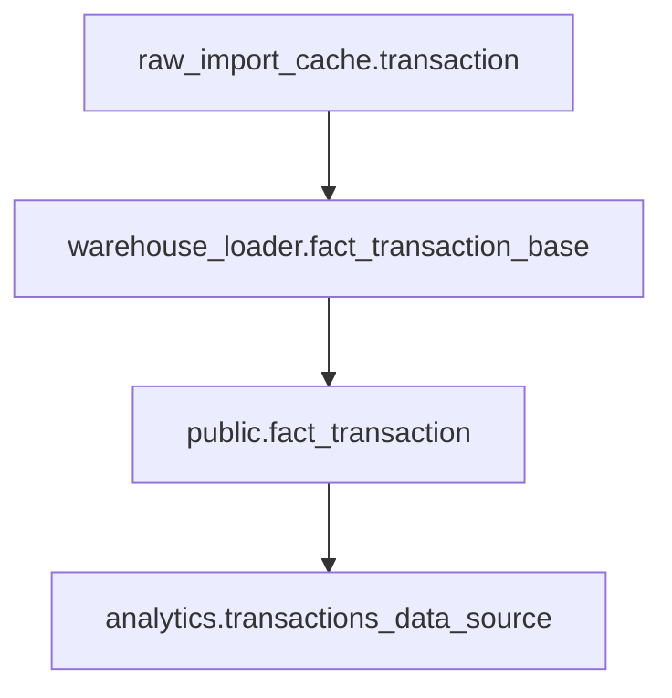

<details>
<summary>Lineage table for transaction_guid</summary>

| Redshift Table | Table Grain | Column Name | Data Type | Description | Example Value | Source | GitHub Link | Logic Explanation |
| --- | --- | --- | --- | --- | --- | --- | --- | --- |
| `raw_import_cache.transaction` | 1 row / transaction_guid | transaction_guid | char(37) | Transaction identifier |  | Backend |  | [passthrough] Extracts `Transaction_GUID` from MSSQL `tblTransaction`. |
| `warehouse_loader.fact_transaction_base` | 1 row / transaction_guid | transaction_guid | varchar(36) | Transaction key |  | Backend |  | [passthrough] Copies `transaction_guid` from `raw_import_cache.transaction`; the base load excludes Subscription Purchase. |
| `public.fact_transaction` | 1 row / transaction_guid | transaction_guid | varchar(36) | Transaction identifier |  | Backend |  | [passthrough] Copies `transaction_guid` from `warehouse_loader.fact_transaction_base`. |
| `analytics.transactions_data_source` | 1 row / transaction_guid | transaction_guid | varchar(36) | Transaction id |  | Backend |  | [passthrough] Copies `transaction_guid` from `public.fact_transaction`. |

</details>

## 002. `is_successful`

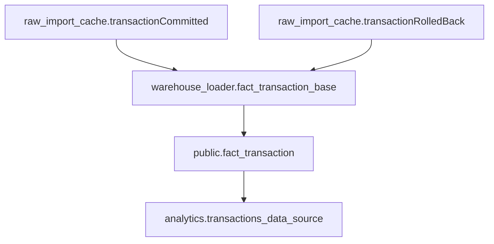

<details>
<summary>Lineage table for is_successful</summary>

| Redshift Table | Table Grain | Column Name | Data Type | Description | Example Value | Source | GitHub Link | Logic Explanation |
| --- | --- | --- | --- | --- | --- | --- | --- | --- |
| `raw_import_cache.transactionCommitted` | 1 row / transaction_guid | transaction_guid | char(37) | Transaction id |  | Backend |  |  |
| `raw_import_cache.transactionRolledBack` | 1 row / transaction_guid | transaction_guid | char(37) | Transaction id |  | Backend |  |  |
| `warehouse_loader.fact_transaction_base` | 1 row / transaction_guid | is_successful | boolean | Successful transaction flag | true | Derived |  | [conditional] True only when the commit is in its extract window and there is no rollback in its window; a late commit can remain false. |
| `public.fact_transaction` | 1 row / transaction_guid | is_successful | boolean | Whether the transaction completed successfully | true | Derived |  | [passthrough] Copies `is_successful` from `warehouse_loader.fact_transaction_base`. |
| `analytics.transactions_data_source` | 1 row / transaction_guid | is_successful | boolean | Success flag | true | Derived |  | [passthrough] Copies `is_successful` from `public.fact_transaction`. |

</details>

## 003. `transaction_start_datetime_utc`


<details>
<summary>Lineage table for transaction_start_datetime_utc</summary>

| Redshift Table | Table Grain | Column Name | Data Type | Description | Example Value | Source | GitHub Link | Logic Explanation |
| --- | --- | --- | --- | --- | --- | --- | --- | --- |
| `raw_import_cache.transaction` | 1 row / transaction_guid | create_dm | timestamp | Transaction start time | 2026-10-01 16:10:00 | Backend |  | [passthrough] Reads `create_dm` from `raw_import_cache.transaction`. |
| `warehouse_loader.fact_transaction_base` | 1 row / transaction_guid | transaction_start_datetime | timestamp | Transaction start time (UTC) | 2026-10-01 16:10:00 | Backend |  | [rename/cast] Casts `raw_import_cache.transaction.create_dm` to timestamp. |
| `public.fact_transaction` | 1 row / transaction_guid | transaction_start_datetime | timestamp | Transaction start time in UTC | 2026-10-01 16:10:00 | Backend |  | [passthrough] Copies `transaction_start_datetime` from `warehouse_loader.fact_transaction_base`. |
| `analytics.transactions_data_source` | 1 row / transaction_guid | transaction_start_datetime_utc | timestamp | Start UTC | 2026-10-01 16:10:00 | Backend |  | [rename] Renames `public.fact_transaction.transaction_start_datetime` to `transaction_start_datetime_utc`. |

</details>

## 004. `transaction_start_datetime_los_angeles`


<details>
<summary>Lineage table for transaction_start_datetime_los_angeles</summary>

| Redshift Table | Table Grain | Column Name | Data Type | Description | Example Value | Source | GitHub Link | Logic Explanation |
| --- | --- | --- | --- | --- | --- | --- | --- | --- |
| `raw_import_cache.transaction` | 1 row / transaction_guid | create_dm | timestamp | Transaction start time | 2026-10-01 16:10:00 | Backend |  | [passthrough] Reads `create_dm` from `raw_import_cache.transaction`. |
| `warehouse_loader.fact_transaction_base` | 1 row / transaction_guid | transaction_start_datetime | timestamp | Transaction start time (UTC) | 2026-10-01 16:10:00 | Backend |  | [rename/cast] Casts `raw_import_cache.transaction.create_dm` to timestamp. |
| `public.fact_transaction` | 1 row / transaction_guid | transaction_start_datetime | timestamp | Transaction start time in UTC | 2026-10-01 16:10:00 | Backend |  | [passthrough] Copies `transaction_start_datetime` from `warehouse_loader.fact_transaction_base`. |
| `analytics.transactions_data_source` | 1 row / transaction_guid | transaction_start_datetime_los_angeles | timestamp | Pacific start datetime | 2026-10-01 09:10:00 | Derived |  | [rename/cast] Converts `transaction_start_datetime` from `public.fact_transaction` to US/Pacific time. |

</details>

## 005. `transaction_commit_datetime_utc`

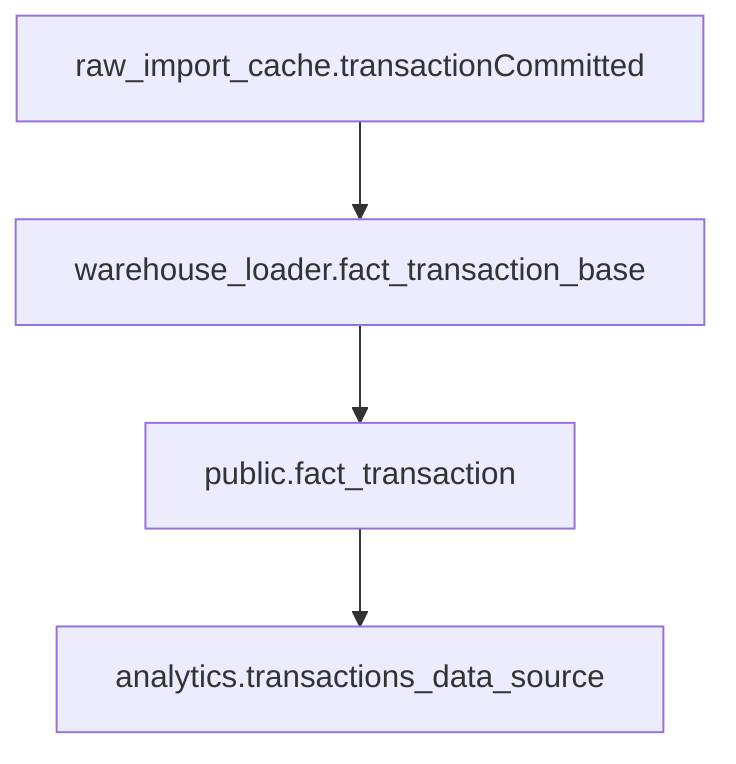


**Notes:** The commit timestamp is included only when `Create_dm` falls in the commit join window.
<details>
<summary>Lineage table for transaction_commit_datetime_utc</summary>

| Redshift Table | Table Grain | Column Name | Data Type | Description | Example Value | Source | GitHub Link | Logic Explanation |
| --- | --- | --- | --- | --- | --- | --- | --- | --- |
| `raw_import_cache.transactionCommitted` | 1 row / transaction_guid | create_dm | timestamp | Commit time | 2026-10-01 16:11:05 | Backend |  | [passthrough] Reads `create_dm` from `raw_import_cache.transactionCommitted`. |
| `warehouse_loader.fact_transaction_base` | 1 row / transaction_guid | transaction_commit_datetime | timestamp | Transaction commit time (UTC) | 2026-10-01 16:11:05 | Backend |  | [passthrough] Reads commit `create_dm`; the commit join window is [begin−10m, end+30d]. |
| `public.fact_transaction` | 1 row / transaction_guid | transaction_commit_datetime | timestamp | Transaction commit time in UTC | 2026-10-01 16:11:05 | Backend |  | [passthrough] Copies `transaction_commit_datetime` from `warehouse_loader.fact_transaction_base`. |
| `analytics.transactions_data_source` | 1 row / transaction_guid | transaction_commit_datetime_utc | timestamp | Commit UTC | 2026-10-01 16:11:05 | Backend |  | [passthrough] Copies `transaction_commit_datetime` from `public.fact_transaction`. |

</details>

## 006. `transaction_commit_datetime_los_angeles`


<details>
<summary>Lineage table for transaction_commit_datetime_los_angeles</summary>

| Redshift Table | Table Grain | Column Name | Data Type | Description | Example Value | Source | GitHub Link | Logic Explanation |
| --- | --- | --- | --- | --- | --- | --- | --- | --- |
| `raw_import_cache.transactionCommitted` | 1 row / transaction_guid | create_dm | timestamp | Commit time | 2026-10-01 16:11:05 | Backend |  | [passthrough] Reads `create_dm` from `raw_import_cache.transactionCommitted`. |
| `warehouse_loader.fact_transaction_base` | 1 row / transaction_guid | transaction_commit_datetime | timestamp | Transaction commit time (UTC) | 2026-10-01 16:11:05 | Backend |  | [passthrough] Copies `create_dm` from `raw_import_cache.transactionCommitted`. |
| `public.fact_transaction` | 1 row / transaction_guid | transaction_commit_datetime | timestamp | Transaction commit time in UTC | 2026-10-01 16:11:05 | Backend |  | [passthrough] Copies `transaction_commit_datetime` from `warehouse_loader.fact_transaction_base`. |
| `analytics.transactions_data_source` | 1 row / transaction_guid | transaction_commit_datetime_los_angeles | timestamp | Pacific commit datetime | 2026-10-01 09:11:05 | Derived |  | [rename/cast] Converts `transaction_commit_datetime` from `public.fact_transaction` to US/Pacific time. |

</details>

## 007. `transaction_rollback_datetime_utc`

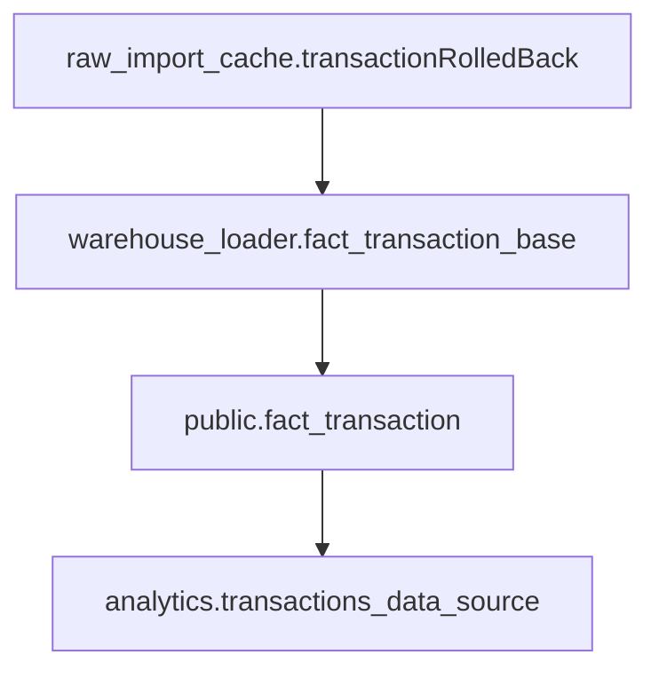


**Notes:** The rollback timestamp is included only when `Create_dm` falls in the rollback join window.
<details>
<summary>Lineage table for transaction_rollback_datetime_utc</summary>

| Redshift Table | Table Grain | Column Name | Data Type | Description | Example Value | Source | GitHub Link | Logic Explanation |
| --- | --- | --- | --- | --- | --- | --- | --- | --- |
| `raw_import_cache.transactionRolledBack` | 1 row / transaction_guid | create_dm | timestamp | Rollback time | NULL | Backend |  | [passthrough] Reads `create_dm` from `raw_import_cache.transactionRolledBack`. |
| `warehouse_loader.fact_transaction_base` | 1 row / transaction_guid | transaction_rollback_datetime | timestamp | Transaction rollback time (UTC) | NULL | Backend |  | [passthrough] Copies `create_dm` from `raw_import_cache.transactionRolledBack`. |
| `public.fact_transaction` | 1 row / transaction_guid | transaction_rollback_datetime | timestamp | Transaction rollback time in UTC | NULL | Backend |  | [passthrough] Copies `transaction_rollback_datetime` from `warehouse_loader.fact_transaction_base`. |
| `analytics.transactions_data_source` | 1 row / transaction_guid | transaction_rollback_datetime_utc | timestamp | Rollback UTC | NULL | Backend |  | [rename] Renames `public.fact_transaction.transaction_rollback_datetime`; rollback join window is [begin−10m, end+1d]. |

</details>

## 008. `transaction_rollback_datetime_los_angeles`


<details>
<summary>Lineage table for transaction_rollback_datetime_los_angeles</summary>

| Redshift Table | Table Grain | Column Name | Data Type | Description | Example Value | Source | GitHub Link | Logic Explanation |
| --- | --- | --- | --- | --- | --- | --- | --- | --- |
| `raw_import_cache.transactionRolledBack` | 1 row / transaction_guid | create_dm | timestamp | Rollback time |  | Backend |  | [passthrough] Reads `create_dm` from `raw_import_cache.transactionRolledBack`. |
| `warehouse_loader.fact_transaction_base` | 1 row / transaction_guid | transaction_rollback_datetime | timestamp | Transaction rollback time (UTC) |  | Backend |  | [passthrough] Copies `create_dm` from `raw_import_cache.transactionRolledBack`. |
| `public.fact_transaction` | 1 row / transaction_guid | transaction_rollback_datetime | timestamp | Transaction rollback time in UTC |  | Backend |  | [passthrough] Copies `transaction_rollback_datetime` from `warehouse_loader.fact_transaction_base`. |
| `analytics.transactions_data_source` | 1 row / transaction_guid | transaction_rollback_datetime_los_angeles | timestamp | Pacific rollback datetime |  | Derived |  | [rename/cast] Converts `transaction_rollback_datetime` from `public.fact_transaction` to US/Pacific time. |

</details>

## 009. `transaction_end_datetime_utc`

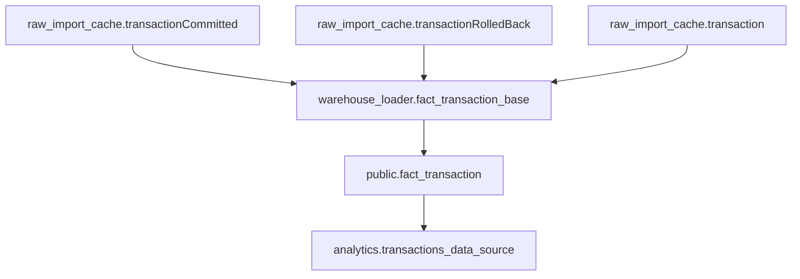

**Notes:** Uses the later commit or rollback time; ties go to commit, and the start time is the fallback. Commit and rollback joins use their extract windows.

<details>
<summary>Lineage table for transaction_end_datetime_utc</summary>

| Redshift Table | Table Grain | Column Name | Data Type | Description | Example Value | Source | GitHub Link | Logic Explanation |
| --- | --- | --- | --- | --- | --- | --- | --- | --- |
| `raw_import_cache.transactionCommitted` | 1 row / transaction_guid | create_dm | timestamp | Commit time | 2026-10-01 16:11:05 | Backend |  | [passthrough] Reads `create_dm` from `raw_import_cache.transactionCommitted`. |
| `raw_import_cache.transactionRolledBack` | 1 row / transaction_guid | create_dm | timestamp | Rollback time |  | Backend |  | [passthrough] Reads `create_dm` from `raw_import_cache.transactionRolledBack`. |
| `raw_import_cache.transaction` | 1 row / transaction_guid | create_dm | timestamp | Transaction start time | 2026-10-01 16:10:00 | Backend |  | [passthrough] Reads `create_dm` from `raw_import_cache.transaction`. |
| `warehouse_loader.fact_transaction_base` | 1 row / transaction_guid | transaction_end_datetime | timestamp | Transaction end time (UTC) | 2026-10-01 16:11:05 | Derived |  | [conditional] Uses the later commit or rollback time; falls back to `raw_import_cache.transaction.create_dm`. |
| `public.fact_transaction` | 1 row / transaction_guid | transaction_end_datetime | timestamp | Transaction end time in UTC | 2026-10-01 16:11:05 | Derived |  | [passthrough] Carries the transaction end timestamp. |
| `analytics.transactions_data_source` | 1 row / transaction_guid | transaction_end_datetime_utc | timestamp | End UTC | 2026-10-01 16:11:05 | Derived |  | [passthrough] Copies `transaction_end_datetime` from `public.fact_transaction`. |

</details>

## 010. `transaction_end_datetime_los_angeles`


**Notes:** Uses the later commit or rollback time; ties go to commit, and the start time is the fallback. Analytics converts the result to US/Pacific time.

<details>
<summary>Lineage table for transaction_end_datetime_los_angeles</summary>

| Redshift Table | Table Grain | Column Name | Data Type | Description | Example Value | Source | GitHub Link | Logic Explanation |
| --- | --- | --- | --- | --- | --- | --- | --- | --- |
| `raw_import_cache.transactionCommitted` | 1 row / transaction_guid | create_dm | timestamp | Commit time | 2026-10-01 16:11:05 | Backend |  | [passthrough] Reads `create_dm` from `raw_import_cache.transactionCommitted`. |
| `raw_import_cache.transactionRolledBack` | 1 row / transaction_guid | create_dm | timestamp | Rollback time |  | Backend |  | [passthrough] Reads `create_dm` from `raw_import_cache.transactionRolledBack`. |
| `raw_import_cache.transaction` | 1 row / transaction_guid | create_dm | timestamp | Transaction start time | 2026-10-01 16:10:00 | Backend |  | [passthrough] Reads `create_dm` from `raw_import_cache.transaction`. |
| `warehouse_loader.fact_transaction_base` | 1 row / transaction_guid | transaction_end_datetime | timestamp | Transaction end time (UTC) | 2026-10-01 16:11:05 | Derived |  | [conditional] Uses the later commit or rollback time; falls back to `raw_import_cache.transaction.create_dm`. |
| `public.fact_transaction` | 1 row / transaction_guid | transaction_end_datetime | timestamp | Transaction end time in UTC | 2026-10-01 16:11:05 | Derived |  | [passthrough] Carries the transaction end timestamp. |
| `analytics.transactions_data_source` | 1 row / transaction_guid | transaction_end_datetime_los_angeles | timestamp | Pacific end datetime | 2026-10-01 09:11:05 | Derived |  | [rename/cast] Converts `transaction_end_datetime` from `public.fact_transaction` to US/Pacific time. |

</details>

## 011. `transaction_end_datetime_local`

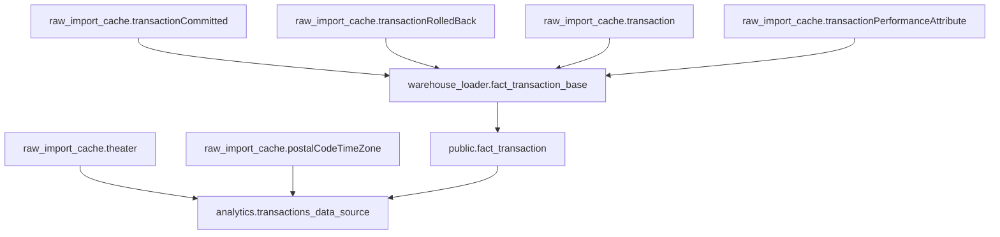

**Notes:** The end time is the later commit or rollback time, falling back to `raw_import_cache.transaction.create_dm`. `public.dim_theater` supplies the timezone used by `public.fact_transaction`; the local time can be NULL when the transaction resolves to the Unknown theater.

<details>
<summary>Lineage table for transaction_end_datetime_local</summary>

| Redshift Table | Table Grain | Column Name | Data Type | Description | Example Value | Source | GitHub Link | Logic Explanation |
| --- | --- | --- | --- | --- | --- | --- | --- | --- |
| `raw_import_cache.transactionCommitted` | 1 row / transaction_guid | Create_dm | timestamp | Commit time (UTC) | 2026-10-01 16:11:05 | Backend |  | [passthrough] Extracted from MSSQL `tblTransactionCommitted.Create_dm`. |
| `raw_import_cache.transactionRolledBack` | 1 row / transaction_guid | Create_dm | timestamp | Rollback time (UTC) | NULL | Backend |  | [passthrough] Extracted from MSSQL `tblTransactionRolledBack.Create_dm`. |
| `raw_import_cache.transaction` | 1 row / transaction_guid | Create_dm | timestamp | Transaction start (UTC) | 2026-10-01 16:10:00 | Backend |  | [passthrough] Extracted from MSSQL `tblTransaction.Create_dm`. |
| `raw_import_cache.transactionPerformanceAttribute` | 1 row / transaction and performance | Theater_pkey | int | Theater id of the performance | 5512 | Backend |  | [passthrough] Extracted from MSSQL `tblTransaction_PerformanceAttribute.Theater_pkey`. |
| `warehouse_loader.fact_transaction_base` | 1 row / transaction_guid | transaction_end_datetime | timestamp | Transaction end (UTC) | 2026-10-01 16:11:05 | Derived |  | [conditional] Later of commit or rollback (a tie goes to commit), else `transaction.Create_dm`. Commit joined if in [begin-10m, end+30d], rollback if in [begin-10m, end+1d]. |
| `warehouse_loader.fact_transaction_base` | 1 row / transaction_guid | theater_key | int | Theater surrogate key | 196075 | ETL |  | [lookup] Selects the theater version valid at the transaction time. |
| `public.fact_transaction` | 1 row / transaction_guid | transaction_end_datetime_local | timestamp | End time in theater time zone | 2026-10-01 09:11:05 | Derived |  | [derived/lookup] Converts the transaction end time using the theater time zone. |
| `raw_import_cache.theater` |  | Zip_cd |  | Theater ZIP used for timezone lookup |  |  |  |  |
| `raw_import_cache.postalCodeTimeZone` |  | postal_code, time_zone_name |  | Timezone by postal code |  |  |  | [lookup] Matched to theater ZIP in the theater dimension ETL. |
| `analytics.transactions_data_source` | 1 row / transaction_guid | transaction_end_datetime_local | timestamp | End local | 2026-10-01 09:11:05 | Derived |  | [passthrough] Copies `public.fact_transaction.transaction_end_datetime_local`. |

</details>

## 012. `deltareleasetopurchasedate`

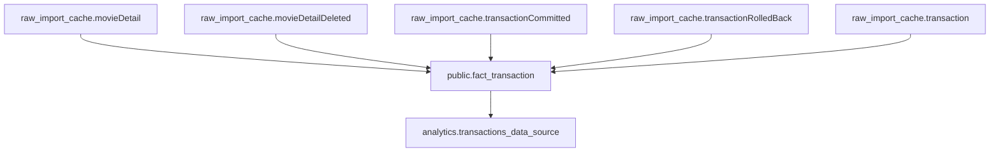

**Notes:** `public.dim_movie` joins to `public.fact_transaction`. The release date comes primarily from `raw_import_cache.movieDetail.date_released`, with `raw_import_cache.movieDetailDeleted.date_released` as fallback. Analytics compares that dimension value with `public.fact_transaction.transaction_end_datetime`, converted to US/Pacific and truncated to a day.

<details>
<summary>Lineage table for deltareleasetopurchasedate</summary>

| Redshift Table | Table Grain | Column Name | Data Type | Description | Example Value | Source | GitHub Link | Logic Explanation |
| --- | --- | --- | --- | --- | --- | --- | --- | --- |
| `raw_import_cache.movieDetail` | 1 row / movie_detail_id | date_released | timestamp | Release date (active movies) | 2026-09-14 00:00:00 | Backend |  | [passthrough] Full daily snapshot of MSSQL `movie_detail`. |
| `raw_import_cache.movieDetailDeleted` | 1 row / movie_detail_id | date_released | timestamp | Release date (deleted movies) | 2026-09-14 00:00:00 | Backend |  | [passthrough] Full daily snapshot of MSSQL `Movie_Detail_Deleted`. |
| `raw_import_cache.transactionCommitted` | 1 row / transaction_guid | create_dm | timestamp | Commit time (UTC) | 2026-10-01 16:11:05 | Backend |  | [passthrough] Raw commit timestamp used by `public.fact_transaction.transaction_end_datetime`. |
| `raw_import_cache.transactionRolledBack` | 1 row / transaction_guid | create_dm | timestamp | Rollback time (UTC) |  | Backend |  | [passthrough] Raw rollback timestamp used by the fact end-time rule. |
| `raw_import_cache.transaction` | 1 row / transaction_guid | create_dm | timestamp | Transaction start time (UTC) | 2026-10-01 16:10:00 | Backend |  | [passthrough] Fallback timestamp for the fact end-time rule. |
| `public.fact_transaction` | 1 row / transaction_guid | transaction_end_datetime | timestamp | end time UTC | 2026-10-01 16:11:05 | ETL |  | [passthrough] From `fact_transaction_base`. |
| `analytics.transactions_data_source` | 1 row / transaction_guid | deltareleasetopurchasedate | int | Days from release to purchase day (Pacific) | 17 | Derived |  | [derived] Calculates days between movie release and purchase day in Pacific time. |

</details>
## 013. `deltareleasetoshowtimedate`

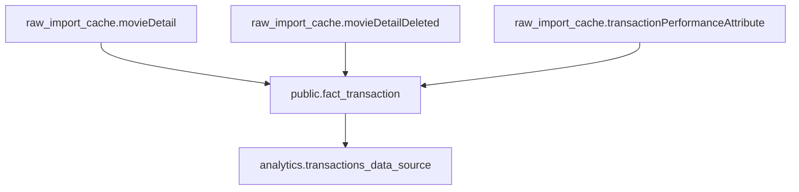

**Notes:** `public.dim_movie` joins to `public.fact_transaction`. The release date comes primarily from `raw_import_cache.movieDetail.date_released`, with `raw_import_cache.movieDetailDeleted.date_released` as fallback. Analytics compares that dimension value with `public.fact_transaction.performance_datetime_local`, truncated to a day; the performance time comes from `raw_import_cache.transactionPerformanceAttribute.Performance_dm`.

<details>
<summary>Lineage table for deltareleasetoshowtimedate</summary>

| Redshift Table | Table Grain | Column Name | Data Type | Description | Example Value | Source | GitHub Link | Logic Explanation |
| --- | --- | --- | --- | --- | --- | --- | --- | --- |
| `raw_import_cache.movieDetail` | 1 row / movie_detail_id | date_released | timestamp | Release date (active movies) | 2026-09-14 00:00:00 | Backend |  | [passthrough] Daily snapshot. |
| `raw_import_cache.movieDetailDeleted` | 1 row / movie_detail_id | date_released | timestamp | Release date (deleted movies; fallback) | 2026-09-14 00:00:00 | Backend |  | [passthrough] Daily snapshot. |
| `raw_import_cache.transactionPerformanceAttribute` | 1 row / transaction and performance | Performance_dm | timestamp | Local performance/showtime | 2026-10-05 19:30:00 | Backend |  | [passthrough] Reads `Performance_dm` from `raw_import_cache.transactionPerformanceAttribute`. |
| `public.fact_transaction` | 1 row / transaction_guid | performance_datetime_local | timestamp | showtime | 2026-10-05 19:30:00 | ETL |  | [passthrough] |
| `analytics.transactions_data_source` | 1 row / transaction_guid | deltareleasetoshowtimedate | int | Days from release to show day | 21 | Derived |  | [derived] `DATEDIFF(day, movie_release_date, DATE_TRUNC('day', performance_datetime_local))`. The show date is theater-local and not converted. |

</details>
## 014. `deltapurchasetoshowtimedate`

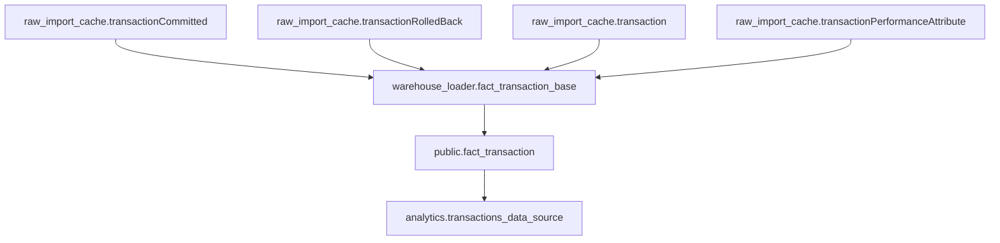

**Notes:** Analytics calculates the day difference from `public.fact_transaction.transaction_end_datetime` (US/Pacific day) to `performance_datetime_local` (theater-local day). The end time uses commit/rollback event times, falling back to `raw_import_cache.transaction.create_dm`; performance time comes from `raw_import_cache.transactionPerformanceAttribute.Performance_dm`.

<details>
<summary>Lineage table for deltapurchasetoshowtimedate</summary>

| Redshift Table | Table Grain | Column Name | Data Type | Description | Example Value | Source | GitHub Link | Logic Explanation |
| --- | --- | --- | --- | --- | --- | --- | --- | --- |
| `raw_import_cache.transactionCommitted` | 1 row / transaction_guid | Create_dm | timestamp | Commit time (UTC) | 2026-10-01 16:11:05 | Backend |  | [passthrough] Reads `create_dm` from the commit row. |
| `raw_import_cache.transactionRolledBack` | 1 row / transaction_guid | Create_dm | timestamp | Rollback time (UTC) |  | Backend |  | [passthrough] Reads `create_dm` from the rollback row. |
| `raw_import_cache.transaction` | 1 row / transaction_guid | Create_dm | timestamp | Transaction start time (UTC) | 2026-10-01 16:10:00 | Backend |  | [passthrough] Reads `create_dm` from the transaction row. |
| `raw_import_cache.transactionPerformanceAttribute` | 1 row / transaction and performance | Performance_dm | timestamp | Local showtime | 2026-10-05 19:30:00 | Backend |  | [passthrough] |
| `warehouse_loader.fact_transaction_base` | 1 row / transaction_guid | transaction_end_datetime; performance_datetime_local | timestamp | End (UTC); showtime (local) | 2026-10-01 16:11:05; 2026-10-05 19:30:00 | Derived |  | [conditional] End time as in 009. [passthrough] `tpa.Performance_dm`. |
| `public.fact_transaction` | 1 row / transaction_guid | transaction_end_datetime; performance_datetime_local | timestamp | End (UTC); showtime (local) | 2026-10-01 16:11:05; 2026-10-05 19:30:00 | Derived |  | [passthrough] |
| `analytics.transactions_data_source` | 1 row / transaction_guid | deltapurchasetoshowtimedate | int | Days from purchase day (Pacific) to show day (local) | 4 | Derived |  | [derived] `DATEDIFF(day, DATE_TRUNC('day', CONVERT_TIMEZONE('US/Pacific', transaction_end_datetime)), DATE_TRUNC('day', performance_datetime_local))`. |

</details>

## 015. `point_of_sale_confirmation_code`


<details>
<summary>Lineage table for point_of_sale_confirmation_code</summary>

| Redshift Table | Table Grain | Column Name | Data Type | Description | Example Value | Source | GitHub Link | Logic Explanation |
| --- | --- | --- | --- | --- | --- | --- | --- | --- |
| `raw_import_cache.transactionCommitted` | 1 row / transaction_guid | confirmation_cd | varchar(40) | POS confirmation code | A0103339362 | Backend |  | [passthrough] Reads `confirmation_cd` from `raw_import_cache.transactionCommitted`. |
| `warehouse_loader.fact_transaction_base` | 1 row / transaction_guid | point_of_sale_confirmation_code | varchar(40) | POS confirmation code | A0103339362 | Backend |  | [passthrough] Copies `confirmation_cd` from `raw_import_cache.transactionCommitted`. |
| `public.fact_transaction` | 1 row / transaction_guid | point_of_sale_confirmation_code | varchar(40) | POS confirmation code | A0103339362 | Backend |  | [passthrough] Copies `point_of_sale_confirmation_code` from `warehouse_loader.fact_transaction_base`. |
| `analytics.transactions_data_source` | 1 row / transaction_guid | point_of_sale_confirmation_code | varchar(40) | POS confirmation code | A0103339362 | Backend |  | [passthrough] Copies `point_of_sale_confirmation_code` from `public.fact_transaction`. |

</details>

## 016. `is_reserved_seating`


<details>
<summary>Lineage table for is_reserved_seating</summary>

| Redshift Table | Table Grain | Column Name | Data Type | Description | Example Value | Source | GitHub Link | Logic Explanation |
| --- | --- | --- | --- | --- | --- | --- | --- | --- |
| `raw_import_cache.transactionCommitted` | 1 row / transaction_guid | reservedseats_tx | varchar(512) | Reserved-seat payload | A10,A11 | Backend |  | [passthrough] Reads `reservedseats_tx` from `raw_import_cache.transactionCommitted`. |
| `warehouse_loader.fact_transaction_base` | 1 row / transaction_guid | is_reserved_seating | boolean | Reserved-seating flag | true | Derived |  | [conditional] TRUE when `reservedseats_tx` is nonblank; otherwise FALSE. |
| `public.fact_transaction` | 1 row / transaction_guid | is_reserved_seating | boolean | Whether reserved seating was selected | true | Derived |  | [passthrough] Copies `is_reserved_seating` from `warehouse_loader.fact_transaction_base`. |
| `analytics.transactions_data_source` | 1 row / transaction_guid | is_reserved_seating | boolean | Reserved seating flag | true | Derived |  | [passthrough] Copies `is_reserved_seating` from `public.fact_transaction`. |

</details>

## 017. `reserved_seats`


<details>
<summary>Lineage table for reserved_seats</summary>

| Redshift Table | Table Grain | Column Name | Data Type | Description | Example Value | Source | GitHub Link | Logic Explanation |
| --- | --- | --- | --- | --- | --- | --- | --- | --- |
| `raw_import_cache.transactionCommitted` | 1 row / transaction_guid | reservedseats_tx | varchar(512) | Reserved-seat payload | A10,A11 | Backend |  | [passthrough] Reads `reservedseats_tx` from `raw_import_cache.transactionCommitted`. |
| `warehouse_loader.fact_transaction_base` | 1 row / transaction_guid | reserved_seats | varchar(100) | Reserved seats | A10,A11 | Backend |  | [conditional] Trims `reservedseats_tx` from `raw_import_cache.transactionCommitted`; blank becomes NULL. |
| `public.fact_transaction` | 1 row / transaction_guid | reserved_seats | varchar(100) | Reserved seat identifiers | A10,A11 | Backend |  | [passthrough] Copies `reserved_seats` from `warehouse_loader.fact_transaction_base`. |
| `analytics.transactions_data_source` | 1 row / transaction_guid | reserved_seats | varchar(100) | Reserved seats | A10,A11 | Backend |  | [passthrough] Copies `reserved_seats` from `public.fact_transaction`. |

</details>

## 018. `loyalty_code`


<details>
<summary>Lineage table for loyalty_code</summary>

| Redshift Table | Table Grain | Column Name | Data Type | Description | Example Value | Source | GitHub Link | Logic Explanation |
| --- | --- | --- | --- | --- | --- | --- | --- | --- |
| `raw_import_cache.transactionCommitted` | 1 row / transaction_guid | loyalty_cd | varchar(40) | Loyalty code | 1101000070540337 | Backend |  | [passthrough] Reads `loyalty_cd` from `raw_import_cache.transactionCommitted`. |
| `warehouse_loader.fact_transaction_base` | 1 row / transaction_guid | loyalty_code | varchar(40) | Loyalty code | 1101000070540337 | Backend |  | [conditional] Trims `loyalty_cd` from `raw_import_cache.transactionCommitted`; blank becomes NULL. |
| `public.fact_transaction` | 1 row / transaction_guid | loyalty_code | varchar(40) | Loyalty code on the transaction | 1101000070540337 | Backend |  | [passthrough] Copies `loyalty_code` from `warehouse_loader.fact_transaction_base`. |
| `analytics.transactions_data_source` | 1 row / transaction_guid | loyalty_code | varchar(40) | Loyalty code | 1101000070540337 | Backend |  | [passthrough] Copies `loyalty_code` from `public.fact_transaction`. |

</details>

## 019. `performance_datetime_local`

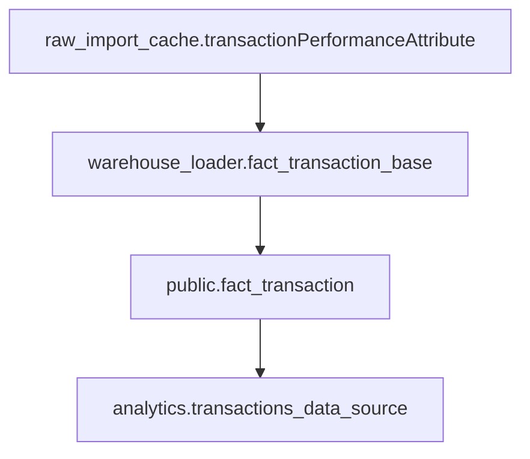

<details>
<summary>Lineage table for performance_datetime_local</summary>

| Redshift Table | Table Grain | Column Name | Data Type | Description | Example Value | Source | GitHub Link | Logic Explanation |
| --- | --- | --- | --- | --- | --- | --- | --- | --- |
| `raw_import_cache.transactionPerformanceAttribute` | 1 row / transaction_guid | performance_dm | timestamp | Local performance time | 2026-10-05 19:30:00 | Backend |  | [passthrough] Reads `performance_dm` from `raw_import_cache.transactionPerformanceAttribute`. |
| `warehouse_loader.fact_transaction_base` | 1 row / transaction_guid | performance_datetime_local | timestamp | Local performance time | 2026-10-05 19:30:00 | Backend |  | [passthrough] Copies `performance_dm` from `raw_import_cache.transactionPerformanceAttribute`. |
| `public.fact_transaction` | 1 row / transaction_guid | performance_datetime_local | timestamp | Performance time associated with the transaction | 2026-10-05 19:30:00 | Backend |  | [passthrough] Carries the performance time. |
| `analytics.transactions_data_source` | 1 row / transaction_guid | performance_datetime_local | timestamp | Performance local | 2026-10-05 19:30:00 | Backend |  | [passthrough] Copies `performance_datetime_local` from `public.fact_transaction`. |

</details>

## 020. `payment_types`

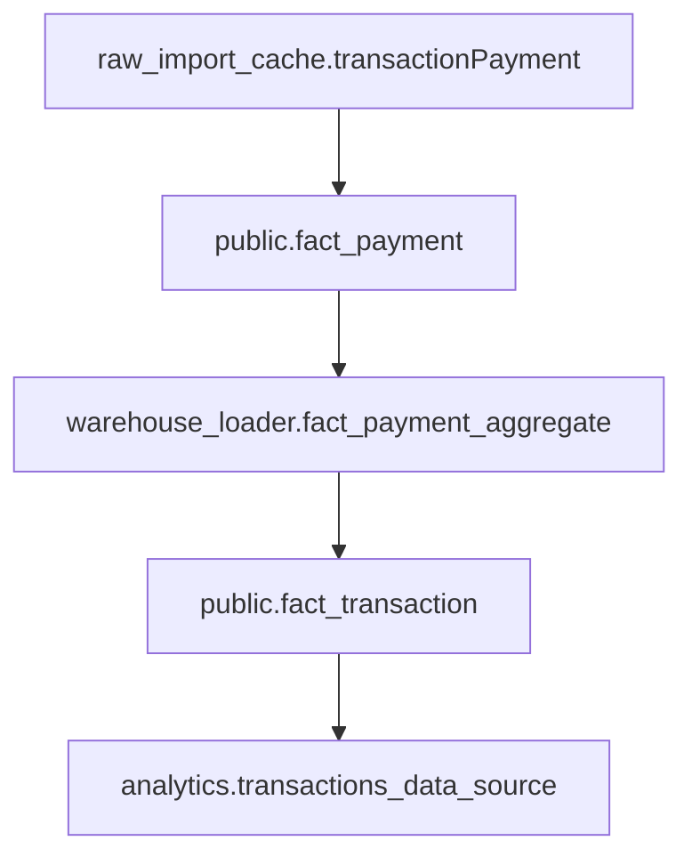

**Notes:** `public.dim_payment_instrument` and `public.dim_payment_type` are joined to `public.fact_payment` in the payment aggregate to derive payment_types.

<details>
<summary>Lineage table for payment_types</summary>

| Redshift Table | Table Grain | Column Name | Data Type | Description | Example Value | Source | GitHub Link | Logic Explanation |
| --- | --- | --- | --- | --- | --- | --- | --- | --- |
| `raw_import_cache.transactionPayment` | 1 row / transaction_guid + payment_guid | Payment_tp | varchar(40) | Payment type at payment time | Apple Pay | Backend |  | [passthrough] Hourly extract of MSSQL `tblTransaction_Payment.Payment_tp`. |
| `raw_import_cache.transactionPayment` | 1 row / transaction_guid + payment_guid | Account_cd | varchar(600) | Instrument code. NULLed in the extract for card and wallet types | (blank) | Backend |  | [conditional] Extract returns NULL for Credit Card, Masterpass, PayPal(OneTouch), Braintree Nonce/Token, Visa Checkout, Venmo, Android Pay, Apple Pay, `V.me`, Generic_Refund. Otherwise Account_cd. |
| `public.fact_payment` | 1 row / payment_guid per transaction_guid | payment_instrument_key | int | Payment instrument key | 355470739 | ETL |  | [lookup] Blank or NULL Account_cd: placeholder row where lookup_value='' and type key = raw Payment_tp's key. Otherwise: match Account_cd on primary_card_number, secondary_card_number or payment_instrument_id. |
| `warehouse_loader.fact_payment_aggregate` | 1 row / transaction_guid | payment_types | varchar(200) | Distinct payment types, A-Z | Credit Card,Promotion Codes | Derived |  |  |
| `public.fact_transaction` | 1 row / transaction_guid | payment_types | varchar(200) | Payment-type labels | Credit Card,Promotion Codes | Derived |  | [passthrough] LEFT JOIN `fact_payment_aggregate` on transaction_guid. NULL if there are no payments. |
| `analytics.transactions_data_source` | 1 row / transaction_guid | payment_types | varchar(200) | Payment types | Credit Card,Promotion Codes | Derived |  | [passthrough] |

</details>

## 021. `processor_order_ids`

```mermaid
flowchart TB
  n0["`raw_import_cache.transactionPayment`"]
  n1["`raw_import_cache.processorBraintreeAuthorizationResponse`"]
  n2["`raw_import_cache.processorBraintreeRefundResponse`"]
  n3["`raw_import_cache.paypalTRRDetail`"]
  n4["`raw_import_cache.paypalSTLDetail`"]
  n5["`public.fact_payment`"]
  n6["`warehouse_loader.fact_payment_aggregate`"]
  n7["`public.fact_transaction`"]
  n8["`analytics.transactions_data_source`"]
  n0 --> n5
  n1 --> n5
  n2 --> n5
  n3 --> n5
  n4 --> n5
  n5 --> n6
  n6 --> n7
  n7 --> n8
```

**Notes:** `public.fact_payment` derives processor_order_id with COALESCE in this order. Each join is processor/refund specific, so later candidates act as fallbacks only where that join applies; this is not one universal primary source.

<details>
<summary>Lineage table for processor_order_ids</summary>

| Redshift Table | Table Grain | Column Name | Data Type | Description | Example Value | Source | GitHub Link | Logic Explanation |
| --- | --- | --- | --- | --- | --- | --- | --- | --- |
| `raw_import_cache.transactionPayment` | 1 row / transaction_guid + payment_guid | Payment_tp; Transaction_tp | varchar(40) | Drives payment rows and gates processor joins | PayPalOneTouch; (purchase) | Backend |  | [passthrough] Joined to `fact_transaction_base` on Transaction_GUID. Create_dm in [begin-10m, end+1d]. |
| `raw_import_cache.processorBraintreeAuthorizationResponse` | 1 row / payment response | BraintreeTransaction_cd | varchar(10) | Braintree auth id | gkwdck4m | Third-party |  | [passthrough] Join on transaction_guid AND payment_guid, non-refund txn_tp, Create_dm window. |
| `raw_import_cache.processorBraintreeRefundResponse` | 1 row / refund response | BraintreeTransaction_cd | varchar(10) | Braintree refund id | 6jbfwgpf | Third-party |  | [passthrough] Join on transaction_guid. Payment_tp in (Android Pay, Braintree Nonce, Apple Pay, PayPalOneTouch, Braintree Token). txn_tp = REFUND. |
| `raw_import_cache.paypalTRRDetail` | 1 row / PayPal txn | transaction_id | varchar(24) | PayPal TRR id | 5XK12345AB678901C | Third-party |  | [passthrough] Loaded by the `paypal` DAG. Join `UPPER(invoice_id)=transaction_guid`, Payment_tp='PayPalOneTouch', transactional_status='S', initiation date in [begin, end+60d]. |
| `raw_import_cache.paypalSTLDetail` | 1 row / PayPal txn | transaction_id | varchar(24) | PayPal STL id | 5XK12345AB678901C | Third-party |  | [passthrough] Loaded by the `paypal` DAG. Same join as TRR, without the status filter. |
| `public.fact_payment` | 1 row / payment_guid per transaction_guid | processor_order_id | varchar(24) | Processor order id | GKWDCK4M | Third-party |  | [conditional] `COALESCE(UPPER(auth_resp.BraintreeTransaction_cd), UPPER(refund_resp.BraintreeTransaction_cd), trr.transaction_id, stl.transaction_id)`. |
| `warehouse_loader.fact_payment_aggregate` | 1 row / transaction_guid | processor_order_ids | varchar(124) | Distinct processor ids, sorted | GKWDCK4M | Derived |  | [aggregate] DISTINCT (txn, processor_order_id). `LEFT(LISTAGG(processor_order_id, ',') WITHIN GROUP (ORDER BY processor_order_id), 124)`. NULLs ignored. Merged into the payment aggregate. |
| `public.fact_transaction` | 1 row / transaction_guid | processor_order_ids | varchar(124) | Processor order ids | GKWDCK4M | Third-party |  | [passthrough] |
| `analytics.transactions_data_source` | 1 row / transaction_guid | processor_order_ids | varchar(124) | Processor order ids | GKWDCK4M | Third-party |  | [passthrough] |

</details>

## 022. `affiliate_name`

```mermaid
flowchart TB
  n0["`raw_import_cache.affiliate`"]
  n1["`public.fact_transaction`"]
  n2["`analytics.transactions_data_source`"]
  n0 --> n1
  n1 --> n2
```

**Notes:** `public.dim_affiliate` joined to `public.fact_transaction`. Value column: `public.dim_affiliate.affiliate_name`.

<details>
<summary>Lineage table for affiliate_name</summary>

| Redshift Table | Table Grain | Column Name | Data Type | Description | Example Value | Source | GitHub Link | Logic Explanation |
| --- | --- | --- | --- | --- | --- | --- | --- | --- |
| `raw_import_cache.affiliate` | 1 row / affiliate_id | Affiliate_id, Affiliate_nm | int; varchar(400); int | Affiliate master | 11879; iPhone App; 7 | Backend |  | [passthrough] Full daily snapshot of `tblAffiliate`. |
| `public.fact_transaction` | 1 row / transaction_guid |  |  |  |  |  |  | [lookup] The dimension value described in Notes is joined to this transaction row. |
| `analytics.transactions_data_source` | 1 row / transaction_guid | affiliate_name | varchar(400) | Affiliate name | iPhone App | Backend |  | [lookup] Uses the corresponding value from the side dimension. |

</details>
## 023. `affiliate_group_name`

```mermaid
flowchart TB
  n0["`raw_import_cache.affiliate`"]
  n1["`raw_import_cache.affiliateGroupMapping`"]
  n2["`raw_import_cache.affiliateGroup`"]
  n3["`public.fact_transaction`"]
  n4["`analytics.transactions_data_source`"]
  n0 --> n3
  n1 --> n3
  n2 --> n3
  n3 --> n4
```

**Notes:** `public.dim_affiliate` is joined to `public.fact_transaction`. The value is `public.dim_affiliate.affiliate_group_name`, built from `raw_import_cache.affiliateGroup.name` via `raw_import_cache.affiliateGroupMapping`. The repo contains the dimension SQL but not extract/load jobs for these mapping tables.

<details>
<summary>Lineage table for affiliate_group_name</summary>

| Redshift Table | Table Grain | Column Name | Data Type | Description | Example Value | Source | GitHub Link | Logic Explanation |
| --- | --- | --- | --- | --- | --- | --- | --- | --- |
| `raw_import_cache.affiliate` | 1 row / affiliate_id | Affiliate_id | int; varchar(400); int | Affiliate master | 11879; iPhone App; 7 | Backend |  | [passthrough] Full daily snapshot of `tblAffiliate`. |
| `raw_import_cache.affiliateGroupMapping` | mapping / 1 row per group | affiliate_id, affiliate_group_id | int | Affiliate-to-group mapping | 11879 to iPhone App | Backend |  | [passthrough] Loader not present in this repo (no extract/copy SQL). Tables exist in prd. |
| `raw_import_cache.affiliateGroup` | mapping / 1 row per group | id, name | int, varchar(100) | Affiliate-to-group mapping | 11879 to iPhone App | Backend |  | [passthrough] Loader not present in this repo (no extract/copy SQL). Tables exist in prd. |
| `public.fact_transaction` | 1 row / transaction_guid |  |  |  |  |  |  | [lookup] The dimension value described in Notes is joined to this transaction row. |
| `analytics.transactions_data_source` | 1 row / transaction_guid | affiliate_group_name | varchar(100) | Affiliate group | iPhone App | Backend |  | [lookup] Uses the corresponding value from the side dimension. |

</details>
## 024. `affiliate_category_name`

```mermaid
flowchart TB
  n0["`raw_import_cache.affiliate`"]
  n1["`raw_import_cache.affiliateCategory`"]
  n2["`public.fact_transaction`"]
  n3["`analytics.transactions_data_source`"]
  n0 --> n2
  n1 --> n2
  n2 --> n3
```

**Notes:** `public.dim_affiliate` joined to `public.fact_transaction`. Value column: `public.dim_affiliate.affiliate_category_name`. Value source: `raw_import_cache.affiliateCategory.category_nm`.

<details>
<summary>Lineage table for affiliate_category_name</summary>

| Redshift Table | Table Grain | Column Name | Data Type | Description | Example Value | Source | GitHub Link | Logic Explanation |
| --- | --- | --- | --- | --- | --- | --- | --- | --- |
| `raw_import_cache.affiliate` | 1 row / affiliate_id | Affiliate_id, category_id | int; varchar(400); int | Affiliate master | 11879; iPhone App; 7 | Backend |  | [passthrough] Full daily snapshot of `tblAffiliate`. |
| `raw_import_cache.affiliateCategory` | 1 row / category_id | Category_id; Category_nm | int; varchar(480) | Category | 7; Fandango Mobile Devices | Backend |  | [passthrough] Full snapshot of `tblAffiliateCategory`. |
| `public.fact_transaction` | 1 row / transaction_guid |  |  |  |  |  |  | [lookup] The dimension value described in Notes is joined to this transaction row. |
| `analytics.transactions_data_source` | 1 row / transaction_guid | affiliate_category_name | varchar(480) | Affiliate category | Fandango Mobile Devices | Backend |  | [lookup] Uses the corresponding value from the side dimension. |

</details>
## 025. `affiliate_id`

```mermaid
flowchart TB
  n0["`raw_import_cache.transaction`"]
  n1["`raw_import_cache.affiliate`"]
  n2["`public.fact_transaction`"]
  n3["`analytics.transactions_data_source`"]
  n0 --> n2
  n1 --> n2
  n2 --> n3
```

**Notes:** `public.dim_affiliate` joins `public.fact_transaction`. Primary: `raw_import_cache.affiliate`; `raw_import_cache.transaction` seeds IDs missing from affiliate. Value column: `public.dim_affiliate.affiliate_id`.

<details>
<summary>Lineage table for affiliate_id</summary>

| Redshift Table | Table Grain | Column Name | Data Type | Description | Example Value | Source | GitHub Link | Logic Explanation |
| --- | --- | --- | --- | --- | --- | --- | --- | --- |
| `raw_import_cache.transaction` | 1 row / transaction_guid | Affiliate_id | int | Affiliate on the transaction | 11879 | Backend |  | [passthrough] Carries the transaction affiliate id; it can seed IDs missing from the master feed. |
| `raw_import_cache.affiliate` | 1 row / affiliate_id | Affiliate_id | int; varchar(400); int | Affiliate master | 11879; iPhone App; 7 | Backend |  | [passthrough] Full daily snapshot of `tblAffiliate`. |
| `public.fact_transaction` | 1 row / transaction_guid |  |  |  |  |  |  | [lookup] The dimension value described in Notes is joined to this transaction row. |
| `analytics.transactions_data_source` | 1 row / transaction_guid | affiliate_id | int | Affiliate id | 11879 | Backend |  | [lookup] Uses the corresponding value from the side dimension. |

</details>

## 026. `channel`

```mermaid
flowchart TB
  n0["`raw_import_cache.transaction`"]
  n1["`public.fact_transaction`"]
  n2["`analytics.transactions_data_source`"]
  n0 --> n1
  n1 --> n2
```

**Notes:** `public.dim_channel` joined to `public.fact_transaction`. Value column: `public.dim_channel.channel_group`.

<details>
<summary>Lineage table for channel</summary>

| Redshift Table | Table Grain | Column Name | Data Type | Description | Example Value | Source | GitHub Link | Logic Explanation |
| --- | --- | --- | --- | --- | --- | --- | --- | --- |
| `raw_import_cache.transaction` | 1 row / transaction_guid | Channel_cd | varchar(40) | Purchase channel code | WAP | Backend |  | [passthrough] Reads `Channel_cd` from `raw_import_cache.transaction`. |
| `public.fact_transaction` | 1 row / transaction_guid |  |  |  |  |  |  | [lookup] The dimension value described in Notes is joined to this transaction row. |
| `analytics.transactions_data_source` | 1 row / transaction_guid | channel | varchar(10) | Channel group | Mobile | Derived |  | [lookup] Uses the corresponding value from the side dimension. |

</details>
## 027. `channel_ungrouped`

```mermaid
flowchart TB
  n0["`raw_import_cache.transaction`"]
  n1["`public.fact_transaction`"]
  n2["`analytics.transactions_data_source`"]
  n0 --> n1
  n1 --> n2
```

**Notes:** `public.dim_channel` joined to `public.fact_transaction`. Value column: `public.dim_channel.channel_name`.

<details>
<summary>Lineage table for channel_ungrouped</summary>

| Redshift Table | Table Grain | Column Name | Data Type | Description | Example Value | Source | GitHub Link | Logic Explanation |
| --- | --- | --- | --- | --- | --- | --- | --- | --- |
| `raw_import_cache.transaction` | 1 row / transaction_guid | Channel_cd | varchar(40) | Purchase channel code | WAP | Backend |  | [passthrough] From `tblTransaction.Channel_cd`. |
| `public.fact_transaction` | 1 row / transaction_guid |  |  |  |  |  |  | [lookup] The dimension value described in Notes is joined to this transaction row. |
| `analytics.transactions_data_source` | 1 row / transaction_guid | channel_ungrouped | varchar(40) | Channel name | WAP | Backend |  | [lookup] Uses the corresponding value from the side dimension. |

</details>
## 028. `filmid_child`

```mermaid
flowchart TB
  n0["`raw_import_cache.transactionPerformanceAttribute`"]
  n1["`public.fact_transaction`"]
  n2["`analytics.transactions_data_source`"]
  n0 --> n1
  n1 --> n2
```

**Notes:** `public.dim_movie` is a side lookup joined to `public.fact_transaction`; it resolves the transaction’s raw `movie_detail_id` to the movie ID. Unknown transactions return NULL. Movie detail tables populate lookup rows; they are not the source of the transaction-specific movie ID.

<details>
<summary>Lineage table for filmid_child</summary>

| Redshift Table | Table Grain | Column Name | Data Type | Description | Example Value | Source | GitHub Link | Logic Explanation |
| --- | --- | --- | --- | --- | --- | --- | --- | --- |
| `raw_import_cache.transactionPerformanceAttribute` | 1 row / transaction_guid | movie_detail_id | int | Movie ID on the transaction | 246472 | Backend |  | [passthrough] Reads `movie_detail_id` from the transaction performance attribute. |
| `public.fact_transaction` | 1 row / transaction_guid |  |  |  |  |  |  | [lookup] The dimension value described in Notes is joined to this transaction row. |
| `analytics.transactions_data_source` | 1 row / transaction_guid | filmid_child | int | Child movie id | 246472 | Backend |  | [lookup] Uses the corresponding value from the side dimension. |

</details>
## 029. `filmname_child`

```mermaid
flowchart TB
  n0["`raw_import_cache.movieDetail`"]
  n1["`raw_import_cache.movieDetailDeleted`"]
  n2["`public.fact_transaction`"]
  n3["`analytics.transactions_data_source`"]
  n0 --> n2
  n1 --> n2
  n2 --> n3
```

**Notes:** `public.dim_movie` joins `public.fact_transaction`. Active `raw_import_cache.movieDetail` is primary; `raw_import_cache.movieDetailDeleted` is fallback. Showtime tables may seed placeholder dimension rows but are not the title source. Value column: `public.dim_movie.movie_title`.

<details>
<summary>Lineage table for filmname_child</summary>

| Redshift Table | Table Grain | Column Name | Data Type | Description | Example Value | Source | GitHub Link | Logic Explanation |
| --- | --- | --- | --- | --- | --- | --- | --- | --- |
| `raw_import_cache.movieDetail` | 1 row / movie_detail_id | movie_detail_id; title; date_released | int; varchar(400); timestamp | Active movie master | 246472; Street Fighter (2026); 2026-10-16 00:00:00 | Backend |  | [passthrough] Full daily snapshot of `movie_detail`. |
| `raw_import_cache.movieDetailDeleted` | 1 row / movie_detail_id | movie_detail_id; title; date_released | int; varchar(400); timestamp | Deleted movie master | (as above) | Backend |  | [passthrough] Full daily snapshot of `Movie_Detail_Deleted`. |
| `public.fact_transaction` | 1 row / transaction_guid |  |  |  |  |  |  | [lookup] The dimension value described in Notes is joined to this transaction row. |
| `analytics.transactions_data_source` | 1 row / transaction_guid | filmname_child | varchar(400) | Child title | Street Fighter (2026) | Backend |  | [lookup] Uses the corresponding value from the side dimension. |

</details>
## 030. `filmid_parent`

```mermaid
flowchart TB
  n0["`raw_import_cache.movieDetail`"]
  n1["`raw_import_cache.movieDetailDeleted`"]
  n2["`raw_import_cache.movieParentOverride`"]
  n3["`public.fact_transaction`"]
  n4["`analytics.transactions_data_source`"]
  n0 --> n3
  n1 --> n3
  n2 --> n3
  n3 --> n4
```

**Notes:** `public.dim_movie` joins `public.fact_transaction`. A non-null `movieParentOverride` wins; otherwise DataEng matches a title prefix and release date. If there is no match (or an override maps to itself), it uses the child movie ID. Value column: `public.dim_movie.movie_parent_id`.

<details>
<summary>Lineage table for filmid_parent</summary>

| Redshift Table | Table Grain | Column Name | Data Type | Description | Example Value | Source | GitHub Link | Logic Explanation |
| --- | --- | --- | --- | --- | --- | --- | --- | --- |
| `raw_import_cache.movieDetail` | 1 row / movie_detail_id | movie_detail_id; title; date_released | int; varchar(400); timestamp | Active movie master | 246472; Street Fighter (2026); 2026-10-16 00:00:00 | Backend |  | [passthrough] Full daily snapshot of `movie_detail`. |
| `raw_import_cache.movieDetailDeleted` | 1 row / movie_detail_id | movie_detail_id; title; date_released | int; varchar(400); timestamp | Deleted movie master | (as above) | Backend |  | [passthrough] Full daily snapshot of `Movie_Detail_Deleted`. |
| `raw_import_cache.movieParentOverride` | 1 row / movie_id | movie_id; movie_parent_id | int; int | Manual parent override | 247001; 246990 | Backend |  |  |
| `public.fact_transaction` | 1 row / transaction_guid |  |  |  |  |  |  | [lookup] The dimension value described in Notes is joined to this transaction row. |
| `analytics.transactions_data_source` | 1 row / transaction_guid | filmid_parent | varchar(32) | Parent movie id | 246472 | Derived |  | [lookup] Uses the corresponding value from the side dimension. |

</details>
## 031. `filmname_parent`

```mermaid
flowchart TB
  n0["`raw_import_cache.movieDetail`"]
  n1["`raw_import_cache.movieDetailDeleted`"]
  n2["`raw_import_cache.movieParentOverride`"]
  n3["`public.fact_transaction`"]
  n4["`analytics.transactions_data_source`"]
  n0 --> n3
  n1 --> n3
  n2 --> n3
  n3 --> n4
```

**Notes:** `public.dim_movie` joins `public.fact_transaction`. A non-null `movieParentOverride` selects the parent ID; otherwise DataEng matches a title prefix and release date, then defaults to the child movie. Deleted details and showtime placeholders cover missing active details. Value column: `public.dim_movie.movie_parent_title`.

<details>
<summary>Lineage table for filmname_parent</summary>

| Redshift Table | Table Grain | Column Name | Data Type | Description | Example Value | Source | GitHub Link | Logic Explanation |
| --- | --- | --- | --- | --- | --- | --- | --- | --- |
| `raw_import_cache.movieDetail` | 1 row / movie_detail_id | movie_detail_id; title; date_released | int; varchar(400); timestamp | Active movie master | 246472; Street Fighter (2026); 2026-10-16 00:00:00 | Backend |  | [passthrough] Full daily snapshot of `movie_detail`. |
| `raw_import_cache.movieDetailDeleted` | 1 row / movie_detail_id | movie_detail_id; title; date_released | int; varchar(400); timestamp | Deleted movie master | (as above) | Backend |  | [passthrough] Full daily snapshot of `Movie_Detail_Deleted`. |
| `raw_import_cache.movieParentOverride` | 1 row / movie_id | movie_id; movie_parent_id | int; int | Manual parent override | 247001; 246990 | Backend |  |  |
| `public.fact_transaction` | 1 row / transaction_guid |  |  |  |  |  |  | [lookup] The dimension value described in Notes is joined to this transaction row. |
| `analytics.transactions_data_source` | 1 row / transaction_guid | filmname_parent | varchar(400) | Parent title | Street Fighter (2026) | Derived |  | [lookup] Uses the corresponding value from the side dimension. |

</details>
## 032. `releasedate`

```mermaid
flowchart TB
  n0["`raw_import_cache.movieDetail`"]
  n1["`raw_import_cache.movieDetailDeleted`"]
  n2["`public.fact_transaction`"]
  n3["`analytics.transactions_data_source`"]
  n0 --> n2
  n1 --> n2
  n2 --> n3
```

**Notes:** `public.dim_movie` joins `public.fact_transaction`. Active `movieDetail` is primary; `movieDetailDeleted` supplies the release date when no active detail exists. Value column: `public.dim_movie.movie_release_date`.

<details>
<summary>Lineage table for releasedate</summary>

| Redshift Table | Table Grain | Column Name | Data Type | Description | Example Value | Source | GitHub Link | Logic Explanation |
| --- | --- | --- | --- | --- | --- | --- | --- | --- |
| `raw_import_cache.movieDetail` | 1 row / movie_detail_id | movie_detail_id; title; date_released | int; varchar(400); timestamp | Active movie master | 246472; Street Fighter (2026); 2026-10-16 00:00:00 | Backend |  | [passthrough] Full daily snapshot of `movie_detail`. |
| `raw_import_cache.movieDetailDeleted` | 1 row / movie_detail_id | movie_detail_id; title; date_released | int; varchar(400); timestamp | Deleted movie master | (as above) | Backend |  | [passthrough] Full daily snapshot of `Movie_Detail_Deleted`. |
| `public.fact_transaction` | 1 row / transaction_guid |  |  |  |  |  |  | [lookup] The dimension value described in Notes is joined to this transaction row. |
| `analytics.transactions_data_source` | 1 row / transaction_guid | releasedate | date | Child release date | 2026-10-16 | Backend |  | [lookup] Uses the corresponding value from the side dimension. |

</details>
## 033. `movie_tms_id`

```mermaid
flowchart TB
  n0["`raw_import_cache.movieDetail`"]
  n1["`raw_import_cache.movieDetailDeleted`"]
  n2["`public.fact_transaction`"]
  n3["`analytics.transactions_data_source`"]
  n0 --> n2
  n1 --> n2
  n2 --> n3
```

**Notes:** `public.dim_movie` joins `public.fact_transaction`. Active `movieDetail` is primary; `movieDetailDeleted` supplies the TMS ID when no active detail exists. Value column: `public.dim_movie.movie_tms_id`.

<details>
<summary>Lineage table for movie_tms_id</summary>

| Redshift Table | Table Grain | Column Name | Data Type | Description | Example Value | Source | GitHub Link | Logic Explanation |
| --- | --- | --- | --- | --- | --- | --- | --- | --- |
| `raw_import_cache.movieDetail` | 1 row / movie_detail_id (full daily reload) | tms_movie_id | integer | TMS movie id (active movies) | 345419 | Third-party |  |  |
| `raw_import_cache.movieDetailDeleted` | 1 row / movie_detail_id (full daily reload) | tms_movie_id | integer | TMS movie id (deleted movies) | 345419 | Third-party |  |  |
| `public.fact_transaction` | 1 row / transaction_guid |  |  |  |  |  |  | [lookup] The dimension value described in Notes is joined to this transaction row. |
| `analytics.transactions_data_source` | 1 row / transaction_guid | movie_tms_id | int | Movie TMS id | 345419 | Third-party |  | [lookup] Uses the corresponding value from the side dimension. |

</details>
## 034. `chainname`

```mermaid
flowchart TB
  n0["`raw_import_cache.chain`"]
  n1["`raw_import_cache.theater`"]
  n2["`public.fact_transaction`"]
  n3["`analytics.transactions_data_source`"]
  n0 --> n2
  n1 --> n2
  n2 --> n3
```

**Notes:** `public.dim_chain` joins `public.fact_transaction`. Primary: `raw_import_cache.chain`; `raw_import_cache.theater` supplies Chain_id as chain_name when the chain row is absent. Value column: `public.dim_chain.chain_name`. `public.dim_theater` is a side lookup joined into `public.fact_transaction`; it is omitted from the flow and lineage rows.

<details>
<summary>Lineage table for chainname</summary>

| Redshift Table | Table Grain | Column Name | Data Type | Description | Example Value | Source | GitHub Link | Logic Explanation |
| --- | --- | --- | --- | --- | --- | --- | --- | --- |
| `raw_import_cache.chain` | 1 row / chain (full daily reload) | chain_name | varchar(50) | Chain name | Consolidated Theatres | Backend |  |  |
| `raw_import_cache.theater` | 1 row / Theater_pkey per update | Chain_id | varchar(20) | Chain code on theater (fallback chain rows) | CONS | Backend |  | [passthrough] Supplies the fallback chain id when no chain master row exists. |
| `public.fact_transaction` | 1 row / transaction_guid |  |  |  |  |  |  | [lookup] The dimension value described in Notes is joined to this transaction row. |
| `analytics.transactions_data_source` | 1 row / transaction_guid | chainname | varchar(200) | Chain name | Consolidated Theatres | Backend |  | [lookup] Uses the corresponding value from the side dimension. |

</details>
## 035. `chainid`

```mermaid
flowchart TB
  n0["`raw_import_cache.chain`"]
  n1["`raw_import_cache.theater`"]
  n2["`public.fact_transaction`"]
  n3["`analytics.transactions_data_source`"]
  n0 --> n2
  n1 --> n2
  n2 --> n3
```

**Notes:** `public.dim_chain` joins `public.fact_transaction`. Primary: `raw_import_cache.chain`; `raw_import_cache.theater` supplies missing chain IDs. Value column: `public.dim_chain.chain_id`. `public.dim_theater` is a side lookup joined into `public.fact_transaction`; it is omitted from the flow and lineage rows.

<details>
<summary>Lineage table for chainid</summary>

| Redshift Table | Table Grain | Column Name | Data Type | Description | Example Value | Source | GitHub Link | Logic Explanation |
| --- | --- | --- | --- | --- | --- | --- | --- | --- |
| `raw_import_cache.chain` | 1 row / chain (full daily reload) | chainid | varchar(10) | Chain code | CONS | Backend |  |  |
| `raw_import_cache.theater` | 1 row / Theater_pkey per update | Chain_id | varchar(20) | Chain code on theater (fallback chain rows) | CONS | Backend |  | [passthrough] Supplies the fallback chain id when no chain master row exists. |
| `public.fact_transaction` | 1 row / transaction_guid |  |  |  |  |  |  | [lookup] The dimension value described in Notes is joined to this transaction row. |
| `analytics.transactions_data_source` | 1 row / transaction_guid | chainid | varchar(10) | Chain code | CONS | Backend |  | [lookup] Uses the corresponding value from the side dimension. |

</details>
## 036. `pos_vendor`

```mermaid
flowchart TB
  n0["`raw_import_cache.chain`"]
  n1["`raw_import_cache.theater`"]
  n2["`public.fact_transaction`"]
  n3["`analytics.transactions_data_source`"]
  n0 --> n2
  n1 --> n2
  n2 --> n3
```

**Notes:** `public.dim_chain` joined to `public.fact_transaction`. Source: `raw_import_cache.chain`. Value column: `public.dim_chain.point_of_sale_vendor`. `public.dim_theater` is a side lookup joined into `public.fact_transaction`; it is omitted from the flow and lineage rows.

<details>
<summary>Lineage table for pos_vendor</summary>

| Redshift Table | Table Grain | Column Name | Data Type | Description | Example Value | Source | GitHub Link | Logic Explanation |
| --- | --- | --- | --- | --- | --- | --- | --- | --- |
| `raw_import_cache.chain` | 1 row / chain (full daily reload) | pos_vendor | varchar(50) | POS vendor | Vista | Backend |  |  |
| `raw_import_cache.theater` | 1 row / Theater_pkey per update | Chain_id | varchar(20) | Theater's chain code | CONS | Backend |  | [passthrough] MSSQL `tblTheater.Chain_id`, hourly create/update window. |
| `public.fact_transaction` | 1 row / transaction_guid |  |  |  |  |  |  | [lookup] The dimension value described in Notes is joined to this transaction row. |
| `analytics.transactions_data_source` | 1 row / transaction_guid | pos_vendor | varchar(50) | POS vendor | Vista | Backend |  | [lookup] Uses the corresponding value from the side dimension. |

</details>
## 037. `awards_program_name`

```mermaid
flowchart TB
  n0["`raw_import_cache.chain`"]
  n1["`raw_import_cache.theater`"]
  n2["`public.fact_transaction`"]
  n3["`analytics.transactions_data_source`"]
  n0 --> n2
  n1 --> n2
  n2 --> n3
```

**Notes:** `public.dim_chain` joined to `public.fact_transaction`. Source: `raw_import_cache.chain`. Value column: `public.dim_chain.awards_program_name`. `public.dim_theater` is a side lookup joined into `public.fact_transaction`; it is omitted from the flow and lineage rows.

<details>
<summary>Lineage table for awards_program_name</summary>

| Redshift Table | Table Grain | Column Name | Data Type | Description | Example Value | Source | GitHub Link | Logic Explanation |
| --- | --- | --- | --- | --- | --- | --- | --- | --- |
| `raw_import_cache.chain` | 1 row / chain (full daily reload) | Program_nm | varchar(80) | Loyalty program name | VIP Rewards | Backend |  |  |
| `raw_import_cache.theater` | 1 row / Theater_pkey per update | Chain_id | varchar(20) | Theater's chain code | CONS | Backend |  | [passthrough] MSSQL `tblTheater.Chain_id`, hourly create/update window. |
| `public.fact_transaction` | 1 row / transaction_guid |  |  |  |  |  |  | [lookup] The dimension value described in Notes is joined to this transaction row. |
| `analytics.transactions_data_source` | 1 row / transaction_guid | awards_program_name | varchar(320) | Loyalty program name | VIP Rewards | Backend |  | [lookup] Uses the corresponding value from the side dimension. |

</details>
## 038. `theater_id`

```mermaid
flowchart TB
  n0["`raw_import_cache.theater`"]
  n1["`public.fact_transaction`"]
  n2["`analytics.transactions_data_source`"]
  n0 --> n1
  n1 --> n2
```

**Notes:** `public.dim_theater` joined to `public.fact_transaction`. Value column: `public.dim_theater.theater_id`.

<details>
<summary>Lineage table for theater_id</summary>

| Redshift Table | Table Grain | Column Name | Data Type | Description | Example Value | Source | GitHub Link | Logic Explanation |
| --- | --- | --- | --- | --- | --- | --- | --- | --- |
| `raw_import_cache.theater` | 1 row / Theater_pkey per update | Theater_pkey | integer | Theater id | 8818 | Backend |  |  |
| `public.fact_transaction` | 1 row / transaction_guid |  |  |  |  |  |  | [lookup] The dimension value described in Notes is joined to this transaction row. |
| `analytics.transactions_data_source` | 1 row / transaction_guid | theater_id | int | Theater id | 8818 | Backend |  | [lookup] Uses the corresponding value from the side dimension. |

</details>
## 039. `theater_code`

```mermaid
flowchart TB
  n0["`raw_import_cache.theater`"]
  n1["`public.fact_transaction`"]
  n2["`analytics.transactions_data_source`"]
  n0 --> n1
  n1 --> n2
```

**Notes:** `public.dim_theater` joined to `public.fact_transaction`. Value column: `public.dim_theater.theater_code`.

<details>
<summary>Lineage table for theater_code</summary>

| Redshift Table | Table Grain | Column Name | Data Type | Description | Example Value | Source | GitHub Link | Logic Explanation |
| --- | --- | --- | --- | --- | --- | --- | --- | --- |
| `raw_import_cache.theater` | 1 row / Theater_pkey per update | Theater_id | varchar(20) | Theater code | AAVJM | Backend |  |  |
| `public.fact_transaction` | 1 row / transaction_guid |  |  |  |  |  |  | [lookup] The dimension value described in Notes is joined to this transaction row. |
| `analytics.transactions_data_source` | 1 row / transaction_guid | theater_code | varchar(10) | Theater code | AAVJM | Backend |  | [lookup] Uses the corresponding value from the side dimension. |

</details>
## 040. `theater_name`

```mermaid
flowchart TB
  n0["`raw_import_cache.theater`"]
  n1["`public.fact_transaction`"]
  n2["`analytics.transactions_data_source`"]
  n0 --> n1
  n1 --> n2
```

**Notes:** `public.dim_theater` joined to `public.fact_transaction`. Value column: `public.dim_theater.theater_name`.

<details>
<summary>Lineage table for theater_name</summary>

| Redshift Table | Table Grain | Column Name | Data Type | Description | Example Value | Source | GitHub Link | Logic Explanation |
| --- | --- | --- | --- | --- | --- | --- | --- | --- |
| `raw_import_cache.theater` | 1 row / Theater_pkey per update | Theater_nm | varchar(100) | Theater name | Maya Salinas 14 Cinemas | Backend |  |  |
| `public.fact_transaction` | 1 row / transaction_guid |  |  |  |  |  |  | [lookup] The dimension value described in Notes is joined to this transaction row. |
| `analytics.transactions_data_source` | 1 row / transaction_guid | theater_name | varchar(200) | Theater name | Maya Salinas 14 Cinemas | Backend |  | [lookup] Uses the corresponding value from the side dimension. |

</details>
## 041. `pdi_id`

```mermaid
flowchart TB
  n0["`raw_import_cache.theater`"]
  n1["`public.fact_transaction`"]
  n2["`analytics.transactions_data_source`"]
  n0 --> n1
  n1 --> n2
```

**Notes:** `public.dim_theater` joined to `public.fact_transaction`. Value column: `public.dim_theater.pdi_id`.

<details>
<summary>Lineage table for pdi_id</summary>

| Redshift Table | Table Grain | Column Name | Data Type | Description | Example Value | Source | GitHub Link | Logic Explanation |
| --- | --- | --- | --- | --- | --- | --- | --- | --- |
| `raw_import_cache.theater` | 1 row / Theater_pkey per update | Pdiid | varchar(12) | PDI id | AAVJM | Backend |  |  |
| `public.fact_transaction` | 1 row / transaction_guid |  |  |  |  |  |  | [lookup] The dimension value described in Notes is joined to this transaction row. |
| `analytics.transactions_data_source` | 1 row / transaction_guid | pdi_id | varchar(6) | PDI id | AAVJM | Backend |  | [lookup] Uses the corresponding value from the side dimension. |

</details>
## 042. `pos_theater_id`

```mermaid
flowchart TB
  n0["`raw_import_cache.theater`"]
  n1["`public.fact_transaction`"]
  n2["`analytics.transactions_data_source`"]
  n0 --> n1
  n1 --> n2
```

**Notes:** `public.dim_theater` joined to `public.fact_transaction`. Value column: `public.dim_theater.point_of_sale_theater_id`.

<details>
<summary>Lineage table for pos_theater_id</summary>

| Redshift Table | Table Grain | Column Name | Data Type | Description | Example Value | Source | GitHub Link | Logic Explanation |
| --- | --- | --- | --- | --- | --- | --- | --- | --- |
| `raw_import_cache.theater` | 1 row / Theater_pkey per update | POS_theater_id | varchar(40) | POS theater id | AAVJM_LIVE | Backend |  |  |
| `public.fact_transaction` | 1 row / transaction_guid |  |  |  |  |  |  | [lookup] The dimension value described in Notes is joined to this transaction row. |
| `analytics.transactions_data_source` | 1 row / transaction_guid | pos_theater_id | varchar(20) | POS theater id | AAVJM_LIVE | Backend |  | [lookup] Uses the corresponding value from the side dimension. |

</details>
## 043. `latitude`

```mermaid
flowchart TB
  n0["`raw_import_cache.theater`"]
  n1["`public.fact_transaction`"]
  n2["`analytics.transactions_data_source`"]
  n0 --> n1
  n1 --> n2
```

**Notes:** `public.dim_theater` joins `public.fact_transaction`. Current non-zero `raw_import_cache.theater` latitude is primary; the dimension ETL retains the prior non-zero value otherwise. This is a dimension-side fallback. Value column: `public.dim_theater.latitude`.

<details>
<summary>Lineage table for latitude</summary>

| Redshift Table | Table Grain | Column Name | Data Type | Description | Example Value | Source | GitHub Link | Logic Explanation |
| --- | --- | --- | --- | --- | --- | --- | --- | --- |
| `raw_import_cache.theater` | 1 row / Theater_pkey per update | Lat_rl | real | Latitude | 34.10 | Backend |  | [passthrough] MSSQL `tblTheater.Lat_rl`, hourly create/update window. |
| `public.fact_transaction` | 1 row / transaction_guid |  |  |  |  |  |  | [lookup] The dimension value described in Notes is joined to this transaction row. |
| `analytics.transactions_data_source` | 1 row / transaction_guid | latitude | real | Latitude | 34.10 | Backend |  | [lookup] Uses the corresponding value from the side dimension. |

</details>
## 044. `longitude`

```mermaid
flowchart TB
  n0["`raw_import_cache.theater`"]
  n1["`public.fact_transaction`"]
  n2["`analytics.transactions_data_source`"]
  n0 --> n1
  n1 --> n2
```

**Notes:** `public.dim_theater` joins `public.fact_transaction`. Current non-zero `raw_import_cache.theater` longitude is primary; the dimension ETL retains the prior non-zero value otherwise. This is a dimension-side fallback. Value column: `public.dim_theater.longitude`.

<details>
<summary>Lineage table for longitude</summary>

| Redshift Table | Table Grain | Column Name | Data Type | Description | Example Value | Source | GitHub Link | Logic Explanation |
| --- | --- | --- | --- | --- | --- | --- | --- | --- |
| `raw_import_cache.theater` | 1 row / Theater_pkey per update | Long_rl | real | Longitude | -118.34 | Backend |  | [passthrough] MSSQL `tblTheater.Long_rl`, hourly create/update window. |
| `public.fact_transaction` | 1 row / transaction_guid |  |  |  |  |  |  | [lookup] The dimension value described in Notes is joined to this transaction row. |
| `analytics.transactions_data_source` | 1 row / transaction_guid | longitude | real | Longitude | -118.34 | Backend |  | [lookup] Uses the corresponding value from the side dimension. |

</details>
## 045. `point_of_sale_id`

```mermaid
flowchart TB
  n0["`raw_import_cache.theater`"]
  n1["`public.fact_transaction`"]
  n2["`analytics.transactions_data_source`"]
  n0 --> n1
  n1 --> n2
```

**Notes:** `public.dim_theater` joined to `public.fact_transaction`. Value column: `public.dim_theater.point_of_sale_id`.

<details>
<summary>Lineage table for point_of_sale_id</summary>

| Redshift Table | Table Grain | Column Name | Data Type | Description | Example Value | Source | GitHub Link | Logic Explanation |
| --- | --- | --- | --- | --- | --- | --- | --- | --- |
| `raw_import_cache.theater` | 1 row / Theater_pkey per update | POS_id | smallint | POS id | 29 | Backend |  |  |
| `public.fact_transaction` | 1 row / transaction_guid |  |  |  |  |  |  | [lookup] The dimension value described in Notes is joined to this transaction row. |
| `analytics.transactions_data_source` | 1 row / transaction_guid | point_of_sale_id | smallint | POS id | 29 | Backend |  | [lookup] Uses the corresponding value from the side dimension. |

</details>
## 046. `address_1`

```mermaid
flowchart TB
  n0["`raw_import_cache.theater`"]
  n1["`public.fact_transaction`"]
  n2["`analytics.transactions_data_source`"]
  n0 --> n1
  n1 --> n2
```

**Notes:** `public.dim_theater` joins `public.fact_transaction`. Current `raw_import_cache.theater` address is primary; the dimension ETL retains its prior non-null address when the incoming address is absent. This is a dimension-side fallback, not a permanent fact-flow step. Value column: `public.dim_theater.address_1`.

<details>
<summary>Lineage table for address_1</summary>

| Redshift Table | Table Grain | Column Name | Data Type | Description | Example Value | Source | GitHub Link | Logic Explanation |
| --- | --- | --- | --- | --- | --- | --- | --- | --- |
| `raw_import_cache.theater` | 1 row / Theater_pkey per update | Address1_nm | varchar(100) | Address 1 | 123 Main St | Backend |  | [passthrough] MSSQL `tblTheater.Address1_nm`, hourly create/update window. |
| `public.fact_transaction` | 1 row / transaction_guid |  |  |  |  |  |  | [lookup] The dimension value described in Notes is joined to this transaction row. |
| `analytics.transactions_data_source` | 1 row / transaction_guid | address_1 | varchar(200) | Address 1 | 123 Main St | Backend |  | [lookup] Uses the corresponding value from the side dimension. |

</details>
## 047. `address_2`

```mermaid
flowchart TB
  n0["`raw_import_cache.theater`"]
  n1["`public.fact_transaction`"]
  n2["`analytics.transactions_data_source`"]
  n0 --> n1
  n1 --> n2
```

**Notes:** `public.dim_theater` joins `public.fact_transaction`. Current `raw_import_cache.theater` address is primary; the dimension ETL retains its prior non-null address when the incoming address is absent. This is a dimension-side fallback, not a permanent fact-flow step. Value column: `public.dim_theater.address_2`.

<details>
<summary>Lineage table for address_2</summary>

| Redshift Table | Table Grain | Column Name | Data Type | Description | Example Value | Source | GitHub Link | Logic Explanation |
| --- | --- | --- | --- | --- | --- | --- | --- | --- |
| `raw_import_cache.theater` | 1 row / Theater_pkey per update | Address2_nm | varchar(100) | Address 2 | Suite 200 | Backend |  | [passthrough] MSSQL `tblTheater.Address2_nm`, hourly create/update window. |
| `public.fact_transaction` | 1 row / transaction_guid |  |  |  |  |  |  | [lookup] The dimension value described in Notes is joined to this transaction row. |
| `analytics.transactions_data_source` | 1 row / transaction_guid | address_2 | varchar(200) | Address 2 | Suite 200 | Backend |  | [lookup] Uses the corresponding value from the side dimension. |

</details>
## 048. `city_name`

```mermaid
flowchart TB
  n0["`raw_import_cache.theater`"]
  n1["`public.fact_transaction`"]
  n2["`analytics.transactions_data_source`"]
  n0 --> n1
  n1 --> n2
```

**Notes:** `public.dim_theater` joins `public.fact_transaction`. Current `raw_import_cache.theater` city is primary; the dimension ETL retains its prior non-null city when the incoming value is absent. This is a dimension-side fallback. Value column: `public.dim_theater.city_name`.

<details>
<summary>Lineage table for city_name</summary>

| Redshift Table | Table Grain | Column Name | Data Type | Description | Example Value | Source | GitHub Link | Logic Explanation |
| --- | --- | --- | --- | --- | --- | --- | --- | --- |
| `raw_import_cache.theater` | 1 row / Theater_pkey per update | City_nm | varchar(80) | City | Los Angeles | Backend |  | [passthrough] MSSQL `tblTheater.City_nm`, hourly create/update window. |
| `public.fact_transaction` | 1 row / transaction_guid |  |  |  |  |  |  | [lookup] The dimension value described in Notes is joined to this transaction row. |
| `analytics.transactions_data_source` | 1 row / transaction_guid | city_name | varchar(160) | City | Los Angeles | Backend |  | [lookup] Uses the corresponding value from the side dimension. |

</details>
## 049. `state_code`

```mermaid
flowchart TB
  n0["`raw_import_cache.theater`"]
  n1["`public.fact_transaction`"]
  n2["`analytics.transactions_data_source`"]
  n0 --> n1
  n1 --> n2
```

**Notes:** `public.dim_theater` joins `public.fact_transaction`. Current `raw_import_cache.theater` state is primary; the dimension ETL retains its prior non-null state when the incoming value is absent. This is a dimension-side fallback. Value column: `public.dim_theater.state_code`.

<details>
<summary>Lineage table for state_code</summary>

| Redshift Table | Table Grain | Column Name | Data Type | Description | Example Value | Source | GitHub Link | Logic Explanation |
| --- | --- | --- | --- | --- | --- | --- | --- | --- |
| `raw_import_cache.theater` | 1 row / Theater_pkey per update | State_cd | varchar(4) | State code | CA | Backend |  | [passthrough] MSSQL `tblTheater.State_cd`, hourly create/update window. |
| `public.fact_transaction` | 1 row / transaction_guid |  |  |  |  |  |  | [lookup] The dimension value described in Notes is joined to this transaction row. |
| `analytics.transactions_data_source` | 1 row / transaction_guid | state_code | varchar(2) | State code | CA | Backend |  | [lookup] Uses the corresponding value from the side dimension. |

</details>
## 050. `zip_code`

```mermaid
flowchart TB
  n0["`raw_import_cache.theater`"]
  n1["`public.fact_transaction`"]
  n2["`analytics.transactions_data_source`"]
  n0 --> n1
  n1 --> n2
```

**Notes:** `public.dim_theater` joins `public.fact_transaction`. Current `raw_import_cache.theater` ZIP is primary; the dimension ETL retains its prior non-null ZIP when the incoming value is absent. This is a dimension-side fallback. Value column: `public.dim_theater.zip_code`.

<details>
<summary>Lineage table for zip_code</summary>

| Redshift Table | Table Grain | Column Name | Data Type | Description | Example Value | Source | GitHub Link | Logic Explanation |
| --- | --- | --- | --- | --- | --- | --- | --- | --- |
| `raw_import_cache.theater` | 1 row / Theater_pkey per update | Zip_cd | varchar(20) | ZIP code | 90028 | Backend |  | [passthrough] MSSQL `tblTheater.Zip_cd`, hourly create/update window. |
| `public.fact_transaction` | 1 row / transaction_guid |  |  |  |  |  |  | [lookup] The dimension value described in Notes is joined to this transaction row. |
| `analytics.transactions_data_source` | 1 row / transaction_guid | zip_code | varchar(10) | ZIP code | 90028 | Backend |  | [lookup] Uses the corresponding value from the side dimension. |

</details>
## 051. `country_code`

```mermaid
flowchart TB
  n0["`raw_import_cache.theater`"]
  n1["`public.fact_transaction`"]
  n2["`analytics.transactions_data_source`"]
  n0 --> n1
  n1 --> n2
```

**Notes:** `public.dim_theater` joins `public.fact_transaction`. Current `raw_import_cache.theater` country is primary; the dimension ETL retains its prior non-null country when the incoming value is absent. This is a dimension-side fallback. Value column: `public.dim_theater.country_code`.

<details>
<summary>Lineage table for country_code</summary>

| Redshift Table | Table Grain | Column Name | Data Type | Description | Example Value | Source | GitHub Link | Logic Explanation |
| --- | --- | --- | --- | --- | --- | --- | --- | --- |
| `raw_import_cache.theater` | 1 row / Theater_pkey per update | Country_cd | varchar(6) | Country code | US | Backend |  | [passthrough] MSSQL `tblTheater.Country_cd`, hourly create/update window. |
| `public.fact_transaction` | 1 row / transaction_guid |  |  |  |  |  |  | [lookup] The dimension value described in Notes is joined to this transaction row. |
| `analytics.transactions_data_source` | 1 row / transaction_guid | country_code | varchar(3) | Country code | US | Backend |  | [lookup] Uses the corresponding value from the side dimension. |

</details>
## 052. `tht_alternate_theater_phone_name`

```mermaid
flowchart TB
  n0["`raw_import_cache.theater`"]
  n1["`public.fact_transaction`"]
  n2["`analytics.transactions_data_source`"]
  n0 --> n1
  n1 --> n2
```

**Notes:** `public.dim_theater` joined to `public.fact_transaction`. Value column: `public.dim_theater.alternate_theater_phone_name`.

<details>
<summary>Lineage table for tht_alternate_theater_phone_name</summary>

| Redshift Table | Table Grain | Column Name | Data Type | Description | Example Value | Source | GitHub Link | Logic Explanation |
| --- | --- | --- | --- | --- | --- | --- | --- | --- |
| `raw_import_cache.theater` | 1 row / Theater_pkey per update | AltTheaterPhone_nm | varchar(100) | Alternate theater phone name | Carmike Wynnsong 12 | Backend |  |  |
| `public.fact_transaction` | 1 row / transaction_guid |  |  |  |  |  |  | [lookup] The dimension value described in Notes is joined to this transaction row. |
| `analytics.transactions_data_source` | 1 row / transaction_guid | tht_alternate_theater_phone_name | varchar(200) | Alternate theater phone name | Carmike Wynnsong 12 | Backend |  | [lookup] Uses the corresponding value from the side dimension. |

</details>
## 053. `chain_specific_site_id`

```mermaid
flowchart TB
  n0["`raw_import_cache.theater`"]
  n1["`public.fact_transaction`"]
  n2["`analytics.transactions_data_source`"]
  n0 --> n1
  n1 --> n2
```

**Notes:** `public.dim_theater` joined to `public.fact_transaction`. Value column: `public.dim_theater.chain_specific_site_id`.

<details>
<summary>Lineage table for chain_specific_site_id</summary>

| Redshift Table | Table Grain | Column Name | Data Type | Description | Example Value | Source | GitHub Link | Logic Explanation |
| --- | --- | --- | --- | --- | --- | --- | --- | --- |
| `raw_import_cache.theater` | 1 row / Theater_pkey per update | ChainSpecificSite_id | varchar(160) | Chain site id | 474 | Backend |  |  |
| `public.fact_transaction` | 1 row / transaction_guid |  |  |  |  |  |  | [lookup] The dimension value described in Notes is joined to this transaction row. |
| `analytics.transactions_data_source` | 1 row / transaction_guid | chain_specific_site_id | varchar(160) | Chain site id | 474 | Backend |  | [lookup] Uses the corresponding value from the side dimension. |

</details>
## 054. `paymentech_terminal_id`

```mermaid
flowchart TB
  n0["`raw_import_cache.theater`"]
  n1["`public.fact_transaction`"]
  n2["`analytics.transactions_data_source`"]
  n0 --> n1
  n1 --> n2
```

**Notes:** `public.dim_theater` joined to `public.fact_transaction`. Value column: `public.dim_theater.paymentech_terminal_id`.

<details>
<summary>Lineage table for paymentech_terminal_id</summary>

| Redshift Table | Table Grain | Column Name | Data Type | Description | Example Value | Source | GitHub Link | Logic Explanation |
| --- | --- | --- | --- | --- | --- | --- | --- | --- |
| `raw_import_cache.theater` | 1 row / Theater_pkey per update | PaymentechTerminal_id | varchar(24) | Paymentech terminal id | 074114 | Backend |  |  |
| `public.fact_transaction` | 1 row / transaction_guid |  |  |  |  |  |  | [lookup] The dimension value described in Notes is joined to this transaction row. |
| `analytics.transactions_data_source` | 1 row / transaction_guid | paymentech_terminal_id | varchar(24) | Paymentech terminal id | 074114 | Backend |  | [lookup] Uses the corresponding value from the side dimension. |

</details>
## 055. `cybersource_terminal_id`

```mermaid
flowchart TB
  n0["`raw_import_cache.theater`"]
  n1["`public.fact_transaction`"]
  n2["`analytics.transactions_data_source`"]
  n0 --> n1
  n1 --> n2
```

**Notes:** `public.dim_theater` is joined to `public.fact_transaction`. The current theater extract hardcodes `'(deprecated)'`; older Type-2 theater versions can still contain the former terminal ID. Value column: `public.dim_theater.cybersource_terminal_id`.

<details>
<summary>Lineage table for cybersource_terminal_id</summary>

| Redshift Table | Table Grain | Column Name | Data Type | Description | Example Value | Source | GitHub Link | Logic Explanation |
| --- | --- | --- | --- | --- | --- | --- | --- | --- |
| `raw_import_cache.theater` | 1 row / Theater_pkey per update | CybersourceTerminal_id | varchar(24) | Cybersource terminal id (deprecated; extract hard-codes '(deprecated)') | (deprecated) | ETL |  | [passthrough] Extract hard-codes `'(deprecated)' as CybersourceTerminal_id` (L23); the MSSQL column is **not** read. |
| `public.fact_transaction` | 1 row / transaction_guid |  |  |  |  |  |  | [lookup] The dimension value described in Notes is joined to this transaction row. |
| `analytics.transactions_data_source` | 1 row / transaction_guid | cybersource_terminal_id | varchar(24) | Cybersource terminal id (deprecated; extract hard-codes '(deprecated)') | (deprecated) | ETL |  | [lookup] Uses the corresponding value from the side dimension. |

</details>
## 056. `screen_count`

```mermaid
flowchart TB
  n0["`raw_import_cache.theater`"]
  n1["`public.fact_transaction`"]
  n2["`analytics.transactions_data_source`"]
  n0 --> n1
  n1 --> n2
```

**Notes:** `public.dim_theater` joined to `public.fact_transaction`. Value column: `public.dim_theater.screen_count`.

<details>
<summary>Lineage table for screen_count</summary>

| Redshift Table | Table Grain | Column Name | Data Type | Description | Example Value | Source | GitHub Link | Logic Explanation |
| --- | --- | --- | --- | --- | --- | --- | --- | --- |
| `raw_import_cache.theater` | 1 row / Theater_pkey per update | Screens_nb | smallint | Screen count | 12 | Backend |  |  |
| `public.fact_transaction` | 1 row / transaction_guid |  |  |  |  |  |  | [lookup] The dimension value described in Notes is joined to this transaction row. |
| `analytics.transactions_data_source` | 1 row / transaction_guid | screen_count | smallint | Screen count | 12 | Backend |  | [lookup] Uses the corresponding value from the side dimension. |

</details>
## 057. `seat_count`

```mermaid
flowchart TB
  n0["`raw_import_cache.theater`"]
  n1["`public.fact_transaction`"]
  n2["`analytics.transactions_data_source`"]
  n0 --> n1
  n1 --> n2
```

**Notes:** `public.dim_theater` joined to `public.fact_transaction`. Value column: `public.dim_theater.seat_count`.

<details>
<summary>Lineage table for seat_count</summary>

| Redshift Table | Table Grain | Column Name | Data Type | Description | Example Value | Source | GitHub Link | Logic Explanation |
| --- | --- | --- | --- | --- | --- | --- | --- | --- |
| `raw_import_cache.theater` | 1 row / Theater_pkey per update | Seats_nb | integer | Seat count | 1800 | Backend |  |  |
| `public.fact_transaction` | 1 row / transaction_guid |  |  |  |  |  |  | [lookup] The dimension value described in Notes is joined to this transaction row. |
| `analytics.transactions_data_source` | 1 row / transaction_guid | seat_count | int | Seat count | 1800 | Backend |  | [lookup] Uses the corresponding value from the side dimension. |

</details>
## 058. `theater_time_zone_name`

```mermaid
flowchart TB
  n0["`raw_import_cache.theater`"]
  n1["`raw_import_cache.postalCodeTimeZone`"]
  n2["`public.fact_transaction`"]
  n3["`analytics.transactions_data_source`"]
  n0 --> n2
  n1 --> n2
  n2 --> n3
```

**Notes:** `public.dim_theater` joins `public.fact_transaction`. `postalCodeTimeZone` supplies the time-zone name from the theater ZIP. If an incoming row has no ZIP, the dimension ETL carries forward the prior ZIP and resolves its time zone; without a ZIP, the value can be null. This stays documented as a dimension side flow. Value column: `public.dim_theater.theater_time_zone_name`. Value source: `raw_import_cache.postalCodeTimeZone.time_zone_name`; the theater ZIP selects the lookup value.

<details>
<summary>Lineage table for theater_time_zone_name</summary>

| Redshift Table | Table Grain | Column Name | Data Type | Description | Example Value | Source | GitHub Link | Logic Explanation |
| --- | --- | --- | --- | --- | --- | --- | --- | --- |
| `raw_import_cache.theater` | 1 row / Theater_pkey per update | Zip_cd | varchar(20) | Theater ZIP (time-zone lookup key) | 90028 | Backend |  | [passthrough] MSSQL `tblTheater.Zip_cd`. |
| `raw_import_cache.postalCodeTimeZone` | 1 row / postal_code | time_zone_name | varchar(50) | IANA time zone for ZIP | America/Los_Angeles | Third-party |  | [passthrough] Static/historical feed (last loaded 2017-02-27 per inventory); no MWAA extract/copy file exists in the repo. |
| `public.fact_transaction` | 1 row / transaction_guid |  |  |  |  |  |  | [lookup] The dimension value described in Notes is joined to this transaction row. |
| `analytics.transactions_data_source` | 1 row / transaction_guid | theater_time_zone_name | varchar(50) | Theater timezone | America/Los_Angeles | Third-party |  | [lookup] Uses the corresponding value from the side dimension. |

</details>
## 059. `dma_market_name`

```mermaid
flowchart TB
  n0["`raw_import_cache.designatedMarketArea`"]
  n1["`public.fact_transaction`"]
  n2["`analytics.transactions_data_source`"]
  n0 --> n1
  n1 --> n2
```

**Notes:** The value comes from `raw_import_cache.designatedMarketArea.market_name`. Analytics joins that raw value to the transaction using the theater ZIP from `public.dim_theater`; the dimension table is a side lookup and is not a field-value source. `public.dim_theater` is a side lookup joined into `public.fact_transaction`; it is omitted from the flow and lineage rows.

<details>
<summary>Lineage table for dma_market_name</summary>

| Redshift Table | Table Grain | Column Name | Data Type | Description | Example Value | Source | GitHub Link | Logic Explanation |
| --- | --- | --- | --- | --- | --- | --- | --- | --- |
| `raw_import_cache.designatedMarketArea` | ~1 row / zip_code (4 duplicate ZIPs in prd) | market_name | varchar(255) | DMA market name | Los Angeles | Third-party |  | [passthrough] Static feed (last loaded 2016-11-23); no MWAA extract/copy in repo. `zip_code` is varchar(6). |
| `public.fact_transaction` | 1 row / transaction_guid |  |  |  |  |  |  | [lookup] Supplies the theater ZIP used to match the raw market value described in Notes. |
| `analytics.transactions_data_source` | 1 row / transaction_guid | dma_market_name | varchar(255) | DMA market name | Los Angeles | Third-party |  | [lookup] `LEFT JOIN raw_import_cache.designatedMarketArea dma ON dma.zip_code = tht.zip_code` (exact match; NULL when unmatched); selects `dma.market_name` (L196). |

</details>
## 060. `transaction_type_id`

```mermaid
flowchart TB
  n0["`raw_import_cache.transaction`"]
  n1["`raw_import_cache.transactionPayment`"]
  n2["`raw_import_cache.transactionItem`"]
  n3["`public.fact_transaction`"]
  n4["`analytics.transactions_data_source`"]
  n0 --> n3
  n1 --> n3
  n2 --> n3
  n3 --> n4
```

**Notes:** `public.dim_transaction_type` joined to `public.fact_transaction`. Value column: `public.dim_transaction_type.transaction_type_id`.

<details>
<summary>Lineage table for transaction_type_id</summary>

| Redshift Table | Table Grain | Column Name | Data Type | Description | Example Value | Source | GitHub Link | Logic Explanation |
| --- | --- | --- | --- | --- | --- | --- | --- | --- |
| `raw_import_cache.transaction` | 1 row / transaction_guid | Transaction_tp | varchar(40) | Transaction type (per-transaction source) | POSS-Vista Ticket Purchase | Backend |  |  |
| `raw_import_cache.transactionPayment` | 1 row / payment | transaction_tp | varchar(40) | Transaction type (dim seed only) | POSS-Vista Ticket Purchase | Backend |  |  |
| `raw_import_cache.transactionItem` | 1 row / transaction item | transaction_tp | varchar(160) | Transaction type (dim seed only) | POSS-Vista Ticket Purchase | Backend |  |  |
| `public.fact_transaction` | 1 row / transaction_guid |  |  |  |  |  |  | [lookup] The dimension value described in Notes is joined to this transaction row. |
| `analytics.transactions_data_source` | 1 row / transaction_guid | transaction_type_id | varchar(40) | Transaction type | POSS-Vista Ticket Purchase | Backend |  | [lookup] Uses the corresponding value from the side dimension. |

</details>
## 061. `transaction_type_name`

```mermaid
flowchart TB
  n0["`raw_import_cache.transaction`"]
  n1["`raw_import_cache.transactionPayment`"]
  n2["`raw_import_cache.transactionItem`"]
  n3["`public.fact_transaction`"]
  n4["`analytics.transactions_data_source`"]
  n0 --> n3
  n1 --> n3
  n2 --> n3
  n3 --> n4
```

**Notes:** `public.dim_transaction_type` joined to `public.fact_transaction`. Value column: `public.dim_transaction_type.transaction_type_name`.

<details>
<summary>Lineage table for transaction_type_name</summary>

| Redshift Table | Table Grain | Column Name | Data Type | Description | Example Value | Source | GitHub Link | Logic Explanation |
| --- | --- | --- | --- | --- | --- | --- | --- | --- |
| `raw_import_cache.transaction` | 1 row / transaction_guid | Transaction_tp | varchar(40) | Transaction type (per-transaction source) | POSS-Vista Ticket Purchase | Backend |  |  |
| `raw_import_cache.transactionPayment` | 1 row / payment | transaction_tp | varchar(40) | Transaction type (dim seed only) | POSS-Vista Ticket Purchase | Backend |  |  |
| `raw_import_cache.transactionItem` | 1 row / transaction item | transaction_tp | varchar(160) | Transaction type (dim seed only) | POSS-Vista Ticket Purchase | Backend |  |  |
| `public.fact_transaction` | 1 row / transaction_guid |  |  |  |  |  |  | [lookup] The dimension value described in Notes is joined to this transaction row. |
| `analytics.transactions_data_source` | 1 row / transaction_guid | transaction_type_name | varchar(40) | Transaction type | POSS-Vista Ticket Purchase | Backend |  | [lookup] Uses the corresponding value from the side dimension. |

</details>
## 062. `user_agent_id`

```mermaid
flowchart TB
  n0["`raw_import_cache.transaction`"]
  n1["`public.fact_transaction`"]
  n2["`analytics.transactions_data_source`"]
  n0 --> n1
  n1 --> n2
```

**Notes:** `public.dim_user_agent` joined to `public.fact_transaction`. Value column: `public.dim_user_agent.user_agent_id`.

<details>
<summary>Lineage table for user_agent_id</summary>

| Redshift Table | Table Grain | Column Name | Data Type | Description | Example Value | Source | GitHub Link | Logic Explanation |
| --- | --- | --- | --- | --- | --- | --- | --- | --- |
| `raw_import_cache.transaction` | 1 row / transaction_guid | UserAgent_nm | varchar(480) | Raw browser/app user agent | Mozilla/5.0 (iPhone; CPU iPhone OS 17_0 like Mac OS X) ... | Backend |  |  |
| `public.fact_transaction` | 1 row / transaction_guid |  |  |  |  |  |  | [lookup] The dimension value described in Notes is joined to this transaction row. |
| `analytics.transactions_data_source` | 1 row / transaction_guid | user_agent_id | varchar(480) | User agent string | Mozilla/5.0 (iPhone; CPU iPhone OS 17_0 like Mac OS X) ... | Backend |  | [lookup] Uses the corresponding value from the side dimension. |

</details>
## 063. `user_agent_description`

```mermaid
flowchart TB
  n0["`raw_import_cache.transaction`"]
  n1["`public.fact_transaction`"]
  n2["`analytics.transactions_data_source`"]
  n0 --> n1
  n1 --> n2
```

**Notes:** `public.dim_user_agent` joined to `public.fact_transaction`. Value column: `public.dim_user_agent.user_agent_description`.

<details>
<summary>Lineage table for user_agent_description</summary>

| Redshift Table | Table Grain | Column Name | Data Type | Description | Example Value | Source | GitHub Link | Logic Explanation |
| --- | --- | --- | --- | --- | --- | --- | --- | --- |
| `raw_import_cache.transaction` | 1 row / transaction_guid | UserAgent_nm | varchar(480) | Raw browser/app user agent | Mozilla/5.0 (iPhone; CPU iPhone OS 17_0 like Mac OS X) ... | Backend |  |  |
| `public.fact_transaction` | 1 row / transaction_guid |  |  |  |  |  |  | [lookup] The dimension value described in Notes is joined to this transaction row. |
| `analytics.transactions_data_source` | 1 row / transaction_guid | user_agent_description | varchar(480) | User agent string | Mozilla/5.0 (iPhone; CPU iPhone OS 17_0 like Mac OS X) ... | Backend |  | [lookup] Uses the corresponding value from the side dimension. |

</details>
## 064. `purchase_funnel_id`

```mermaid
flowchart TB
  n0["`raw_import_cache.transactionPurchaseFunnel`"]
  n1["`public.fact_transaction`"]
  n2["`analytics.transactions_data_source`"]
  n0 --> n1
  n1 --> n2
```

**Notes:** `public.dim_purchase_funnel` joined to `public.fact_transaction`. Value column: `public.dim_purchase_funnel.purchase_funnel_id`.

<details>
<summary>Lineage table for purchase_funnel_id</summary>

| Redshift Table | Table Grain | Column Name | Data Type | Description | Example Value | Source | GitHub Link | Logic Explanation |
| --- | --- | --- | --- | --- | --- | --- | --- | --- |
| `raw_import_cache.transactionPurchaseFunnel` | 1 row / transaction_guid + Funnel_cd | Funnel_cd | varchar(160) | Purchase funnel code | iosHandheld_MobileExpress | Backend |  |  |
| `public.fact_transaction` | 1 row / transaction_guid |  |  |  |  |  |  | [lookup] The dimension value described in Notes is joined to this transaction row. |
| `analytics.transactions_data_source` | 1 row / transaction_guid | purchase_funnel_id | varchar(40) | Funnel id | iosHandheld_MobileExpress | Backend |  | [lookup] Uses the corresponding value from the side dimension. |

</details>
## 065. `purchase_funnel_name`

```mermaid
flowchart TB
  n0["`raw_import_cache.transactionPurchaseFunnel`"]
  n1["`public.fact_transaction`"]
  n2["`analytics.transactions_data_source`"]
  n0 --> n1
  n1 --> n2
```

**Notes:** `public.dim_purchase_funnel` joined to `public.fact_transaction`. Value column: `public.dim_purchase_funnel.purchase_funnel_name`.

<details>
<summary>Lineage table for purchase_funnel_name</summary>

| Redshift Table | Table Grain | Column Name | Data Type | Description | Example Value | Source | GitHub Link | Logic Explanation |
| --- | --- | --- | --- | --- | --- | --- | --- | --- |
| `raw_import_cache.transactionPurchaseFunnel` | 1 row / transaction_guid | Funnel_cd | varchar(160) | Purchase funnel code (MSSQL `tblTransaction_PurchaseFunnel.Funnel_cd`) | iosHandheld_MobileExpress | Backend |  | [extract] Inner join of tblTransaction and tblTransaction_PurchaseFunnel on Transaction_GUID, window on `t.Create_dm`; loaded by delete/insert on Transaction_create_dm. |
| `public.fact_transaction` | 1 row / transaction_guid |  |  |  |  |  |  | [lookup] The dimension value described in Notes is joined to this transaction row. |
| `analytics.transactions_data_source` | 1 row / transaction_guid | purchase_funnel_name | varchar(100) | Funnel name | iosHandheld_MobileExpress | Backend |  | [lookup] Uses the corresponding value from the side dimension. |

</details>
## 066. `return_method`

```mermaid
flowchart TB
  n0["`raw_import_cache.returnType`"]
  n1["`raw_import_cache.transactionCommitted`"]
  n2["`public.fact_transaction`"]
  n3["`analytics.transactions_data_source`"]
  n0 --> n2
  n1 --> n2
  n2 --> n3
```

**Notes:** `public.dim_return_type` joined to `public.fact_transaction`. Value column: `public.dim_return_type.return_method`.

<details>
<summary>Lineage table for return_method</summary>

| Redshift Table | Table Grain | Column Name | Data Type | Description | Example Value | Source | GitHub Link | Logic Explanation |
| --- | --- | --- | --- | --- | --- | --- | --- | --- |
| `raw_import_cache.returnType` | 1 row / returnTypeCode | returnTypeCode, returnTypeDescription, returnMethod | varchar(3), varchar(20), varchar(20) | Return-type reference feed | REF / Refund / Self-service | Backend |  | [reference] Historical-only feed (last loaded 2017-12-20). No extract or copy SQL in the repo. |
| `raw_import_cache.transactionCommitted` | 1 row / transaction_guid | Confirmation_cd | varchar(40) | POS confirmation code; the first 3 characters mark the return type | REF123456 | Backend |  | [extract] `tblTransactionCommitted.Confirmation_cd`. |
| `public.fact_transaction` | 1 row / transaction_guid |  |  |  |  |  |  | [lookup] The dimension value described in Notes is joined to this transaction row. |
| `analytics.transactions_data_source` | 1 row / transaction_guid | return_method | varchar(20) | Return method | Self-service | Backend |  | [lookup] Uses the corresponding value from the side dimension. |

</details>
## 067. `return_type_code`

```mermaid
flowchart TB
  n0["`raw_import_cache.returnType`"]
  n1["`raw_import_cache.transactionCommitted`"]
  n2["`public.fact_transaction`"]
  n3["`analytics.transactions_data_source`"]
  n0 --> n2
  n1 --> n2
  n2 --> n3
```

**Notes:** `public.dim_return_type` joined to `public.fact_transaction`. Value column: `public.dim_return_type.return_type_code`.

<details>
<summary>Lineage table for return_type_code</summary>

| Redshift Table | Table Grain | Column Name | Data Type | Description | Example Value | Source | GitHub Link | Logic Explanation |
| --- | --- | --- | --- | --- | --- | --- | --- | --- |
| `raw_import_cache.returnType` | 1 row / returnTypeCode | returnTypeCode, returnTypeDescription, returnMethod | varchar(3), varchar(20), varchar(20) | Return-type reference feed | REF / Refund / Self-service | Backend |  | [reference] Historical-only feed (last loaded 2017-12-20). No extract or copy SQL in the repo. |
| `raw_import_cache.transactionCommitted` | 1 row / transaction_guid | Confirmation_cd | varchar(40) | POS confirmation code; the first 3 characters mark the return type | REF123456 | Backend |  | [extract] `tblTransactionCommitted.Confirmation_cd`. |
| `public.fact_transaction` | 1 row / transaction_guid |  |  |  |  |  |  | [lookup] The dimension value described in Notes is joined to this transaction row. |
| `analytics.transactions_data_source` | 1 row / transaction_guid | return_type_code | varchar(3) | Return type code | REF | Backend |  | [lookup] Uses the corresponding value from the side dimension. |

</details>
## 068. `return_type_description`

```mermaid
flowchart TB
  n0["`raw_import_cache.returnType`"]
  n1["`raw_import_cache.transactionCommitted`"]
  n2["`public.fact_transaction`"]
  n3["`analytics.transactions_data_source`"]
  n0 --> n2
  n1 --> n2
  n2 --> n3
```

**Notes:** `public.dim_return_type` joined to `public.fact_transaction`. Value column: `public.dim_return_type.return_type_description`.

<details>
<summary>Lineage table for return_type_description</summary>

| Redshift Table | Table Grain | Column Name | Data Type | Description | Example Value | Source | GitHub Link | Logic Explanation |
| --- | --- | --- | --- | --- | --- | --- | --- | --- |
| `raw_import_cache.returnType` | 1 row / returnTypeCode | returnTypeCode, returnTypeDescription, returnMethod | varchar(3), varchar(20), varchar(20) | Return-type reference feed | REF / Refund / Self-service | Backend |  | [reference] Historical-only feed (last loaded 2017-12-20). No extract or copy SQL in the repo. |
| `raw_import_cache.transactionCommitted` | 1 row / transaction_guid | Confirmation_cd | varchar(40) | POS confirmation code; the first 3 characters mark the return type | REF123456 | Backend |  | [extract] `tblTransactionCommitted.Confirmation_cd`. |
| `public.fact_transaction` | 1 row / transaction_guid |  |  |  |  |  |  | [lookup] The dimension value described in Notes is joined to this transaction row. |
| `analytics.transactions_data_source` | 1 row / transaction_guid | return_type_description | varchar(20) | Return type description | Refund | Backend |  | [lookup] Uses the corresponding value from the side dimension. |

</details>
## 069. `affiliate grouping`

```mermaid
flowchart TB
  n0["`raw_import_cache.affiliate`"]
  n1["`raw_import_cache.transaction`"]
  n2["`public.fact_transaction`"]
  n3["`analytics.transactions_data_source`"]
  n0 --> n2
  n1 --> n2
  n2 --> n3
```

**Notes:** `public.dim_affiliate` joins `public.fact_transaction`. Primary: `raw_import_cache.affiliate`; `raw_import_cache.transaction` seeds IDs missing from affiliate. Value is derived with CASE from `public.dim_affiliate.affiliate_id`.

<details>
<summary>Lineage table for affiliate grouping</summary>

| Redshift Table | Table Grain | Column Name | Data Type | Description | Example Value | Source | GitHub Link | Logic Explanation |
| --- | --- | --- | --- | --- | --- | --- | --- | --- |
| `raw_import_cache.affiliate` | 1 row / affiliate_id | Affiliate_id | integer | Affiliate master (MSSQL tblAffiliate) | 11879 | Backend |  | [extract] Full reload (DELETE then COPY). |
| `raw_import_cache.transaction` | 1 row / transaction_guid | Affiliate_id | integer | Affiliate on the transaction (tblTransaction) | 11879 | Backend |  | [extract] Window on create_dm. |
| `public.fact_transaction` | 1 row / transaction_guid |  |  |  |  |  |  | [lookup] The dimension value described in Notes is joined to this transaction row. |
| `analytics.transactions_data_source` | 1 row / transaction_guid | affiliate grouping | varchar(256) | Detailed affiliate bucket | iPhone App | Derived |  |  |

</details>
## 070. `affiliate grouping - high level bins`

```mermaid
flowchart TB
  n0["`raw_import_cache.affiliate`"]
  n1["`raw_import_cache.transaction`"]
  n2["`public.fact_transaction`"]
  n3["`analytics.transactions_data_source`"]
  n0 --> n2
  n1 --> n2
  n2 --> n3
```

**Notes:** `public.dim_affiliate` joins `public.fact_transaction`. Primary: `raw_import_cache.affiliate`; `raw_import_cache.transaction` seeds IDs missing from affiliate. Value is derived with CASE from `public.dim_affiliate.affiliate_id`.

<details>
<summary>Lineage table for affiliate grouping - high level bins</summary>

| Redshift Table | Table Grain | Column Name | Data Type | Description | Example Value | Source | GitHub Link | Logic Explanation |
| --- | --- | --- | --- | --- | --- | --- | --- | --- |
| `raw_import_cache.affiliate` | 1 row / affiliate_id | Affiliate_id | integer | Affiliate master (MSSQL tblAffiliate) | 11879 | Backend |  | [extract] Full reload (DELETE then COPY). |
| `raw_import_cache.transaction` | 1 row / transaction_guid | Affiliate_id | integer | Affiliate on the transaction (tblTransaction) | 11879 | Backend |  | [extract] Window on create_dm. |
| `public.fact_transaction` | 1 row / transaction_guid |  |  |  |  |  |  | [lookup] The dimension value described in Notes is joined to this transaction row. |
| `analytics.transactions_data_source` | 1 row / transaction_guid | affiliate grouping - high level bins | varchar(256) | High-level bucket | Fandango O&O | Derived |  |  |

</details>
## 071. `apps`

```mermaid
flowchart TB
  n0["`raw_import_cache.affiliate`"]
  n1["`raw_import_cache.transaction`"]
  n2["`public.fact_transaction`"]
  n3["`analytics.transactions_data_source`"]
  n0 --> n2
  n1 --> n2
  n2 --> n3
```

**Notes:** Analytics derives `apps` from `dim_affiliate.affiliate_id` using CASE rules. `public.dim_affiliate` joins `public.fact_transaction`; `raw_import_cache.affiliate` supplies affiliate details, and `raw_import_cache.transaction` seeds IDs not present in affiliate. Value is derived with CASE from `public.dim_affiliate.affiliate_id`.

<details>
<summary>Lineage table for apps</summary>

| Redshift Table | Table Grain | Column Name | Data Type | Description | Example Value | Source | GitHub Link | Logic Explanation |
| --- | --- | --- | --- | --- | --- | --- | --- | --- |
| `raw_import_cache.affiliate` | 1 row / affiliate_id | Affiliate_id | integer | Affiliate master (MSSQL tblAffiliate) | 11879 | Backend |  | [extract] Full reload (DELETE then COPY). |
| `raw_import_cache.transaction` | 1 row / transaction_guid | Affiliate_id | integer | Affiliate on the transaction (tblTransaction) | 11879 | Backend |  | [extract] Window on create_dm. |
| `public.fact_transaction` | 1 row / transaction_guid |  |  |  |  |  |  | [lookup] The dimension value described in Notes is joined to this transaction row. |
| `analytics.transactions_data_source` | 1 row / transaction_guid | apps | varchar(256) | App bucket | Fandango App: iPhone | Derived |  |  |

</details>
## 072. `platform`

```mermaid
flowchart TB
  n0["`raw_import_cache.transaction`"]
  n1["`raw_import_cache.affiliate`"]
  n2["`public.fact_transaction`"]
  n3["`analytics.transactions_data_source`"]
  n0 --> n2
  n1 --> n2
  n2 --> n3
```

**Notes:** Analytics derives `platform` from `dim_channel.channel_name` and `dim_affiliate.affiliate_id` using CASE rules. Both dimensions join to `public.fact_transaction`; `raw_import_cache.transaction` supplies channel IDs and seeds affiliate IDs not present in `raw_import_cache.affiliate`. Value is derived with CASE from `public.dim_channel.channel_name` and `public.dim_affiliate.affiliate_id`.

<details>
<summary>Lineage table for platform</summary>

| Redshift Table | Table Grain | Column Name | Data Type | Description | Example Value | Source | GitHub Link | Logic Explanation |
| --- | --- | --- | --- | --- | --- | --- | --- | --- |
| `raw_import_cache.transaction` | 1 row / transaction_guid | Channel_cd, Affiliate_id | varchar, integer | Purchase channel and affiliate (tblTransaction) | WAP / 11879 | Backend |  | [extract] Window on create_dm. |
| `raw_import_cache.affiliate` | 1 row / affiliate_id | Affiliate_id | integer | Affiliate master | 11879 | Backend |  | [extract] Full reload. |
| `public.fact_transaction` | 1 row / transaction_guid |  |  |  |  |  |  | [lookup] The dimension value described in Notes is joined to this transaction row. |
| `analytics.transactions_data_source` | 1 row / transaction_guid | platform | varchar(256) | Platform bucket | Mobile Apps | Derived |  |  |

</details>
## 073. `item_qty`

```mermaid
flowchart TB
  n0["`raw_import_cache.transactionItem`"]
  n1["`public.fact_transaction_item`"]
  n2["`warehouse_loader.fact_transaction_item_aggregate`"]
  n3["`public.fact_transaction`"]
  n4["`analytics.transactions_data_source`"]
  n0 --> n1
  n1 --> n2
  n2 --> n3
  n3 --> n4
```

<details>
<summary>Lineage table for item_qty</summary>

| Redshift Table | Table Grain | Column Name | Data Type | Description | Example Value | Source | GitHub Link | Logic Explanation |
| --- | --- | --- | --- | --- | --- | --- | --- | --- |
| `raw_import_cache.transactionItem` | 1 row / transaction_guid + item_guid | Item_qy, pos_tickettype_nm, Item_tp | integer, varchar, varchar | Quantity, ticket type, item type (tblTransaction_Item) | 2 / Adult / Ticket | Backend |  | [extract] Joined to tblTransaction, window on create_dm. |
| `public.fact_transaction_item` | 1 row / transaction_guid + item_guid | item_count, ticket_type_description, source_item_type | integer, varchar, varchar | Item quantity and type | 2 | Backend |  | [passthrough] Item_qy → item_count; pos_tickettype_nm → ticket_type_description; Item_tp → source_item_type. Inner join to `fact_transaction_base`. |
| `warehouse_loader.fact_transaction_item_aggregate` | 1 row / transaction_guid | item_count | integer | Non-donation, non-subscription item count | 2 | ETL |  | [aggregate] SUM(CASE WHEN ticket_type_description ILIKE '%subscription%' THEN 0 ELSE item_count END) over source_item_type <> 'Donation' lines; upsert. |
| `public.fact_transaction` | 1 row / transaction_guid | item_count | integer | Item count | 2 | ETL |  | [lookup] `ftia.item_count`; the aggregate is joined only when transaction_type_id != 'Refund', so NULL on refunds. |
| `analytics.transactions_data_source` | 1 row / transaction_guid | item_qty | integer | Item qty | 2 | Backend |  | [passthrough] `ft.item_count` AS item_qty. |

</details>

## 074. `gross_transaction_amount`

```mermaid
flowchart TB
  n0["`raw_import_cache.transactionPayment`"]
  n1["`raw_import_cache.transactionItem`"]
  n2["`public.fact_payment`"]
  n3["`public.fact_transaction_item`"]
  n4["`warehouse_loader.fact_payment_aggregate`"]
  n5["`warehouse_loader.fact_transaction_item_aggregate`"]
  n6["`public.fact_transaction`"]
  n7["`analytics.transactions_data_source`"]
  n0 --> n2
  n1 --> n2
  n2 --> n3
  n3 --> n4
  n4 --> n5
  n5 --> n6
  n6 --> n7
```

**Notes:** The payment aggregate uses `public.dim_payment_instrument` and `public.dim_payment_type` as side checks; these dimensions are not shown in the permanent flow.

<details>
<summary>Lineage table for gross_transaction_amount</summary>

| Redshift Table | Table Grain | Column Name | Data Type | Description | Example Value | Source | GitHub Link | Logic Explanation |
| --- | --- | --- | --- | --- | --- | --- | --- | --- |
| `raw_import_cache.transactionPayment` | 1 row / payment_guid | Transaction_at | numeric(10,4) | Payment amount (tblTransaction_Payment) | 42.50 | Backend |  | [extract] Window on create_dm. |
| `raw_import_cache.transactionItem` | 1 row / transaction_guid + item_guid | Item_at, Item_tp, Transaction_tp | numeric(10,4), varchar, varchar | Item amount and types | 1.00 / Donation / Refund | Backend |  | [extract] |
| `public.fact_payment` | 1 row / payment_guid | transaction_amount | numeric | Payment amount | 42.50 | Backend |  | [passthrough] `tp.Transaction_at`. |
| `public.fact_transaction_item` | 1 row / transaction_guid + item_guid | item_amount, source_item_type, source_transaction_type | numeric(19,4), varchar, varchar | Item amount and types | 1.00 / Donation | Backend |  | [passthrough] |
| `warehouse_loader.fact_payment_aggregate` | 1 row / transaction_guid | gross_transaction_amount | numeric(19,4) | Sum of payments | 42.50 | ETL |  | [aggregate] Sums matched payment amounts by transaction_guid after payment-type and instrument checks. |
| `warehouse_loader.fact_transaction_item_aggregate` | 1 row / transaction_guid | charity_amount | numeric(19,4) | Donation amount | 1.00 | ETL |  | [aggregate] SUM(item_amount) WHERE source_item_type='Donation'. |
| `public.fact_transaction` | 1 row / transaction_guid | gross_transaction_amount | numeric(19,4) | Gross excluding donation | 41.50 | Derived |  |  |
| `analytics.transactions_data_source` | 1 row / transaction_guid | gross_transaction_amount | numeric(19,4) | Gross amount | 41.50 | Derived |  | [passthrough] |

</details>

## 075. `sales_fee_amount`

```mermaid
flowchart TB
  n0["`raw_import_cache.transactionItem`"]
  n1["`public.fact_transaction_item`"]
  n2["`warehouse_loader.fact_transaction_item_aggregate`"]
  n3["`public.fact_transaction`"]
  n4["`analytics.transactions_data_source`"]
  n0 --> n1
  n1 --> n2
  n2 --> n3
  n3 --> n4
```

<details>
<summary>Lineage table for sales_fee_amount</summary>

| Redshift Table | Table Grain | Column Name | Data Type | Description | Example Value | Source | GitHub Link | Logic Explanation |
| --- | --- | --- | --- | --- | --- | --- | --- | --- |
| `raw_import_cache.transactionItem` | 1 row / transaction_guid + item_guid | Item_qy, SalesFee_at, ReservedFee_at, CardFee_at, Shipping_at, TotalAdmissions_qy | integer, numeric(10,4)… | Per-admission fees and quantities | 2 / 2.50 / 0 / 0 / 0 / 1 | Backend |  | [extract] |
| `public.fact_transaction_item` | 1 row / transaction_guid + item_guid | item_count, sales_fee_amount, reserved_fee_amount, card_fee_amount, shipping_fee_amount, admissions_count | integer, numeric(19,4)… | Item fee components | 2 / 2.50 | Backend |  | [passthrough] Renames the raw columns. |
| `warehouse_loader.fact_transaction_item_aggregate` | 1 row / transaction_guid | item_fees_amount | numeric(19,4) | Total item fees | 5.00 | ETL |  | [aggregate] SUM(item_count*admissions_count*(COALESCE(sales_fee,0)+COALESCE(reserved_fee,0)+COALESCE(card_fee,0)+COALESCE(shipping_fee,0))), Donation lines excluded. |
| `public.fact_transaction` | 1 row / transaction_guid | sales_fee_amount | numeric(19,4) | Sales + reserved + card + shipping fees | 5.00 | ETL |  | [lookup] `ftia.item_fees_amount`; NULL on Refund rows. |
| `analytics.transactions_data_source` | 1 row / transaction_guid | sales_fee_amount | numeric(19,4) | Sales fee | 5.00 | Backend |  | [passthrough] |

</details>

## 076. `waived_sales_fee_ticket_count`

```mermaid
flowchart TB
  n0["`raw_import_cache.transactionItem`"]
  n1["`public.fact_transaction_item`"]
  n2["`warehouse_loader.fact_transaction_item_aggregate`"]
  n3["`public.fact_transaction`"]
  n4["`analytics.transactions_data_source`"]
  n0 --> n1
  n1 --> n2
  n2 --> n3
  n3 --> n4
```

<details>
<summary>Lineage table for waived_sales_fee_ticket_count</summary>

| Redshift Table | Table Grain | Column Name | Data Type | Description | Example Value | Source | GitHub Link | Logic Explanation |
| --- | --- | --- | --- | --- | --- | --- | --- | --- |
| `raw_import_cache.transactionItem` | 1 row / transaction_guid + item_guid | Item_qy, WaivedSalesFee_at, TotalAdmissions_qy | integer, numeric, integer | Qty, waived fee, admissions | 2 / 1.50 / 1 | Backend |  | [extract] |
| `public.fact_transaction_item` | 1 row / transaction_guid + item_guid | item_count, waived_sales_fee_amount, admissions_count | integer, numeric(19,4), integer | Item quantities and waived fee | 2 / 1.50 / 1 | Backend |  | [passthrough] |
| `warehouse_loader.fact_transaction_item_aggregate` | 1 row / transaction_guid | fee_waiver_item_count | integer | Admissions with fee waived | 2 | ETL |  | [aggregate/conditional] SUM(CASE WHEN waived_sales_fee_amount>0 THEN item_count*admissions_count ELSE 0 END), non-Donation. |
| `public.fact_transaction` | 1 row / transaction_guid | waived_sales_fee_ticket_count | integer | Waived-fee ticket count | 2 | ETL |  | [lookup] NULL on refunds. |
| `analytics.transactions_data_source` | 1 row / transaction_guid | waived_sales_fee_ticket_count | numeric(19,4) | Waived sales fee ticket count | 2 | Backend |  | [passthrough] |

</details>

## 077. `returned_amount`

```mermaid
flowchart TB
  n0["`raw_import_cache.refund`"]
  n1["`public.fact_return`"]
  n2["`warehouse_loader.fact_return_aggregate`"]
  n3["`public.fact_transaction`"]
  n4["`analytics.transactions_data_source`"]
  n0 --> n1
  n1 --> n2
  n2 --> n3
  n3 --> n4
```

<details>
<summary>Lineage table for returned_amount</summary>

| Redshift Table | Table Grain | Column Name | Data Type | Description | Example Value | Source | GitHub Link | Logic Explanation |
| --- | --- | --- | --- | --- | --- | --- | --- | --- |
| `raw_import_cache.refund` | 1 row / refund line | Refund_GUID, Transaction_GUID, Price_at, Reason_cd | varchar, varchar, numeric(19,4), varchar | Refund line (tblRefund); Transaction_GUID = purchase | 42.50 | Backend |  | [extract] tblRefund joined to tblTransaction on `t.Transaction_GUID` = `r.Refund_GUID`; window on the refund's Create_dm. |
| `public.fact_return` | 1 row / refund guid + purchase guid + return_start_datetime + reason | return_amount, is_successful | numeric(10,4), boolean | Returned ticket amount per refund | 42.50 | ETL |  | [aggregate] SUM(`r.Price_at`) grouped by Refund_GUID, Transaction_GUID, Transaction_Create_dm, Reason_cd. is_successful comes from the refund's `fact_transaction_base` row. |
| `warehouse_loader.fact_return_aggregate` | 1 row / purchase_transaction_guid | returned_ticket_amount | numeric(19,4) | Total returned per purchase | 42.50 | ETL |  | [aggregate] SUM(return_amount) over all `fact_return` WHERE is_successful; upsert. |
| `public.fact_transaction` | 1 row / purchase transaction_guid | returned_amount | numeric(19,4) | Returned amount on the purchase row (positive) | 42.50 | Derived |  | [lookup] UPDATE from fra on transaction_guid = purchase_transaction_guid (no date filter). |
| `analytics.transactions_data_source` | 1 row / transaction_guid | returned_amount | numeric(19,4) | Returned amount | 42.50 | Derived |  | [passthrough + late update] Inserted from ft. A post-insert UPDATE re-copies it for purchases with returns starting in [begin-72h, end) when the value differs. |

</details>

## 078. `returned_fee_amount`

```mermaid
flowchart TB
  n0["`raw_import_cache.refund`"]
  n1["`public.fact_return`"]
  n2["`warehouse_loader.fact_return_aggregate`"]
  n3["`public.fact_transaction`"]
  n4["`analytics.transactions_data_source`"]
  n0 --> n1
  n1 --> n2
  n2 --> n3
  n3 --> n4
```

<details>
<summary>Lineage table for returned_fee_amount</summary>

| Redshift Table | Table Grain | Column Name | Data Type | Description | Example Value | Source | GitHub Link | Logic Explanation |
| --- | --- | --- | --- | --- | --- | --- | --- | --- |
| `raw_import_cache.refund` | 1 row / refund line | Fee_at | numeric(19,4) | Refunded sales fee | 5.00 | Backend |  | [extract] |
| `public.fact_return` | 1 row / refund guid + purchase guid + return_start_datetime + reason | return_fee_amount | numeric(10,4) | Refunded fee | 5.00 | ETL |  | [aggregate] SUM(`r.Fee_at`) only (reserved, card and shipping fees go to other columns). |
| `warehouse_loader.fact_return_aggregate` | 1 row / purchase_transaction_guid | returned_fee_amount | numeric(19,4) | Total refunded fee per purchase | 5.00 | ETL |  | [aggregate] SUM(return_fee_amount) WHERE is_successful. |
| `public.fact_transaction` | 1 row / purchase transaction_guid | returned_fee_amount | numeric(19,4) | Returned fee on purchase (positive) | 5.00 | Derived |  | [lookup] |
| `analytics.transactions_data_source` | 1 row / transaction_guid | returned_fee_amount | numeric(19,4) | Returned fee amount | 5.00 | Derived |  | [passthrough + late update] As 077. |

</details>

## 079. `ticket_sales_amount`

```mermaid
flowchart TB
  n0["`raw_import_cache.transactionItem`"]
  n1["`public.fact_transaction_item`"]
  n2["`warehouse_loader.fact_transaction_item_aggregate`"]
  n3["`public.fact_transaction`"]
  n4["`analytics.transactions_data_source`"]
  n0 --> n1
  n1 --> n2
  n2 --> n3
  n3 --> n4
```

<details>
<summary>Lineage table for ticket_sales_amount</summary>

| Redshift Table | Table Grain | Column Name | Data Type | Description | Example Value | Source | GitHub Link | Logic Explanation |
| --- | --- | --- | --- | --- | --- | --- | --- | --- |
| `raw_import_cache.transactionItem` | 1 row / transaction_guid + item_guid | Item_qy, Item_at, Item_tp | integer, numeric(10,4), varchar | Qty, unit price, item type | 2 / 17.50 | Backend |  | [extract] |
| `public.fact_transaction_item` | 1 row / transaction_guid + item_guid | item_count, item_amount, source_item_type | integer, numeric(19,4), varchar | Qty and unit price | 2 / 17.50 | Backend |  | [passthrough] |
| `warehouse_loader.fact_transaction_item_aggregate` | 1 row / transaction_guid | item_sales_amount | numeric(19,4) | Ticket sales | 35.00 | ETL |  | [aggregate] SUM(item_count*item_amount), Donation lines excluded. |
| `public.fact_transaction` | 1 row / transaction_guid | ticket_sales_amount | numeric(19,4) | Ticket sales | 35.00 | ETL |  | [lookup] NULL on refunds. |
| `analytics.transactions_data_source` | 1 row / transaction_guid | ticket_sales_amount | numeric(19,4) | Ticket sales amount | 35.00 | Backend |  | [passthrough] |

</details>

## 080. `waived_sales_fee_amount`

```mermaid
flowchart TB
  n0["`raw_import_cache.transactionItem`"]
  n1["`public.fact_transaction_item`"]
  n2["`warehouse_loader.fact_transaction_item_aggregate`"]
  n3["`public.fact_transaction`"]
  n4["`analytics.transactions_data_source`"]
  n0 --> n1
  n1 --> n2
  n2 --> n3
  n3 --> n4
```

<details>
<summary>Lineage table for waived_sales_fee_amount</summary>

| Redshift Table | Table Grain | Column Name | Data Type | Description | Example Value | Source | GitHub Link | Logic Explanation |
| --- | --- | --- | --- | --- | --- | --- | --- | --- |
| `raw_import_cache.transactionItem` | 1 row / transaction_guid + item_guid | Item_qy, WaivedSalesFee_at, TotalAdmissions_qy | integer, numeric, integer | Per-admission amount | 1.50 | Backend |  | [extract] |
| `public.fact_transaction_item` | 1 row / transaction_guid + item_guid | item_count, waived_sales_fee_amount, admissions_count | integer, numeric(19,4), integer | Item amounts | 1.50 | Backend |  | [passthrough] |
| `warehouse_loader.fact_transaction_item_aggregate` | 1 row / transaction_guid | item_waived_sales_fee_amount | numeric(19,4) | Total | 3.00 | ETL |  | [aggregate] SUM(item_count*admissions_count*amount), non-Donation, no COALESCE. |
| `public.fact_transaction` | 1 row / transaction_guid | waived_sales_fee_amount | numeric(19,4) | Total | 3.00 | ETL |  | [lookup] NULL on refunds. |
| `analytics.transactions_data_source` | 1 row / transaction_guid | waived_sales_fee_amount | numeric(19,4) | Total | 3.00 | Backend |  | [passthrough] |

</details>

## 081. `surcharge_fee_amount`

```mermaid
flowchart TB
  n0["`raw_import_cache.transactionItem`"]
  n1["`public.fact_transaction_item`"]
  n2["`warehouse_loader.fact_transaction_item_aggregate`"]
  n3["`public.fact_transaction`"]
  n4["`analytics.transactions_data_source`"]
  n0 --> n1
  n1 --> n2
  n2 --> n3
  n3 --> n4
```

<details>
<summary>Lineage table for surcharge_fee_amount</summary>

| Redshift Table | Table Grain | Column Name | Data Type | Description | Example Value | Source | GitHub Link | Logic Explanation |
| --- | --- | --- | --- | --- | --- | --- | --- | --- |
| `raw_import_cache.transactionItem` | 1 row / transaction_guid + item_guid | Item_qy, SurchargeFee_at, TotalAdmissions_qy | integer, numeric, integer | Per-admission amount | 1.50 | Backend |  | [extract] |
| `public.fact_transaction_item` | 1 row / transaction_guid + item_guid | item_count, surcharge_fee_amount, admissions_count | integer, numeric(19,4), integer | Item amounts | 1.50 | Backend |  | [passthrough] |
| `warehouse_loader.fact_transaction_item_aggregate` | 1 row / transaction_guid | item_surcharge_fee_amount | numeric(19,4) | Total | 3.00 | ETL |  | [aggregate] SUM(item_count*admissions_count*amount), non-Donation, no COALESCE. |
| `public.fact_transaction` | 1 row / transaction_guid | surcharge_fee_amount | numeric(19,4) | Total | 3.00 | ETL |  | [lookup] NULL on refunds. |
| `analytics.transactions_data_source` | 1 row / transaction_guid | surcharge_fee_amount | numeric(19,4) | Total | 3.00 | Backend |  | [passthrough] |

</details>

## 082. `sales_fee_return_amount`

```mermaid
flowchart TB
  n0["`raw_import_cache.refund`"]
  n1["`public.fact_return`"]
  n2["`public.fact_transaction`"]
  n3["`analytics.transactions_data_source`"]
  n0 --> n1
  n1 --> n2
  n2 --> n3
```

**Notes:** ETL uses temporary `#fact_return_lookup`, built from `public.fact_return`, before updating `public.fact_transaction`. Temporary ETL tables excluded from the flow: `#fact_return_lookup`.

<details>
<summary>Lineage table for sales_fee_return_amount</summary>

| Redshift Table | Table Grain | Column Name | Data Type | Description | Example Value | Source | GitHub Link | Logic Explanation |
| --- | --- | --- | --- | --- | --- | --- | --- | --- |
| `raw_import_cache.refund` | 1 row / refund line | Fee_at | numeric(19,4) | Refunded component | 5.00 | Backend |  | [extract] tblRefund. Only the one mapped column feeds the field. |
| `public.fact_return` | 1 row / refund guid + purchase guid + return_start_datetime + reason | return_fee_amount | numeric(10,4) | Refunded component per refund | 5.00 | ETL |  | [aggregate] SUM(raw col) grouped by Refund_GUID, Transaction_GUID, Transaction_Create_dm, Reason_cd. |
| `public.fact_transaction` | 1 row / refund transaction_guid | sales_fee_return_amount | numeric(19,4) | Return amount on the refund row (negative) | -5.00 | Derived |  |  |
| `analytics.transactions_data_source` | 1 row / transaction_guid | sales_fee_return_amount | numeric(19,4) | Return amount | -5.00 | Derived |  | [passthrough] |

</details>

## 083. `surcharge_fee_return_amount`

```mermaid
flowchart TB
  n0["`raw_import_cache.refund`"]
  n1["`public.fact_return`"]
  n2["`public.fact_transaction`"]
  n3["`analytics.transactions_data_source`"]
  n0 --> n1
  n1 --> n2
  n2 --> n3
```

**Notes:** ETL uses temporary `#fact_return_lookup`, built from `public.fact_return`, before updating `public.fact_transaction`. Temporary ETL tables excluded from the flow: `#fact_return_lookup`.

<details>
<summary>Lineage table for surcharge_fee_return_amount</summary>

| Redshift Table | Table Grain | Column Name | Data Type | Description | Example Value | Source | GitHub Link | Logic Explanation |
| --- | --- | --- | --- | --- | --- | --- | --- | --- |
| `raw_import_cache.refund` | 1 row / refund line | Surcharge_at | numeric(19,4) | Refunded component | 5.00 | Backend |  | [extract] tblRefund. Only the one mapped column feeds the field. |
| `public.fact_return` | 1 row / refund guid + purchase guid + return_start_datetime + reason | return_surcharge_amount | numeric(10,4) | Refunded component per refund | 5.00 | ETL |  | [aggregate] SUM(raw col) grouped by Refund_GUID, Transaction_GUID, Transaction_Create_dm, Reason_cd. |
| `public.fact_transaction` | 1 row / refund transaction_guid | surcharge_fee_return_amount | numeric(19,4) | Return amount on the refund row (negative) | -5.00 | Derived |  |  |
| `analytics.transactions_data_source` | 1 row / transaction_guid | surcharge_fee_return_amount | numeric(19,4) | Return amount | -5.00 | Derived |  | [passthrough] |

</details>

## 084. `reservation_fee_return_amount`

```mermaid
flowchart TB
  n0["`raw_import_cache.refund`"]
  n1["`public.fact_return`"]
  n2["`public.fact_transaction`"]
  n3["`analytics.transactions_data_source`"]
  n0 --> n1
  n1 --> n2
  n2 --> n3
```

**Notes:** ETL uses temporary `#fact_return_lookup`, built from `public.fact_return`, before updating `public.fact_transaction`. Temporary ETL tables excluded from the flow: `#fact_return_lookup`.

<details>
<summary>Lineage table for reservation_fee_return_amount</summary>

| Redshift Table | Table Grain | Column Name | Data Type | Description | Example Value | Source | GitHub Link | Logic Explanation |
| --- | --- | --- | --- | --- | --- | --- | --- | --- |
| `raw_import_cache.refund` | 1 row / refund line | ReservedFee_at | numeric(19,4) | Refunded component | 5.00 | Backend |  | [extract] tblRefund. Only the one mapped column feeds the field. |
| `public.fact_return` | 1 row / refund guid + purchase guid + return_start_datetime + reason | return_reservation_fee_amount | numeric(10,4) | Refunded component per refund | 5.00 | ETL |  | [aggregate] SUM(raw col) grouped by Refund_GUID, Transaction_GUID, Transaction_Create_dm, Reason_cd. |
| `public.fact_transaction` | 1 row / refund transaction_guid | reservation_fee_return_amount | numeric(19,4) | Return amount on the refund row (negative) | -5.00 | Derived |  |  |
| `analytics.transactions_data_source` | 1 row / transaction_guid | reservation_fee_return_amount | numeric(19,4) | Return amount | -5.00 | Derived |  | [passthrough] |

</details>

## 085. `tax_return_amount`

```mermaid
flowchart TB
  n0["`raw_import_cache.refund`"]
  n1["`public.fact_return`"]
  n2["`public.fact_transaction`"]
  n3["`analytics.transactions_data_source`"]
  n0 --> n1
  n1 --> n2
  n2 --> n3
```

**Notes:** ETL uses temporary `#fact_return_lookup`, built from `public.fact_return`, before updating `public.fact_transaction`. Temporary ETL tables excluded from the flow: `#fact_return_lookup`.

<details>
<summary>Lineage table for tax_return_amount</summary>

| Redshift Table | Table Grain | Column Name | Data Type | Description | Example Value | Source | GitHub Link | Logic Explanation |
| --- | --- | --- | --- | --- | --- | --- | --- | --- |
| `raw_import_cache.refund` | 1 row / refund line | Tax_at | numeric(19,4) | Refunded component | 5.00 | Backend |  | [extract] tblRefund. Only the one mapped column feeds the field. |
| `public.fact_return` | 1 row / refund guid + purchase guid + return_start_datetime + reason | return_tax_amount | numeric(10,4) | Refunded component per refund | 5.00 | ETL |  | [aggregate] SUM(raw col) grouped by Refund_GUID, Transaction_GUID, Transaction_Create_dm, Reason_cd. |
| `public.fact_transaction` | 1 row / refund transaction_guid | tax_return_amount | numeric(19,4) | Return amount on the refund row (negative) | -5.00 | Derived |  |  |
| `analytics.transactions_data_source` | 1 row / transaction_guid | tax_return_amount | numeric(19,4) | Return amount | -5.00 | Derived |  | [passthrough] |

</details>

## 086. `card_fee_return_amount`

```mermaid
flowchart TB
  n0["`raw_import_cache.refund`"]
  n1["`public.fact_return`"]
  n2["`public.fact_transaction`"]
  n3["`analytics.transactions_data_source`"]
  n0 --> n1
  n1 --> n2
  n2 --> n3
```

**Notes:** ETL uses temporary `#fact_return_lookup`, built from `public.fact_return`, before updating `public.fact_transaction`. Temporary ETL tables excluded from the flow: `#fact_return_lookup`.

<details>
<summary>Lineage table for card_fee_return_amount</summary>

| Redshift Table | Table Grain | Column Name | Data Type | Description | Example Value | Source | GitHub Link | Logic Explanation |
| --- | --- | --- | --- | --- | --- | --- | --- | --- |
| `raw_import_cache.refund` | 1 row / refund line | CardFee_at | numeric(19,4) | Refunded component | 5.00 | Backend |  | [extract] tblRefund. Only the one mapped column feeds the field. |
| `public.fact_return` | 1 row / refund guid + purchase guid + return_start_datetime + reason | return_card_fee_amount | numeric(10,4) | Refunded component per refund | 5.00 | ETL |  | [aggregate] SUM(raw col) grouped by Refund_GUID, Transaction_GUID, Transaction_Create_dm, Reason_cd. |
| `public.fact_transaction` | 1 row / refund transaction_guid | card_fee_return_amount | numeric(19,4) | Return amount on the refund row (negative) | -5.00 | Derived |  |  |
| `analytics.transactions_data_source` | 1 row / transaction_guid | card_fee_return_amount | numeric(19,4) | Return amount | -5.00 | Derived |  | [passthrough] |

</details>

## 087. `sales_fee_amount_for_returned_purchase`

```mermaid
flowchart TB
  n0["`raw_import_cache.transactionItem`"]
  n1["`public.fact_transaction_item`"]
  n2["`warehouse_loader.fact_transaction_item_aggregate`"]
  n3["`raw_import_cache.refund`"]
  n4["`public.fact_return`"]
  n5["`public.fact_transaction`"]
  n6["`analytics.transactions_data_source`"]
  n0 --> n1
  n1 --> n2
  n3 --> n4
  n2 --> n4
  n4 --> n5
  n5 --> n6
```

**Notes:** The refund/purchase link uses temporary `#fact_return_lookup`; the item branch uses the permanent transaction-item aggregate. Temporary ETL tables excluded from the flow: `#fact_return_lookup`.

<details>
<summary>Lineage table for sales_fee_amount_for_returned_purchase</summary>

| Redshift Table | Table Grain | Column Name | Data Type | Description | Example Value | Source | GitHub Link | Logic Explanation |
| --- | --- | --- | --- | --- | --- | --- | --- | --- |
| `raw_import_cache.transactionItem` | 1 row / transaction_guid + item_guid | Item_qy, SalesFee_at, ReservedFee_at, CardFee_at, Shipping_at, TotalAdmissions_qy | integer, numeric… | Purchase item fees | 2.50 | Backend |  | [extract] |
| `public.fact_transaction_item` | 1 row / transaction_guid + item_guid | item_count, sales_fee_amount, reserved_fee_amount, card_fee_amount, shipping_fee_amount, admissions_count | integer, numeric(19,4)… | Purchase item fees | 2.50 | Backend |  | [passthrough] |
| `warehouse_loader.fact_transaction_item_aggregate` | 1 row / transaction_guid (purchase) | item_fees_amount | numeric(19,4) | Purchase total fees | 5.00 | ETL |  | [aggregate] As 075. |
| `raw_import_cache.refund` | 1 row / refund line | Refund_GUID, Transaction_GUID | varchar | Refund→purchase mapping | — | Backend |  | [mapping only] |
| `public.fact_return` | 1 row / refund guid + purchase guid + … | return_transaction_guid, purchase_transaction_guid | varchar | Refund→purchase mapping | — | ETL |  | [mapping only] |
| `public.fact_transaction` | 1 row / refund transaction_guid | sales_fee_amount_for_returned_purchase | numeric(19,4) | Original purchase's fees, on the refund row (positive) | 5.00 | Derived |  |  |
| `analytics.transactions_data_source` | 1 row / transaction_guid | sales_fee_amount_for_returned_purchase | numeric(19,4) | Sales fee amount for returned purchase | 5.00 | Derived |  | [passthrough] |

</details>

## 088. `property_id`

```mermaid
flowchart TB
  n0["`raw_import_cache.transaction`"]
  n1["`raw_import_cache.refund`"]
  n2["`public.fact_transaction`"]
  n3["`analytics.transactions_data_source`"]
  n0 --> n2
  n1 --> n2
  n2 --> n3
```

**Notes:** `public.dim_property` is joined to `public.fact_transaction`. A refund with blank `Property_nm` uses the parent purchase property. The dimension maps blank or known Fandango aliases to `Fandango USA`; `Fandango` is normalized to `Fandango USA` for the property ID.

<details>
<summary>Lineage table for property_id</summary>

| Redshift Table | Table Grain | Column Name | Data Type | Description | Example Value | Source | GitHub Link | Logic Explanation |
| --- | --- | --- | --- | --- | --- | --- | --- | --- |
| `raw_import_cache.transaction` | 1 row / transaction_guid | Property_nm | varchar | Property on the transaction | Fandango | Backend |  | [extract] |
| `raw_import_cache.refund` | 1 row / refund line | Refund_GUID, Transaction_GUID | varchar | Refund→parent purchase mapping | — | Backend |  | [mapping only] |
| `public.fact_transaction` | 1 row / transaction_guid |  |  |  |  |  |  | [lookup] The dimension value described in Notes is joined to this transaction row. |
| `analytics.transactions_data_source` | 1 row / transaction_guid | property_id | varchar(60) | Property id | Fandango USA | Backend |  | [lookup] Uses the corresponding value from the side dimension. |

</details>
## 089. `pos_reference_cd`

```mermaid
flowchart TB
  n0["`raw_import_cache.transactionCommitted`"]
  n1["`warehouse_loader.fact_transaction_base`"]
  n2["`public.fact_transaction`"]
  n3["`analytics.transactions_data_source`"]
  n0 --> n1
  n1 --> n2
  n2 --> n3
```

<details>
<summary>Lineage table for pos_reference_cd</summary>

| Redshift Table | Table Grain | Column Name | Data Type | Description | Example Value | Source | GitHub Link | Logic Explanation |
| --- | --- | --- | --- | --- | --- | --- | --- | --- |
| `raw_import_cache.transactionCommitted` | 1 row / transaction_guid | pos_reference_cd | varchar | POS reference code | /v3/orders/1270290387 | Backend |  | [passthrough] Reads `pos_reference_cd` from `tblTransactionCommitted`; joined by transaction GUID within the commit load window. |
| `warehouse_loader.fact_transaction_base` | 1 row / transaction_guid | pos_reference_cd | varchar(40) | POS reference code | /v3/orders/1270290387 | Backend |  | [passthrough] Copies `pos_reference_cd` from `raw_import_cache.transactionCommitted`. |
| `public.fact_transaction` | 1 row / transaction_guid | pos_reference_cd | varchar(40) | POS reference code | /v3/orders/1270290387 | Backend |  | [passthrough] Copies `pos_reference_cd` from `warehouse_loader.fact_transaction_base`. |
| `analytics.transactions_data_source` | 1 row / transaction_guid | pos_reference_cd | varchar(40) | POS reference code | /v3/orders/1270290387 | Backend |  | [passthrough] Copies `pos_reference_cd` from `public.fact_transaction`. |

</details>

## 090. `braintree_merchant_id`

```mermaid
flowchart TB
  n0["`raw_import_cache.theater`"]
  n1["`public.fact_transaction`"]
  n2["`analytics.transactions_data_source`"]
  n0 --> n1
  n1 --> n2
```

**Notes:** `public.dim_theater` joins `public.fact_transaction`. Current `raw_import_cache.theater` merchant ID is primary; the dimension ETL retains the prior value when the incoming value is absent. This is a dimension-side fallback. Value column: `public.dim_theater.braintree_merchant_id`.

<details>
<summary>Lineage table for braintree_merchant_id</summary>

| Redshift Table | Table Grain | Column Name | Data Type | Description | Example Value | Source | GitHub Link | Logic Explanation |
| --- | --- | --- | --- | --- | --- | --- | --- | --- |
| `raw_import_cache.theater` | 1 row / theater change | Braintree_Merchant_id | varchar(60) | Theater merchant id (tblTheater) | AMC_instant | Backend |  | [extract] |
| `public.fact_transaction` | 1 row / transaction_guid |  |  |  |  |  |  | [lookup] The dimension value described in Notes is joined to this transaction row. |
| `analytics.transactions_data_source` | 1 row / transaction_guid | braintree_merchant_id | varchar(60) | Merchant id | AMC_instant | Third-party |  | [lookup] Uses the corresponding value from the side dimension. |

</details>
## 091. `taxable_sales_fee_amount`

```mermaid
flowchart TB
  n0["`raw_import_cache.transactionItem`"]
  n1["`public.fact_transaction_item`"]
  n2["`warehouse_loader.fact_transaction_item_aggregate`"]
  n3["`raw_import_cache.refund`"]
  n4["`public.fact_return`"]
  n5["`public.fact_transaction`"]
  n6["`analytics.transactions_data_source`"]
  n0 --> n1
  n1 --> n2
  n3 --> n4
  n2 --> n4
  n4 --> n5
  n5 --> n6
```

**Notes:** The refund/purchase link uses temporary `#fact_return_lookup`; the item branch uses the permanent transaction-item aggregate.

<details>
<summary>Lineage table for taxable_sales_fee_amount</summary>

| Redshift Table | Table Grain | Column Name | Data Type | Description | Example Value | Source | GitHub Link | Logic Explanation |
| --- | --- | --- | --- | --- | --- | --- | --- | --- |
| `raw_import_cache.transactionItem` | 1 row / transaction_guid + item_guid | taxable_at | numeric(10,4) | Taxable sales fee | 2.50 | Backend |  | [extract] |
| `public.fact_transaction_item` | 1 row / transaction_guid + item_guid | taxable_sales_fee_amount | numeric(10,4) | Taxable sales fee | 2.50 | Backend |  | [passthrough] |
| `warehouse_loader.fact_transaction_item_aggregate` | 1 row / transaction_guid | item_taxable_sales_fee_amount | numeric(10,4) | Taxable fee total | 2.50 | ETL |  | [aggregate] SUM(taxable_sales_fee_amount), not multiplied by item_count; non-Donation. |
| `raw_import_cache.refund` | 1 row / refund line | taxable_at | numeric(19,4) | Refunded taxable fee | 2.50 | Backend |  | [extract] |
| `public.fact_return` | 1 row / refund guid + purchase guid + … | taxable_sales_fee_amount | numeric(10,4) | Refunded taxable fee | 2.50 | ETL |  | [aggregate] SUM(`r.taxable_at`). |
| `public.fact_transaction` | 1 row / transaction_guid | taxable_sales_fee_amount | numeric(10,4) | Taxable fee (purchase +, refund −) | 2.50 / -2.50 | Derived |  | [lookup/derived] Purchases: `ftia.item_taxable_sales_fee_amount`. Refunds: UPDATE = -`frl.return_taxable_sales_fee_amount`. |
| `analytics.transactions_data_source` | 1 row / transaction_guid | taxable_sales_fee_amount | numeric(19,4) | Taxable sales fee amount | 2.50 | Derived |  | [passthrough] |

</details>

## 092. `sales_fee_tax_amount`

```mermaid
flowchart TB
  n0["`raw_import_cache.stgsalestaxtransaction`"]
  n1["`raw_import_cache.stgsalestaxtransaction_unmatched`"]
  n2["`public.fact_transaction`"]
  n3["`public.fact_sales_fee_tax` (purchase row)"]
  n4["`analytics.transactions_data_source`"]
  n0 --> n3
  n1 --> n3
  n2 --> n3
  n3 --> n4
```

**Notes:** Temporary `#NEW_TRANSACTIONS_TICKET` and `#transactionSalesTax` support the sales-tax load and Analytics update; they are excluded from the permanent flow.

<details>
<summary>Lineage table for sales_fee_tax_amount</summary>

| Redshift Table | Table Grain | Column Name | Data Type | Description | Example Value | Source | GitHub Link | Logic Explanation |
| --- | --- | --- | --- | --- | --- | --- | --- | --- |
| `raw_import_cache.stgsalestaxtransaction` | 1 row / document_number + lineitem_number + load_date | document_number, lineitem_number, total_lineitem_tax, load_date | varchar, int, numeric(19,4), timestamp | Staged Vertex tax row | 0.35 | Third-party |  | [filter] Keeps status `OK`, excludes `_con`/`_tkt`, and processes rows after the load watermark. |
| `raw_import_cache.stgsalestaxtransaction_unmatched` | 1 row / document_number + lineitem_number + load_date | document_number, lineitem_number, total_lineitem_tax, load_date | varchar, int, numeric(19,4), timestamp | Unmatched Vertex tax row retried on later runs | 0.35 | Third-party |  | [filter] Retries eligible rows until their transaction appears in `public.fact_transaction`. |
| `public.fact_transaction` | 1 row / transaction_guid | transaction_guid, transaction_type_id |  | Transaction match and type used by the sales-tax load |  | ETL |  | [lookup] Matches Vertex tax documents to transactions and identifies Refund/Exchange rows. |
| `public.fact_sales_fee_tax` | 1 row / transaction_guid | sales_fee_tax_amount | numeric(19,4) | Sales-fee tax on purchase transactions | 0.35 | Third-party/Derived |  | [conditional + lookup] Uses the latest eligible line item 1; joins `public.fact_transaction` and sets tax only for purchases, not Refund/Exchange rows. |
| `analytics.transactions_data_source` | 1 row / transaction_guid | sales_fee_tax_amount | numeric(19,4) | Sales-fee tax on purchases | 0.35 | Third-party/Derived |  | [lookup + update] Left joins `public.fact_sales_fee_tax`; the sales-tax job updates rows in its lag window. |

</details>

## 093. `returned_sales_fee_tax_amount`

```mermaid
flowchart TB
  n0["`raw_import_cache.stgsalestaxtransaction`"]
  n1["`raw_import_cache.stgsalestaxtransaction_unmatched`"]
  n2["`public.fact_transaction`"]
  n3["`public.fact_sales_fee_tax` (refund row)"]
  n4["`public.fact_return`"]
  n5["`public.fact_concession_return`"]
  n6["`public.fact_sales_fee_tax` (purchase row)"]
  n7["`analytics.transactions_data_source`"]
  n0 --> n3
  n1 --> n3
  n2 --> n3
  n3 --> n4
  n3 --> n5
  n4 --> n6
  n5 --> n6
  n6 --> n7
```

**Notes:** This is a purchase-row rollup through `public.fact_return` and `public.fact_concession_return`. Temporary `#transactionSalesTax` supports the Analytics update.

<details>
<summary>Lineage table for returned_sales_fee_tax_amount</summary>

| Redshift Table | Table Grain | Column Name | Data Type | Description | Example Value | Source | GitHub Link | Logic Explanation |
| --- | --- | --- | --- | --- | --- | --- | --- | --- |
| `raw_import_cache.stgsalestaxtransaction` | 1 row / document_number + lineitem_number + load_date | document_number, lineitem_number, total_lineitem_tax, load_date | varchar, int, numeric(19,4), timestamp | Staged Vertex tax row | 0.35 | Third-party |  | [filter] Keeps status `OK`, excludes `_con`/`_tkt`, and processes rows after the load watermark. |
| `raw_import_cache.stgsalestaxtransaction_unmatched` | 1 row / document_number + lineitem_number + load_date | document_number, lineitem_number, total_lineitem_tax, load_date | varchar, int, numeric(19,4), timestamp | Unmatched Vertex tax row retried on later runs | 0.35 | Third-party |  | [filter] Retries eligible rows until their transaction appears in `public.fact_transaction`. |
| `public.fact_transaction` | 1 row / transaction_guid | transaction_guid, transaction_type_id |  | Transaction match and type used by the sales-tax load |  | ETL |  | [lookup] Matches Vertex tax documents to transactions and identifies Refund/Exchange rows. |
| `public.fact_sales_fee_tax` | 1 row / refund transaction_guid | sales_fee_tax_return_amount | numeric(19,4) | Sales-fee tax on refund or exchange rows | -0.35 | Third-party/Derived |  | [conditional] Stores eligible Refund/Exchange tax amounts; the initial insert is NULL before tax processing. |
| `public.fact_return` | 1 row / refund and purchase transaction_guid | return_transaction_guid, purchase_transaction_guid | varchar | Refund-to-purchase mapping | — | ETL |  | [lookup] Matches each refund row to its purchase. |
| `public.fact_sales_fee_tax` | 1 row / purchase transaction_guid | returned_sales_fee_tax_amount | numeric(19,4) | Sales-fee tax returned against a purchase | 0.35 | Derived |  | [aggregate] Sets `-SUM(refund sales_fee_tax_return_amount)` on the purchase row when matching refunds exist; NULL otherwise. |
| `public.fact_concession_return` | 1 row / refund and purchase transaction_guid | return_transaction_guid, purchase_transaction_guid |  | Concession refund-to-purchase mapping |  | ETL |  | [lookup] Supports the concession-return update branch in the sales-tax job. |
| `analytics.transactions_data_source` | 1 row / transaction_guid | returned_sales_fee_tax_amount | numeric(19,4) | Sales-fee tax returned against a purchase | 0.35 | Derived |  | [lookup + update] Left joins the purchase-row value; the sales-tax job updates it from refunds in the lag window. |

</details>

## 094. `sales_fee_tax_return_amount`

```mermaid
flowchart TB
  n0["`raw_import_cache.stgsalestaxtransaction`"]
  n1["`raw_import_cache.stgsalestaxtransaction_unmatched`"]
  n2["`public.fact_transaction`"]
  n3["`public.fact_sales_fee_tax` (refund row)"]
  n4["`analytics.transactions_data_source`"]
  n0 --> n3
  n1 --> n3
  n2 --> n3
  n3 --> n4
```

**Notes:** Temporary `#NEW_TRANSACTIONS_TICKET` and `#transactionSalesTax` support the sales-tax load and Analytics update.

<details>
<summary>Lineage table for sales_fee_tax_return_amount</summary>

| Redshift Table | Table Grain | Column Name | Data Type | Description | Example Value | Source | GitHub Link | Logic Explanation |
| --- | --- | --- | --- | --- | --- | --- | --- | --- |
| `raw_import_cache.stgsalestaxtransaction` | 1 row / document_number + lineitem_number + load_date | document_number, lineitem_number, total_lineitem_tax, load_date | varchar, int, numeric(19,4), timestamp | Staged Vertex tax row | 0.35 | Third-party |  | [filter] Keeps status `OK`, excludes `_con`/`_tkt`, and processes rows after the load watermark. |
| `raw_import_cache.stgsalestaxtransaction_unmatched` | 1 row / document_number + lineitem_number + load_date | document_number, lineitem_number, total_lineitem_tax, load_date | varchar, int, numeric(19,4), timestamp | Unmatched Vertex tax row retried on later runs | 0.35 | Third-party |  | [filter] Retries eligible rows until their transaction appears in `public.fact_transaction`. |
| `public.fact_transaction` | 1 row / transaction_guid | transaction_guid, transaction_type_id |  | Transaction match and type used by the sales-tax load |  | ETL |  | [lookup] Matches Vertex tax documents to transactions and identifies Refund/Exchange rows. |
| `public.fact_sales_fee_tax` | 1 row / transaction_guid | sales_fee_tax_return_amount | numeric(19,4) | Sales-fee tax on refund or exchange rows | -0.35 | Third-party/Derived |  | [conditional] Uses latest eligible line item 1 and stores the amount only for Refund/Exchange transactions. |
| `analytics.transactions_data_source` | 1 row / transaction_guid | sales_fee_tax_return_amount | numeric(19,4) | Sales-fee tax on refund or exchange rows | -0.35 | Third-party/Derived |  | [lookup + update] Left joins `public.fact_sales_fee_tax`; the sales-tax job updates rows in its lag window. |

</details>

## 095. `sales_fee_tax_amount_for_returned_purchase`

```mermaid
flowchart TB
  n0["`raw_import_cache.stgsalestaxtransaction`"]
  n1["`raw_import_cache.stgsalestaxtransaction_unmatched`"]
  n2["`public.fact_transaction`"]
  n3["`public.fact_sales_fee_tax` (purchase row)"]
  n4["`public.fact_return`"]
  n5["`public.fact_concession_return`"]
  n6["`public.fact_sales_fee_tax` (refund row)"]
  n7["`analytics.transactions_data_source`"]
  n0 --> n3
  n1 --> n3
  n2 --> n3
  n3 --> n4
  n3 --> n5
  n4 --> n6
  n5 --> n6
  n6 --> n7
```

**Notes:** Both `public.fact_return` and `public.fact_concession_return` can map purchases to refunds. Temporary `#transactionSalesTax` supports the Analytics update.

<details>
<summary>Lineage table for sales_fee_tax_amount_for_returned_purchase</summary>

| Redshift Table | Table Grain | Column Name | Data Type | Description | Example Value | Source | GitHub Link | Logic Explanation |
| --- | --- | --- | --- | --- | --- | --- | --- | --- |
| `raw_import_cache.stgsalestaxtransaction` | 1 row / document_number + lineitem_number + load_date | document_number, lineitem_number, total_lineitem_tax, load_date | varchar, int, numeric(19,4), timestamp | Staged Vertex tax row | 0.35 | Third-party |  | [filter] Keeps status `OK`, excludes `_con`/`_tkt`, and processes rows after the load watermark. |
| `raw_import_cache.stgsalestaxtransaction_unmatched` | 1 row / document_number + lineitem_number + load_date | document_number, lineitem_number, total_lineitem_tax, load_date | varchar, int, numeric(19,4), timestamp | Unmatched Vertex tax row retried on later runs | 0.35 | Third-party |  | [filter] Retries eligible rows until their transaction appears in `public.fact_transaction`. |
| `public.fact_transaction` | 1 row / transaction_guid | transaction_guid, transaction_type_id |  | Transaction match and type used by the sales-tax load |  | ETL |  | [lookup] Matches Vertex tax documents to transactions and identifies Refund/Exchange rows. |
| `public.fact_sales_fee_tax` | 1 row / purchase transaction_guid | sales_fee_tax_amount | numeric(19,4) | Sales-fee tax on the original purchase | 0.35 | Third-party/Derived |  | [conditional] Purchase-row tax populated from the eligible purchase line item. |
| `public.fact_return` | 1 row / refund and purchase transaction_guid | return_transaction_guid, purchase_transaction_guid | varchar | Refund-to-purchase mapping | — | ETL |  | [lookup] Matches a refund row to its purchase. |
| `public.fact_sales_fee_tax` | 1 row / refund transaction_guid | sales_fee_tax_amount_for_returned_purchase | numeric(19,4) | Purchase sales-fee tax carried onto the refund | 0.35 | Derived |  | [lookup + update] Copies the purchase row’s `sales_fee_tax_amount` onto its refund row through `public.fact_return`. |
| `public.fact_concession_return` | 1 row / refund and purchase transaction_guid | return_transaction_guid, purchase_transaction_guid |  | Concession refund-to-purchase mapping |  | ETL |  | [lookup] Supports the concession-return update branch in the sales-tax job. |
| `analytics.transactions_data_source` | 1 row / transaction_guid | sales_fee_tax_amount_for_returned_purchase | numeric(19,4) | Purchase sales-fee tax carried onto the refund | 0.35 | Derived |  | [lookup + update] Left joins this value; the sales-tax job updates it from the purchase row in the lag window. |

</details>

## 096. `is_test`

```mermaid
flowchart TB
  n0["`raw_import_cache.transaction`"]
  n1["`raw_import_cache.transactionCustomer`"]
  n2["`raw_import_cache.testEmailAddress`"]
  n3["`raw_import_cache.testTransactionEmailList`"]
  n4["`raw_import_cache.theater`"]
  n5["`raw_import_cache.transactionPerformanceAttribute`"]
  n6["`warehouse_loader.fact_transaction_base`"]
  n7["`public.fact_transaction`"]
  n8["`analytics.transactions_data_source`"]
  n0 --> n6
  n1 --> n6
  n2 --> n6
  n3 --> n6
  n4 --> n6
  n5 --> n6
  n6 --> n7
  n7 --> n8
```

**Notes:** `public.dim_theater` supplies the theater `pdi_id` checked by the stage logic. The field is also classified using transaction and customer test indicators and the test-email lists. `public.dim_theater` is a side lookup joined into `public.fact_transaction`; it is omitted from the flow and lineage rows.

<details>
<summary>Lineage table for is_test</summary>

| Redshift Table | Table Grain | Column Name | Data Type | Description | Example Value | Source | GitHub Link | Logic Explanation |
| --- | --- | --- | --- | --- | --- | --- | --- | --- |
| `raw_import_cache.transaction` | 1 row / transaction_guid | Test_bt, Transaction_tp | boolean, varchar | Source test flag; transaction type | false / Fandango Test Ticket Purchase | Backend |  | [extract] |
| `raw_import_cache.transactionCustomer` | 1 row / transaction_guid | Email_nm | varchar | Customer email | user@`example.com` | Backend |  | [extract] |
| `raw_import_cache.testEmailAddress` | 1 row / email | email_address, activation_datetime, expiration_datetime | varchar(320), timestamp, timestamp | Test email allowlist | tester@`example.com` | Backend |  | [reference] Load source not in this repo. |
| `raw_import_cache.testTransactionEmailList` | 1 row / TestTransactionEmailList_id | Email_tx, Active_bt, Pattern_bt | varchar(100), boolean, boolean | Test email list / regex patterns | qa(.+)@`fandango.com` | Backend |  | [extract] Full reload of tblTestTransactionEmailList. |
| `raw_import_cache.theater` | 1 row / theater_id | Pdiid | varchar(12) | Theater PDI id | AVSTA | Backend |  | [lookup] Supplies the PDI id checked by the test-transaction rule. |
| `raw_import_cache.transactionPerformanceAttribute` | 1 row / transaction_guid | Theater_pkey | integer | Theater link for the pdi lookup | 1234 | Backend |  | [extract] |
| `warehouse_loader.fact_transaction_base` | 1 row / transaction_guid | is_test | boolean | Test transaction flag | false | Derived |  |  |
| `public.fact_transaction` | 1 row / transaction_guid | is_test | boolean | Test flag | false | Derived |  | [passthrough] |
| `analytics.transactions_data_source` | 1 row / transaction_guid | is_test | boolean | Test flag | false | Derived |  | [passthrough] |

</details>

## 097. `devicetype`

```mermaid
flowchart TB
  n0["`raw_import_cache.transaction`"]
  n1["`warehouse_loader.fact_transaction_base`"]
  n2["`public.fact_transaction`"]
  n3["`analytics.transactions_data_source`"]
  n0 --> n1
  n1 --> n2
  n2 --> n3
```

<details>
<summary>Lineage table for devicetype</summary>

| Redshift Table | Table Grain | Column Name | Data Type | Description | Example Value | Source | GitHub Link | Logic Explanation |
| --- | --- | --- | --- | --- | --- | --- | --- | --- |
| `raw_import_cache.transaction` | 1 row / transaction_guid | devicetype_cd | varchar(60) | Device type code | iosHandheld | Backend |  | [passthrough] Reads `devicetype_cd` from `raw_import_cache.transaction`. |
| `warehouse_loader.fact_transaction_base` | 1 row / transaction_guid | devicetype | varchar(60) | Device type | iosHandheld | Backend |  | [passthrough] Copies `devicetype_cd` from `raw_import_cache.transaction`. |
| `public.fact_transaction` | 1 row / transaction_guid | devicetype | varchar(60) | Device type recorded for the transaction | iosHandheld | Backend |  | [passthrough] Copies `devicetype` from `warehouse_loader.fact_transaction_base`. |
| `analytics.transactions_data_source` | 1 row / transaction_guid | devicetype | varchar(60) | Device type | iosHandheld | Backend |  | [passthrough] Copies `devicetype` from `public.fact_transaction`. |

</details>

## 098. `is_fanclub`

```mermaid
flowchart TB
  n0["`raw_import_cache.transactionAttribute`"]
  n1["`warehouse_loader.fact_transaction_base`"]
  n2["`public.fact_transaction`"]
  n3["`analytics.transactions_data_source`"]
  n0 --> n1
  n1 --> n2
  n2 --> n3
```

<details>
<summary>Lineage table for is_fanclub</summary>

| Redshift Table | Table Grain | Column Name | Data Type | Description | Example Value | Source | GitHub Link | Logic Explanation |
| --- | --- | --- | --- | --- | --- | --- | --- | --- |
| `raw_import_cache.transactionAttribute` | 1 row / transaction_guid + attribute_nm | Attribute_nm | varchar(255) | Attribute key | FanClubStatus | Backend |  | [lookup] Filter `attribute_nm = 'FanClubStatus'` (case-sensitive), attribute `Create_dm` in [begin-10min, end+10min). |
| `raw_import_cache.transactionAttribute` | 1 row / transaction_guid + attribute_nm | Value_tx | varchar(512) | Fan club status | Active | Backend |  | [passthrough] Supplies the status value. |
| `warehouse_loader.fact_transaction_base` | 1 row / transaction_guid | is_fanclub | boolean | Fanclub transaction flag | true | Derived |  | [conditional] `CASE WHEN ta.value_tx IN ('Active','Trial','OverdueTrial','Overdue') THEN TRUE ELSE FALSE`. Missing attribute → FALSE. |
| `public.fact_transaction` | 1 row / transaction_guid | is_fanclub | boolean | Whether the transaction is associated with fanclub | true | Derived |  | [passthrough] Copies `is_fanclub` from `warehouse_loader.fact_transaction_base`. |
| `analytics.transactions_data_source` | 1 row / transaction_guid | is_fanclub | boolean | Fanclub flag | true | Derived |  | [passthrough] Copies `ft.is_fanclub`. |

</details>

## 099. `waived_fanclub_fee_amount`

```mermaid
flowchart TB
  n0["`raw_import_cache.transactionItem`"]
  n1["`public.fact_transaction_item`"]
  n2["`warehouse_loader.fact_transaction_item_aggregate`"]
  n3["`public.fact_transaction`"]
  n4["`analytics.transactions_data_source`"]
  n0 --> n1
  n1 --> n2
  n2 --> n3
  n3 --> n4
```

<details>
<summary>Lineage table for waived_fanclub_fee_amount</summary>

| Redshift Table | Table Grain | Column Name | Data Type | Description | Example Value | Source | GitHub Link | Logic Explanation |
| --- | --- | --- | --- | --- | --- | --- | --- | --- |
| `raw_import_cache.transactionItem` | 1 row / transaction_guid + item_guid | Item_qy | integer | Item quantity | 2 | Backend |  | [passthrough] From `tblTransaction_Item.Item_qy`. |
| `raw_import_cache.transactionItem` | 1 row / transaction_guid + item_guid | ReservedFee_at | numeric(10,4) | Reserved (fan club waived) fee per admission | 1.50 | Backend |  | [passthrough] From `tblTransaction_Item.ReservedFee_at`. |
| `raw_import_cache.transactionItem` | 1 row / transaction_guid + item_guid | totaladmissions_qy | integer | Admissions per item | 1 | Backend |  | [passthrough] From `tblTransaction_Item.TotalAdmissions_qy`. |
| `public.fact_transaction_item` | 1 row / transaction_guid + item_guid | item_count | integer | Item quantity | 2 | Backend |  | [passthrough] `ti.Item_qy AS item_count`. |
| `public.fact_transaction_item` | 1 row / transaction_guid + item_guid | reserved_fee_amount | numeric(19,4) | Reserved fee per admission | 1.50 | Backend |  | [passthrough] `ti.ReservedFee_at AS reserved_fee_amount`. |
| `public.fact_transaction_item` | 1 row / transaction_guid + item_guid | admissions_count | numeric(10,4) | Admissions per item | 1 | Backend |  | [passthrough] `ti.totaladmissions_qy AS admissions_count`. |
| `warehouse_loader.fact_transaction_item_aggregate` | 1 row / transaction_guid | fanclub_waived_sales_fee_amount | numeric(19,4) | Fanclub waived fee amount | 3.00 | Derived |  | [aggregate] `SUM(item_count * admissions_count * COALESCE(reserved_fee_amount,0))` over items with `source_item_type <> 'Donation'`, by transaction_guid. |
| `public.fact_transaction` | 1 row / transaction_guid | waived_fanclub_fee_amount | numeric(19,4) | Fanclub waived fee amount | 3.00 | Derived |  | [lookup] `ftia.fanclub_waived_sales_fee_amount`. The FTIA join applies only when `transaction_type_id != 'Refund'`, so refund rows are NULL. |
| `analytics.transactions_data_source` | 1 row / transaction_guid | waived_fanclub_fee_amount | numeric(19,4) | Waived fanclub fee amount | 3.00 | Derived |  | [passthrough] Copies `ft.waived_fanclub_fee_amount`. |

</details>

## 100. `waived_fanclub_fee_ticket_count`

```mermaid
flowchart TB
  n0["`raw_import_cache.transactionItem`"]
  n1["`public.fact_transaction_item`"]
  n2["`warehouse_loader.fact_transaction_item_aggregate`"]
  n3["`public.fact_transaction`"]
  n4["`analytics.transactions_data_source`"]
  n0 --> n1
  n1 --> n2
  n2 --> n3
  n3 --> n4
```

<details>
<summary>Lineage table for waived_fanclub_fee_ticket_count</summary>

| Redshift Table | Table Grain | Column Name | Data Type | Description | Example Value | Source | GitHub Link | Logic Explanation |
| --- | --- | --- | --- | --- | --- | --- | --- | --- |
| `raw_import_cache.transactionItem` | 1 row / transaction_guid + item_guid | Item_qy | integer | Item quantity | 2 | Backend |  | [passthrough] From `tblTransaction_Item.Item_qy`. |
| `raw_import_cache.transactionItem` | 1 row / transaction_guid + item_guid | ReservedFee_at | numeric(10,4) | Reserved fee per admission | 1.50 | Backend |  | [passthrough] From `tblTransaction_Item.ReservedFee_at`. |
| `raw_import_cache.transactionItem` | 1 row / transaction_guid + item_guid | totaladmissions_qy | integer | Admissions per item | 1 | Backend |  | [passthrough] From `tblTransaction_Item.TotalAdmissions_qy`. |
| `public.fact_transaction_item` | 1 row / transaction_guid + item_guid | item_count | integer | Item quantity | 2 | Backend |  | [passthrough] `ti.Item_qy`. |
| `public.fact_transaction_item` | 1 row / transaction_guid + item_guid | reserved_fee_amount | numeric(19,4) | Reserved fee per admission | 1.50 | Backend |  | [passthrough] `ti.ReservedFee_at`. |
| `public.fact_transaction_item` | 1 row / transaction_guid + item_guid | admissions_count | numeric(10,4) | Admissions per item | 1 | Backend |  | [passthrough] `ti.totaladmissions_qy`. |
| `warehouse_loader.fact_transaction_item_aggregate` | 1 row / transaction_guid | fanclub_fee_waiver_item_count | integer | Fanclub waived-fee admissions | 2 | Derived |  | [aggregate/conditional] `SUM(CASE WHEN reserved_fee_amount > 0 THEN item_count * admissions_count ELSE 0 END)`, non-Donation items. Counts admissions (tickets), not line items. |
| `public.fact_transaction` | 1 row / transaction_guid | waived_fanclub_fee_ticket_count | integer | Fanclub waived-fee ticket count | 2 | Derived |  | [lookup] `ftia.fanclub_fee_waiver_item_count`. NULL on Refund rows (FTIA not joined). |
| `analytics.transactions_data_source` | 1 row / transaction_guid | waived_fanclub_fee_ticket_count | integer | Waived fanclub fee ticket count | 2 | Derived |  | [passthrough] Copies `ft.waived_fanclub_fee_ticket_count`. |

</details>

## 101. `charity_amount`

```mermaid
flowchart TB
  n0["`raw_import_cache.transactionItem`"]
  n1["`public.fact_transaction_item`"]
  n2["`warehouse_loader.fact_transaction_item_aggregate`"]
  n3["`public.fact_transaction`"]
  n4["`analytics.transactions_data_source`"]
  n0 --> n1
  n1 --> n2
  n2 --> n3
  n3 --> n4
```

<details>
<summary>Lineage table for charity_amount</summary>

| Redshift Table | Table Grain | Column Name | Data Type | Description | Example Value | Source | GitHub Link | Logic Explanation |
| --- | --- | --- | --- | --- | --- | --- | --- | --- |
| `raw_import_cache.transactionItem` | 1 row / transaction_guid + item_guid | Item_at | numeric(10,4) | Item amount | 1.00 | Backend |  | [passthrough] From `tblTransaction_Item.Item_at`. |
| `raw_import_cache.transactionItem` | 1 row / transaction_guid + item_guid | Item_tp | varchar(160) | Item type code | Donation | Backend |  | [passthrough] From `tblTransaction_Item.Item_tp`. |
| `public.fact_transaction_item` | 1 row / transaction_guid + item_guid | item_amount | numeric(19,4) | Item amount | 1.00 | Backend |  | [passthrough] `ti.Item_at AS item_amount`. |
| `public.fact_transaction_item` | 1 row / transaction_guid + item_guid | source_item_type | varchar(160) | Raw item type | Donation | Backend |  | [passthrough] `ti.item_tp AS source_item_type`. |
| `warehouse_loader.fact_transaction_item_aggregate` | 1 row / transaction_guid | charity_amount | numeric(19,4) | Donation amount | 1.00 | Derived |  | [aggregate] `SUM(item_amount)` where `source_item_type = 'Donation'`, by transaction_guid. No item_count multiplier. |
| `public.fact_transaction` | 1 row / transaction_guid | charity_amount | numeric(19,4) | Charity donation amount | 1.00 | Derived |  | [lookup] `ftia.charity_amount`. NULL on Refund rows. The same value is subtracted from `gross_transaction_amount` (FT L123). |
| `analytics.transactions_data_source` | 1 row / transaction_guid | charity_amount | numeric(19,4) | Charity amount | 1.00 | Derived |  | [passthrough] Copies `ft.charity_amount`. |

</details>

## 102. `true_gross_transaction_amount`

```mermaid
flowchart TB
  n0["`raw_import_cache.transactionPayment`"]
  n1["`public.fact_payment`"]
  n2["`warehouse_loader.fact_payment_aggregate`"]
  n3["`public.fact_transaction`"]
  n4["`analytics.transactions_data_source`"]
  n0 --> n1
  n1 --> n2
  n2 --> n3
  n3 --> n4
```

**Notes:** The payment aggregate uses `public.dim_payment_instrument` and `public.dim_payment_type` as side checks; these dimensions are not shown in the permanent flow.

<details>
<summary>Lineage table for true_gross_transaction_amount</summary>

| Redshift Table | Table Grain | Column Name | Data Type | Description | Example Value | Source | GitHub Link | Logic Explanation |
| --- | --- | --- | --- | --- | --- | --- | --- | --- |
| `raw_import_cache.transactionPayment` | 1 row / payment_guid | Transaction_at | numeric(10,4) | Payment amount | 43.50 | Backend |  | [passthrough] From `tblTransaction_Payment.Transaction_at`. |
| `public.fact_payment` | 1 row / payment_guid | transaction_amount | numeric(19,4) | Payment amount | 43.50 | Backend |  | [passthrough] `tp.Transaction_at AS transaction_amount`, for payments joined to `fact_transaction_base` in the batch window. |
| `warehouse_loader.fact_payment_aggregate` | 1 row / transaction_guid | gross_transaction_amount | numeric(19,4) | Gross payment amount | 43.50 | Derived |  | [aggregate] Sums matched payment amounts by transaction_guid after payment-type and instrument checks. |
| `public.fact_transaction` | 1 row / transaction_guid | true_gross_transaction_amount | numeric(19,4) | Gross payment total, including charity | 43.50 | Derived |  | [lookup] `fpa.gross_transaction_amount`. No charity deduction, unlike `gross_transaction_amount` (L123). |
| `analytics.transactions_data_source` | 1 row / transaction_guid | true_gross_transaction_amount | numeric(19,4) | Gross including charity | 43.50 | Derived |  | [passthrough] Copies `ft.true_gross_transaction_amount`. |

</details>

## 103. `returned_charity_amount`

```mermaid
flowchart TB
  n0["`raw_import_cache.refund`"]
  n1["`public.fact_return`"]
  n2["`warehouse_loader.fact_return_aggregate`"]
  n3["`public.fact_transaction`"]
  n4["`analytics.transactions_data_source`"]
  n0 --> n1
  n1 --> n2
  n2 --> n3
  n3 --> n4
```

<details>
<summary>Lineage table for returned_charity_amount</summary>

| Redshift Table | Table Grain | Column Name | Data Type | Description | Example Value | Source | GitHub Link | Logic Explanation |
| --- | --- | --- | --- | --- | --- | --- | --- | --- |
| `raw_import_cache.refund` | 1 row / refund line (Refund_GUID + Transaction_GUID) | donation_at | numeric(19,4) | Refunded donation amount | 1.00 | Backend |  | [passthrough] From `tblRefund.Donation_at` (tblRefund ⨝ tblTransaction on Refund_GUID). |
| `public.fact_return` | 1 row / return guid + purchase guid + return_start_datetime + reason code | return_charity_amount | numeric(19,4) | Refunded charity per return | 1.00 | Derived |  | [aggregate] `SUM(r.donation_at)` grouped by Refund_GUID, Transaction_GUID, Transaction_Create_dm, Reason_cd. |
| `warehouse_loader.fact_return_aggregate` | 1 row / purchase_transaction_guid | returned_charity_amount | numeric(19,4) | Total refunded charity per purchase | 1.00 | Derived |  | [aggregate] `SUM(return_charity_amount)` over `fact_return WHERE is_successful`, by purchase_transaction_guid. Not negated. |
| `public.fact_transaction` | 1 row / purchase transaction_guid | returned_charity_amount | numeric(19,4) | Returned charity on the purchase row | 1.00 | Derived |  | [lookup] UPDATE purchase row `= fra.returned_charity_amount` (positive). |
| `analytics.transactions_data_source` | 1 row / transaction_guid | returned_charity_amount | numeric(19,4) | Returned charity amount | 1.00 | Derived |  | [passthrough] INSERT `ft.returned_charity_amount`. A second UPDATE refreshes it for purchases with returns in the window whose purchase row lies outside the 72h reload window. |

</details>

## 104. `charity_return_amount`

```mermaid
flowchart TB
  n0["`raw_import_cache.refund`"]
  n1["`public.fact_return`"]
  n2["`public.fact_transaction`"]
  n3["`analytics.transactions_data_source`"]
  n0 --> n1
  n1 --> n2
  n2 --> n3
```

**Notes:** ETL uses temporary `#fact_return_lookup`, built from `public.fact_return`, before updating `public.fact_transaction`. Temporary ETL tables excluded from the flow: `#fact_return_lookup`.

<details>
<summary>Lineage table for charity_return_amount</summary>

| Redshift Table | Table Grain | Column Name | Data Type | Description | Example Value | Source | GitHub Link | Logic Explanation |
| --- | --- | --- | --- | --- | --- | --- | --- | --- |
| `raw_import_cache.refund` | 1 row / refund line (Refund_GUID + Transaction_GUID) | donation_at | numeric(19,4) | Refunded donation amount | 0.81 | Backend |  | [passthrough] From `tblRefund.Donation_at`. |
| `public.fact_return` | 1 row / return guid + purchase guid + return_start_datetime + reason code | return_charity_amount | numeric(19,4) | Refunded charity per return | 0.81 | Derived |  | [aggregate] `SUM(r.donation_at)` per return group. |
| `public.fact_transaction` | 1 row / refund transaction_guid | charity_return_amount | numeric(19,4) | Charity returned, on the refund row | -0.81 | Derived |  |  |
| `analytics.transactions_data_source` | 1 row / transaction_guid | charity_return_amount | numeric(19,4) | Charity return amount | -0.81 | Derived |  | [passthrough] Copies `ft.charity_return_amount`. |

</details>

## 105. `is_buynow`

```mermaid
flowchart TB
  n0["`raw_import_cache.transactionAttribute`"]
  n1["`warehouse_loader.fact_transaction_base`"]
  n2["`public.fact_transaction`"]
  n3["`analytics.transactions_data_source`"]
  n0 --> n1
  n1 --> n2
  n2 --> n3
```

<details>
<summary>Lineage table for is_buynow</summary>

| Redshift Table | Table Grain | Column Name | Data Type | Description | Example Value | Source | GitHub Link | Logic Explanation |
| --- | --- | --- | --- | --- | --- | --- | --- | --- |
| `raw_import_cache.transactionAttribute` | 1 row / transaction_guid + attribute_nm | Attribute_nm | varchar(255) | Attribute key | IsBuyNowOrder | Backend |  | [lookup] Filter `attribute_nm = 'IsBuyNowOrder'`, Create_dm ±10 min. |
| `raw_import_cache.transactionAttribute` | 1 row / transaction_guid + attribute_nm | Value_tx | varchar(512) | Buy-now indicator | true | Backend |  | [passthrough] Supplies the value. |
| `warehouse_loader.fact_transaction_base` | 1 row / transaction_guid | is_buynow | boolean | Buy-now transaction flag | true | Derived |  | [conditional] TRUE only when `attribute_nm='IsBuyNowOrder' AND value_tx='true'` (case-sensitive), else FALSE. |
| `public.fact_transaction` | 1 row / transaction_guid | is_buynow | boolean | Whether the transaction used Buy Now | true | Derived |  | [passthrough] Copies `is_buynow`. |
| `analytics.transactions_data_source` | 1 row / transaction_guid | is_buynow | boolean | Buy-now flag | true | Derived |  | [passthrough] Copies `ft.is_buynow`. |

</details>

## 106. `charity_name`

```mermaid
flowchart TB
  n0["`raw_import_cache.transactionAttribute`"]
  n1["`warehouse_loader.fact_transaction_base`"]
  n2["`public.fact_transaction`"]
  n3["`analytics.transactions_data_source`"]
  n0 --> n1
  n1 --> n2
  n2 --> n3
```

<details>
<summary>Lineage table for charity_name</summary>

| Redshift Table | Table Grain | Column Name | Data Type | Description | Example Value | Source | GitHub Link | Logic Explanation |
| --- | --- | --- | --- | --- | --- | --- | --- | --- |
| `raw_import_cache.transactionAttribute` | 1 row / transaction_guid | attribute_nm | varchar | Attribute key that identifies the value | CharityName | Backend |  | [lookup] Selects the meaning of `value_tx` in `raw_import_cache.transactionAttribute`. |
| `raw_import_cache.transactionAttribute` | 1 row / transaction_guid | value_tx | varchar(512) | Attribute value selected by Attribute_nm | Boys and Girls Club | Backend |  | [passthrough] Reads `value_tx` for the matching attribute name from `raw_import_cache.transactionAttribute`. |
| `warehouse_loader.fact_transaction_base` | 1 row / transaction_guid | charity_name | varchar(256) | Charity name | Boys and Girls Club | Backend |  | [passthrough] Reads `CharityName` from `raw_import_cache.transactionAttribute`. |
| `public.fact_transaction` | 1 row / transaction_guid | charity_name | varchar(256) | Charity name associated with the transaction | Boys and Girls Club | Backend |  | [passthrough] Copies `charity_name` from `warehouse_loader.fact_transaction_base`. |
| `analytics.transactions_data_source` | 1 row / transaction_guid | charity_name | varchar(256) | Charity name | Boys and Girls Club | Backend |  | [passthrough] Copies `charity_name` from `public.fact_transaction`. |

</details>

## 107. `partner_defined_data_value`

```mermaid
flowchart TB
  n0["`raw_import_cache.transactionAttribute`"]
  n1["`warehouse_loader.fact_transaction_base`"]
  n2["`public.fact_transaction`"]
  n3["`analytics.transactions_data_source`"]
  n0 --> n1
  n1 --> n2
  n2 --> n3
```

<details>
<summary>Lineage table for partner_defined_data_value</summary>

| Redshift Table | Table Grain | Column Name | Data Type | Description | Example Value | Source | GitHub Link | Logic Explanation |
| --- | --- | --- | --- | --- | --- | --- | --- | --- |
| `raw_import_cache.transactionAttribute` | 1 row / transaction_guid | attribute_nm | varchar(255) | Attribute key that identifies the value | PartnerDefinedData | Backend |  | [lookup] Selects the meaning of `value_tx` in `raw_import_cache.transactionAttribute`. |
| `raw_import_cache.transactionAttribute` | 1 row / transaction_guid | value_tx | varchar(512) | Attribute value selected by Attribute_nm | MG005TRW4OP6XX0WLUBA | Backend |  | [passthrough] Reads `value_tx` for the matching attribute name from `raw_import_cache.transactionAttribute`. |
| `warehouse_loader.fact_transaction_base` | 1 row / transaction_guid | partner_defined_data_value | varchar(255) | Partner-defined data | MG005TRW4OP6XX0WLUBA | Backend |  | [passthrough] Reads `PartnerDefinedData` from `raw_import_cache.transactionAttribute`. |
| `public.fact_transaction` | 1 row / transaction_guid | partner_defined_data_value | varchar(255) | Partner-defined transaction data | MG005TRW4OP6XX0WLUBA | Backend |  | [passthrough] Copies `partner_defined_data_value` from `warehouse_loader.fact_transaction_base`. |
| `analytics.transactions_data_source` | 1 row / transaction_guid | partner_defined_data_value | varchar(255) | Partner payload | MG005TRW4OP6XX0WLUBA | Backend |  | [passthrough] Copies `partner_defined_data_value` from `public.fact_transaction`. |

</details>

## 108. `partner_channel`

```mermaid
flowchart TB
  n0["`raw_import_cache.transactionAttribute`"]
  n1["`raw_import_cache.refund`"]
  n2["`public.fact_transaction`"]
  n3["`analytics.transactions_data_source`"]
  n0 --> n2
  n1 --> n2
  n2 --> n3
```

**Notes:** `public.dim_partner_channel` is joined to `public.fact_transaction`. The stage uses the transaction Channel attribute when present, otherwise the parent purchase Channel attribute for refunds (no date filter); unmatched values use the empty-channel dimension row. The attribute value is from `raw_import_cache.transactionAttribute.value_tx`.

<details>
<summary>Lineage table for partner_channel</summary>

| Redshift Table | Table Grain | Column Name | Data Type | Description | Example Value | Source | GitHub Link | Logic Explanation |
| --- | --- | --- | --- | --- | --- | --- | --- | --- |
| `raw_import_cache.transactionAttribute` | 1 row / transaction_guid + attribute_nm | Value_tx | varchar(512) | Channel attribute value (`LOWER(TRIM(attribute_nm))='channel'`) | angelstudios | Third-party |  | [lookup] Own attribute (Create_dm ±10 min), or the parent purchase's attribute for refunds (no date filter). |
| `raw_import_cache.refund` | 1 row / refund line | Refund_GUID, Transaction_GUID | varchar | Refund → parent purchase mapping | — | Backend |  | [lookup] Maps a refund to its purchase for the attribute fallback. |
| `public.fact_transaction` | 1 row / transaction_guid |  |  |  |  |  |  | [lookup] The dimension value described in Notes is joined to this transaction row. |
| `analytics.transactions_data_source` | 1 row / transaction_guid | partner_channel | varchar(256) | Partner channel id | angelstudios | Third-party |  | [lookup] `dpc.partner_channel_id AS partner_channel` via `ft.partner_channel_key`. `''` when there is no channel. |

</details>
## 109. `partner_display_name`

```mermaid
flowchart TB
  n0["`raw_import_cache.transactionAttribute`"]
  n1["`raw_import_cache.refund`"]
  n2["`public.fact_transaction`"]
  n3["`analytics.transactions_data_source`"]
  n0 --> n2
  n1 --> n2
  n2 --> n3
```

**Notes:** `public.dim_partner_channel` joins `public.fact_transaction`. The display name follows the partner-channel ID; refunds can inherit that ID from the parent purchase through `raw_import_cache.refund`. Source value: `raw_import_cache.transactionAttribute.value_tx` for the PartnerDisplayName attribute.

<details>
<summary>Lineage table for partner_display_name</summary>

| Redshift Table | Table Grain | Column Name | Data Type | Description | Example Value | Source | GitHub Link | Logic Explanation |
| --- | --- | --- | --- | --- | --- | --- | --- | --- |
| `raw_import_cache.transactionAttribute` | 1 row / transaction_guid + attribute_nm | Value_tx | varchar(512) | PartnerDisplayName value on the same transaction as Channel | Angel Studios | Third-party |  | [lookup] Paired with the transaction's channel attribute; display attribute Create_dm ±10 min. |
| `raw_import_cache.refund` | 1 row / refund line | Refund_GUID, Transaction_GUID | varchar | Refund → parent purchase mapping | — | Backend |  | [lookup] A refund inherits the parent's channel key, and therefore its display name. |
| `public.fact_transaction` | 1 row / transaction_guid |  |  |  |  |  |  | [lookup] The dimension value described in Notes is joined to this transaction row. |
| `analytics.transactions_data_source` | 1 row / transaction_guid | partner_display_name | varchar(256) | Partner display name | Angel Studios | Third-party |  | [lookup] `dpc.partner_display_name`. `Unknown` for the no-channel key. |

</details>
## 110. `partner_platform`

```mermaid
flowchart TB
  n0["`raw_import_cache.transactionAttribute`"]
  n1["`raw_import_cache.refund`"]
  n2["`public.fact_transaction`"]
  n3["`analytics.transactions_data_source`"]
  n0 --> n2
  n1 --> n2
  n2 --> n3
```

**Notes:** `public.dim_partner_platform` joins `public.fact_transaction`. A transaction's own PartnerPlatform attribute is primary; refunds inherit it from the parent purchase through `raw_import_cache.refund` when absent. Source value: `raw_import_cache.transactionAttribute.value_tx` for the PartnerPlatform attribute; refunds can inherit the parent purchase value.

<details>
<summary>Lineage table for partner_platform</summary>

| Redshift Table | Table Grain | Column Name | Data Type | Description | Example Value | Source | GitHub Link | Logic Explanation |
| --- | --- | --- | --- | --- | --- | --- | --- | --- |
| `raw_import_cache.transactionAttribute` | 1 row / transaction_guid + attribute_nm | Value_tx | varchar(512) | PartnerPlatform attribute value (`LOWER(TRIM(attribute_nm))='partnerplatform'`) | WEBVIEW | Third-party |  | [lookup] Own attribute (±10 min), or the parent purchase's for refunds. |
| `raw_import_cache.refund` | 1 row / refund line | Refund_GUID, Transaction_GUID | varchar | Refund → parent purchase mapping | — | Backend |  | [lookup] |
| `public.fact_transaction` | 1 row / transaction_guid |  |  |  |  |  |  | [lookup] The dimension value described in Notes is joined to this transaction row. |
| `analytics.transactions_data_source` | 1 row / transaction_guid | partner_platform | varchar(256) | Partner platform id | WEBVIEW | Third-party |  | [lookup] `dpp.partner_platform_id AS partner_platform`. |

</details>
## 111. `network_token_usage`

```mermaid
flowchart TB
  n0["`raw_import_cache.transactionAttribute`"]
  n1["`raw_import_cache.refund`"]
  n2["`warehouse_loader.fact_transaction_base`"]
  n3["`public.fact_transaction`"]
  n4["`analytics.transactions_data_source`"]
  n0 --> n2
  n1 --> n2
  n2 --> n3
  n3 --> n4
```

**Notes:** `warehouse_loader.fact_transaction_base` uses the transaction's own NetworkToken attribute first; for refunds it falls back to the parent purchase's attribute through `raw_import_cache.refund`. Source value: `raw_import_cache.transactionAttribute.value_tx` for NetworkToken; refund fallback reads the parent purchase value. The ETL helper `#refund_parent_platform_attrs` is temporary and is not part of the permanent flow. Temporary ETL tables excluded from the flow: `#refund_parent_platform_attrs`.

<details>
<summary>Lineage table for network_token_usage</summary>

| Redshift Table | Table Grain | Column Name | Data Type | Description | Example Value | Source | GitHub Link | Logic Explanation |
| --- | --- | --- | --- | --- | --- | --- | --- | --- |
| `raw_import_cache.transactionAttribute` | 1 row / transaction_guid + attribute_nm | Attribute_nm | varchar(255) | Attribute key | NetworkToken | Backend |  | [lookup] `LOWER(TRIM(attribute_nm)) = 'networktoken'`. Own: Create_dm ±10 min. Parent: no date filter. |
| `raw_import_cache.transactionAttribute` | 1 row / transaction_guid + attribute_nm | Value_tx | varchar(512) | Network-token indicator | true | Backend |  | [passthrough] |
| `raw_import_cache.refund` | 1 row / refund line | Refund_GUID, Transaction_GUID | varchar | Refund → parent purchase mapping | — | Backend |  |  |
| `warehouse_loader.fact_transaction_base` | 1 row / transaction_guid | network_token_usage | boolean | Network-token usage flag | true | Derived |  | [conditional] `CASE WHEN LOWER(TRIM(COALESCE(own value, parent value))) = 'true' THEN TRUE ELSE FALSE`. |
| `public.fact_transaction` | 1 row / transaction_guid | network_token_usage | boolean | Whether network-token payment was used | true | Derived |  | [passthrough] |
| `analytics.transactions_data_source` | 1 row / transaction_guid | network_token_usage | boolean | Network token usage | true | Derived |  | [passthrough] Copies `ft.network_token_usage`. |

</details>

## 112. `property_group`

```mermaid
flowchart TB
  n0["`raw_import_cache.transaction`"]
  n1["`raw_import_cache.refund`"]
  n2["`public.fact_transaction`"]
  n3["`analytics.transactions_data_source`"]
  n0 --> n2
  n1 --> n2
  n2 --> n3
```

**Notes:** `public.dim_property` is joined to `public.fact_transaction`. A refund with blank `Property_nm` uses the parent purchase property. The dimension maps blank or known Fandango aliases to `Fandango USA`; Value column: `public.dim_property.property_group`.

<details>
<summary>Lineage table for property_group</summary>

| Redshift Table | Table Grain | Column Name | Data Type | Description | Example Value | Source | GitHub Link | Logic Explanation |
| --- | --- | --- | --- | --- | --- | --- | --- | --- |
| `raw_import_cache.transaction` | 1 row / transaction_guid | Property_nm | varchar(60) | Selling property name | Fandango | Backend |  | [passthrough] From `tblTransaction.Property_nm`. |
| `raw_import_cache.refund` | 1 row / refund line | Refund_GUID, Transaction_GUID | varchar | Refund → parent purchase mapping | — | Backend |  | [lookup] Lets a refund with blank Property_nm use the parent purchase's Property_nm. |
| `public.fact_transaction` | 1 row / transaction_guid |  |  |  |  |  |  | [lookup] The dimension value described in Notes is joined to this transaction row. |
| `analytics.transactions_data_source` | 1 row / transaction_guid | property_group | varchar(60) | Property group | Fandango USA | Derived |  | [lookup] `dp.property_group` via `ft.property_key = dp.property_key`. |

</details>
## 113. `is_plf`

```mermaid
flowchart TB
  n0["`raw_import_cache.transactionPerformanceAttribute`"]
  n1["`analytics_manual.plf_amenity_mapping`"]
  n2["`warehouse_loader.fact_transaction_base`"]
  n3["`public.fact_transaction`"]
  n4["`analytics.transactions_data_source`"]
  n0 --> n1
  n1 --> n2
  n2 --> n3
  n3 --> n4
```

<details>
<summary>Lineage table for is_plf</summary>

| Redshift Table | Table Grain | Column Name | Data Type | Description | Example Value | Source | GitHub Link | Logic Explanation |
| --- | --- | --- | --- | --- | --- | --- | --- | --- |
| `raw_import_cache.transactionPerformanceAttribute` | 1 row / transaction_guid + performance | amenity_ids | varchar(100) | Comma-delimited amenity IDs | 3,10 | Backend |  | [passthrough] From `tblTransaction_PerformanceAttribute.Amenity_ids`. |
| `analytics_manual.plf_amenity_mapping` | 1 row / amenity_id | is_plf | varchar(16) | Manual flag (`YES`/other) per amenity | YES | Manual |  | [lookup] Joined where `amenity_id` matches a whole comma-delimited token (spaces removed). |
| `warehouse_loader.fact_transaction_base` | 1 row / transaction_guid | is_plf | boolean | PLF amenity flag | false | Derived |  | [aggregate/conditional] `MAX(UPPER(TRIM(pam.is_plf)) = 'YES')` per transaction, over TPA rows with non-empty amenity_ids, `performance_dm >= 2017-12-31`, transaction Create_dm in the batch. `COALESCE(..., FALSE)`. |
| `public.fact_transaction` | 1 row / transaction_guid | is_plf | boolean | Whether the performance has a PLF amenity | false | Derived |  | [passthrough] |
| `analytics.transactions_data_source` | 1 row / transaction_guid | is_plf | boolean | PLF flag | false | Derived |  | [passthrough] Copies `ft.is_plf`. |

</details>

## 114. `is_imax`

```mermaid
flowchart TB
  n0["`raw_import_cache.transactionPerformanceAttribute`"]
  n1["`analytics_manual.plf_amenity_mapping`"]
  n2["`warehouse_loader.fact_transaction_base`"]
  n3["`public.fact_transaction`"]
  n4["`analytics.transactions_data_source`"]
  n0 --> n1
  n1 --> n2
  n2 --> n3
  n3 --> n4
```

<details>
<summary>Lineage table for is_imax</summary>

| Redshift Table | Table Grain | Column Name | Data Type | Description | Example Value | Source | GitHub Link | Logic Explanation |
| --- | --- | --- | --- | --- | --- | --- | --- | --- |
| `raw_import_cache.transactionPerformanceAttribute` | 1 row / transaction_guid + performance | amenity_ids | varchar(100) | Comma-delimited amenity IDs | 3,10 | Backend |  | [passthrough] From `tblTransaction_PerformanceAttribute.Amenity_ids`. |
| `analytics_manual.plf_amenity_mapping` | 1 row / amenity_id | is_imax | varchar(16) | Manual flag (`YES`/other) per amenity | YES | Manual |  | [lookup] Joined where `amenity_id` matches a whole comma-delimited token (spaces removed). |
| `warehouse_loader.fact_transaction_base` | 1 row / transaction_guid | is_imax | boolean | PLF amenity flag | false | Derived |  | [aggregate/conditional] `MAX(UPPER(TRIM(pam.is_imax)) = 'YES')` per transaction, over TPA rows with non-empty amenity_ids, `performance_dm >= 2017-12-31`, transaction Create_dm in the batch. `COALESCE(..., FALSE)`. |
| `public.fact_transaction` | 1 row / transaction_guid | is_imax | boolean | Whether the performance has a PLF amenity | false | Derived |  | [passthrough] |
| `analytics.transactions_data_source` | 1 row / transaction_guid | is_imax | boolean | PLF flag | false | Derived |  | [passthrough] Copies `ft.is_imax`. |

</details>

## 115. `is_3d`

```mermaid
flowchart TB
  n0["`raw_import_cache.transactionPerformanceAttribute`"]
  n1["`analytics_manual.plf_amenity_mapping`"]
  n2["`warehouse_loader.fact_transaction_base`"]
  n3["`public.fact_transaction`"]
  n4["`analytics.transactions_data_source`"]
  n0 --> n1
  n1 --> n2
  n2 --> n3
  n3 --> n4
```

<details>
<summary>Lineage table for is_3d</summary>

| Redshift Table | Table Grain | Column Name | Data Type | Description | Example Value | Source | GitHub Link | Logic Explanation |
| --- | --- | --- | --- | --- | --- | --- | --- | --- |
| `raw_import_cache.transactionPerformanceAttribute` | 1 row / transaction_guid + performance | amenity_ids | varchar(100) | Comma-delimited amenity IDs | 3,10 | Backend |  | [passthrough] From `tblTransaction_PerformanceAttribute.Amenity_ids`. |
| `analytics_manual.plf_amenity_mapping` | 1 row / amenity_id | is_3d | varchar(16) | Manual flag (`YES`/other) per amenity | YES | Manual |  | [lookup] Joined where `amenity_id` matches a whole comma-delimited token (spaces removed). |
| `warehouse_loader.fact_transaction_base` | 1 row / transaction_guid | is_3d | boolean | PLF amenity flag | false | Derived |  | [aggregate/conditional] `MAX(UPPER(TRIM(pam.is_3d)) = 'YES')` per transaction, over TPA rows with non-empty amenity_ids, `performance_dm >= 2017-12-31`, transaction Create_dm in the batch. `COALESCE(..., FALSE)`. |
| `public.fact_transaction` | 1 row / transaction_guid | is_3d | boolean | Whether the performance has a PLF amenity | false | Derived |  | [passthrough] |
| `analytics.transactions_data_source` | 1 row / transaction_guid | is_3d | boolean | PLF flag | false | Derived |  | [passthrough] Copies `ft.is_3d`. |

</details>

## 116. `is_higher_fee_amenity`

```mermaid
flowchart TB
  n0["`raw_import_cache.transactionPerformanceAttribute`"]
  n1["`analytics_manual.plf_amenity_mapping`"]
  n2["`warehouse_loader.fact_transaction_base`"]
  n3["`public.fact_transaction`"]
  n4["`analytics.transactions_data_source`"]
  n0 --> n1
  n1 --> n2
  n2 --> n3
  n3 --> n4
```

<details>
<summary>Lineage table for is_higher_fee_amenity</summary>

| Redshift Table | Table Grain | Column Name | Data Type | Description | Example Value | Source | GitHub Link | Logic Explanation |
| --- | --- | --- | --- | --- | --- | --- | --- | --- |
| `raw_import_cache.transactionPerformanceAttribute` | 1 row / transaction_guid + performance | amenity_ids | varchar(100) | Comma-delimited amenity IDs | 3,10 | Backend |  | [passthrough] From `tblTransaction_PerformanceAttribute.Amenity_ids`. |
| `analytics_manual.plf_amenity_mapping` | 1 row / amenity_id | is_higher_fee_amenity | varchar(16) | Manual flag (`YES`/other) per amenity | YES | Manual |  | [lookup] Joined where `amenity_id` matches a whole comma-delimited token (spaces removed). |
| `warehouse_loader.fact_transaction_base` | 1 row / transaction_guid | is_higher_fee_amenity | boolean | PLF amenity flag | false | Derived |  |  |
| `public.fact_transaction` | 1 row / transaction_guid | is_higher_fee_amenity | boolean | Whether the performance has a PLF amenity | false | Derived |  | [passthrough] |
| `analytics.transactions_data_source` | 1 row / transaction_guid | is_higher_fee_amenity | boolean | PLF flag | false | Derived |  | [passthrough] Copies `ft.is_higher_fee_amenity`. |

</details>

## 117. `utm_source`

```mermaid
flowchart TB
  n0["`raw_import_cache.transactionAttribute`"]
  n1["`warehouse_loader.fact_transaction_base`"]
  n2["`public.fact_transaction`"]
  n3["`analytics.transactions_data_source`"]
  n0 --> n1
  n1 --> n2
  n2 --> n3
```

<details>
<summary>Lineage table for utm_source</summary>

| Redshift Table | Table Grain | Column Name | Data Type | Description | Example Value | Source | GitHub Link | Logic Explanation |
| --- | --- | --- | --- | --- | --- | --- | --- | --- |
| `raw_import_cache.transactionAttribute` | 1 row / transaction_guid | attribute_nm | varchar | Attribute key that identifies the value | UtmSource | Backend |  | [lookup] Selects the meaning of `value_tx` in `raw_import_cache.transactionAttribute`. |
| `raw_import_cache.transactionAttribute` | 1 row / transaction_guid | value_tx | varchar | Attribute value selected by Attribute_nm | wpp | Backend |  | [passthrough] Reads `value_tx` for the matching attribute name from `raw_import_cache.transactionAttribute`. |
| `warehouse_loader.fact_transaction_base` | 1 row / transaction_guid | utm_source | varchar(255) | UTM source | wpp | Backend |  | [lookup] Selects `value_tx` where `Attribute_nm = 'UtmSource'`. |
| `public.fact_transaction` | 1 row / transaction_guid | utm_source | varchar(255) | UTM source associated with the transaction | wpp | Backend |  | [passthrough] Copies `UtmSource` from `warehouse_loader.fact_transaction_base`. |
| `analytics.transactions_data_source` | 1 row / transaction_guid | utm_source | varchar(255) | UTM source | wpp | Backend |  | [passthrough] Copies `UtmSource` from `public.fact_transaction`. |

</details>

## 118. `utm_medium`

```mermaid
flowchart TB
  n0["`raw_import_cache.transactionAttribute`"]
  n1["`warehouse_loader.fact_transaction_base`"]
  n2["`public.fact_transaction`"]
  n3["`analytics.transactions_data_source`"]
  n0 --> n1
  n1 --> n2
  n2 --> n3
```

<details>
<summary>Lineage table for utm_medium</summary>

| Redshift Table | Table Grain | Column Name | Data Type | Description | Example Value | Source | GitHub Link | Logic Explanation |
| --- | --- | --- | --- | --- | --- | --- | --- | --- |
| `raw_import_cache.transactionAttribute` | 1 row / transaction_guid | attribute_nm | varchar | Attribute key that identifies the value | UtmMedium | Backend |  | [lookup] Selects the meaning of `value_tx` in `raw_import_cache.transactionAttribute`. |
| `raw_import_cache.transactionAttribute` | 1 row / transaction_guid | value_tx | varchar | Attribute value selected by Attribute_nm |  | Backend |  | [passthrough] Reads `value_tx` for the matching attribute name from `raw_import_cache.transactionAttribute`. |
| `warehouse_loader.fact_transaction_base` | 1 row / transaction_guid | utm_medium | varchar(255) | UTM medium | cpc | Third-party |  | [lookup] Selects `value_tx` where `Attribute_nm = 'UtmMedium'`. |
| `public.fact_transaction` | 1 row / transaction_guid | utm_medium | varchar(255) | UTM medium associated with the transaction | cpc | Third-party |  | [passthrough] Copies `UtmMedium` from `warehouse_loader.fact_transaction_base`. |
| `analytics.transactions_data_source` | 1 row / transaction_guid | utm_medium | varchar(255) | UTM medium | cpc | Third-party |  | [passthrough] Copies `UtmMedium` from `public.fact_transaction`. |

</details>

## 119. `utm_campaign`

```mermaid
flowchart TB
  n0["`raw_import_cache.transactionAttribute`"]
  n1["`warehouse_loader.fact_transaction_base`"]
  n2["`public.fact_transaction`"]
  n3["`analytics.transactions_data_source`"]
  n0 --> n1
  n1 --> n2
  n2 --> n3
```

<details>
<summary>Lineage table for utm_campaign</summary>

| Redshift Table | Table Grain | Column Name | Data Type | Description | Example Value | Source | GitHub Link | Logic Explanation |
| --- | --- | --- | --- | --- | --- | --- | --- | --- |
| `raw_import_cache.transactionAttribute` | 1 row / transaction_guid | attribute_nm | varchar | Attribute key that identifies the value | UtmCampaign | Backend |  | [lookup] Selects the meaning of `value_tx` in `raw_import_cache.transactionAttribute`. |
| `raw_import_cache.transactionAttribute` | 1 row / transaction_guid | value_tx | varchar | Attribute value selected by Attribute_nm |  | Backend |  | [passthrough] Reads `value_tx` for the matching attribute name from `raw_import_cache.transactionAttribute`. |
| `warehouse_loader.fact_transaction_base` | 1 row / transaction_guid | utm_campaign | varchar(255) | UTM campaign | fall_promo | Third-party |  | [lookup] Selects `value_tx` where `Attribute_nm = 'UtmCampaign'`. |
| `public.fact_transaction` | 1 row / transaction_guid | utm_campaign | varchar(255) | UTM campaign associated with the transaction | fall_promo | Third-party |  | [passthrough] Copies `UtmCampaign` from `warehouse_loader.fact_transaction_base`. |
| `analytics.transactions_data_source` | 1 row / transaction_guid | utm_campaign | varchar(255) | UTM campaign | fall_promo | Third-party |  | [passthrough] Copies `UtmCampaign` from `public.fact_transaction`. |

</details>

## 120. `utm_content`

```mermaid
flowchart TB
  n0["`raw_import_cache.transactionAttribute`"]
  n1["`warehouse_loader.fact_transaction_base`"]
  n2["`public.fact_transaction`"]
  n3["`analytics.transactions_data_source`"]
  n0 --> n1
  n1 --> n2
  n2 --> n3
```

<details>
<summary>Lineage table for utm_content</summary>

| Redshift Table | Table Grain | Column Name | Data Type | Description | Example Value | Source | GitHub Link | Logic Explanation |
| --- | --- | --- | --- | --- | --- | --- | --- | --- |
| `raw_import_cache.transactionAttribute` | 1 row / transaction_guid | attribute_nm | varchar | Attribute key that identifies the value | UtmContent | Backend |  | [lookup] Selects the meaning of `value_tx` in `raw_import_cache.transactionAttribute`. |
| `raw_import_cache.transactionAttribute` | 1 row / transaction_guid | value_tx | varchar | Attribute value selected by Attribute_nm |  | Backend |  | [passthrough] Reads `value_tx` for the matching attribute name from `raw_import_cache.transactionAttribute`. |
| `warehouse_loader.fact_transaction_base` | 1 row / transaction_guid | utm_content | varchar(255) | UTM content | banner_a | Third-party |  | [lookup] Selects `value_tx` where `Attribute_nm = 'UtmContent'`. |
| `public.fact_transaction` | 1 row / transaction_guid | utm_content | varchar(255) | UTM content associated with the transaction | banner_a | Third-party |  | [passthrough] Copies `UtmContent` from `warehouse_loader.fact_transaction_base`. |
| `analytics.transactions_data_source` | 1 row / transaction_guid | utm_content | varchar(255) | UTM content | banner_a | Third-party |  | [passthrough] Copies `UtmContent` from `public.fact_transaction`. |

</details>

## 121. `utm_term`

```mermaid
flowchart TB
  n0["`raw_import_cache.transactionAttribute`"]
  n1["`warehouse_loader.fact_transaction_base`"]
  n2["`public.fact_transaction`"]
  n3["`analytics.transactions_data_source`"]
  n0 --> n1
  n1 --> n2
  n2 --> n3
```

<details>
<summary>Lineage table for utm_term</summary>

| Redshift Table | Table Grain | Column Name | Data Type | Description | Example Value | Source | GitHub Link | Logic Explanation |
| --- | --- | --- | --- | --- | --- | --- | --- | --- |
| `raw_import_cache.transactionAttribute` | 1 row / transaction_guid | attribute_nm | varchar | Attribute key that identifies the value | UtmTerm | Backend |  | [lookup] Selects the meaning of `value_tx` in `raw_import_cache.transactionAttribute`. |
| `raw_import_cache.transactionAttribute` | 1 row / transaction_guid | value_tx | varchar | Attribute value selected by Attribute_nm |  | Backend |  | [passthrough] Reads `value_tx` for the matching attribute name from `raw_import_cache.transactionAttribute`. |
| `warehouse_loader.fact_transaction_base` | 1 row / transaction_guid | utm_term | varchar(255) | UTM term | movie+tickets | Third-party |  | [lookup] Selects `value_tx` where `Attribute_nm = 'UtmTerm'`. |
| `public.fact_transaction` | 1 row / transaction_guid | utm_term | varchar(255) | UTM term associated with the transaction | movie+tickets | Third-party |  | [passthrough] Copies `UtmTerm` from `warehouse_loader.fact_transaction_base`. |
| `analytics.transactions_data_source` | 1 row / transaction_guid | utm_term | varchar(255) | UTM term | movie+tickets | Third-party |  | [passthrough] Copies `UtmTerm` from `public.fact_transaction`. |

</details>

## 122. `ticket_tax_rate`

```mermaid
flowchart TB
  n0["`raw_import_cache.transaction`"]
  n1["`warehouse_loader.fact_transaction_base`"]
  n2["`public.fact_transaction`"]
  n3["`analytics.transactions_data_source`"]
  n0 --> n1
  n1 --> n2
  n2 --> n3
```


**Notes:** PR ticket-tax transactions only; NULL for non-PR rows. The source data is in scope from 2026-09-28.
<details>
<summary>Lineage table for ticket_tax_rate</summary>

| Redshift Table | Table Grain | Column Name | Data Type | Description | Example Value | Source | GitHub Link | Logic Explanation |
| --- | --- | --- | --- | --- | --- | --- | --- | --- |
| `raw_import_cache.transaction` | 1 row / transaction_guid | tickettaxrate_rt | decimal(6,4) | Ticket tax rate | 11.5000 | Backend |  | [passthrough] Reads `tickettaxrate_rt` from `raw_import_cache.transaction`. |
| `warehouse_loader.fact_transaction_base` | 1 row / transaction_guid | ticket_tax_rate | decimal(6,4) | Ticket tax rate | 11.5000 | Backend |  | [passthrough] Copies `tickettaxrate_rt` from `raw_import_cache.transaction`. |
| `public.fact_transaction` | 1 row / transaction_guid | ticket_tax_rate | decimal(6,4) | Ticket tax rate associated with the transaction | 11.5000 | Backend |  | [passthrough] Copies `ticket_tax_rate` from `warehouse_loader.fact_transaction_base`. |
| `analytics.transactions_data_source` | 1 row / transaction_guid | ticket_tax_rate | decimal(6,4) | PR ticket tax rate | 11.5000 | Backend |  | [passthrough] Copies `ticket_tax_rate` from `public.fact_transaction`. |

</details>

## 123. `is_ticket_tax_transaction`

```mermaid
flowchart TB
  n0["`raw_import_cache.transaction`"]
  n1["`warehouse_loader.fact_transaction_base`"]
  n2["`public.fact_transaction`"]
  n3["`analytics.transactions_data_source`"]
  n0 --> n1
  n1 --> n2
  n2 --> n3
```

<details>
<summary>Lineage table for is_ticket_tax_transaction</summary>

| Redshift Table | Table Grain | Column Name | Data Type | Description | Example Value | Source | GitHub Link | Logic Explanation |
| --- | --- | --- | --- | --- | --- | --- | --- | --- |
| `raw_import_cache.transaction` | 1 row / transaction_guid | tickettaxtransaction_bt | boolean | Ticket-tax transaction flag | true | Backend |  | [passthrough] Reads `tickettaxtransaction_bt` from `raw_import_cache.transaction`. |
| `warehouse_loader.fact_transaction_base` | 1 row / transaction_guid | is_ticket_tax_transaction | boolean | Ticket-tax transaction flag | true | Derived |  | [conditional] Uses `tickettaxtransaction_bt` from `raw_import_cache.transaction`; NULL defaults to false. |
| `public.fact_transaction` | 1 row / transaction_guid | is_ticket_tax_transaction | boolean | Whether ticket tax applies to the transaction | true | Derived |  | [passthrough] Copies `is_ticket_tax_transaction` from `warehouse_loader.fact_transaction_base`. |
| `analytics.transactions_data_source` | 1 row / transaction_guid | is_ticket_tax_transaction | boolean | PR tax txn flag | true | Derived |  | [passthrough] Copies `is_ticket_tax_transaction` from `public.fact_transaction`. |

</details>

## 124. `ticket_tax_amount`

```mermaid
flowchart TB
  n0["`raw_import_cache.stgsalestaxtransaction`"]
  n1["`raw_import_cache.stgsalestaxtransaction_unmatched`"]
  n2["`public.fact_transaction`"]
  n3["`public.fact_sales_fee_tax` (purchase row)"]
  n4["`analytics.transactions_data_source`"]
  n0 --> n3
  n1 --> n3
  n2 --> n3
  n3 --> n4
```

**Notes:** The sales-tax ETL also builds temporary `#transactionSalesTax` from `public.fact_sales_fee_tax` for its Analytics update. Temporary ETL tables excluded from the flow: `#NEW_TRANSACTIONS_TICKET`.

<details>
<summary>Lineage table for ticket_tax_amount</summary>

| Redshift Table | Table Grain | Column Name | Data Type | Description | Example Value | Source | GitHub Link | Logic Explanation |
| --- | --- | --- | --- | --- | --- | --- | --- | --- |
| `raw_import_cache.stgsalestaxtransaction` | 1 row / document_number + lineitem_number + load_date | total_lineitem_tax | numeric(19,4) | Staged Vertex tax rows | 1.65 | Third-party (Vertex) |  | [filter] `status='OK'`, `document_number` not like `%_con`/`%_tkt`, `load_date > last watermark`. `document_number` is upper-cased. |
| `raw_import_cache.stgsalestaxtransaction_unmatched` | 1 row / document_number + lineitem_number + load_date | total_lineitem_tax | numeric(19,4) | Earlier Vertex rows that had no matching `fact_transaction` yet; retried each run | 1.65 | Third-party (Vertex) |  | [filter] Unioned with stg, excluding `%_CON`/`%_TKT`. Rows are deleted once matched. |
| `public.fact_transaction` | 1 row / transaction_guid | transaction_guid, transaction_type_id |  | Transaction match and type used by the sales-tax load |  | ETL |  | [lookup] Matches Vertex tax documents to transactions and identifies Refund/Exchange rows. |
| `public.fact_sales_fee_tax` | 1 row / transaction_guid | pr_ticket_tax_amount | numeric(19,4) | PR ticket tax for purchases | 1.65 | Third-party/Derived |  |  |
| `analytics.transactions_data_source` | 1 row / transaction_guid | ticket_tax_amount | numeric(19,4) | Vertex ticket tax amount (PR only; in scope from 2026-09-28) | 1.65 | Third-party/Derived |  |  |

</details>

## 125. `pre_tax_ticket_sales_amount`

```mermaid
flowchart TB
  n0["`raw_import_cache.transactionItem`"]
  n1["`public.fact_transaction_item`"]
  n2["`warehouse_loader.fact_transaction_item_aggregate`"]
  n3["`public.fact_transaction`"]
  n4["`raw_import_cache.stgsalestaxtransaction`"]
  n5["`raw_import_cache.stgsalestaxtransaction_unmatched`"]
  n6["`public.fact_sales_fee_tax` (purchase row)"]
  n7["`analytics.transactions_data_source`"]
  n0 --> n1
  n1 --> n2
  n2 --> n3
  n4 --> n6
  n5 --> n6
  n3 --> n6
  n6 --> n7
```

**Notes:** The sales-tax ETL also builds temporary `#transactionSalesTax` from `public.fact_sales_fee_tax` for its Analytics update.

<details>
<summary>Lineage table for pre_tax_ticket_sales_amount</summary>

| Redshift Table | Table Grain | Column Name | Data Type | Description | Example Value | Source | GitHub Link | Logic Explanation |
| --- | --- | --- | --- | --- | --- | --- | --- | --- |
| `raw_import_cache.transactionItem` | 1 row / transaction_guid + item_guid | Item_qy | integer | Item quantity | 2 | Backend |  | [passthrough] |
| `raw_import_cache.transactionItem` | 1 row / transaction_guid + item_guid | Item_at | numeric(10,4) | Item price | 8.00 | Backend |  | [passthrough] |
| `public.fact_transaction_item` | 1 row / transaction_guid + item_guid | item_count | integer | Item quantity | 2 | Backend |  | [passthrough] `ti.Item_qy`. |
| `public.fact_transaction_item` | 1 row / transaction_guid + item_guid | item_amount | numeric(19,4) | Item price | 8.00 | Backend |  | [passthrough] `ti.Item_at`. |
| `warehouse_loader.fact_transaction_item_aggregate` | 1 row / transaction_guid | item_sales_amount | numeric(19,4) | Ticket sales amount | 16.00 | Derived |  | [aggregate] `SUM(item_count * item_amount)` over non-Donation items. |
| `public.fact_transaction` | 1 row / transaction_guid | ticket_sales_amount | numeric(19,4) | Ticket sales amount | 16.00 | Derived |  | [lookup] `ftia.item_sales_amount`. NULL for Refund rows. |
| `raw_import_cache.stgsalestaxtransaction` | 1 row / document_number + lineitem_number + load_date | total_lineitem_tax | numeric(19,4) | Vertex line-item tax | 1.65 | Third-party (Vertex) |  | [filter] Line item 2 only (see 124). |
| `raw_import_cache.stgsalestaxtransaction_unmatched` | 1 row / document_number + lineitem_number + load_date | total_lineitem_tax | numeric(19,4) | Vertex line-item tax | 1.65 | Third-party (Vertex) |  | [filter] Line item 2 only (see 124). |
| `public.fact_sales_fee_tax` | 1 row / transaction_guid | pr_ticket_tax_amount | numeric(19,4) | PR ticket tax | 1.65 | Third-party/Derived |  | [conditional] See 124. |
| `analytics.transactions_data_source` | 1 row / transaction_guid | pre_tax_ticket_sales_amount | numeric(19,4) | Ticket sales before PR ticket tax | 14.35 | Derived |  |  |

</details>

## 126. `returned_ticket_tax_amount`

```mermaid
flowchart TB
  n0["`raw_import_cache.stgsalestaxtransaction`"]
  n1["`raw_import_cache.stgsalestaxtransaction_unmatched`"]
  n2["`public.fact_transaction`"]
  n3["`public.fact_sales_fee_tax` (refund row)"]
  n4["`public.fact_return`"]
  n5["`public.fact_sales_fee_tax` (purchase row)"]
  n6["`analytics.transactions_data_source`"]
  n0 --> n3
  n1 --> n3
  n2 --> n3
  n3 --> n4
  n4 --> n5
  n5 --> n6
```

**Notes:** No nonzero production examples were found in the audit snapshot; the sign follows the negative-sum rule. Temporary `#transactionSalesTax` supports the Analytics update.

<details>
<summary>Lineage table for returned_ticket_tax_amount</summary>

| Redshift Table | Table Grain | Column Name | Data Type | Description | Example Value | Source | GitHub Link | Logic Explanation |
| --- | --- | --- | --- | --- | --- | --- | --- | --- |
| `raw_import_cache.stgsalestaxtransaction` | 1 row / document_number + lineitem_number + load_date | document_number, lineitem_number, total_lineitem_tax, load_date | varchar, int, numeric(19,4), timestamp | Staged Vertex tax row | 0.35 | Third-party |  | [filter] Keeps status `OK`, excludes `_con`/`_tkt`, and processes rows after the load watermark. |
| `raw_import_cache.stgsalestaxtransaction_unmatched` | 1 row / document_number + lineitem_number + load_date | document_number, lineitem_number, total_lineitem_tax, load_date | varchar, int, numeric(19,4), timestamp | Unmatched Vertex tax row retried on later runs | 0.35 | Third-party |  | [filter] Retries eligible rows until their transaction appears in `public.fact_transaction`. |
| `public.fact_transaction` | 1 row / transaction_guid | transaction_guid, transaction_type_id |  | Transaction match and type used by the sales-tax load |  | ETL |  | [lookup] Matches Vertex tax documents to transactions and identifies Refund/Exchange rows. |
| `public.fact_sales_fee_tax` | 1 row / refund transaction_guid | ticket_tax_return_amount | numeric(19,4) | PR ticket tax on the refund | 0.0000 | Third-party/Derived |  | [conditional] Stores the Vertex ticket-tax amount on Refund/Exchange rows without changing its sign. |
| `public.fact_return` | 1 row / refund and purchase transaction_guid | return_transaction_guid, purchase_transaction_guid | varchar | Refund-to-purchase mapping | — | ETL |  | [lookup] Links refund rows to their purchase rows. |
| `public.fact_sales_fee_tax` | 1 row / purchase transaction_guid | returned_ticket_tax_amount | numeric(19,4) | Ticket tax returned against the purchase | 0.0000 | Derived |  | [aggregate] `-SUM(refund ticket_tax_return_amount)` for matching refunds; NULL if no refund tax is present, updated within the lag window. |
| `analytics.transactions_data_source` | 1 row / transaction_guid | returned_ticket_tax_amount | numeric(19,4) | Ticket tax returned against the purchase | 0.0000 | Derived |  | [lookup + update] Reads the purchase-row aggregate; the sales-tax job updates it within the lag window. |

</details>

## 127. `ticket_tax_return_amount`

```mermaid
flowchart TB
  n0["`raw_import_cache.stgsalestaxtransaction`"]
  n1["`raw_import_cache.stgsalestaxtransaction_unmatched`"]
  n2["`public.fact_transaction`"]
  n3["`public.fact_return`"]
  n4["`public.fact_sales_fee_tax` (refund row)"]
  n5["`analytics.transactions_data_source`"]
  n0 --> n4
  n1 --> n4
  n2 --> n4
  n3 --> n4
  n4 --> n5
```

**Notes:** Temporary `#TICKET_TAX_BASE` matches refunds to purchases and uses `COALESCE(purchase.ticket_sales_amount, own ticket_sales_amount)`; temporary `#transactionSalesTax` supports the Analytics update.

<details>
<summary>Lineage table for ticket_tax_return_amount</summary>

| Redshift Table | Table Grain | Column Name | Data Type | Description | Example Value | Source | GitHub Link | Logic Explanation |
| --- | --- | --- | --- | --- | --- | --- | --- | --- |
| `raw_import_cache.stgsalestaxtransaction` | 1 row / document_number + lineitem_number + load_date | document_number, lineitem_number, total_lineitem_tax, load_date | varchar, int, numeric(19,4), timestamp | Staged Vertex tax row | 0.35 | Third-party |  | [filter] Keeps status `OK`, excludes `_con`/`_tkt`, and processes rows after the load watermark. |
| `raw_import_cache.stgsalestaxtransaction_unmatched` | 1 row / document_number + lineitem_number + load_date | document_number, lineitem_number, total_lineitem_tax, load_date | varchar, int, numeric(19,4), timestamp | Unmatched Vertex tax row retried on later runs | 0.35 | Third-party |  | [filter] Retries eligible rows until their transaction appears in `public.fact_transaction`. |
| `public.fact_return` | 1 row / refund and purchase transaction_guid | return_transaction_guid, purchase_transaction_guid | varchar | Refund-to-purchase mapping used to identify the parent ticket base | — | ETL |  | [lookup] Uses the parent purchase ticket amount when available. |
| `public.fact_transaction` | 1 row / transaction_guid | transaction_guid, transaction_type_id |  | Transaction match and type used by the sales-tax load |  | ETL |  | [lookup] Matches Vertex tax documents to transactions and identifies Refund/Exchange rows. |
| `public.fact_sales_fee_tax` | 1 row / refund transaction_guid | ticket_tax_return_amount | numeric(19,4) | Vertex ticket tax on refund or exchange rows | 0.0000 | Third-party/Derived |  | [conditional] Stores line item 2 for Refund/Exchange transactions as received; the code does not negate it. |
| `analytics.transactions_data_source` | 1 row / transaction_guid | ticket_tax_return_amount | numeric(19,4) | Ticket tax on refund or exchange rows | 0.0000 | Third-party/Derived |  | [lookup + update] Reads the refund-row value; the sales-tax job updates it within the lag window. |

</details>

## 128. `ticket_tax_amount_for_returned_purchase`

```mermaid
flowchart TB
  n0["`raw_import_cache.stgsalestaxtransaction`"]
  n1["`raw_import_cache.stgsalestaxtransaction_unmatched`"]
  n2["`public.fact_transaction`"]
  n3["`public.fact_sales_fee_tax` (purchase row)"]
  n4["`public.fact_return`"]
  n5["`public.fact_sales_fee_tax` (refund row)"]
  n6["`analytics.transactions_data_source`"]
  n0 --> n3
  n1 --> n3
  n2 --> n3
  n3 --> n4
  n4 --> n5
  n5 --> n6
```

**Notes:** This refund field copies the original purchase tax through `public.fact_return`. Temporary `#transactionSalesTax` supports the Analytics update.

<details>
<summary>Lineage table for ticket_tax_amount_for_returned_purchase</summary>

| Redshift Table | Table Grain | Column Name | Data Type | Description | Example Value | Source | GitHub Link | Logic Explanation |
| --- | --- | --- | --- | --- | --- | --- | --- | --- |
| `raw_import_cache.stgsalestaxtransaction` | 1 row / document_number + lineitem_number + load_date | document_number, lineitem_number, total_lineitem_tax, load_date | varchar, int, numeric(19,4), timestamp | Staged Vertex tax row | 0.35 | Third-party |  | [filter] Keeps status `OK`, excludes `_con`/`_tkt`, and processes rows after the load watermark. |
| `raw_import_cache.stgsalestaxtransaction_unmatched` | 1 row / document_number + lineitem_number + load_date | document_number, lineitem_number, total_lineitem_tax, load_date | varchar, int, numeric(19,4), timestamp | Unmatched Vertex tax row retried on later runs | 0.35 | Third-party |  | [filter] Retries eligible rows until their transaction appears in `public.fact_transaction`. |
| `public.fact_transaction` | 1 row / transaction_guid | transaction_guid, transaction_type_id |  | Transaction match and type used by the sales-tax load |  | ETL |  | [lookup] Matches Vertex tax documents to transactions and identifies Refund/Exchange rows. |
| `public.fact_sales_fee_tax` | 1 row / purchase transaction_guid | pr_ticket_tax_amount | numeric(19,4) | PR ticket tax on the original purchase | 1.65 | Third-party/Derived |  | [conditional] Holds the purchase ticket-tax amount from the eligible Vertex line. |
| `public.fact_return` | 1 row / refund and purchase transaction_guid | return_transaction_guid, purchase_transaction_guid | varchar | Refund-to-purchase mapping | — | ETL |  | [lookup] Matches the refund to the original purchase. |
| `public.fact_sales_fee_tax` | 1 row / refund transaction_guid | ticket_tax_amount_for_returned_purchase | numeric(19,4) | Purchase ticket tax carried onto the refund | 1.65 | Derived |  | [lookup + update] Copies the purchase row’s `pr_ticket_tax_amount` onto the refund row through `public.fact_return`. |
| `analytics.transactions_data_source` | 1 row / transaction_guid | ticket_tax_amount_for_returned_purchase | numeric(19,4) | Ticket tax amount for returned purchase | 1.65 | Derived |  | [lookup + update] Left joins the refund-row value; the sales-tax job updates it from the purchase row. |

</details>


---

Coverage: **128 fields**. The field names and ordinal sequence come from the reordered workbook.
