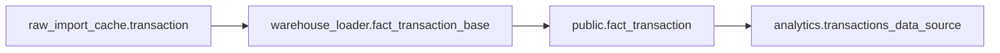
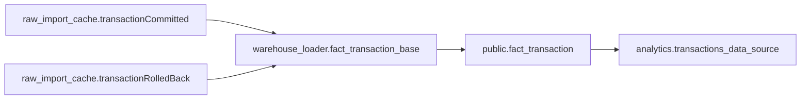
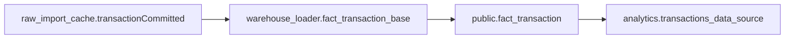
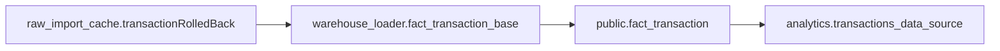
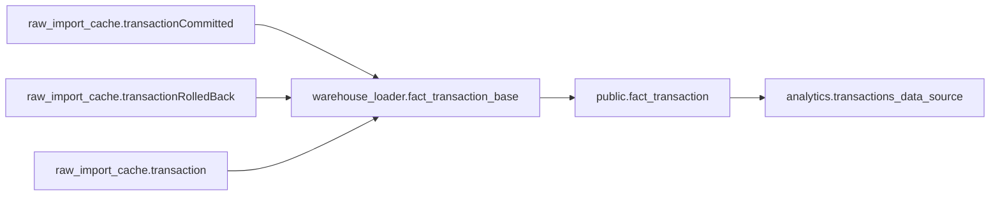
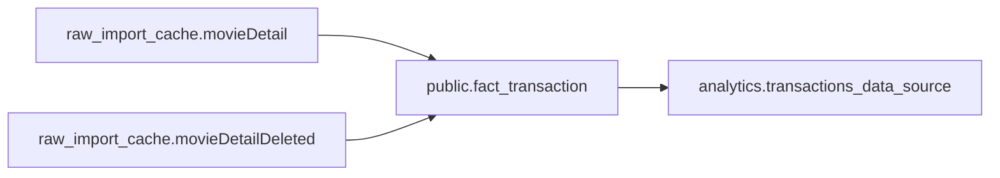
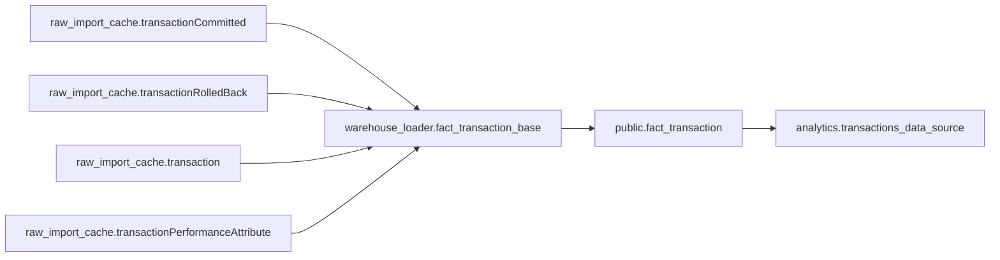
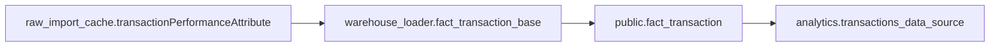
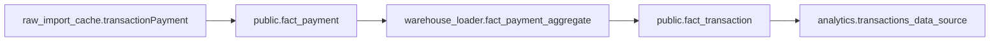

# `analytics.transactions_data_source` Field Lineage — By Field

This document maps all **128 fields** in `analytics.transactions_data_source` across:

```text
MSSQL -> raw_import_cache -> warehouse_loader -> public -> analytics
```

## Conventions

- **Transform tags** used in **Logic Explanation**:
  - `[passthrough]` — carries a value forward without changing it.
  - `[rename/cast]` — renames a value, converts its data type, or both.
  - `[lookup]` — gets a value by matching a key to a lookup table or dimension.
  - `[derived]` — calculates a value from one or more inputs.
  - `[aggregate]` — combines multiple rows into a summarized result, such as a sum or count.
  - `[conditional]` — chooses or adjusts a value based on a condition, such as a `CASE` rule.
  - Tags can be combined when a transformation does more than one of these things.
- Each field is listed separately in ordinal order. The flow diagram shows its permanent table path from source to analytics; branches show when a field uses multiple paths.
- Dimension tables are side lookups. They are listed in field notes and are not shown as permanent steps in the main flow.
- Temporary tables, including `#` tables, are mentioned in notes and excluded from the permanent flow diagram and lineage table.
- When a field has a fallback source, its primary source is named first and the fallback is identified in the notes.
- **Source** describes the origin or classification of the row's data:
  - `Backend` — data from Fandango ticketing/backend systems.
  - `Third-party` — data supplied by an external provider or feed.
  - `ETL` — data populated or staged by a data pipeline.
  - `Derived` — data calculated or combined from other inputs.
  - Combined values such as `Backend/Third-party` or `Third-party/Derived` indicate mixed origins or processing. A blank Source cell means no source classification is specified.

## Fields

## 001. `transaction_guid`



<details>
<summary>Lineage table for transaction_guid</summary>

| Redshift Table | Table Grain | Column Name | Data Type | Description | Example Value | Source | GitHub Link | Logic Explanation |
| --- | --- | --- | --- | --- | --- | --- | --- | --- |
| `raw_import_cache.transaction` | 1 row / transaction_guid | Transaction_GUID | varchar(36) | Transaction identifier | 9F2A... | Backend |  | [passthrough] Reads `Transaction_GUID` from `raw_import_cache.transaction`. |
| `warehouse_loader.fact_transaction_base` | 1 row / transaction_guid | transaction_guid | varchar(36) | Transaction key | 9F2A... | Backend |  | [passthrough] Copies `Transaction_GUID` from `raw_import_cache.transaction`. |
| `public.fact_transaction` | 1 row / transaction_guid | transaction_guid | varchar(36) | Transaction identifier | 9F2A... | Backend |  | [passthrough] Copies `transaction_guid` from `warehouse_loader.fact_transaction_base`. |
| `analytics.transactions_data_source` | 1 row / transaction_guid | transaction_guid | varchar(36) | Transaction id | 9F2A... | Backend |  | [passthrough] Copies `transaction_guid` from `public.fact_transaction`. |

</details>
## 002. `is_successful`



<details>
<summary>Lineage table for is_successful</summary>

| Redshift Table | Table Grain | Column Name | Data Type | Description | Example Value | Source | GitHub Link | Logic Explanation |
| --- | --- | --- | --- | --- | --- | --- | --- | --- |
| `raw_import_cache.transactionCommitted` | 1 row / transaction_guid | Create_dm | timestamp | Commit time | 2026-10-01 16:11:05 | Backend |  | [passthrough] Reads `Create_dm` from `raw_import_cache.transactionCommitted`. |
| `raw_import_cache.transactionRolledBack` | 1 row / transaction_guid | Create_dm | timestamp | Rollback time |  | Backend |  | [passthrough] Reads `Create_dm` from `raw_import_cache.transactionRolledBack`. |
| `warehouse_loader.fact_transaction_base` | 1 row / transaction_guid | is_successful | boolean | Successful transaction flag | true | Derived |  | [conditional] True when `raw_import_cache.transactionCommitted` has a row and `raw_import_cache.transactionRolledBack` does not. |
| `public.fact_transaction` | 1 row / transaction_guid | is_successful | boolean | Whether the transaction completed successfully | true | Derived |  | [passthrough] Copies `is_successful` from `warehouse_loader.fact_transaction_base`. |
| `analytics.transactions_data_source` | 1 row / transaction_guid | is_successful | boolean | Success flag | true | Derived |  | [passthrough] Copies `is_successful` from `public.fact_transaction`. |

</details>
## 003. `transaction_start_datetime_utc`


<details>
<summary>Lineage table for transaction_start_datetime_utc</summary>

| Redshift Table | Table Grain | Column Name | Data Type | Description | Example Value | Source | GitHub Link | Logic Explanation |
| --- | --- | --- | --- | --- | --- | --- | --- | --- |
| `raw_import_cache.transaction` | 1 row / transaction_guid | Create_dm | timestamp | Transaction start time | 2026-10-01 16:10:00 | Backend |  | [passthrough] Reads `Create_dm` from `raw_import_cache.transaction`. |
| `warehouse_loader.fact_transaction_base` | 1 row / transaction_guid | transaction_start_datetime | timestamp | Transaction start time (UTC) | 2026-10-01 16:10:00 | Backend |  | [rename/cast] Casts `raw_import_cache.transaction.Create_dm` to timestamp. |
| `public.fact_transaction` | 1 row / transaction_guid | transaction_start_datetime | timestamp | Transaction start time in UTC | 2026-10-01 16:10:00 | Backend |  | [passthrough] Copies `transaction_start_datetime` from `warehouse_loader.fact_transaction_base`. |
| `analytics.transactions_data_source` | 1 row / transaction_guid | transaction_start_datetime_utc | timestamp | Start UTC | 2026-10-01 16:10:00 | Backend |  | [passthrough] Copies `transaction_start_datetime_utc` from `public.fact_transaction`. |

</details>
## 004. `transaction_start_datetime_los_angeles`


<details>
<summary>Lineage table for transaction_start_datetime_los_angeles</summary>

| Redshift Table | Table Grain | Column Name | Data Type | Description | Example Value | Source | GitHub Link | Logic Explanation |
| --- | --- | --- | --- | --- | --- | --- | --- | --- |
| `raw_import_cache.transaction` | 1 row / transaction_guid | Create_dm | timestamp | Transaction start time | 2026-10-01 16:10:00 | Backend |  | [passthrough] Reads `Create_dm` from `raw_import_cache.transaction`. |
| `warehouse_loader.fact_transaction_base` | 1 row / transaction_guid | transaction_start_datetime | timestamp | Transaction start time (UTC) | 2026-10-01 16:10:00 | Backend |  | [rename/cast] Casts `raw_import_cache.transaction.Create_dm` to timestamp. |
| `public.fact_transaction` | 1 row / transaction_guid | transaction_start_datetime | timestamp | Transaction start time in UTC | 2026-10-01 16:10:00 | Backend |  | [passthrough] Copies `transaction_start_datetime` from `warehouse_loader.fact_transaction_base`. |
| `analytics.transactions_data_source` | 1 row / transaction_guid | transaction_start_datetime_los_angeles | timestamp | Pacific start datetime | 2026-10-01 09:10:00 | Derived |  | [rename/cast] Converts `transaction_start_datetime` from `public.fact_transaction` to US/Pacific time. |

</details>
## 005. `transaction_commit_datetime_utc`



<details>
<summary>Lineage table for transaction_commit_datetime_utc</summary>

| Redshift Table | Table Grain | Column Name | Data Type | Description | Example Value | Source | GitHub Link | Logic Explanation |
| --- | --- | --- | --- | --- | --- | --- | --- | --- |
| `raw_import_cache.transactionCommitted` | 1 row / transaction_guid | Create_dm | timestamp | Commit time | 2026-10-01 16:11:05 | Backend |  | [passthrough] Reads `Create_dm` from `raw_import_cache.transactionCommitted`. |
| `warehouse_loader.fact_transaction_base` | 1 row / transaction_guid | transaction_commit_datetime | timestamp | Transaction commit time (UTC) | 2026-10-01 16:11:05 | Backend |  | [passthrough] Copies `Create_dm` from `raw_import_cache.transactionCommitted`. |
| `public.fact_transaction` | 1 row / transaction_guid | transaction_commit_datetime | timestamp | Transaction commit time in UTC | 2026-10-01 16:11:05 | Backend |  | [passthrough] Copies `transaction_commit_datetime` from `warehouse_loader.fact_transaction_base`. |
| `analytics.transactions_data_source` | 1 row / transaction_guid | transaction_commit_datetime_utc | timestamp | Commit UTC | 2026-10-01 16:11:05 | Backend |  | [passthrough] Copies `transaction_commit_datetime_utc` from `public.fact_transaction`. |

</details>
## 006. `transaction_commit_datetime_los_angeles`


<details>
<summary>Lineage table for transaction_commit_datetime_los_angeles</summary>

| Redshift Table | Table Grain | Column Name | Data Type | Description | Example Value | Source | GitHub Link | Logic Explanation |
| --- | --- | --- | --- | --- | --- | --- | --- | --- |
| `raw_import_cache.transactionCommitted` | 1 row / transaction_guid | Create_dm | timestamp | Commit time | 2026-10-01 16:11:05 | Backend |  | [passthrough] Reads `Create_dm` from `raw_import_cache.transactionCommitted`. |
| `warehouse_loader.fact_transaction_base` | 1 row / transaction_guid | transaction_commit_datetime | timestamp | Transaction commit time (UTC) | 2026-10-01 16:11:05 | Backend |  | [passthrough] Copies `Create_dm` from `raw_import_cache.transactionCommitted`. |
| `public.fact_transaction` | 1 row / transaction_guid | transaction_commit_datetime | timestamp | Transaction commit time in UTC | 2026-10-01 16:11:05 | Backend |  | [passthrough] Copies `transaction_commit_datetime` from `warehouse_loader.fact_transaction_base`. |
| `analytics.transactions_data_source` | 1 row / transaction_guid | transaction_commit_datetime_los_angeles | timestamp | Pacific commit datetime | 2026-10-01 09:11:05 | Derived |  | [rename/cast] Converts `transaction_commit_datetime` from `public.fact_transaction` to US/Pacific time. |

</details>
## 007. `transaction_rollback_datetime_utc`



<details>
<summary>Lineage table for transaction_rollback_datetime_utc</summary>

| Redshift Table | Table Grain | Column Name | Data Type | Description | Example Value | Source | GitHub Link | Logic Explanation |
| --- | --- | --- | --- | --- | --- | --- | --- | --- |
| `raw_import_cache.transactionRolledBack` | 1 row / transaction_guid | Create_dm | timestamp | Rollback time |  | Backend |  | [passthrough] Reads `Create_dm` from `raw_import_cache.transactionRolledBack`. |
| `warehouse_loader.fact_transaction_base` | 1 row / transaction_guid | transaction_rollback_datetime | timestamp | Transaction rollback time (UTC) | — | Backend |  | [passthrough] Copies `Create_dm` from `raw_import_cache.transactionRolledBack`. |
| `public.fact_transaction` | 1 row / transaction_guid | transaction_rollback_datetime | timestamp | Transaction rollback time in UTC | NULL | Backend |  | [passthrough] Copies `transaction_rollback_datetime` from `warehouse_loader.fact_transaction_base`. |
| `analytics.transactions_data_source` | 1 row / transaction_guid | transaction_rollback_datetime_utc | timestamp | Rollback UTC | NULL | Backend |  | [passthrough] Copies `transaction_rollback_datetime_utc` from `public.fact_transaction`. |

</details>
## 008. `transaction_rollback_datetime_los_angeles`


<details>
<summary>Lineage table for transaction_rollback_datetime_los_angeles</summary>

| Redshift Table | Table Grain | Column Name | Data Type | Description | Example Value | Source | GitHub Link | Logic Explanation |
| --- | --- | --- | --- | --- | --- | --- | --- | --- |
| `raw_import_cache.transactionRolledBack` | 1 row / transaction_guid | Create_dm | timestamp | Rollback time |  | Backend |  | [passthrough] Reads `Create_dm` from `raw_import_cache.transactionRolledBack`. |
| `warehouse_loader.fact_transaction_base` | 1 row / transaction_guid | transaction_rollback_datetime | timestamp | Transaction rollback time (UTC) | — | Backend |  | [passthrough] Copies `Create_dm` from `raw_import_cache.transactionRolledBack`. |
| `public.fact_transaction` | 1 row / transaction_guid | transaction_rollback_datetime | timestamp | Transaction rollback time in UTC | NULL | Backend |  | [passthrough] Copies `transaction_rollback_datetime` from `warehouse_loader.fact_transaction_base`. |
| `analytics.transactions_data_source` | 1 row / transaction_guid | transaction_rollback_datetime_los_angeles | timestamp | Pacific rollback datetime | NULL | Derived |  | [rename/cast] Converts `transaction_rollback_datetime` from `public.fact_transaction` to US/Pacific time. |

</details>
## 009. `transaction_end_datetime_utc`



**Notes:** `warehouse_loader.fact_transaction_base` uses the later commit or rollback timestamp; it falls back to transaction.create_dm if neither exists.  

<details>
<summary>Lineage table for transaction_end_datetime_utc</summary>

| Redshift Table | Table Grain | Column Name | Data Type | Description | Example Value | Source | GitHub Link | Logic Explanation |
| --- | --- | --- | --- | --- | --- | --- | --- | --- |
| `raw_import_cache.transactionCommitted` | 1 row / transaction_guid | Create_dm | timestamp | Commit time | 2026-10-01 16:11:05 | Backend |  | [passthrough] Reads `Create_dm` from `raw_import_cache.transactionCommitted`. |
| `raw_import_cache.transactionRolledBack` | 1 row / transaction_guid | Create_dm | timestamp | Rollback time |  | Backend |  | [passthrough] Reads `Create_dm` from `raw_import_cache.transactionRolledBack`. |
| `raw_import_cache.transaction` | 1 row / transaction_guid | Create_dm | timestamp | Transaction start time | 2026-10-01 16:10:00 | Backend |  | [passthrough] Reads `Create_dm` from `raw_import_cache.transaction`. |
| `warehouse_loader.fact_transaction_base` | 1 row / transaction_guid | transaction_end_datetime | timestamp | Transaction end time (UTC) | 2026-10-01 16:11:05 | Derived |  | [conditional] Uses the later commit or rollback time; falls back to `raw_import_cache.transaction.Create_dm`. |
| `public.fact_transaction` | 1 row / transaction_guid | transaction_end_datetime | timestamp | Transaction end time in UTC | 2026-10-01 16:11:05 | Derived |  | [passthrough] Carries the transaction end timestamp. |
| `analytics.transactions_data_source` | 1 row / transaction_guid | transaction_end_datetime_utc | timestamp | End UTC | 2026-10-01 16:11:05 | Derived |  | [passthrough] Copies `transaction_end_datetime_utc` from `public.fact_transaction`. |

</details>
## 010. `transaction_end_datetime_los_angeles`


**Notes:** `warehouse_loader.fact_transaction_base` uses the later commit or rollback timestamp; it falls back to transaction.create_dm if neither exists. Analytics converts the result to US/Pacific time.  

<details>
<summary>Lineage table for transaction_end_datetime_los_angeles</summary>

| Redshift Table | Table Grain | Column Name | Data Type | Description | Example Value | Source | GitHub Link | Logic Explanation |
| --- | --- | --- | --- | --- | --- | --- | --- | --- |
| `raw_import_cache.transactionCommitted` | 1 row / transaction_guid | Create_dm | timestamp | Commit time | 2026-10-01 16:11:05 | Backend |  | [passthrough] Reads `Create_dm` from `raw_import_cache.transactionCommitted`. |
| `raw_import_cache.transactionRolledBack` | 1 row / transaction_guid | Create_dm | timestamp | Rollback time |  | Backend |  | [passthrough] Reads `Create_dm` from `raw_import_cache.transactionRolledBack`. |
| `raw_import_cache.transaction` | 1 row / transaction_guid | Create_dm | timestamp | Transaction start time | 2026-10-01 16:10:00 | Backend |  | [passthrough] Reads `Create_dm` from `raw_import_cache.transaction`. |
| `warehouse_loader.fact_transaction_base` | 1 row / transaction_guid | transaction_end_datetime | timestamp | Transaction end time (UTC) | 2026-10-01 16:11:05 | Derived |  | [conditional] Uses the later commit or rollback time; falls back to `raw_import_cache.transaction.Create_dm`. |
| `public.fact_transaction` | 1 row / transaction_guid | transaction_end_datetime | timestamp | Transaction end time in UTC | 2026-10-01 16:11:05 | Derived |  | [passthrough] Carries the transaction end timestamp. |
| `analytics.transactions_data_source` | 1 row / transaction_guid | transaction_end_datetime_los_angeles | timestamp | Pacific end datetime | 2026-10-01 09:11:05 | Derived |  | [rename/cast] Converts `transaction_end_datetime` from `public.fact_transaction` to US/Pacific time. |

</details>
## 011. `transaction_end_datetime_local`


**Notes:** The end timestamp uses the later commit or rollback time, falling back to `raw_import_cache.transaction.Create_dm`. `public.dim_theater` supplies the theater time zone used when `public.fact_transaction` converts the timestamp to local time.

<details>
<summary>Lineage table for transaction_end_datetime_local</summary>

| Redshift Table | Table Grain | Column Name | Data Type | Description | Example Value | Source | GitHub Link | Logic Explanation |
| --- | --- | --- | --- | --- | --- | --- | --- | --- |
| `raw_import_cache.transactionCommitted` | 1 row / transaction_guid | Create_dm | timestamp | Commit time | 2026-10-01 16:11:05 | Backend |  | [passthrough] Reads `Create_dm` from `raw_import_cache.transactionCommitted`. |
| `raw_import_cache.transactionRolledBack` | 1 row / transaction_guid | Create_dm | timestamp | Rollback time |  | Backend |  | [passthrough] Reads `Create_dm` from `raw_import_cache.transactionRolledBack`. |
| `raw_import_cache.transaction` | 1 row / transaction_guid | Create_dm | timestamp | Transaction start time | 2026-10-01 16:10:00 | Backend |  | [passthrough] Reads `Create_dm` from `raw_import_cache.transaction`. |
| `warehouse_loader.fact_transaction_base` | 1 row / transaction_guid | transaction_end_datetime | timestamp | Transaction end time in UTC | 2026-10-01 16:11:05 | Derived |  | [conditional] Uses the later commit or rollback time; falls back to `raw_import_cache.transaction.Create_dm`. |
| `public.fact_transaction` | 1 row / transaction_guid | transaction_end_datetime_local | timestamp | Transaction end time in the theater time zone | 2026-10-01 09:11:05 | Derived |  | [derived] Converts the end timestamp using `public.dim_theater.theater_time_zone_name`. |
| `analytics.transactions_data_source` | 1 row / transaction_guid | transaction_end_datetime_local | timestamp | End local | 2026-10-01 09:11:05 | Derived |  | [passthrough] Copies `transaction_end_datetime_local` from `public.fact_transaction`. |

</details>
## 012. `deltareleasetopurchasedate`



**Notes:** `public.dim_movie` joins to `public.fact_transaction`. The release date comes primarily from `raw_import_cache.movieDetail.date_released`, with `raw_import_cache.movieDetailDeleted.date_released` as fallback. Analytics compares that dimension value with `public.fact_transaction.transaction_end_datetime`.

<details>
<summary>Lineage table for deltareleasetopurchasedate</summary>

| Redshift Table | Table Grain | Column Name | Data Type | Description | Example Value | Source | GitHub Link | Logic Explanation |
| --- | --- | --- | --- | --- | --- | --- | --- | --- |
| `raw_import_cache.movieDetail` | 1 row / transaction_guid | date_released |  | Raw column(s) used by the dimension load for `deltareleasetopurchasedate`. |  | Backend/Third-party |  |  |
| `raw_import_cache.movieDetailDeleted` | 1 row / transaction_guid | date_released |  | Raw column(s) used by the dimension load for `deltareleasetopurchasedate`. |  | Backend/Third-party |  |  |
| `public.fact_transaction` | 1 row / transaction_guid | transaction_end_datetime | timestamp | Transaction end time in UTC | 2026-10-01 16:11:05 | Derived |  | [passthrough] Carries the transaction end timestamp. |
| `analytics.transactions_data_source` | 1 row / transaction_guid | deltareleasetopurchasedate | int | Days release->purchase day | 17 | Derived |  | [derived] Uses the dimension value described in Notes. |

</details>
## 013. `deltareleasetoshowtimedate`


**Notes:** `public.dim_movie` joins to `public.fact_transaction`. The release date comes primarily from `raw_import_cache.movieDetail.date_released`, with `raw_import_cache.movieDetailDeleted.date_released` as fallback. Analytics compares that dimension value with `public.fact_transaction.performance_datetime_local`.

<details>
<summary>Lineage table for deltareleasetoshowtimedate</summary>

| Redshift Table | Table Grain | Column Name | Data Type | Description | Example Value | Source | GitHub Link | Logic Explanation |
| --- | --- | --- | --- | --- | --- | --- | --- | --- |
| `raw_import_cache.movieDetail` | 1 row / transaction_guid | date_released |  | Raw column(s) used by the dimension load for `deltareleasetoshowtimedate`. |  | Backend/Third-party |  |  |
| `raw_import_cache.movieDetailDeleted` | 1 row / transaction_guid | date_released |  | Raw column(s) used by the dimension load for `deltareleasetoshowtimedate`. |  | Backend/Third-party |  |  |
| `public.fact_transaction` | 1 row / transaction_guid | performance_datetime_local | timestamp | Performance time associated with the transaction | 2026-10-05 19:30:00 | Backend |  | [passthrough] Carries the performance time. |
| `analytics.transactions_data_source` | 1 row / transaction_guid | deltareleasetoshowtimedate | int | Days release->showtime day | 21 | Derived |  | [derived] Calculates days from movie release to `performance_datetime_local`. |

</details>
## 014. `deltapurchasetoshowtimedate`



**Notes:** Analytics calculates the date difference from transaction end time to performance time. The end time uses commit/rollback event dates, falling back to transaction.create_dm; performance time comes from transactionPerformanceAttribute. Value columns: `public.fact_transaction`.transaction_end_datetime and `public.fact_transaction.performance_datetime_local`; the end time is built from `transactionCommitted.Create_dm` / `transactionRolledBack.Create_dm`, falling back to `transaction.Create_dm`, and performance time comes from `transactionPerformanceAttribute.Performance_dm`.

<details>
<summary>Lineage table for deltapurchasetoshowtimedate</summary>

| Redshift Table | Table Grain | Column Name | Data Type | Description | Example Value | Source | GitHub Link | Logic Explanation |
| --- | --- | --- | --- | --- | --- | --- | --- | --- |
| `raw_import_cache.transactionCommitted` | 1 row / transaction_guid | Create_dm | timestamp | Commit time | 2026-10-01 16:11:05 | Backend |  | [passthrough] Reads `Create_dm` from `raw_import_cache.transactionCommitted`. |
| `raw_import_cache.transactionRolledBack` | 1 row / transaction_guid | Create_dm | timestamp | Rollback time |  | Backend |  | [passthrough] Reads `Create_dm` from `raw_import_cache.transactionRolledBack`. |
| `raw_import_cache.transaction` | 1 row / transaction_guid | Create_dm | timestamp | Transaction start time | 2026-10-01 16:10:00 | Backend |  | [passthrough] Reads `Create_dm` from `raw_import_cache.transaction`. |
| `raw_import_cache.transactionPerformanceAttribute` | 1 row / transaction_guid | Performance_dm | timestamp | Local performance time | 2026-10-05 19:30:00 | Backend |  | [passthrough] Reads `Performance_dm` from `raw_import_cache.transactionPerformanceAttribute`. |
| `warehouse_loader.fact_transaction_base` | 1 row / transaction_guid | transaction_end_datetime | timestamp | Transaction end time (UTC) | 2026-10-01 16:11:05 | Derived |  | [conditional] Uses the later commit or rollback time; falls back to `raw_import_cache.transaction.Create_dm`. |
| `warehouse_loader.fact_transaction_base` | 1 row / transaction_guid | performance_datetime_local | timestamp | Local performance time | 2026-10-05 19:30:00 | Backend |  | [passthrough] Copies `Performance_dm` from `raw_import_cache.transactionPerformanceAttribute`. |
| `public.fact_transaction` | 1 row / transaction_guid | transaction_end_datetime | timestamp | Transaction end time in UTC | 2026-10-01 16:11:05 | Derived |  | [passthrough] Carries the transaction end timestamp. |
| `public.fact_transaction` | 1 row / transaction_guid | performance_datetime_local | timestamp | Performance time associated with the transaction | 2026-10-05 19:30:00 | Backend |  | [passthrough] Carries the performance time. |
| `analytics.transactions_data_source` | 1 row / transaction_guid | deltapurchasetoshowtimedate | int | Days purchase day->showtime day | 4 | Derived |  | [derived] Calculates days from transaction end to `performance_datetime_local`. |

</details>
## 015. `point_of_sale_confirmation_code`


<details>
<summary>Lineage table for point_of_sale_confirmation_code</summary>

| Redshift Table | Table Grain | Column Name | Data Type | Description | Example Value | Source | GitHub Link | Logic Explanation |
| --- | --- | --- | --- | --- | --- | --- | --- | --- |
| `raw_import_cache.transactionCommitted` | 1 row / transaction_guid | Confirmation_cd | varchar | POS confirmation code | CNF908812 | Backend |  | [passthrough] Reads `Confirmation_cd` from `raw_import_cache.transactionCommitted`. |
| `warehouse_loader.fact_transaction_base` | 1 row / transaction_guid | point_of_sale_confirmation_code | varchar(40) | POS confirmation code | CNF908812 | Backend |  | [passthrough] Copies `Confirmation_cd` from `raw_import_cache.transactionCommitted`. |
| `public.fact_transaction` | 1 row / transaction_guid | point_of_sale_confirmation_code | varchar(40) | POS confirmation code | CNF908812 | Backend |  | [passthrough] Copies `point_of_sale_confirmation_code` from `warehouse_loader.fact_transaction_base`. |
| `analytics.transactions_data_source` | 1 row / transaction_guid | point_of_sale_confirmation_code | varchar(40) | POS confirmation code | CNF908812 | Backend |  | [passthrough] Copies `point_of_sale_confirmation_code` from `public.fact_transaction`. |

</details>
## 016. `is_reserved_seating`


<details>
<summary>Lineage table for is_reserved_seating</summary>

| Redshift Table | Table Grain | Column Name | Data Type | Description | Example Value | Source | GitHub Link | Logic Explanation |
| --- | --- | --- | --- | --- | --- | --- | --- | --- |
| `raw_import_cache.transactionCommitted` | 1 row / transaction_guid | ReservedSeats_tx | varchar | Reserved-seat payload | A10,A11 | Backend |  | [passthrough] Reads `ReservedSeats_tx` from `raw_import_cache.transactionCommitted`. |
| `warehouse_loader.fact_transaction_base` | 1 row / transaction_guid | is_reserved_seating | boolean | Reserved-seating flag | true | Derived |  | [conditional] True when `ReservedSeats_tx` in `raw_import_cache.transactionCommitted` is nonblank. |
| `public.fact_transaction` | 1 row / transaction_guid | is_reserved_seating | boolean | Whether reserved seating was selected | true | Derived |  | [passthrough] Copies `is_reserved_seating` from `warehouse_loader.fact_transaction_base`. |
| `analytics.transactions_data_source` | 1 row / transaction_guid | is_reserved_seating | boolean | Reserved seating flag | true | Derived |  | [passthrough] Copies `is_reserved_seating` from `public.fact_transaction`. |

</details>
## 017. `reserved_seats`


<details>
<summary>Lineage table for reserved_seats</summary>

| Redshift Table | Table Grain | Column Name | Data Type | Description | Example Value | Source | GitHub Link | Logic Explanation |
| --- | --- | --- | --- | --- | --- | --- | --- | --- |
| `raw_import_cache.transactionCommitted` | 1 row / transaction_guid | ReservedSeats_tx | varchar | Reserved-seat payload | A10,A11 | Backend |  | [passthrough] Reads `ReservedSeats_tx` from `raw_import_cache.transactionCommitted`. |
| `warehouse_loader.fact_transaction_base` | 1 row / transaction_guid | reserved_seats | varchar(100) | Reserved seats | A10,A11 | Backend |  | [conditional] Trims `ReservedSeats_tx` from `raw_import_cache.transactionCommitted`; blank becomes NULL. |
| `public.fact_transaction` | 1 row / transaction_guid | reserved_seats | varchar(100) | Reserved seat identifiers | A10,A11 | Backend |  | [passthrough] Copies `reserved_seats` from `warehouse_loader.fact_transaction_base`. |
| `analytics.transactions_data_source` | 1 row / transaction_guid | reserved_seats | varchar(100) | Reserved seats | A10,A11 | Backend |  | [passthrough] Copies `reserved_seats` from `public.fact_transaction`. |

</details>
## 018. `loyalty_code`


<details>
<summary>Lineage table for loyalty_code</summary>

| Redshift Table | Table Grain | Column Name | Data Type | Description | Example Value | Source | GitHub Link | Logic Explanation |
| --- | --- | --- | --- | --- | --- | --- | --- | --- |
| `raw_import_cache.transactionCommitted` | 1 row / transaction_guid | Loyalty_cd | varchar | Loyalty code | LOY123 | Backend |  | [passthrough] Reads `Loyalty_cd` from `raw_import_cache.transactionCommitted`. |
| `warehouse_loader.fact_transaction_base` | 1 row / transaction_guid | loyalty_code | varchar(40) | Loyalty code | LOY123 | Backend |  | [conditional] Trims `Loyalty_cd` from `raw_import_cache.transactionCommitted`; blank becomes NULL. |
| `public.fact_transaction` | 1 row / transaction_guid | loyalty_code | varchar(40) | Loyalty code on the transaction | LOY123 | Backend |  | [passthrough] Copies `loyalty_code` from `warehouse_loader.fact_transaction_base`. |
| `analytics.transactions_data_source` | 1 row / transaction_guid | loyalty_code | varchar(40) | Loyalty code | LOY123 | Backend |  | [passthrough] Copies `loyalty_code` from `public.fact_transaction`. |

</details>
## 019. `performance_datetime_local`



<details>
<summary>Lineage table for performance_datetime_local</summary>

| Redshift Table | Table Grain | Column Name | Data Type | Description | Example Value | Source | GitHub Link | Logic Explanation |
| --- | --- | --- | --- | --- | --- | --- | --- | --- |
| `raw_import_cache.transactionPerformanceAttribute` | 1 row / transaction_guid | Performance_dm | timestamp | Local performance time | 2026-10-05 19:30:00 | Backend |  | [passthrough] Reads `Performance_dm` from `raw_import_cache.transactionPerformanceAttribute`. |
| `warehouse_loader.fact_transaction_base` | 1 row / transaction_guid | performance_datetime_local | timestamp | Local performance time | 2026-10-05 19:30:00 | Backend |  | [passthrough] Copies `Performance_dm` from `raw_import_cache.transactionPerformanceAttribute`. |
| `public.fact_transaction` | 1 row / transaction_guid | performance_datetime_local | timestamp | Performance time associated with the transaction | 2026-10-05 19:30:00 | Backend |  | [passthrough] Carries the performance time. |
| `analytics.transactions_data_source` | 1 row / transaction_guid | performance_datetime_local | timestamp | Performance local | 2026-10-05 19:30:00 | Backend |  | [passthrough] Copies `performance_datetime_local` from `public.fact_transaction`. |

</details>
## 020. `payment_types`



**Notes:** `public.dim_payment_instrument` and `public.dim_payment_type` are joined to `public.fact_payment` in the payment aggregate to derive payment_types.  

<details>
<summary>Lineage table for payment_types</summary>

| Redshift Table | Table Grain | Column Name | Data Type | Description | Example Value | Source | GitHub Link | Logic Explanation |
| --- | --- | --- | --- | --- | --- | --- | --- | --- |
| `raw_import_cache.transactionPayment` | 1 row / transaction_guid | Payment_tp | varchar(40) | Payment type code | VISA | Backend |  | [passthrough] Reads `Payment_tp` from `raw_import_cache.transactionPayment`. |
| `raw_import_cache.transactionPayment` | 1 row / transaction_guid | Account_cd | varchar(600) | Payment account or instrument code |  | Backend |  | [passthrough] Reads `Account_cd` from `raw_import_cache.transactionPayment`. |
| `public.fact_payment` | 1 row / transaction_guid | payment_instrument_key | integer | Payment instrument key | — | Backend |  | [lookup] Uses the payment-instrument mapping described in Notes. |
| `warehouse_loader.fact_payment_aggregate` | 1 row / transaction_guid | payment_types | varchar(200) | Payment types | VISA | Backend |  | [aggregate/lookup] Groups `public.fact_payment` by transaction and resolves labels with payment dimensions. |
| `public.fact_transaction` | 1 row / transaction_guid | payment_types | varchar(200) | Payment-type labels | VISA | Backend |  | [passthrough] Copies `payment_types` from `warehouse_loader.fact_payment_aggregate`. |
| `analytics.transactions_data_source` | 1 row / transaction_guid | payment_types | varchar(200) | Payment types | VISA | Backend |  | [passthrough] Copies `payment_types` from `public.fact_transaction`. |

</details>
## 021. `processor_order_ids`

```mermaid
flowchart LR
  n0_0["`raw_import_cache.processorbraintreeauthorizationresponse`"]
  n0_1["`raw_import_cache.processorbraintreerefundresponse`"]
  n0_2["`raw_import_cache.paypaltrrdetail`"]
  n0_3["`raw_import_cache.paypalstldetail`"]
  n1_0["`public.fact_payment`"]
  n2_0["`warehouse_loader.fact_payment_aggregate`"]
  n3_0["`public.fact_transaction`"]
  n4_0["`analytics.transactions_data_source`"]
  n0_0 --> n1_0
  n0_1 --> n1_0
  n0_2 --> n1_0
  n0_3 --> n1_0
  n1_0 --> n2_0
  n2_0 --> n3_0
  n3_0 --> n4_0
```

**Notes:** `public.fact_payment` derives processor_order_id with COALESCE in this order. Each join is processor/refund specific, so later candidates act as fallbacks only where that join applies; this is not one universal primary source.  

<details>
<summary>Lineage table for processor_order_ids</summary>

| Redshift Table | Table Grain | Column Name | Data Type | Description | Example Value | Source | GitHub Link | Logic Explanation |
| --- | --- | --- | --- | --- | --- | --- | --- | --- |
| `raw_import_cache.processorbraintreeauthorizationresponse` | 1 row / transaction_guid | BraintreeTransaction_cd | varchar | Braintree authorization ID |  | Third-party |  | [passthrough] Reads `BraintreeTransaction_cd` from `raw_import_cache.processorbraintreeauthorizationresponse`. |
| `raw_import_cache.processorbraintreerefundresponse` | 1 row / transaction_guid | BraintreeTransaction_cd | varchar | Braintree refund ID |  | Third-party |  | [passthrough] Reads `BraintreeTransaction_cd` from `raw_import_cache.processorbraintreerefundresponse`. |
| `raw_import_cache.paypaltrrdetail` | 1 row / transaction_guid | transaction_id | varchar | PayPal TRR transaction ID |  | Third-party |  | [passthrough] Reads `transaction_id` from `raw_import_cache.paypaltrrdetail`. |
| `raw_import_cache.paypalstldetail` | 1 row / transaction_guid | transaction_id | varchar | PayPal STL transaction ID |  | Third-party |  | [passthrough] Reads `transaction_id` from `raw_import_cache.paypalstldetail`. |
| `public.fact_payment` | 1 row / transaction_guid | processor_order_id | varchar | Processor order ID | — | Third-party |  |  |
| `warehouse_loader.fact_payment_aggregate` | 1 row / transaction_guid | processor_order_ids | varchar(124) | Processor order IDs | — | Third-party |  |  |
| `public.fact_transaction` | 1 row / transaction_guid | processor_order_ids | varchar(124) | Processor order IDs | — | Third-party |  | [passthrough] Copies `processor_order_ids` from `warehouse_loader.fact_payment_aggregate`. |
| `analytics.transactions_data_source` | 1 row / transaction_guid | processor_order_ids | varchar(124) | Processor order ids | ord_123 | Third-party |  | [passthrough] Copies `processor_order_ids` from `public.fact_transaction`. |

</details>
## 022. `affiliate_name`

```mermaid
flowchart LR
  n0_0["`raw_import_cache.affiliate`"]
  n1_0["`public.fact_transaction`"]
  n2_0["`analytics.transactions_data_source`"]
  n0_0 --> n1_0
  n1_0 --> n2_0
```

**Notes:** `public.dim_affiliate` joined to `public.fact_transaction`. Value column: `public.dim_affiliate.affiliate_name`.

<details>
<summary>Lineage table for affiliate_name</summary>

| Redshift Table | Table Grain | Column Name | Data Type | Description | Example Value | Source | GitHub Link | Logic Explanation |
| --- | --- | --- | --- | --- | --- | --- | --- | --- |
| `raw_import_cache.affiliate` | 1 row / transaction_guid | affiliate_nm |  | Raw column(s) used by the dimension load for `affiliate_name`. |  | Backend/Third-party |  |  |
| `public.fact_transaction` | 1 row / transaction_guid | — | — | Dimension lookup anchor; this row has no direct value column for the field. | — | ETL |  | [lookup] The field value comes from the dimension value column named in Notes. |
| `analytics.transactions_data_source` | 1 row / transaction_guid | affiliate_name | varchar(400) | Affiliate name | Fandango iOS App | Backend |  | [lookup] Uses the dimension value described in Notes. |

</details>
## 023. `affiliate_group_name`

```mermaid
flowchart LR
  n0_0["`raw_import_cache.affiliate`"]
  n0_1["`raw_import_cache.affiliateGroupMapping`"]
  n0_2["`raw_import_cache.affiliateGroup`"]
  n1_0["`public.fact_transaction`"]
  n2_0["`analytics.transactions_data_source`"]
  n0_0 --> n1_0
  n0_1 --> n1_0
  n0_2 --> n1_0
  n1_0 --> n2_0
```

**Notes:** `public.dim_affiliate` joined to `public.fact_transaction`. Value column: `public.dim_affiliate.affiliate_group_name`. Value source: `raw_import_cache.affiliateGroup.name`, linked through `raw_import_cache.affiliateGroupMapping`.

<details>
<summary>Lineage table for affiliate_group_name</summary>

| Redshift Table | Table Grain | Column Name | Data Type | Description | Example Value | Source | GitHub Link | Logic Explanation |
| --- | --- | --- | --- | --- | --- | --- | --- | --- |
| `raw_import_cache.affiliate` | 1 row / transaction_guid |  |  | Mapping-only input; the field value is supplied by the value column identified in Notes. |  | Backend/Third-party |  |  |
| `raw_import_cache.affiliateGroupMapping` | 1 row / transaction_guid |  |  | Mapping-only input; the field value is supplied by the value column identified in Notes. |  | Backend/Third-party |  |  |
| `raw_import_cache.affiliateGroup` | 1 row / transaction_guid | name |  | Raw column(s) used by the dimension load for `affiliate_group_name`. |  | Backend/Third-party |  |  |
| `public.fact_transaction` | 1 row / transaction_guid | — | — | Dimension lookup anchor; this row has no direct value column for the field. | — | ETL |  | [lookup] The field value comes from the dimension value column named in Notes. |
| `analytics.transactions_data_source` | 1 row / transaction_guid | affiliate_group_name | varchar(100) | Affiliate group name | Mobile | Backend |  | [lookup] Uses the dimension value described in Notes. |

</details>
## 024. `affiliate_category_name`

```mermaid
flowchart LR
  n0_0["`raw_import_cache.affiliate`"]
  n0_1["`raw_import_cache.affiliateCategory`"]
  n1_0["`public.fact_transaction`"]
  n2_0["`analytics.transactions_data_source`"]
  n0_0 --> n1_0
  n0_1 --> n1_0
  n1_0 --> n2_0
```

**Notes:** `public.dim_affiliate` joined to `public.fact_transaction`. Value column: `public.dim_affiliate.affiliate_category_name`. Value source: `raw_import_cache.affiliateCategory.Category_nm`.

<details>
<summary>Lineage table for affiliate_category_name</summary>

| Redshift Table | Table Grain | Column Name | Data Type | Description | Example Value | Source | GitHub Link | Logic Explanation |
| --- | --- | --- | --- | --- | --- | --- | --- | --- |
| `raw_import_cache.affiliate` | 1 row / transaction_guid |  |  | Mapping-only input; the field value is supplied by the value column identified in Notes. |  | Backend/Third-party |  |  |
| `raw_import_cache.affiliateCategory` | 1 row / transaction_guid | Category_nm |  | Raw column(s) used by the dimension load for `affiliate_category_name`. |  | Backend/Third-party |  |  |
| `public.fact_transaction` | 1 row / transaction_guid | — | — | Dimension lookup anchor; this row has no direct value column for the field. | — | ETL |  | [lookup] The field value comes from the dimension value column named in Notes. |
| `analytics.transactions_data_source` | 1 row / transaction_guid | affiliate_category_name | varchar(480) | Affiliate category name | O&O | Backend |  | [lookup] Uses the dimension value described in Notes. |

</details>
## 025. `affiliate_id`

```mermaid
flowchart LR
  n0_0["`raw_import_cache.affiliate`"]
  n0_1["`raw_import_cache.transaction`"]
  n1_0["`public.fact_transaction`"]
  n2_0["`analytics.transactions_data_source`"]
  n0_0 --> n1_0
  n0_1 --> n1_0
  n1_0 --> n2_0
```

**Notes:** `public.dim_affiliate` joins `public.fact_transaction`. Primary: `raw_import_cache.affiliate`; `raw_import_cache.transaction` seeds IDs missing from affiliate. Value column: `public.dim_affiliate.affiliate_id`.

<details>
<summary>Lineage table for affiliate_id</summary>

| Redshift Table | Table Grain | Column Name | Data Type | Description | Example Value | Source | GitHub Link | Logic Explanation |
| --- | --- | --- | --- | --- | --- | --- | --- | --- |
| `raw_import_cache.affiliate` | 1 row / transaction_guid | affiliate_id |  | Raw column(s) used by the dimension load for `affiliate_id`. |  | Backend/Third-party |  |  |
| `raw_import_cache.transaction` | 1 row / transaction_guid | affiliate_id |  | Raw column(s) used by the dimension load for `affiliate_id`. |  | Backend/Third-party |  |  |
| `public.fact_transaction` | 1 row / transaction_guid | — | — | Dimension lookup anchor; this row has no direct value column for the field. | — | ETL |  | [lookup] The field value comes from the dimension value column named in Notes. |
| `analytics.transactions_data_source` | 1 row / transaction_guid | affiliate_id | int | Affiliate id | 11879 | Backend |  | [lookup] Uses the dimension value described in Notes. |

</details>
## 026. `channel`

```mermaid
flowchart LR
  n0_0["`raw_import_cache.transaction`"]
  n1_0["`public.fact_transaction`"]
  n2_0["`analytics.transactions_data_source`"]
  n0_0 --> n1_0
  n1_0 --> n2_0
```

**Notes:** `public.dim_channel` joined to `public.fact_transaction`. Value column: `public.dim_channel.channel_group`.

<details>
<summary>Lineage table for channel</summary>

| Redshift Table | Table Grain | Column Name | Data Type | Description | Example Value | Source | GitHub Link | Logic Explanation |
| --- | --- | --- | --- | --- | --- | --- | --- | --- |
| `raw_import_cache.transaction` | 1 row / transaction_guid | channel_cd |  | Raw column(s) used by the dimension load for `channel`. |  | Backend/Third-party |  |  |
| `public.fact_transaction` | 1 row / transaction_guid | — | — | Dimension lookup anchor; this row has no direct value column for the field. | — | ETL |  | [lookup] The field value comes from the dimension value column named in Notes. |
| `analytics.transactions_data_source` | 1 row / transaction_guid | channel | varchar(10) | Channel group | App | Backend |  | [lookup] Uses the dimension value described in Notes. |

</details>
## 027. `channel_ungrouped`

```mermaid
flowchart LR
  n0_0["`raw_import_cache.transaction`"]
  n1_0["`public.fact_transaction`"]
  n2_0["`analytics.transactions_data_source`"]
  n0_0 --> n1_0
  n1_0 --> n2_0
```

**Notes:** `public.dim_channel` joined to `public.fact_transaction`. Value column: `public.dim_channel.channel_name`.

<details>
<summary>Lineage table for channel_ungrouped</summary>

| Redshift Table | Table Grain | Column Name | Data Type | Description | Example Value | Source | GitHub Link | Logic Explanation |
| --- | --- | --- | --- | --- | --- | --- | --- | --- |
| `raw_import_cache.transaction` | 1 row / transaction_guid | channel_cd |  | Raw column(s) used by the dimension load for `channel_ungrouped`. |  | Backend/Third-party |  |  |
| `public.fact_transaction` | 1 row / transaction_guid | — | — | Dimension lookup anchor; this row has no direct value column for the field. | — | ETL |  | [lookup] The field value comes from the dimension value column named in Notes. |
| `analytics.transactions_data_source` | 1 row / transaction_guid | channel_ungrouped | varchar(40) | Channel name | WAP | Backend |  | [lookup] Uses the dimension value described in Notes. |

</details>
## 028. `filmid_child`

```mermaid
flowchart LR
  n0_0["`raw_import_cache.movieDetail`"]
  n0_1["`raw_import_cache.movieDetailDeleted`"]
  n0_2["`raw_import_cache.showtime`"]
  n0_3["`raw_import_cache.showtimeTMS`"]
  n1_0["`public.fact_transaction`"]
  n2_0["`analytics.transactions_data_source`"]
  n0_0 --> n1_0
  n0_1 --> n1_0
  n0_2 --> n1_0
  n0_3 --> n1_0
  n1_0 --> n2_0
```

**Notes:** `public.dim_movie` joins `public.fact_transaction`. Active movieDetail is primary; movieDetailDeleted fills absent active records, then showtime/showtimeTMS can create placeholder movie rows. Value column: `public.dim_movie.movie_id`.

<details>
<summary>Lineage table for filmid_child</summary>

| Redshift Table | Table Grain | Column Name | Data Type | Description | Example Value | Source | GitHub Link | Logic Explanation |
| --- | --- | --- | --- | --- | --- | --- | --- | --- |
| `raw_import_cache.movieDetail` | 1 row / transaction_guid | movie_detail_id |  | Raw column(s) used by the dimension load for `filmid_child`. |  | Backend/Third-party |  |  |
| `raw_import_cache.movieDetailDeleted` | 1 row / transaction_guid | movie_detail_id |  | Raw column(s) used by the dimension load for `filmid_child`. |  | Backend/Third-party |  |  |
| `raw_import_cache.showtime` | 1 row / transaction_guid | movie_detail_id |  | Movie ID used by the movie dimension; showtime inputs can create a placeholder movie row when no movie detail exists. |  | Backend |  |  |
| `raw_import_cache.showtimeTMS` | 1 row / transaction_guid | movie_detail_id |  | Movie ID used by the movie dimension; showtime inputs can create a placeholder movie row when no movie detail exists. |  | Third-party |  |  |
| `public.fact_transaction` | 1 row / transaction_guid | — | — | Dimension lookup anchor; this row has no direct value column for the field. | — | ETL |  | [lookup] The field value comes from the dimension value column named in Notes. |
| `analytics.transactions_data_source` | 1 row / transaction_guid | filmid_child | int | Child movie id | 10293 | Backend |  | [lookup] Uses the dimension value described in Notes. |

</details>
## 029. `filmname_child`

```mermaid
flowchart LR
  n0_0["`raw_import_cache.movieDetail`"]
  n0_1["`raw_import_cache.movieDetailDeleted`"]
  n0_2["`raw_import_cache.showtime`"]
  n0_3["`raw_import_cache.showtimeTMS`"]
  n1_0["`public.fact_transaction`"]
  n2_0["`analytics.transactions_data_source`"]
  n0_0 --> n1_0
  n0_1 --> n1_0
  n0_2 --> n1_0
  n0_3 --> n1_0
  n1_0 --> n2_0
```

**Notes:** `public.dim_movie` joins `public.fact_transaction`. Active movieDetail is primary; movieDetailDeleted fills absent active records, then showtime/showtimeTMS can create placeholder titles. Value column: `public.dim_movie.movie_title`.

<details>
<summary>Lineage table for filmname_child</summary>

| Redshift Table | Table Grain | Column Name | Data Type | Description | Example Value | Source | GitHub Link | Logic Explanation |
| --- | --- | --- | --- | --- | --- | --- | --- | --- |
| `raw_import_cache.movieDetail` | 1 row / transaction_guid | title |  | Raw column(s) used by the dimension load for `filmname_child`. |  | Backend/Third-party |  |  |
| `raw_import_cache.movieDetailDeleted` | 1 row / transaction_guid | title |  | Raw column(s) used by the dimension load for `filmname_child`. |  | Backend/Third-party |  |  |
| `raw_import_cache.showtime` | 1 row / transaction_guid | movie_detail_id |  | Movie ID used by the movie dimension; showtime inputs can create a placeholder movie row when no movie detail exists. |  | Backend |  |  |
| `raw_import_cache.showtimeTMS` | 1 row / transaction_guid | movie_detail_id |  | Movie ID used by the movie dimension; showtime inputs can create a placeholder movie row when no movie detail exists. |  | Third-party |  |  |
| `public.fact_transaction` | 1 row / transaction_guid | — | — | Dimension lookup anchor; this row has no direct value column for the field. | — | ETL |  | [lookup] The field value comes from the dimension value column named in Notes. |
| `analytics.transactions_data_source` | 1 row / transaction_guid | filmname_child | varchar(400) | Child movie title | Example Movie | Backend |  | [lookup] Uses the dimension value described in Notes. |

</details>
## 030. `filmid_parent`

```mermaid
flowchart LR
  n0_0["`raw_import_cache.movieParentOverride`"]
  n0_1["`raw_import_cache.movieDetail`"]
  n0_2["`raw_import_cache.movieDetailDeleted`"]
  n0_3["`raw_import_cache.showtime`"]
  n0_4["`raw_import_cache.showtimeTMS`"]
  n1_0["`public.fact_transaction`"]
  n2_0["`analytics.transactions_data_source`"]
  n0_0 --> n1_0
  n0_1 --> n1_0
  n0_2 --> n1_0
  n0_3 --> n1_0
  n0_4 --> n1_0
  n1_0 --> n2_0
```

**Notes:** `public.dim_movie` joins `public.fact_transaction`. A non-null movieParentOverride wins; otherwise DataEng matches a title prefix and release date. If there is no match (or an override maps to itself), it uses the child movie ID. Value column: `public.dim_movie.movie_parent_id`.

<details>
<summary>Lineage table for filmid_parent</summary>

| Redshift Table | Table Grain | Column Name | Data Type | Description | Example Value | Source | GitHub Link | Logic Explanation |
| --- | --- | --- | --- | --- | --- | --- | --- | --- |
| `raw_import_cache.movieParentOverride` | 1 row / transaction_guid | movie_parent_id |  | Raw column(s) used by the dimension load for `filmid_parent`. |  | Backend/Third-party |  |  |
| `raw_import_cache.movieDetail` | 1 row / transaction_guid | movie_detail_id, title, date_released |  | Raw column(s) used by the dimension load for `filmid_parent`. |  | Backend/Third-party |  |  |
| `raw_import_cache.movieDetailDeleted` | 1 row / transaction_guid | movie_detail_id |  | Movie ID used by the movie dimension; showtime inputs can create a placeholder movie row when no movie detail exists. |  | Backend/Third-party |  |  |
| `raw_import_cache.showtime` | 1 row / transaction_guid | movie_detail_id |  | Movie ID used by the movie dimension; showtime inputs can create a placeholder movie row when no movie detail exists. |  | Backend |  |  |
| `raw_import_cache.showtimeTMS` | 1 row / transaction_guid | movie_detail_id |  | Movie ID used by the movie dimension; showtime inputs can create a placeholder movie row when no movie detail exists. |  | Third-party |  |  |
| `public.fact_transaction` | 1 row / transaction_guid | — | — | Dimension lookup anchor; this row has no direct value column for the field. | — | ETL |  | [lookup] The field value comes from the dimension value column named in Notes. |
| `analytics.transactions_data_source` | 1 row / transaction_guid | filmid_parent | varchar(32) | Parent movie id | 872 | Backend |  | [lookup] Uses the dimension value described in Notes. |

</details>
## 031. `filmname_parent`

```mermaid
flowchart LR
  n0_0["`raw_import_cache.movieDetail`"]
  n0_1["`raw_import_cache.movieParentOverride`"]
  n0_2["`raw_import_cache.movieDetailDeleted`"]
  n0_3["`raw_import_cache.showtime`"]
  n0_4["`raw_import_cache.showtimeTMS`"]
  n1_0["`public.fact_transaction`"]
  n2_0["`analytics.transactions_data_source`"]
  n0_0 --> n1_0
  n0_1 --> n1_0
  n0_2 --> n1_0
  n0_3 --> n1_0
  n0_4 --> n1_0
  n1_0 --> n2_0
```

**Notes:** `public.dim_movie` joins `public.fact_transaction`. A non-null movieParentOverride selects the parent ID; otherwise DataEng matches a title prefix and release date, then defaults to the child movie. Deleted details and showtime placeholders cover missing active details. Value column: `public.dim_movie.movie_parent_title`.

<details>
<summary>Lineage table for filmname_parent</summary>

| Redshift Table | Table Grain | Column Name | Data Type | Description | Example Value | Source | GitHub Link | Logic Explanation |
| --- | --- | --- | --- | --- | --- | --- | --- | --- |
| `raw_import_cache.movieDetail` | 1 row / transaction_guid | title, date_released |  | Raw column(s) used by the dimension load for `filmname_parent`. |  | Backend/Third-party |  |  |
| `raw_import_cache.movieParentOverride` | 1 row / transaction_guid | movie_parent_id |  | Raw column(s) used by the dimension load for `filmname_parent`. |  | Backend/Third-party |  |  |
| `raw_import_cache.movieDetailDeleted` | 1 row / transaction_guid | movie_detail_id |  | Movie ID used by the movie dimension; showtime inputs can create a placeholder movie row when no movie detail exists. |  | Backend/Third-party |  |  |
| `raw_import_cache.showtime` | 1 row / transaction_guid | movie_detail_id |  | Movie ID used by the movie dimension; showtime inputs can create a placeholder movie row when no movie detail exists. |  | Backend |  |  |
| `raw_import_cache.showtimeTMS` | 1 row / transaction_guid | movie_detail_id |  | Movie ID used by the movie dimension; showtime inputs can create a placeholder movie row when no movie detail exists. |  | Third-party |  |  |
| `public.fact_transaction` | 1 row / transaction_guid | — | — | Dimension lookup anchor; this row has no direct value column for the field. | — | ETL |  | [lookup] The field value comes from the dimension value column named in Notes. |
| `analytics.transactions_data_source` | 1 row / transaction_guid | filmname_parent | varchar(400) | Parent movie title | Franchise X | Backend |  | [lookup] Uses the dimension value described in Notes. |

</details>
## 032. `releasedate`

```mermaid
flowchart LR
  n0_0["`raw_import_cache.movieDetail`"]
  n0_1["`raw_import_cache.movieDetailDeleted`"]
  n1_0["`public.fact_transaction`"]
  n2_0["`analytics.transactions_data_source`"]
  n0_0 --> n1_0
  n0_1 --> n1_0
  n1_0 --> n2_0
```

**Notes:** `public.dim_movie` joins `public.fact_transaction`. Active movieDetail is primary; movieDetailDeleted supplies the release date when no active detail exists. Value column: `public.dim_movie.movie_release_date`.

<details>
<summary>Lineage table for releasedate</summary>

| Redshift Table | Table Grain | Column Name | Data Type | Description | Example Value | Source | GitHub Link | Logic Explanation |
| --- | --- | --- | --- | --- | --- | --- | --- | --- |
| `raw_import_cache.movieDetail` | 1 row / transaction_guid | date_released |  | Raw column(s) used by the dimension load for `releasedate`. |  | Backend/Third-party |  |  |
| `raw_import_cache.movieDetailDeleted` | 1 row / transaction_guid | date_released |  | Raw column(s) used by the dimension load for `releasedate`. |  | Backend/Third-party |  |  |
| `public.fact_transaction` | 1 row / transaction_guid | — | — | Dimension lookup anchor; this row has no direct value column for the field. | — | ETL |  | [lookup] The field value comes from the dimension value column named in Notes. |
| `analytics.transactions_data_source` | 1 row / transaction_guid | releasedate | date | Release date | 2026-09-14 | Backend |  | [lookup] Uses the dimension value described in Notes. |

</details>
## 033. `movie_tms_id`

```mermaid
flowchart LR
  n0_0["`raw_import_cache.movieDetail`"]
  n0_1["`raw_import_cache.movieDetailDeleted`"]
  n1_0["`public.fact_transaction`"]
  n2_0["`analytics.transactions_data_source`"]
  n0_0 --> n1_0
  n0_1 --> n1_0
  n1_0 --> n2_0
```

**Notes:** `public.dim_movie` joins `public.fact_transaction`. Active movieDetail is primary; movieDetailDeleted supplies the TMS ID when no active detail exists. Value column: `public.dim_movie.movie_tms_id`.

<details>
<summary>Lineage table for movie_tms_id</summary>

| Redshift Table | Table Grain | Column Name | Data Type | Description | Example Value | Source | GitHub Link | Logic Explanation |
| --- | --- | --- | --- | --- | --- | --- | --- | --- |
| `raw_import_cache.movieDetail` | 1 row / transaction_guid | tms_movie_id |  | Raw column(s) used by the dimension load for `movie_tms_id`. |  | Backend/Third-party |  |  |
| `raw_import_cache.movieDetailDeleted` | 1 row / transaction_guid | tms_movie_id |  | Raw column(s) used by the dimension load for `movie_tms_id`. |  | Backend/Third-party |  |  |
| `public.fact_transaction` | 1 row / transaction_guid | — | — | Dimension lookup anchor; this row has no direct value column for the field. | — | ETL |  | [lookup] The field value comes from the dimension value column named in Notes. |
| `analytics.transactions_data_source` | 1 row / transaction_guid | movie_tms_id | int | Movie TMS id | 123456 | Third-party |  | [lookup] Uses the dimension value described in Notes. |

</details>
## 034. `chainname`

```mermaid
flowchart LR
  n0_0["`raw_import_cache.chain`"]
  n0_1["`raw_import_cache.theater`"]
  n1_0["`public.fact_transaction`"]
  n2_0["`analytics.transactions_data_source`"]
  n0_0 --> n1_0
  n0_1 --> n1_0
  n1_0 --> n2_0
```

**Notes:** `public.dim_chain` joins `public.fact_transaction`. Primary: `raw_import_cache.chain`; `raw_import_cache.theater` supplies Chain_id as chain_name when the chain row is absent. Value column: `public.dim_chain.chain_name`.

<details>
<summary>Lineage table for chainname</summary>

| Redshift Table | Table Grain | Column Name | Data Type | Description | Example Value | Source | GitHub Link | Logic Explanation |
| --- | --- | --- | --- | --- | --- | --- | --- | --- |
| `raw_import_cache.chain` | 1 row / transaction_guid | chain_name |  | Raw column(s) used by the dimension load for `chainname`. |  | Backend |  |  |
| `raw_import_cache.theater` | 1 row / transaction_guid | Chain_id |  | Raw column(s) used by the dimension load for `chainname`. |  | Backend |  |  |
| `public.fact_transaction` | 1 row / transaction_guid | — | — | Dimension lookup anchor; this row has no direct value column for the field. | — | ETL |  | [lookup] The field value comes from the dimension value column named in Notes. |
| `analytics.transactions_data_source` | 1 row / transaction_guid | chainname | varchar(200) | Chain name | Example Cinemas | Backend |  | [lookup] Uses the dimension value described in Notes. |

</details>
## 035. `chainid`

```mermaid
flowchart LR
  n0_0["`raw_import_cache.chain`"]
  n0_1["`raw_import_cache.theater`"]
  n1_0["`public.fact_transaction`"]
  n2_0["`analytics.transactions_data_source`"]
  n0_0 --> n1_0
  n0_1 --> n1_0
  n1_0 --> n2_0
```

**Notes:** `public.dim_chain` joins `public.fact_transaction`. Primary: `raw_import_cache.chain`; `raw_import_cache.theater` supplies missing chain IDs. Value column: `public.dim_chain.chain_id`.

<details>
<summary>Lineage table for chainid</summary>

| Redshift Table | Table Grain | Column Name | Data Type | Description | Example Value | Source | GitHub Link | Logic Explanation |
| --- | --- | --- | --- | --- | --- | --- | --- | --- |
| `raw_import_cache.chain` | 1 row / transaction_guid | chainid |  | Raw column(s) used by the dimension load for `chainid`. |  | Backend |  |  |
| `raw_import_cache.theater` | 1 row / transaction_guid | Chain_id |  | Raw column(s) used by the dimension load for `chainid`. |  | Backend |  |  |
| `public.fact_transaction` | 1 row / transaction_guid | — | — | Dimension lookup anchor; this row has no direct value column for the field. | — | ETL |  | [lookup] The field value comes from the dimension value column named in Notes. |
| `analytics.transactions_data_source` | 1 row / transaction_guid | chainid | varchar(10) | Chain id | CHN019 | Backend |  | [lookup] Uses the dimension value described in Notes. |

</details>
## 036. `pos_vendor`

```mermaid
flowchart LR
  n0_0["`raw_import_cache.chain`"]
  n1_0["`public.fact_transaction`"]
  n2_0["`analytics.transactions_data_source`"]
  n0_0 --> n1_0
  n1_0 --> n2_0
```

**Notes:** `public.dim_chain` joined to `public.fact_transaction`. Source: `raw_import_cache.chain`. Value column: `public.dim_chain.point_of_sale_vendor`.

<details>
<summary>Lineage table for pos_vendor</summary>

| Redshift Table | Table Grain | Column Name | Data Type | Description | Example Value | Source | GitHub Link | Logic Explanation |
| --- | --- | --- | --- | --- | --- | --- | --- | --- |
| `raw_import_cache.chain` | 1 row / transaction_guid | pos_vendor |  | Raw column(s) used by the dimension load for `pos_vendor`. |  | Backend |  |  |
| `public.fact_transaction` | 1 row / transaction_guid | — | — | Dimension lookup anchor; this row has no direct value column for the field. | — | ETL |  | [lookup] The field value comes from the dimension value column named in Notes. |
| `analytics.transactions_data_source` | 1 row / transaction_guid | pos_vendor | varchar(50) | POS vendor | Vista | Third-party |  | [lookup] Uses the dimension value described in Notes. |

</details>
## 037. `awards_program_name`

```mermaid
flowchart LR
  n0_0["`raw_import_cache.chain`"]
  n1_0["`public.fact_transaction`"]
  n2_0["`analytics.transactions_data_source`"]
  n0_0 --> n1_0
  n1_0 --> n2_0
```

**Notes:** `public.dim_chain` joined to `public.fact_transaction`. Source: `raw_import_cache.chain`. Value column: `public.dim_chain.awards_program_name`.

<details>
<summary>Lineage table for awards_program_name</summary>

| Redshift Table | Table Grain | Column Name | Data Type | Description | Example Value | Source | GitHub Link | Logic Explanation |
| --- | --- | --- | --- | --- | --- | --- | --- | --- |
| `raw_import_cache.chain` | 1 row / transaction_guid | Program_nm |  | Raw column(s) used by the dimension load for `awards_program_name`. |  | Backend |  |  |
| `public.fact_transaction` | 1 row / transaction_guid | — | — | Dimension lookup anchor; this row has no direct value column for the field. | — | ETL |  | [lookup] The field value comes from the dimension value column named in Notes. |
| `analytics.transactions_data_source` | 1 row / transaction_guid | awards_program_name | varchar(320) | Awards program | Rewards+ | Backend |  | [lookup] Uses the dimension value described in Notes. |

</details>
## 038. `theater_id`

```mermaid
flowchart LR
  n0_0["`raw_import_cache.theater`"]
  n1_0["`public.fact_transaction`"]
  n2_0["`analytics.transactions_data_source`"]
  n0_0 --> n1_0
  n1_0 --> n2_0
```

**Notes:** `public.dim_theater` joined to `public.fact_transaction`. Value column: `public.dim_theater.theater_id`.

<details>
<summary>Lineage table for theater_id</summary>

| Redshift Table | Table Grain | Column Name | Data Type | Description | Example Value | Source | GitHub Link | Logic Explanation |
| --- | --- | --- | --- | --- | --- | --- | --- | --- |
| `raw_import_cache.theater` | 1 row / transaction_guid | Theater_pkey |  | Raw column(s) used by the dimension load for `theater_id`. |  | Backend/Third-party |  |  |
| `public.fact_transaction` | 1 row / transaction_guid | — | — | Dimension lookup anchor; this row has no direct value column for the field. | — | ETL |  | [lookup] The field value comes from the dimension value column named in Notes. |
| `analytics.transactions_data_source` | 1 row / transaction_guid | theater_id | int | Theater id | 4451 | Backend |  | [lookup] Uses the dimension value described in Notes. |

</details>
## 039. `theater_code`

```mermaid
flowchart LR
  n0_0["`raw_import_cache.theater`"]
  n1_0["`public.fact_transaction`"]
  n2_0["`analytics.transactions_data_source`"]
  n0_0 --> n1_0
  n1_0 --> n2_0
```

**Notes:** `public.dim_theater` joined to `public.fact_transaction`. Value column: `public.dim_theater.theater_code`.

<details>
<summary>Lineage table for theater_code</summary>

| Redshift Table | Table Grain | Column Name | Data Type | Description | Example Value | Source | GitHub Link | Logic Explanation |
| --- | --- | --- | --- | --- | --- | --- | --- | --- |
| `raw_import_cache.theater` | 1 row / transaction_guid | Theater_id |  | Raw column(s) used by the dimension load for `theater_code`. |  | Backend/Third-party |  |  |
| `public.fact_transaction` | 1 row / transaction_guid | — | — | Dimension lookup anchor; this row has no direct value column for the field. | — | ETL |  | [lookup] The field value comes from the dimension value column named in Notes. |
| `analytics.transactions_data_source` | 1 row / transaction_guid | theater_code | varchar(10) | Theater code | TH4451 | Backend |  | [lookup] Uses the dimension value described in Notes. |

</details>
## 040. `theater_name`

```mermaid
flowchart LR
  n0_0["`raw_import_cache.theater`"]
  n1_0["`public.fact_transaction`"]
  n2_0["`analytics.transactions_data_source`"]
  n0_0 --> n1_0
  n1_0 --> n2_0
```

**Notes:** `public.dim_theater` joined to `public.fact_transaction`. Value column: `public.dim_theater.theater_name`.

<details>
<summary>Lineage table for theater_name</summary>

| Redshift Table | Table Grain | Column Name | Data Type | Description | Example Value | Source | GitHub Link | Logic Explanation |
| --- | --- | --- | --- | --- | --- | --- | --- | --- |
| `raw_import_cache.theater` | 1 row / transaction_guid | Theater_nm |  | Raw column(s) used by the dimension load for `theater_name`. |  | Backend/Third-party |  |  |
| `public.fact_transaction` | 1 row / transaction_guid | — | — | Dimension lookup anchor; this row has no direct value column for the field. | — | ETL |  | [lookup] The field value comes from the dimension value column named in Notes. |
| `analytics.transactions_data_source` | 1 row / transaction_guid | theater_name | varchar(200) | Theater name | Example Hollywood | Backend |  | [lookup] Uses the dimension value described in Notes. |

</details>
## 041. `pdi_id`

```mermaid
flowchart LR
  n0_0["`raw_import_cache.theater`"]
  n1_0["`public.fact_transaction`"]
  n2_0["`analytics.transactions_data_source`"]
  n0_0 --> n1_0
  n1_0 --> n2_0
```

**Notes:** `public.dim_theater` joined to `public.fact_transaction`. Value column: `public.dim_theater.pdi_id`.

<details>
<summary>Lineage table for pdi_id</summary>

| Redshift Table | Table Grain | Column Name | Data Type | Description | Example Value | Source | GitHub Link | Logic Explanation |
| --- | --- | --- | --- | --- | --- | --- | --- | --- |
| `raw_import_cache.theater` | 1 row / transaction_guid | Pdiid |  | Raw column(s) used by the dimension load for `pdi_id`. |  | Backend/Third-party |  |  |
| `public.fact_transaction` | 1 row / transaction_guid | — | — | Dimension lookup anchor; this row has no direct value column for the field. | — | ETL |  | [lookup] The field value comes from the dimension value column named in Notes. |
| `analytics.transactions_data_source` | 1 row / transaction_guid | pdi_id | varchar(6) | PDI id | AVSTA | Backend |  | [lookup] Uses the dimension value described in Notes. |

</details>
## 042. `pos_theater_id`

```mermaid
flowchart LR
  n0_0["`raw_import_cache.theater`"]
  n1_0["`public.fact_transaction`"]
  n2_0["`analytics.transactions_data_source`"]
  n0_0 --> n1_0
  n1_0 --> n2_0
```

**Notes:** `public.dim_theater` joined to `public.fact_transaction`. Value column: `public.dim_theater.point_of_sale_theater_id`.

<details>
<summary>Lineage table for pos_theater_id</summary>

| Redshift Table | Table Grain | Column Name | Data Type | Description | Example Value | Source | GitHub Link | Logic Explanation |
| --- | --- | --- | --- | --- | --- | --- | --- | --- |
| `raw_import_cache.theater` | 1 row / transaction_guid | POS_theater_id |  | Raw column(s) used by the dimension load for `pos_theater_id`. |  | Backend/Third-party |  |  |
| `public.fact_transaction` | 1 row / transaction_guid | — | — | Dimension lookup anchor; this row has no direct value column for the field. | — | ETL |  | [lookup] The field value comes from the dimension value column named in Notes. |
| `analytics.transactions_data_source` | 1 row / transaction_guid | pos_theater_id | varchar(20) | POS theater id | POS-4451 | Backend |  | [lookup] Uses the dimension value described in Notes. |

</details>
## 043. `latitude`

```mermaid
flowchart LR
  n0_0["`raw_import_cache.theater`"]
  n1_0["`public.fact_transaction`"]
  n2_0["`analytics.transactions_data_source`"]
  n0_0 --> n1_0
  n1_0 --> n2_0
```

**Notes:** `public.dim_theater` joins `public.fact_transaction`. Current non-zero `raw_import_cache.theater` latitude is primary; the dimension ETL retains the prior non-zero value otherwise. This is a dimension-side fallback. Value column: `public.dim_theater.latitude`.

<details>
<summary>Lineage table for latitude</summary>

| Redshift Table | Table Grain | Column Name | Data Type | Description | Example Value | Source | GitHub Link | Logic Explanation |
| --- | --- | --- | --- | --- | --- | --- | --- | --- |
| `raw_import_cache.theater` | 1 row / transaction_guid | Lat_rl |  | Raw column(s) used by the dimension load for `latitude`. |  | Backend/Third-party |  |  |
| `public.fact_transaction` | 1 row / transaction_guid | — | — | Dimension lookup anchor; this row has no direct value column for the field. | — | ETL |  | [lookup] The field value comes from the dimension value column named in Notes. |
| `analytics.transactions_data_source` | 1 row / transaction_guid | latitude | real | Latitude | 34.10 | Backend |  | [lookup] Uses the dimension value described in Notes. |

</details>
## 044. `longitude`

```mermaid
flowchart LR
  n0_0["`raw_import_cache.theater`"]
  n1_0["`public.fact_transaction`"]
  n2_0["`analytics.transactions_data_source`"]
  n0_0 --> n1_0
  n1_0 --> n2_0
```

**Notes:** `public.dim_theater` joins `public.fact_transaction`. Current non-zero `raw_import_cache.theater` longitude is primary; the dimension ETL retains the prior non-zero value otherwise. This is a dimension-side fallback. Value column: `public.dim_theater.longitude`.

<details>
<summary>Lineage table for longitude</summary>

| Redshift Table | Table Grain | Column Name | Data Type | Description | Example Value | Source | GitHub Link | Logic Explanation |
| --- | --- | --- | --- | --- | --- | --- | --- | --- |
| `raw_import_cache.theater` | 1 row / transaction_guid | Long_rl |  | Raw column(s) used by the dimension load for `longitude`. |  | Backend/Third-party |  |  |
| `public.fact_transaction` | 1 row / transaction_guid | — | — | Dimension lookup anchor; this row has no direct value column for the field. | — | ETL |  | [lookup] The field value comes from the dimension value column named in Notes. |
| `analytics.transactions_data_source` | 1 row / transaction_guid | longitude | real | Longitude | -118.34 | Backend |  | [lookup] Uses the dimension value described in Notes. |

</details>
## 045. `point_of_sale_id`

```mermaid
flowchart LR
  n0_0["`raw_import_cache.theater`"]
  n1_0["`public.fact_transaction`"]
  n2_0["`analytics.transactions_data_source`"]
  n0_0 --> n1_0
  n1_0 --> n2_0
```

**Notes:** `public.dim_theater` joined to `public.fact_transaction`. Value column: `public.dim_theater.point_of_sale_id`.

<details>
<summary>Lineage table for point_of_sale_id</summary>

| Redshift Table | Table Grain | Column Name | Data Type | Description | Example Value | Source | GitHub Link | Logic Explanation |
| --- | --- | --- | --- | --- | --- | --- | --- | --- |
| `raw_import_cache.theater` | 1 row / transaction_guid | POS_id |  | Raw column(s) used by the dimension load for `point_of_sale_id`. |  | Backend/Third-party |  |  |
| `public.fact_transaction` | 1 row / transaction_guid | — | — | Dimension lookup anchor; this row has no direct value column for the field. | — | ETL |  | [lookup] The field value comes from the dimension value column named in Notes. |
| `analytics.transactions_data_source` | 1 row / transaction_guid | point_of_sale_id | smallint | POS id | 1 | Backend |  | [lookup] Uses the dimension value described in Notes. |

</details>
## 046. `address_1`

```mermaid
flowchart LR
  n0_0["`raw_import_cache.theater`"]
  n1_0["`public.fact_transaction`"]
  n2_0["`analytics.transactions_data_source`"]
  n0_0 --> n1_0
  n1_0 --> n2_0
```

**Notes:** `public.dim_theater` joins `public.fact_transaction`. Current `raw_import_cache.theater` address is primary; the dimension ETL retains its prior non-null address when the incoming address is absent. This is a dimension-side fallback, not a permanent fact-flow step. Value column: `public.dim_theater.address_1`.

<details>
<summary>Lineage table for address_1</summary>

| Redshift Table | Table Grain | Column Name | Data Type | Description | Example Value | Source | GitHub Link | Logic Explanation |
| --- | --- | --- | --- | --- | --- | --- | --- | --- |
| `raw_import_cache.theater` | 1 row / transaction_guid | Address1_nm |  | Raw column(s) used by the dimension load for `address_1`. |  | Backend/Third-party |  |  |
| `public.fact_transaction` | 1 row / transaction_guid | — | — | Dimension lookup anchor; this row has no direct value column for the field. | — | ETL |  | [lookup] The field value comes from the dimension value column named in Notes. |
| `analytics.transactions_data_source` | 1 row / transaction_guid | address_1 | varchar(200) | Address 1 | 123 Main St | Backend |  | [lookup] Uses the dimension value described in Notes. |

</details>
## 047. `address_2`

```mermaid
flowchart LR
  n0_0["`raw_import_cache.theater`"]
  n1_0["`public.fact_transaction`"]
  n2_0["`analytics.transactions_data_source`"]
  n0_0 --> n1_0
  n1_0 --> n2_0
```

**Notes:** `public.dim_theater` joins `public.fact_transaction`. Current `raw_import_cache.theater` address is primary; the dimension ETL retains its prior non-null address when the incoming address is absent. This is a dimension-side fallback, not a permanent fact-flow step. Value column: `public.dim_theater.address_2`.

<details>
<summary>Lineage table for address_2</summary>

| Redshift Table | Table Grain | Column Name | Data Type | Description | Example Value | Source | GitHub Link | Logic Explanation |
| --- | --- | --- | --- | --- | --- | --- | --- | --- |
| `raw_import_cache.theater` | 1 row / transaction_guid | Address2_nm |  | Raw column(s) used by the dimension load for `address_2`. |  | Backend/Third-party |  |  |
| `public.fact_transaction` | 1 row / transaction_guid | — | — | Dimension lookup anchor; this row has no direct value column for the field. | — | ETL |  | [lookup] The field value comes from the dimension value column named in Notes. |
| `analytics.transactions_data_source` | 1 row / transaction_guid | address_2 | varchar(200) | Address 2 | Suite 200 | Backend |  | [lookup] Uses the dimension value described in Notes. |

</details>
## 048. `city_name`

```mermaid
flowchart LR
  n0_0["`raw_import_cache.theater`"]
  n1_0["`public.fact_transaction`"]
  n2_0["`analytics.transactions_data_source`"]
  n0_0 --> n1_0
  n1_0 --> n2_0
```

**Notes:** `public.dim_theater` joins `public.fact_transaction`. Current `raw_import_cache.theater` city is primary; the dimension ETL retains its prior non-null city when the incoming value is absent. This is a dimension-side fallback. Value column: `public.dim_theater.city_name`.

<details>
<summary>Lineage table for city_name</summary>

| Redshift Table | Table Grain | Column Name | Data Type | Description | Example Value | Source | GitHub Link | Logic Explanation |
| --- | --- | --- | --- | --- | --- | --- | --- | --- |
| `raw_import_cache.theater` | 1 row / transaction_guid | City_nm |  | Raw column(s) used by the dimension load for `city_name`. |  | Backend/Third-party |  |  |
| `public.fact_transaction` | 1 row / transaction_guid | — | — | Dimension lookup anchor; this row has no direct value column for the field. | — | ETL |  | [lookup] The field value comes from the dimension value column named in Notes. |
| `analytics.transactions_data_source` | 1 row / transaction_guid | city_name | varchar(160) | City | Los Angeles | Backend |  | [lookup] Uses the dimension value described in Notes. |

</details>
## 049. `state_code`

```mermaid
flowchart LR
  n0_0["`raw_import_cache.theater`"]
  n1_0["`public.fact_transaction`"]
  n2_0["`analytics.transactions_data_source`"]
  n0_0 --> n1_0
  n1_0 --> n2_0
```

**Notes:** `public.dim_theater` joins `public.fact_transaction`. Current `raw_import_cache.theater` state is primary; the dimension ETL retains its prior non-null state when the incoming value is absent. This is a dimension-side fallback. Value column: `public.dim_theater.state_code`.

<details>
<summary>Lineage table for state_code</summary>

| Redshift Table | Table Grain | Column Name | Data Type | Description | Example Value | Source | GitHub Link | Logic Explanation |
| --- | --- | --- | --- | --- | --- | --- | --- | --- |
| `raw_import_cache.theater` | 1 row / transaction_guid | State_cd |  | Raw column(s) used by the dimension load for `state_code`. |  | Backend/Third-party |  |  |
| `public.fact_transaction` | 1 row / transaction_guid | — | — | Dimension lookup anchor; this row has no direct value column for the field. | — | ETL |  | [lookup] The field value comes from the dimension value column named in Notes. |
| `analytics.transactions_data_source` | 1 row / transaction_guid | state_code | varchar(2) | State code | CA | Backend |  | [lookup] Uses the dimension value described in Notes. |

</details>
## 050. `zip_code`

```mermaid
flowchart LR
  n0_0["`raw_import_cache.theater`"]
  n1_0["`public.fact_transaction`"]
  n2_0["`analytics.transactions_data_source`"]
  n0_0 --> n1_0
  n1_0 --> n2_0
```

**Notes:** `public.dim_theater` joins `public.fact_transaction`. Current `raw_import_cache.theater` ZIP is primary; the dimension ETL retains its prior non-null ZIP when the incoming value is absent. This is a dimension-side fallback. Value column: `public.dim_theater.zip_code`.

<details>
<summary>Lineage table for zip_code</summary>

| Redshift Table | Table Grain | Column Name | Data Type | Description | Example Value | Source | GitHub Link | Logic Explanation |
| --- | --- | --- | --- | --- | --- | --- | --- | --- |
| `raw_import_cache.theater` | 1 row / transaction_guid | Zip_cd |  | Raw column(s) used by the dimension load for `zip_code`. |  | Backend/Third-party |  |  |
| `public.fact_transaction` | 1 row / transaction_guid | — | — | Dimension lookup anchor; this row has no direct value column for the field. | — | ETL |  | [lookup] The field value comes from the dimension value column named in Notes. |
| `analytics.transactions_data_source` | 1 row / transaction_guid | zip_code | varchar(10) | ZIP code | 90028 | Backend |  | [lookup] Uses the dimension value described in Notes. |

</details>
## 051. `country_code`

```mermaid
flowchart LR
  n0_0["`raw_import_cache.theater`"]
  n1_0["`public.fact_transaction`"]
  n2_0["`analytics.transactions_data_source`"]
  n0_0 --> n1_0
  n1_0 --> n2_0
```

**Notes:** `public.dim_theater` joins `public.fact_transaction`. Current `raw_import_cache.theater` country is primary; the dimension ETL retains its prior non-null country when the incoming value is absent. This is a dimension-side fallback. Value column: `public.dim_theater.country_code`.

<details>
<summary>Lineage table for country_code</summary>

| Redshift Table | Table Grain | Column Name | Data Type | Description | Example Value | Source | GitHub Link | Logic Explanation |
| --- | --- | --- | --- | --- | --- | --- | --- | --- |
| `raw_import_cache.theater` | 1 row / transaction_guid | Country_cd |  | Raw column(s) used by the dimension load for `country_code`. |  | Backend/Third-party |  |  |
| `public.fact_transaction` | 1 row / transaction_guid | — | — | Dimension lookup anchor; this row has no direct value column for the field. | — | ETL |  | [lookup] The field value comes from the dimension value column named in Notes. |
| `analytics.transactions_data_source` | 1 row / transaction_guid | country_code | varchar(3) | Country code | US | Backend |  | [lookup] Uses the dimension value described in Notes. |

</details>
## 052. `tht_alternate_theater_phone_name`

```mermaid
flowchart LR
  n0_0["`raw_import_cache.theater`"]
  n1_0["`public.fact_transaction`"]
  n2_0["`analytics.transactions_data_source`"]
  n0_0 --> n1_0
  n1_0 --> n2_0
```

**Notes:** `public.dim_theater` joined to `public.fact_transaction`. Value column: `public.dim_theater.alternate_theater_phone_name`.

<details>
<summary>Lineage table for tht_alternate_theater_phone_name</summary>

| Redshift Table | Table Grain | Column Name | Data Type | Description | Example Value | Source | GitHub Link | Logic Explanation |
| --- | --- | --- | --- | --- | --- | --- | --- | --- |
| `raw_import_cache.theater` | 1 row / transaction_guid | AltTheaterPhone_nm |  | Raw column(s) used by the dimension load for `tht_alternate_theater_phone_name`. |  | Backend/Third-party |  |  |
| `public.fact_transaction` | 1 row / transaction_guid | — | — | Dimension lookup anchor; this row has no direct value column for the field. | — | ETL |  | [lookup] The field value comes from the dimension value column named in Notes. |
| `analytics.transactions_data_source` | 1 row / transaction_guid | tht_alternate_theater_phone_name | varchar(200) | Alternate phone/name | Box Office | Backend |  | [lookup] Uses the dimension value described in Notes. |

</details>
## 053. `chain_specific_site_id`

```mermaid
flowchart LR
  n0_0["`raw_import_cache.theater`"]
  n1_0["`public.fact_transaction`"]
  n2_0["`analytics.transactions_data_source`"]
  n0_0 --> n1_0
  n1_0 --> n2_0
```

**Notes:** `public.dim_theater` joined to `public.fact_transaction`. Value column: `public.dim_theater.chain_specific_site_id`.

<details>
<summary>Lineage table for chain_specific_site_id</summary>

| Redshift Table | Table Grain | Column Name | Data Type | Description | Example Value | Source | GitHub Link | Logic Explanation |
| --- | --- | --- | --- | --- | --- | --- | --- | --- |
| `raw_import_cache.theater` | 1 row / transaction_guid | ChainSpecificSite_id |  | Raw column(s) used by the dimension load for `chain_specific_site_id`. |  | Backend/Third-party |  |  |
| `public.fact_transaction` | 1 row / transaction_guid | — | — | Dimension lookup anchor; this row has no direct value column for the field. | — | ETL |  | [lookup] The field value comes from the dimension value column named in Notes. |
| `analytics.transactions_data_source` | 1 row / transaction_guid | chain_specific_site_id | varchar(10) | Chain site id | SITE-22 | Backend |  | [lookup] Uses the dimension value described in Notes. |

</details>
## 054. `paymentech_terminal_id`

```mermaid
flowchart LR
  n0_0["`raw_import_cache.theater`"]
  n1_0["`public.fact_transaction`"]
  n2_0["`analytics.transactions_data_source`"]
  n0_0 --> n1_0
  n1_0 --> n2_0
```

**Notes:** `public.dim_theater` joined to `public.fact_transaction`. Value column: `public.dim_theater.paymentech_terminal_id`.

<details>
<summary>Lineage table for paymentech_terminal_id</summary>

| Redshift Table | Table Grain | Column Name | Data Type | Description | Example Value | Source | GitHub Link | Logic Explanation |
| --- | --- | --- | --- | --- | --- | --- | --- | --- |
| `raw_import_cache.theater` | 1 row / transaction_guid | PaymentechTerminal_id |  | Raw column(s) used by the dimension load for `paymentech_terminal_id`. |  | Backend/Third-party |  |  |
| `public.fact_transaction` | 1 row / transaction_guid | — | — | Dimension lookup anchor; this row has no direct value column for the field. | — | ETL |  | [lookup] The field value comes from the dimension value column named in Notes. |
| `analytics.transactions_data_source` | 1 row / transaction_guid | paymentech_terminal_id | varchar(24) | Paymentech terminal id | PT-100 | Third-party |  | [lookup] Uses the dimension value described in Notes. |

</details>
## 055. `cybersource_terminal_id`

```mermaid
flowchart LR
  n0_0["`raw_import_cache.theater`"]
  n1_0["`public.fact_transaction`"]
  n2_0["`analytics.transactions_data_source`"]
  n0_0 --> n1_0
  n1_0 --> n2_0
```

**Notes:** `public.dim_theater` joined to `public.fact_transaction`. Value column: `public.dim_theater.cybersource_terminal_id`.

<details>
<summary>Lineage table for cybersource_terminal_id</summary>

| Redshift Table | Table Grain | Column Name | Data Type | Description | Example Value | Source | GitHub Link | Logic Explanation |
| --- | --- | --- | --- | --- | --- | --- | --- | --- |
| `raw_import_cache.theater` | 1 row / transaction_guid | CybersourceTerminal_id |  | Raw column(s) used by the dimension load for `cybersource_terminal_id`. |  | Backend/Third-party |  |  |
| `public.fact_transaction` | 1 row / transaction_guid | — | — | Dimension lookup anchor; this row has no direct value column for the field. | — | ETL |  | [lookup] The field value comes from the dimension value column named in Notes. |
| `analytics.transactions_data_source` | 1 row / transaction_guid | cybersource_terminal_id | varchar(24) | Cybersource terminal id | CS-200 | Third-party |  | [lookup] Uses the dimension value described in Notes. |

</details>
## 056. `screen_count`

```mermaid
flowchart LR
  n0_0["`raw_import_cache.theater`"]
  n1_0["`public.fact_transaction`"]
  n2_0["`analytics.transactions_data_source`"]
  n0_0 --> n1_0
  n1_0 --> n2_0
```

**Notes:** `public.dim_theater` joined to `public.fact_transaction`. Value column: `public.dim_theater.screen_count`.

<details>
<summary>Lineage table for screen_count</summary>

| Redshift Table | Table Grain | Column Name | Data Type | Description | Example Value | Source | GitHub Link | Logic Explanation |
| --- | --- | --- | --- | --- | --- | --- | --- | --- |
| `raw_import_cache.theater` | 1 row / transaction_guid | Screens_nb |  | Raw column(s) used by the dimension load for `screen_count`. |  | Backend/Third-party |  |  |
| `public.fact_transaction` | 1 row / transaction_guid | — | — | Dimension lookup anchor; this row has no direct value column for the field. | — | ETL |  | [lookup] The field value comes from the dimension value column named in Notes. |
| `analytics.transactions_data_source` | 1 row / transaction_guid | screen_count | smallint | Screen count | 12 | Backend |  | [lookup] Uses the dimension value described in Notes. |

</details>
## 057. `seat_count`

```mermaid
flowchart LR
  n0_0["`raw_import_cache.theater`"]
  n1_0["`public.fact_transaction`"]
  n2_0["`analytics.transactions_data_source`"]
  n0_0 --> n1_0
  n1_0 --> n2_0
```

**Notes:** `public.dim_theater` joined to `public.fact_transaction`. Value column: `public.dim_theater.seat_count`.

<details>
<summary>Lineage table for seat_count</summary>

| Redshift Table | Table Grain | Column Name | Data Type | Description | Example Value | Source | GitHub Link | Logic Explanation |
| --- | --- | --- | --- | --- | --- | --- | --- | --- |
| `raw_import_cache.theater` | 1 row / transaction_guid | Seats_nb |  | Raw column(s) used by the dimension load for `seat_count`. |  | Backend/Third-party |  |  |
| `public.fact_transaction` | 1 row / transaction_guid | — | — | Dimension lookup anchor; this row has no direct value column for the field. | — | ETL |  | [lookup] The field value comes from the dimension value column named in Notes. |
| `analytics.transactions_data_source` | 1 row / transaction_guid | seat_count | int | Seat count | 1800 | Backend |  | [lookup] Uses the dimension value described in Notes. |

</details>
## 058. `theater_time_zone_name`

```mermaid
flowchart LR
  n0_0["`raw_import_cache.postalCodeTimeZone`"]
  n1_0["`public.fact_transaction`"]
  n2_0["`analytics.transactions_data_source`"]
  n0_0 --> n1_0
  n1_0 --> n2_0
```

**Notes:** `public.dim_theater` joins `public.fact_transaction`. postalCodeTimeZone supplies the time-zone name from the theater ZIP. If an incoming row has no ZIP, the dimension ETL carries forward the prior ZIP and resolves its time zone; without a ZIP, the value can be null. This stays documented as a dimension side flow. Value column: `public.dim_theater.theater_time_zone_name`. Value source: `raw_import_cache.postalCodeTimeZone.time_zone_name`; the theater ZIP selects the lookup value.

<details>
<summary>Lineage table for theater_time_zone_name</summary>

| Redshift Table | Table Grain | Column Name | Data Type | Description | Example Value | Source | GitHub Link | Logic Explanation |
| --- | --- | --- | --- | --- | --- | --- | --- | --- |
| `raw_import_cache.postalCodeTimeZone` | 1 row / transaction_guid | time_zone_name |  | Raw column(s) used by the dimension load for `theater_time_zone_name`. |  | Backend/Third-party |  |  |
| `public.fact_transaction` | 1 row / transaction_guid | — | — | Dimension lookup anchor; this row has no direct value column for the field. | — | ETL |  | [lookup] The field value comes from the dimension value column named in Notes. |
| `analytics.transactions_data_source` | 1 row / transaction_guid | theater_time_zone_name | varchar(50) | Theater timezone | America/Los_Angeles | Backend |  | [lookup] Uses the dimension value described in Notes. |

</details>
## 059. `dma_market_name`

```mermaid
flowchart LR
  n0_0["`raw_import_cache.designatedMarketArea`"]
  n1_0["`public.fact_transaction`"]
  n2_0["`analytics.transactions_data_source`"]
  n0_0 --> n1_0
  n1_0 --> n2_0
```

**Notes:** The value comes from `raw_import_cache.designatedMarketArea.market_name`. Analytics joins that raw value to the transaction using the theater ZIP from `public.dim_theater`; the dimension table is a side lookup and is not a field-value source.

<details>
<summary>Lineage table for dma_market_name</summary>

| Redshift Table | Table Grain | Column Name | Data Type | Description | Example Value | Source | GitHub Link | Logic Explanation |
| --- | --- | --- | --- | --- | --- | --- | --- | --- |
| `raw_import_cache.designatedMarketArea` | 1 row / transaction_guid | market_name | varchar | DMA market name | Los Angeles | Third-party |  | Field value selected directly by analytics. |
| `public.fact_transaction` | 1 row / transaction_guid | — | — | Transaction row used to associate the DMA value with a transaction; no direct DMA value column. | — | ETL |  | [lookup] Analytics joins the DMA market value to the transaction using the theater ZIP from `public.dim_theater`. |
| `analytics.transactions_data_source` | 1 row / transaction_guid | dma_market_name | varchar(255) | DMA market name | Los Angeles | Third-party |  | [lookup] Reads `market_name` from `raw_import_cache.designatedMarketArea`. |

</details>
## 060. `transaction_type_id`

```mermaid
flowchart LR
  n0_0["`raw_import_cache.transactionPayment`"]
  n0_1["`raw_import_cache.transactionItem`"]
  n0_2["`raw_import_cache.transaction`"]
  n1_0["`public.fact_transaction`"]
  n2_0["`analytics.transactions_data_source`"]
  n0_0 --> n1_0
  n0_1 --> n1_0
  n0_2 --> n1_0
  n1_0 --> n2_0
```

**Notes:** `public.dim_transaction_type` joined to `public.fact_transaction`. Value column: `public.dim_transaction_type.transaction_type_id`.

<details>
<summary>Lineage table for transaction_type_id</summary>

| Redshift Table | Table Grain | Column Name | Data Type | Description | Example Value | Source | GitHub Link | Logic Explanation |
| --- | --- | --- | --- | --- | --- | --- | --- | --- |
| `raw_import_cache.transactionPayment` | 1 row / transaction_guid | transaction_tp |  | Raw column(s) used by the dimension load for `transaction_type_id`. |  | Backend/Third-party |  |  |
| `raw_import_cache.transactionItem` | 1 row / item_guid | transaction_tp |  | Raw column(s) used by the dimension load for `transaction_type_id`. |  | Backend/Third-party |  |  |
| `raw_import_cache.transaction` | 1 row / transaction_guid | transaction_tp |  | Raw column(s) used by the dimension load for `transaction_type_id`. |  | Backend/Third-party |  |  |
| `public.fact_transaction` | 1 row / transaction_guid | — | — | Dimension lookup anchor; this row has no direct value column for the field. | — | ETL |  | [lookup] The field value comes from the dimension value column named in Notes. |
| `analytics.transactions_data_source` | 1 row / transaction_guid | transaction_type_id | varchar(40) | Transaction type id | Purchase | Backend |  | [lookup] Uses the dimension value described in Notes. |

</details>
## 061. `transaction_type_name`

```mermaid
flowchart LR
  n0_0["`raw_import_cache.transactionPayment`"]
  n0_1["`raw_import_cache.transactionItem`"]
  n0_2["`raw_import_cache.transaction`"]
  n1_0["`public.fact_transaction`"]
  n2_0["`analytics.transactions_data_source`"]
  n0_0 --> n1_0
  n0_1 --> n1_0
  n0_2 --> n1_0
  n1_0 --> n2_0
```

**Notes:** `public.dim_transaction_type` joined to `public.fact_transaction`. Value column: `public.dim_transaction_type.transaction_type_name`.

<details>
<summary>Lineage table for transaction_type_name</summary>

| Redshift Table | Table Grain | Column Name | Data Type | Description | Example Value | Source | GitHub Link | Logic Explanation |
| --- | --- | --- | --- | --- | --- | --- | --- | --- |
| `raw_import_cache.transactionPayment` | 1 row / transaction_guid | transaction_tp |  | Raw column(s) used by the dimension load for `transaction_type_name`. |  | Backend/Third-party |  |  |
| `raw_import_cache.transactionItem` | 1 row / item_guid | transaction_tp |  | Raw column(s) used by the dimension load for `transaction_type_name`. |  | Backend/Third-party |  |  |
| `raw_import_cache.transaction` | 1 row / transaction_guid | transaction_tp |  | Raw column(s) used by the dimension load for `transaction_type_name`. |  | Backend/Third-party |  |  |
| `public.fact_transaction` | 1 row / transaction_guid | — | — | Dimension lookup anchor; this row has no direct value column for the field. | — | ETL |  | [lookup] The field value comes from the dimension value column named in Notes. |
| `analytics.transactions_data_source` | 1 row / transaction_guid | transaction_type_name | varchar(40) | Transaction type name | Ticket Purchase | Backend |  | [lookup] Uses the dimension value described in Notes. |

</details>
## 062. `user_agent_id`

```mermaid
flowchart LR
  n0_0["`raw_import_cache.transaction`"]
  n1_0["`public.fact_transaction`"]
  n2_0["`analytics.transactions_data_source`"]
  n0_0 --> n1_0
  n1_0 --> n2_0
```

**Notes:** `public.dim_user_agent` joined to `public.fact_transaction`. Value column: `public.dim_user_agent.user_agent_id`.

<details>
<summary>Lineage table for user_agent_id</summary>

| Redshift Table | Table Grain | Column Name | Data Type | Description | Example Value | Source | GitHub Link | Logic Explanation |
| --- | --- | --- | --- | --- | --- | --- | --- | --- |
| `raw_import_cache.transaction` | 1 row / transaction_guid | useragent_nm |  | Raw column(s) used by the dimension load for `user_agent_id`. |  | Backend/Third-party |  |  |
| `public.fact_transaction` | 1 row / transaction_guid | — | — | Dimension lookup anchor; this row has no direct value column for the field. | — | ETL |  | [lookup] The field value comes from the dimension value column named in Notes. |
| `analytics.transactions_data_source` | 1 row / transaction_guid | user_agent_id | varchar(480) | User agent id | UA-1 | Backend |  | [lookup] Uses the dimension value described in Notes. |

</details>
## 063. `user_agent_description`

```mermaid
flowchart LR
  n0_0["`raw_import_cache.transaction`"]
  n1_0["`public.fact_transaction`"]
  n2_0["`analytics.transactions_data_source`"]
  n0_0 --> n1_0
  n1_0 --> n2_0
```

**Notes:** `public.dim_user_agent` joined to `public.fact_transaction`. Value column: `public.dim_user_agent.user_agent_description`.

<details>
<summary>Lineage table for user_agent_description</summary>

| Redshift Table | Table Grain | Column Name | Data Type | Description | Example Value | Source | GitHub Link | Logic Explanation |
| --- | --- | --- | --- | --- | --- | --- | --- | --- |
| `raw_import_cache.transaction` | 1 row / transaction_guid | useragent_nm |  | Raw column(s) used by the dimension load for `user_agent_description`. |  | Backend/Third-party |  |  |
| `public.fact_transaction` | 1 row / transaction_guid | — | — | Dimension lookup anchor; this row has no direct value column for the field. | — | ETL |  | [lookup] The field value comes from the dimension value column named in Notes. |
| `analytics.transactions_data_source` | 1 row / transaction_guid | user_agent_description | varchar(480) | User agent description | iOS Safari | Backend |  | [lookup] Uses the dimension value described in Notes. |

</details>
## 064. `purchase_funnel_id`

```mermaid
flowchart LR
  n0_0["`raw_import_cache.transactionPurchaseFunnel`"]
  n1_0["`public.fact_transaction`"]
  n2_0["`analytics.transactions_data_source`"]
  n0_0 --> n1_0
  n1_0 --> n2_0
```

**Notes:** `public.dim_purchase_funnel` joined to `public.fact_transaction`. Value column: `public.dim_purchase_funnel.purchase_funnel_id`.

<details>
<summary>Lineage table for purchase_funnel_id</summary>

| Redshift Table | Table Grain | Column Name | Data Type | Description | Example Value | Source | GitHub Link | Logic Explanation |
| --- | --- | --- | --- | --- | --- | --- | --- | --- |
| `raw_import_cache.transactionPurchaseFunnel` | 1 row / transaction_guid | Funnel_cd | varchar | Funnel code | 14 | Backend |  | Input to purchase_funnel_key. |
| `public.fact_transaction` | 1 row / transaction_guid | — | — | Dimension lookup anchor; this row has no direct value column for the field. | — | ETL |  | [lookup] The field value comes from the dimension value column named in Notes. |
| `analytics.transactions_data_source` | 1 row / transaction_guid | purchase_funnel_id | varchar(40) | Funnel id | 14 | Backend |  | [lookup] Uses the dimension value described in Notes. |

</details>
## 065. `purchase_funnel_name`

```mermaid
flowchart LR
  n0_0["`raw_import_cache.transactionPurchaseFunnel`"]
  n1_0["`public.fact_transaction`"]
  n2_0["`analytics.transactions_data_source`"]
  n0_0 --> n1_0
  n1_0 --> n2_0
```

**Notes:** `public.dim_purchase_funnel` joined to `public.fact_transaction`. Value column: `public.dim_purchase_funnel.purchase_funnel_name`.

<details>
<summary>Lineage table for purchase_funnel_name</summary>

| Redshift Table | Table Grain | Column Name | Data Type | Description | Example Value | Source | GitHub Link | Logic Explanation |
| --- | --- | --- | --- | --- | --- | --- | --- | --- |
| `raw_import_cache.transactionPurchaseFunnel` | 1 row / transaction_guid | Funnel_cd | varchar | Funnel code | 14 | Backend |  | Input to purchase_funnel_key. |
| `public.fact_transaction` | 1 row / transaction_guid | — | — | Dimension lookup anchor; this row has no direct value column for the field. | — | ETL |  | [lookup] The field value comes from the dimension value column named in Notes. |
| `analytics.transactions_data_source` | 1 row / transaction_guid | purchase_funnel_name | varchar(100) | Funnel name | Guest Checkout | Backend |  | [lookup] Uses the dimension value described in Notes. |

</details>
## 066. `return_method`

```mermaid
flowchart LR
  n0_0["`raw_import_cache.returnType`"]
  n1_0["`public.fact_transaction`"]
  n2_0["`analytics.transactions_data_source`"]
  n0_0 --> n1_0
  n1_0 --> n2_0
```

**Notes:** `public.dim_return_type` joined to `public.fact_transaction`. Value column: `public.dim_return_type.return_method`.

<details>
<summary>Lineage table for return_method</summary>

| Redshift Table | Table Grain | Column Name | Data Type | Description | Example Value | Source | GitHub Link | Logic Explanation |
| --- | --- | --- | --- | --- | --- | --- | --- | --- |
| `raw_import_cache.returnType` | 1 row / transaction_guid | returnMethod |  | Raw column(s) used by the dimension load for `return_method`. |  | Backend/Third-party |  |  |
| `public.fact_transaction` | 1 row / transaction_guid | — | — | Dimension lookup anchor; this row has no direct value column for the field. | — | ETL |  | [lookup] The field value comes from the dimension value column named in Notes. |
| `analytics.transactions_data_source` | 1 row / transaction_guid | return_method | varchar(20) | Return method | Self-service | Backend |  | [lookup] Uses the dimension value described in Notes. |

</details>
## 067. `return_type_code`

```mermaid
flowchart LR
  n0_0["`raw_import_cache.returnType`"]
  n1_0["`public.fact_transaction`"]
  n2_0["`analytics.transactions_data_source`"]
  n0_0 --> n1_0
  n1_0 --> n2_0
```

**Notes:** `public.dim_return_type` joined to `public.fact_transaction`. Value column: `public.dim_return_type.return_type_code`.

<details>
<summary>Lineage table for return_type_code</summary>

| Redshift Table | Table Grain | Column Name | Data Type | Description | Example Value | Source | GitHub Link | Logic Explanation |
| --- | --- | --- | --- | --- | --- | --- | --- | --- |
| `raw_import_cache.returnType` | 1 row / transaction_guid | returnTypeCode |  | Raw column(s) used by the dimension load for `return_type_code`. |  | Backend/Third-party |  |  |
| `public.fact_transaction` | 1 row / transaction_guid | — | — | Dimension lookup anchor; this row has no direct value column for the field. | — | ETL |  | [lookup] The field value comes from the dimension value column named in Notes. |
| `analytics.transactions_data_source` | 1 row / transaction_guid | return_type_code | varchar(3) | Return type code | REF | Backend |  | [lookup] Uses the dimension value described in Notes. |

</details>
## 068. `return_type_description`

```mermaid
flowchart LR
  n0_0["`raw_import_cache.returnType`"]
  n1_0["`public.fact_transaction`"]
  n2_0["`analytics.transactions_data_source`"]
  n0_0 --> n1_0
  n1_0 --> n2_0
```

**Notes:** `public.dim_return_type` joined to `public.fact_transaction`. Value column: `public.dim_return_type.return_type_description`.

<details>
<summary>Lineage table for return_type_description</summary>

| Redshift Table | Table Grain | Column Name | Data Type | Description | Example Value | Source | GitHub Link | Logic Explanation |
| --- | --- | --- | --- | --- | --- | --- | --- | --- |
| `raw_import_cache.returnType` | 1 row / transaction_guid | returnTypeDescription |  | Raw column(s) used by the dimension load for `return_type_description`. |  | Backend/Third-party |  |  |
| `public.fact_transaction` | 1 row / transaction_guid | — | — | Dimension lookup anchor; this row has no direct value column for the field. | — | ETL |  | [lookup] The field value comes from the dimension value column named in Notes. |
| `analytics.transactions_data_source` | 1 row / transaction_guid | return_type_description | varchar(20) | Return type description | Refund | Backend |  | [lookup] Uses the dimension value described in Notes. |

</details>
## 069. `affiliate grouping`

```mermaid
flowchart LR
  n0_0["`raw_import_cache.affiliate`"]
  n0_1["`raw_import_cache.transaction`"]
  n1_0["`public.fact_transaction`"]
  n2_0["`analytics.transactions_data_source`"]
  n0_0 --> n1_0
  n0_1 --> n1_0
  n1_0 --> n2_0
```

**Notes:** `public.dim_affiliate` joins `public.fact_transaction`. Primary: `raw_import_cache.affiliate`; `raw_import_cache.transaction` seeds IDs missing from affiliate. Value column: `CASE using `public.dim_affiliate`.affiliate_id`.

<details>
<summary>Lineage table for affiliate grouping</summary>

| Redshift Table | Table Grain | Column Name | Data Type | Description | Example Value | Source | GitHub Link | Logic Explanation |
| --- | --- | --- | --- | --- | --- | --- | --- | --- |
| `raw_import_cache.affiliate` | 1 row / transaction_guid | affiliate_id |  | Raw column(s) used by the dimension load for `affiliate grouping`. |  | Backend/Third-party |  |  |
| `raw_import_cache.transaction` | 1 row / transaction_guid | affiliate_id |  | Raw column(s) used by the dimension load for `affiliate grouping`. |  | Backend/Third-party |  |  |
| `public.fact_transaction` | 1 row / transaction_guid | — | — | Dimension lookup anchor; this row has no direct value column for the field. | — | ETL |  | [lookup] The field value comes from the dimension value column named in Notes. |
| `analytics.transactions_data_source` | 1 row / transaction_guid | affiliate grouping | varchar(256) | Detailed affiliate bucket | iPhone App | Derived |  | [conditional] Buckets affiliate IDs into reporting groups with CASE rules. |

</details>
## 070. `affiliate grouping - high level bins`

```mermaid
flowchart LR
  n0_0["`raw_import_cache.affiliate`"]
  n0_1["`raw_import_cache.transaction`"]
  n1_0["`public.fact_transaction`"]
  n2_0["`analytics.transactions_data_source`"]
  n0_0 --> n1_0
  n0_1 --> n1_0
  n1_0 --> n2_0
```

**Notes:** `public.dim_affiliate` joins `public.fact_transaction`. Primary: `raw_import_cache.affiliate`; `raw_import_cache.transaction` seeds IDs missing from affiliate. Value column: `CASE using `public.dim_affiliate`.affiliate_id`.

<details>
<summary>Lineage table for affiliate grouping - high level bins</summary>

| Redshift Table | Table Grain | Column Name | Data Type | Description | Example Value | Source | GitHub Link | Logic Explanation |
| --- | --- | --- | --- | --- | --- | --- | --- | --- |
| `raw_import_cache.affiliate` | 1 row / transaction_guid | affiliate_id |  | Raw column(s) used by the dimension load for `affiliate grouping - high level bins`. |  | Backend/Third-party |  |  |
| `raw_import_cache.transaction` | 1 row / transaction_guid | affiliate_id |  | Raw column(s) used by the dimension load for `affiliate grouping - high level bins`. |  | Backend/Third-party |  |  |
| `public.fact_transaction` | 1 row / transaction_guid | — | — | Dimension lookup anchor; this row has no direct value column for the field. | — | ETL |  | [lookup] The field value comes from the dimension value column named in Notes. |
| `analytics.transactions_data_source` | 1 row / transaction_guid | affiliate grouping - high level bins | varchar(256) | High-level bucket | Fandango O&O | Derived |  | [conditional] Groups affiliate IDs into high-level reporting bins. |

</details>
## 071. `apps`

```mermaid
flowchart LR
  n0_0["`raw_import_cache.affiliate`"]
  n0_1["`raw_import_cache.transaction`"]
  n1_0["`public.fact_transaction`"]
  n2_0["`analytics.transactions_data_source`"]
  n0_0 --> n1_0
  n0_1 --> n1_0
  n1_0 --> n2_0
```

**Notes:** Analytics derives `apps` from `dim_affiliate.affiliate_id` using CASE rules. `public.dim_affiliate` joins `public.fact_transaction`; `raw_import_cache.affiliate` supplies affiliate details, and `raw_import_cache.transaction` seeds IDs not present in affiliate. Value column: `CASE using `public.dim_affiliate`.affiliate_id`.

<details>
<summary>Lineage table for apps</summary>

| Redshift Table | Table Grain | Column Name | Data Type | Description | Example Value | Source | GitHub Link | Logic Explanation |
| --- | --- | --- | --- | --- | --- | --- | --- | --- |
| `raw_import_cache.affiliate` | 1 row / transaction_guid | affiliate_id |  | Raw column(s) used by the dimension load for `apps`. |  | Backend/Third-party |  |  |
| `raw_import_cache.transaction` | 1 row / transaction_guid | affiliate_id |  | Raw column(s) used by the dimension load for `apps`. |  | Backend/Third-party |  |  |
| `public.fact_transaction` | 1 row / transaction_guid | — | — | Dimension lookup anchor; this row has no direct value column for the field. | — | ETL |  | [lookup] The field value comes from the dimension value column named in Notes. |
| `analytics.transactions_data_source` | 1 row / transaction_guid | apps | varchar(256) | App bucket | Fandango App: iPhone | Derived |  | [conditional] Classifies app types from affiliate IDs. |

</details>
## 072. `platform`

```mermaid
flowchart LR
  n0_0["`raw_import_cache.affiliate`"]
  n0_1["`raw_import_cache.transaction`"]
  n1_0["`public.fact_transaction`"]
  n2_0["`analytics.transactions_data_source`"]
  n0_0 --> n1_0
  n0_1 --> n1_0
  n1_0 --> n2_0
```

**Notes:** Analytics derives `platform` from `dim_channel.channel_name` and `dim_affiliate.affiliate_id` using CASE rules. Both dimensions join to `public.fact_transaction`; `raw_import_cache.transaction` supplies channel IDs and seeds affiliate IDs not present in `raw_import_cache.affiliate`. Value column: `CASE using `public.dim_channel`.channel_name and `public.dim_affiliate`.affiliate_id`.

<details>
<summary>Lineage table for platform</summary>

| Redshift Table | Table Grain | Column Name | Data Type | Description | Example Value | Source | GitHub Link | Logic Explanation |
| --- | --- | --- | --- | --- | --- | --- | --- | --- |
| `raw_import_cache.affiliate` | 1 row / transaction_guid | affiliate_id |  | Raw column(s) used by the dimension load for `platform`. |  | Backend/Third-party |  |  |
| `raw_import_cache.transaction` | 1 row / transaction_guid | affiliate_id, channel_cd |  | Raw column(s) used by the dimension load for `platform`. |  | Backend/Third-party |  |  |
| `public.fact_transaction` | 1 row / transaction_guid | — | — | Dimension lookup anchor; this row has no direct value column for the field. | — | ETL |  | [lookup] The field value comes from the dimension value column named in Notes. |
| `analytics.transactions_data_source` | 1 row / transaction_guid | platform | varchar(256) | Platform bucket | Mobile Apps | Derived |  | [conditional] Classifies platform from channel and affiliate IDs. |

</details>
## 073. `item_qty`

```mermaid
flowchart LR
  n0_0["`raw_import_cache.transactionItem`"]
  n1_0["`public.fact_transaction_item`"]
  n2_0["`warehouse_loader.fact_transaction_item_aggregate`"]
  n3_0["`public.fact_transaction`"]
  n4_0["`analytics.transactions_data_source`"]
  n0_0 --> n1_0
  n1_0 --> n2_0
  n2_0 --> n3_0
  n3_0 --> n4_0
```

<details>
<summary>Lineage table for item_qty</summary>

| Redshift Table | Table Grain | Column Name | Data Type | Description | Example Value | Source | GitHub Link | Logic Explanation |
| --- | --- | --- | --- | --- | --- | --- | --- | --- |
| `raw_import_cache.transactionItem` | 1 row / item_guid | Item_qy | integer | Item quantity | 2 | Backend |  | [passthrough] Reads `Item_qy` from `raw_import_cache.transactionItem`. |
| `raw_import_cache.transactionItem` | 1 row / item_guid | POS_TicketType_nm | varchar | Ticket type description | Adult Ticket | Backend |  | [passthrough] Reads `POS_TicketType_nm` from `raw_import_cache.transactionItem`. |
| `public.fact_transaction_item` | 1 row / item_guid | item_count | integer | Item quantity | 2 | Backend |  | [passthrough] Copies `Item_qy` from `raw_import_cache.transactionItem`. |
| `warehouse_loader.fact_transaction_item_aggregate` | 1 row / transaction_guid | item_count | integer | Non-subscription item count | 2 | Backend |  | [aggregate] Sums eligible item counts from `public.fact_transaction_item`. |
| `public.fact_transaction` | 1 row / transaction_guid | item_count | integer | Non-subscription item count | 2 | Backend |  | [passthrough] Copies `item_count` from `warehouse_loader.fact_transaction_item_aggregate`. |
| `analytics.transactions_data_source` | 1 row / transaction_guid | item_qty | int | Item qty | 2 | Backend |  | [passthrough] Copies `item_count` from `public.fact_transaction`. |

</details>
## 074. `gross_transaction_amount`

```mermaid
flowchart LR
  r1["`raw_import_cache.transactionPayment`"] --> p1["`public.fact_payment`"]
  p1 --> s1["`warehouse_loader.fact_payment_aggregate`"]
  s1 --> p["`public.fact_transaction`"]
  r2["`raw_import_cache.transactionItem`"] --> p2["`public.fact_transaction_item`"]
  p2 --> s2["`warehouse_loader.fact_transaction_item_aggregate`"]
  s2 --> p
  p --> a["`analytics.transactions_data_source`"]
```

<details>
<summary>Lineage table for gross_transaction_amount</summary>

| Redshift Table | Table Grain | Column Name | Data Type | Description | Example Value | Source | GitHub Link | Logic Explanation |
| --- | --- | --- | --- | --- | --- | --- | --- | --- |
| `raw_import_cache.transactionPayment` | 1 row / transaction_guid | Transaction_at | numeric(10,4) | Payment amount | 42.50 | Backend |  | [passthrough] Reads `Transaction_at` from `raw_import_cache.transactionPayment`. |
| `raw_import_cache.transactionItem` | 1 row / item_guid | Item_at | numeric | Item amount | 35.00 | Backend |  | [passthrough] Reads `Item_at` from `raw_import_cache.transactionItem`. |
| `raw_import_cache.transactionItem` | 1 row / item_guid | Item_tp | varchar | Item type code | Donation | Backend |  | [passthrough] Reads `Item_tp` from `raw_import_cache.transactionItem`. |
| `public.fact_payment` | 1 row / transaction_guid | transaction_amount | numeric | Payment amount | 42.50 | Backend |  |  |
| `public.fact_transaction_item` | 1 row / item_guid | item_amount | numeric(19,4) | Item amount | 35.00 | Backend |  | [passthrough] Copies `Item_at` from `raw_import_cache.transactionItem`. |
| `warehouse_loader.fact_payment_aggregate` | 1 row / transaction_guid | gross_transaction_amount | numeric(19,4) | Gross payment amount | 42.50 | Backend |  | [aggregate] Sums payment amounts from `public.fact_payment` by transaction. |
| `warehouse_loader.fact_transaction_item_aggregate` | 1 row / transaction_guid | charity_amount | numeric(19,4) | Donation amount | 1.00 | Backend |  | [aggregate] Sums donation item amounts from `public.fact_transaction_item` by transaction. |
| `public.fact_transaction` | 1 row / transaction_guid | gross_transaction_amount | numeric(19,4) | Gross amount excluding charity | 42.50 | Derived |  | [derived] Subtracts charity amount from payment total. |
| `analytics.transactions_data_source` | 1 row / transaction_guid | gross_transaction_amount | numeric(19,4) | Gross amount | 42.50 | Derived |  | [passthrough] Copies `gross_transaction_amount` from `public.fact_transaction`. |

</details>
## 075. `sales_fee_amount`

```mermaid
flowchart LR
  n0_0["`raw_import_cache.transactionItem`"]
  n1_0["`public.fact_transaction_item`"]
  n2_0["`warehouse_loader.fact_transaction_item_aggregate`"]
  n3_0["`public.fact_transaction`"]
  n4_0["`analytics.transactions_data_source`"]
  n0_0 --> n1_0
  n1_0 --> n2_0
  n2_0 --> n3_0
  n3_0 --> n4_0
```

<details>
<summary>Lineage table for sales_fee_amount</summary>

| Redshift Table | Table Grain | Column Name | Data Type | Description | Example Value | Source | GitHub Link | Logic Explanation |
| --- | --- | --- | --- | --- | --- | --- | --- | --- |
| `raw_import_cache.transactionItem` | 1 row / item_guid | Item_qy | integer | Item quantity | 2 | Backend |  | [passthrough] Reads `Item_qy` from `raw_import_cache.transactionItem`. |
| `raw_import_cache.transactionItem` | 1 row / item_guid | SalesFee_at | numeric | Sales fee per admission | 5.00 | Backend |  | [passthrough] Reads `SalesFee_at` from `raw_import_cache.transactionItem`. |
| `raw_import_cache.transactionItem` | 1 row / item_guid | ReservedFee_at | numeric | Reserved fee per admission | 0.00 | Backend |  | [passthrough] Reads `ReservedFee_at` from `raw_import_cache.transactionItem`. |
| `raw_import_cache.transactionItem` | 1 row / item_guid | CardFee_at | numeric | Card fee per admission | 0.00 | Backend |  | [passthrough] Reads `CardFee_at` from `raw_import_cache.transactionItem`. |
| `raw_import_cache.transactionItem` | 1 row / item_guid | Shipping_at | numeric | Shipping fee per admission | 0.00 | Backend |  | [passthrough] Reads `Shipping_at` from `raw_import_cache.transactionItem`. |
| `raw_import_cache.transactionItem` | 1 row / item_guid | totaladmissions_qy | integer | Admissions per item | 1 | Backend |  | [passthrough] Reads `totaladmissions_qy` from `raw_import_cache.transactionItem`. |
| `public.fact_transaction_item` | 1 row / item_guid | taxable_sales_fee_amount | numeric(19,4) | Taxable sales-fee amount | 0.00 | Backend |  | [passthrough] Copies `taxable_at` from `raw_import_cache.transactionItem`. |
| `warehouse_loader.fact_transaction_item_aggregate` | 1 row / transaction_guid | item_fees_amount | numeric(19,4) | Sales and item fees | 6.50 | Backend |  | [aggregate] Sums transaction item fees by transaction. |
| `public.fact_transaction` | 1 row / transaction_guid | sales_fee_amount | numeric(19,4) | Sales and item fees | 6.50 | Backend |  | [passthrough] Copies `item_fees_amount` from `warehouse_loader.fact_transaction_item_aggregate`. |
| `analytics.transactions_data_source` | 1 row / transaction_guid | sales_fee_amount | numeric(19,4) | Sales fee | 5.00 | Backend |  | [passthrough] Copies `sales_fee_amount` from `public.fact_transaction`. |

</details>
## 076. `waived_sales_fee_ticket_count`

```mermaid
flowchart LR
  n0_0["`raw_import_cache.transactionItem`"]
  n1_0["`public.fact_transaction_item`"]
  n2_0["`warehouse_loader.fact_transaction_item_aggregate`"]
  n3_0["`public.fact_transaction`"]
  n4_0["`analytics.transactions_data_source`"]
  n0_0 --> n1_0
  n1_0 --> n2_0
  n2_0 --> n3_0
  n3_0 --> n4_0
```

<details>
<summary>Lineage table for waived_sales_fee_ticket_count</summary>

| Redshift Table | Table Grain | Column Name | Data Type | Description | Example Value | Source | GitHub Link | Logic Explanation |
| --- | --- | --- | --- | --- | --- | --- | --- | --- |
| `raw_import_cache.transactionItem` | 1 row / item_guid | Item_qy | integer | Item quantity | 2 | Backend |  | [passthrough] Reads `Item_qy` from `raw_import_cache.transactionItem`. |
| `raw_import_cache.transactionItem` | 1 row / item_guid | WaivedSalesFee_at | numeric | Waived sales fee per admission | 0.00 | Backend |  | [passthrough] Reads `WaivedSalesFee_at` from `raw_import_cache.transactionItem`. |
| `raw_import_cache.transactionItem` | 1 row / item_guid | totaladmissions_qy | integer | Admissions per item | 1 | Backend |  | [passthrough] Reads `totaladmissions_qy` from `raw_import_cache.transactionItem`. |
| `public.fact_transaction_item` | 1 row / item_guid | waived_sales_fee_amount | numeric(19,4) | Waived sales fee per item | 0.00 | Backend |  | [passthrough] Copies `WaivedSalesFee_at` from `raw_import_cache.transactionItem`. |
| `warehouse_loader.fact_transaction_item_aggregate` | 1 row / transaction_guid | fee_waiver_item_count | integer | Waived sales-fee item count | 0 | Backend |  | [aggregate/conditional] Counts items with waived sales fees. |
| `public.fact_transaction` | 1 row / transaction_guid | waived_sales_fee_ticket_count | integer | Waived sales-fee item count | 0 | Backend |  | [passthrough] Copies the waiver count from `warehouse_loader.fact_transaction_item_aggregate`. |
| `analytics.transactions_data_source` | 1 row / transaction_guid | waived_sales_fee_ticket_count | numeric(19,4) | Waived sales fee ticket count | 0 | Backend |  | [passthrough] Copies `waived_sales_fee_ticket_count` from `public.fact_transaction`. |

</details>
## 077. `returned_amount`

```mermaid
flowchart LR
  n0_0["`raw_import_cache.refund`"]
  n1_0["`public.fact_return`"]
  n2_0["`warehouse_loader.fact_return_aggregate`"]
  n3_0["`public.fact_transaction`"]
  n4_0["`analytics.transactions_data_source`"]
  n0_0 --> n1_0
  n1_0 --> n2_0
  n2_0 --> n3_0
  n3_0 --> n4_0
```

<details>
<summary>Lineage table for returned_amount</summary>

| Redshift Table | Table Grain | Column Name | Data Type | Description | Example Value | Source | GitHub Link | Logic Explanation |
| --- | --- | --- | --- | --- | --- | --- | --- | --- |
| `raw_import_cache.refund` | 1 row / item_guid | Price_at | numeric | Return-side financial values |  | Backend |  |  |
| `public.fact_return` | 1 row / transaction_guid | return_amount | mixed | Return facts consumed by return aggregation and refund updates | — | ETL |  |  |
| `warehouse_loader.fact_return_aggregate` | 1 row / transaction_guid | returned_ticket_amount | numeric | Purchase-side returned rollups | — | Derived |  | [aggregate] Sums successful `public.fact_return` amounts by purchase transaction. |
| `public.fact_transaction` | 1 row / transaction_guid | returned_amount | numeric(19,4) | Returned values at purchase row | -42.50 | Derived |  | [lookup] Copies purchase return totals from `warehouse_loader.fact_return_aggregate`. |
| `analytics.transactions_data_source` | 1 row / transaction_guid | returned_amount | numeric(19,4) | Returned amount | -42.50 | Derived |  | [passthrough] Copies `returned_amount` from `public.fact_transaction`. |

</details>
## 078. `returned_fee_amount`

```mermaid
flowchart LR
  n0_0["`raw_import_cache.refund`"]
  n1_0["`public.fact_return`"]
  n2_0["`warehouse_loader.fact_return_aggregate`"]
  n3_0["`public.fact_transaction`"]
  n4_0["`analytics.transactions_data_source`"]
  n0_0 --> n1_0
  n1_0 --> n2_0
  n2_0 --> n3_0
  n3_0 --> n4_0
```

<details>
<summary>Lineage table for returned_fee_amount</summary>

| Redshift Table | Table Grain | Column Name | Data Type | Description | Example Value | Source | GitHub Link | Logic Explanation |
| --- | --- | --- | --- | --- | --- | --- | --- | --- |
| `raw_import_cache.refund` | 1 row / item_guid | Fee_at | numeric | Return-side financial values |  | Backend |  |  |
| `raw_import_cache.refund` | 1 row / item_guid | ReservedFee_at | numeric | Return-side financial values |  | Backend |  |  |
| `raw_import_cache.refund` | 1 row / item_guid | CardFee_at | numeric | Return-side financial values |  | Backend |  |  |
| `public.fact_return` | 1 row / transaction_guid | taxable_sales_fee_amount | numeric(19,4) | Returned taxable sales-fee amount | — | ETL |  |  |
| `warehouse_loader.fact_return_aggregate` | 1 row / transaction_guid | returned_fee_amount | numeric | Purchase-side returned rollups | — | Derived |  | [aggregate] Sums successful `public.fact_return` amounts by purchase transaction. |
| `public.fact_transaction` | 1 row / transaction_guid | returned_fee_amount | numeric(19,4) | Returned values at purchase row | -42.50 | Derived |  | [lookup] Copies purchase return totals from `warehouse_loader.fact_return_aggregate`. |
| `analytics.transactions_data_source` | 1 row / transaction_guid | returned_fee_amount | numeric(19,4) | Returned fee amount | -5.00 | Derived |  | [passthrough] Copies `returned_fee_amount` from `public.fact_transaction`. |

</details>
## 079. `ticket_sales_amount`

```mermaid
flowchart LR
  n0_0["`raw_import_cache.transactionItem`"]
  n1_0["`public.fact_transaction_item`"]
  n2_0["`warehouse_loader.fact_transaction_item_aggregate`"]
  n3_0["`public.fact_transaction`"]
  n4_0["`analytics.transactions_data_source`"]
  n0_0 --> n1_0
  n1_0 --> n2_0
  n2_0 --> n3_0
  n3_0 --> n4_0
```

<details>
<summary>Lineage table for ticket_sales_amount</summary>

| Redshift Table | Table Grain | Column Name | Data Type | Description | Example Value | Source | GitHub Link | Logic Explanation |
| --- | --- | --- | --- | --- | --- | --- | --- | --- |
| `raw_import_cache.transactionItem` | 1 row / item_guid | Item_qy | integer | Item quantity | 2 | Backend |  | [passthrough] Reads `Item_qy` from `raw_import_cache.transactionItem`. |
| `raw_import_cache.transactionItem` | 1 row / item_guid | Item_at | numeric | Item amount | 35.00 | Backend |  | [passthrough] Reads `Item_at` from `raw_import_cache.transactionItem`. |
| `public.fact_transaction_item` | 1 row / item_guid | taxable_sales_fee_amount | numeric(19,4) | Taxable sales-fee amount | 0.00 | Backend |  | [passthrough] Copies `taxable_at` from `raw_import_cache.transactionItem`. |
| `warehouse_loader.fact_transaction_item_aggregate` | 1 row / transaction_guid | item_sales_amount | numeric(19,4) | Ticket sales amount | 70.00 | Backend |  | [aggregate] Sums `item_count × item_amount` from `public.fact_transaction_item`. |
| `public.fact_transaction` | 1 row / transaction_guid | ticket_sales_amount | numeric(19,4) | Ticket sales amount | 70.00 | Backend |  | [passthrough] Copies `item_sales_amount` from `warehouse_loader.fact_transaction_item_aggregate`. |
| `analytics.transactions_data_source` | 1 row / transaction_guid | ticket_sales_amount | numeric(19,4) | Ticket sales amount | 35.00 | Backend |  | [passthrough] Copies `ticket_sales_amount` from `public.fact_transaction`. |

</details>
## 080. `waived_sales_fee_amount`

```mermaid
flowchart LR
  n0_0["`raw_import_cache.transactionItem`"]
  n1_0["`public.fact_transaction_item`"]
  n2_0["`warehouse_loader.fact_transaction_item_aggregate`"]
  n3_0["`public.fact_transaction`"]
  n4_0["`analytics.transactions_data_source`"]
  n0_0 --> n1_0
  n1_0 --> n2_0
  n2_0 --> n3_0
  n3_0 --> n4_0
```

<details>
<summary>Lineage table for waived_sales_fee_amount</summary>

| Redshift Table | Table Grain | Column Name | Data Type | Description | Example Value | Source | GitHub Link | Logic Explanation |
| --- | --- | --- | --- | --- | --- | --- | --- | --- |
| `raw_import_cache.transactionItem` | 1 row / item_guid | Item_qy | integer | Item quantity | 2 | Backend |  | [passthrough] Reads `Item_qy` from `raw_import_cache.transactionItem`. |
| `raw_import_cache.transactionItem` | 1 row / item_guid | WaivedSalesFee_at | numeric | Waived sales fee per admission | 0.00 | Backend |  | [passthrough] Reads `WaivedSalesFee_at` from `raw_import_cache.transactionItem`. |
| `raw_import_cache.transactionItem` | 1 row / item_guid | totaladmissions_qy | integer | Admissions per item | 1 | Backend |  | [passthrough] Reads `totaladmissions_qy` from `raw_import_cache.transactionItem`. |
| `public.fact_transaction_item` | 1 row / item_guid | waived_sales_fee_amount | numeric(19,4) | Waived sales fee per item | 0.00 | Backend |  | [passthrough] Copies `WaivedSalesFee_at` from `raw_import_cache.transactionItem`. |
| `warehouse_loader.fact_transaction_item_aggregate` | 1 row / transaction_guid | item_waived_sales_fee_amount | numeric(19,4) | Waived sales fee amount | 0.00 | Backend |  | [aggregate] Sums waived sales fees from transaction items. |
| `public.fact_transaction` | 1 row / transaction_guid | waived_sales_fee_amount | numeric(19,4) | Waived sales fee amount | 0.00 | Backend |  | [passthrough] Copies the waived-fee aggregate from `warehouse_loader.fact_transaction_item_aggregate`. |
| `analytics.transactions_data_source` | 1 row / transaction_guid | waived_sales_fee_amount | numeric(19,4) | Waived sales fee amount | 0.00 | Backend |  | [passthrough] Copies `waived_sales_fee_amount` from `public.fact_transaction`. |

</details>
## 081. `surcharge_fee_amount`

```mermaid
flowchart LR
  n0_0["`raw_import_cache.transactionItem`"]
  n1_0["`public.fact_transaction_item`"]
  n2_0["`warehouse_loader.fact_transaction_item_aggregate`"]
  n3_0["`public.fact_transaction`"]
  n4_0["`analytics.transactions_data_source`"]
  n0_0 --> n1_0
  n1_0 --> n2_0
  n2_0 --> n3_0
  n3_0 --> n4_0
```

<details>
<summary>Lineage table for surcharge_fee_amount</summary>

| Redshift Table | Table Grain | Column Name | Data Type | Description | Example Value | Source | GitHub Link | Logic Explanation |
| --- | --- | --- | --- | --- | --- | --- | --- | --- |
| `raw_import_cache.transactionItem` | 1 row / item_guid | Item_qy | integer | Item quantity | 2 | Backend |  | [passthrough] Reads `Item_qy` from `raw_import_cache.transactionItem`. |
| `raw_import_cache.transactionItem` | 1 row / item_guid | SurchargeFee_at | numeric | Surcharge fee per admission | 1.50 | Backend |  | [passthrough] Reads `SurchargeFee_at` from `raw_import_cache.transactionItem`. |
| `raw_import_cache.transactionItem` | 1 row / item_guid | totaladmissions_qy | integer | Admissions per item | 1 | Backend |  | [passthrough] Reads `totaladmissions_qy` from `raw_import_cache.transactionItem`. |
| `public.fact_transaction_item` | 1 row / item_guid | surcharge_fee_amount | numeric(19,4) | Surcharge fee per item | 1.50 | Backend |  | [passthrough] Copies `SurchargeFee_at` from `raw_import_cache.transactionItem`. |
| `warehouse_loader.fact_transaction_item_aggregate` | 1 row / transaction_guid | item_surcharge_fee_amount | numeric(19,4) | Surcharge fee amount | 1.50 | Backend |  | [aggregate] Sums surcharge fees from transaction items. |
| `public.fact_transaction` | 1 row / transaction_guid | surcharge_fee_amount | numeric(19,4) | Surcharge fee amount | 1.50 | Backend |  | [passthrough] Copies the surcharge aggregate from `warehouse_loader.fact_transaction_item_aggregate`. |
| `analytics.transactions_data_source` | 1 row / transaction_guid | surcharge_fee_amount | numeric(19,4) | Surcharge fee | 1.50 | Backend |  | [passthrough] Copies `surcharge_fee_amount` from `public.fact_transaction`. |

</details>
## 082. `sales_fee_return_amount`

```mermaid
flowchart LR
  n0_0["`raw_import_cache.refund`"]
  n1_0["`public.fact_return`"]
  n2_0["`public.fact_transaction`"]
  n3_0["`analytics.transactions_data_source`"]
  n0_0 --> n1_0
  n1_0 --> n2_0
  n2_0 --> n3_0
```

**Notes:** ETL uses temporary `#fact_return_lookup`, built from `public.fact_return`, before updating `public.fact_transaction`.  

<details>
<summary>Lineage table for sales_fee_return_amount</summary>

| Redshift Table | Table Grain | Column Name | Data Type | Description | Example Value | Source | GitHub Link | Logic Explanation |
| --- | --- | --- | --- | --- | --- | --- | --- | --- |
| `raw_import_cache.refund` | 1 row / item_guid | Price_at | numeric | Return-side financial values |  | Backend |  |  |
| `raw_import_cache.refund` | 1 row / item_guid | Fee_at | numeric | Return-side financial values |  | Backend |  |  |
| `raw_import_cache.refund` | 1 row / item_guid | Tax_at | numeric | Return-side financial values |  | Backend |  |  |
| `raw_import_cache.refund` | 1 row / item_guid | Surcharge_at | numeric | Return-side financial values |  | Backend |  |  |
| `raw_import_cache.refund` | 1 row / item_guid | ReservedFee_at | numeric | Return-side financial values |  | Backend |  |  |
| `raw_import_cache.refund` | 1 row / item_guid | CardFee_at | numeric | Return-side financial values |  | Backend |  |  |
| `raw_import_cache.refund` | 1 row / item_guid | taxable_at | numeric | Return-side financial values |  | Backend |  |  |
| `raw_import_cache.refund` | 1 row / item_guid | donation_at | numeric | Return-side financial values |  | Backend |  |  |
| `public.fact_return` | 1 row / transaction_guid | return_fee_amount | mixed | Return facts consumed by return aggregation and refund updates | — | ETL |  |  |
| `public.fact_transaction` | 1 row / transaction_guid | sales_fee_return_amount | numeric(19,4) | Return amounts on refund row | -5.00 etc | Derived |  | [derived] Sets the refund value to negative `return_fee_amount` from `public.fact_return`. |
| `analytics.transactions_data_source` | 1 row / transaction_guid | sales_fee_return_amount | numeric(19,4) | Sales fee return amount | -5.00 | Derived |  | [passthrough] Copies `sales_fee_return_amount` from `public.fact_transaction`. |

</details>
## 083. `surcharge_fee_return_amount`

```mermaid
flowchart LR
  n0_0["`raw_import_cache.refund`"]
  n1_0["`public.fact_return`"]
  n2_0["`public.fact_transaction`"]
  n3_0["`analytics.transactions_data_source`"]
  n0_0 --> n1_0
  n1_0 --> n2_0
  n2_0 --> n3_0
```

**Notes:** ETL uses temporary `#fact_return_lookup`, built from `public.fact_return`, before updating `public.fact_transaction`.  

<details>
<summary>Lineage table for surcharge_fee_return_amount</summary>

| Redshift Table | Table Grain | Column Name | Data Type | Description | Example Value | Source | GitHub Link | Logic Explanation |
| --- | --- | --- | --- | --- | --- | --- | --- | --- |
| `raw_import_cache.refund` | 1 row / item_guid | Price_at | numeric | Return-side financial values |  | Backend |  |  |
| `raw_import_cache.refund` | 1 row / item_guid | Fee_at | numeric | Return-side financial values |  | Backend |  |  |
| `raw_import_cache.refund` | 1 row / item_guid | Tax_at | numeric | Return-side financial values |  | Backend |  |  |
| `raw_import_cache.refund` | 1 row / item_guid | Surcharge_at | numeric | Return-side financial values |  | Backend |  |  |
| `raw_import_cache.refund` | 1 row / item_guid | ReservedFee_at | numeric | Return-side financial values |  | Backend |  |  |
| `raw_import_cache.refund` | 1 row / item_guid | CardFee_at | numeric | Return-side financial values |  | Backend |  |  |
| `raw_import_cache.refund` | 1 row / item_guid | taxable_at | numeric | Return-side financial values |  | Backend |  |  |
| `raw_import_cache.refund` | 1 row / item_guid | donation_at | numeric | Return-side financial values |  | Backend |  |  |
| `public.fact_return` | 1 row / transaction_guid | return_fee_amount | mixed | Return facts consumed by return aggregation and refund updates | — | ETL |  |  |
| `public.fact_transaction` | 1 row / transaction_guid | surcharge_fee_return_amount | numeric(19,4) | Return amounts on refund row | -5.00 etc | Derived |  | [derived] Sets the refund value to negative `return_surcharge_amount` from `public.fact_return`. |
| `analytics.transactions_data_source` | 1 row / transaction_guid | surcharge_fee_return_amount | numeric(19,4) | Surcharge fee return amount | -1.50 | Derived |  | [passthrough] Copies `surcharge_fee_return_amount` from `public.fact_transaction`. |

</details>
## 084. `reservation_fee_return_amount`

```mermaid
flowchart LR
  n0_0["`raw_import_cache.refund`"]
  n1_0["`public.fact_return`"]
  n2_0["`public.fact_transaction`"]
  n3_0["`analytics.transactions_data_source`"]
  n0_0 --> n1_0
  n1_0 --> n2_0
  n2_0 --> n3_0
```

**Notes:** ETL uses temporary `#fact_return_lookup`, built from `public.fact_return`, before updating `public.fact_transaction`.  

<details>
<summary>Lineage table for reservation_fee_return_amount</summary>

| Redshift Table | Table Grain | Column Name | Data Type | Description | Example Value | Source | GitHub Link | Logic Explanation |
| --- | --- | --- | --- | --- | --- | --- | --- | --- |
| `raw_import_cache.refund` | 1 row / item_guid | Price_at | numeric | Return-side financial values |  | Backend |  |  |
| `raw_import_cache.refund` | 1 row / item_guid | Fee_at | numeric | Return-side financial values |  | Backend |  |  |
| `raw_import_cache.refund` | 1 row / item_guid | Tax_at | numeric | Return-side financial values |  | Backend |  |  |
| `raw_import_cache.refund` | 1 row / item_guid | Surcharge_at | numeric | Return-side financial values |  | Backend |  |  |
| `raw_import_cache.refund` | 1 row / item_guid | ReservedFee_at | numeric | Return-side financial values |  | Backend |  |  |
| `raw_import_cache.refund` | 1 row / item_guid | CardFee_at | numeric | Return-side financial values |  | Backend |  |  |
| `raw_import_cache.refund` | 1 row / item_guid | taxable_at | numeric | Return-side financial values |  | Backend |  |  |
| `raw_import_cache.refund` | 1 row / item_guid | donation_at | numeric | Return-side financial values |  | Backend |  |  |
| `public.fact_return` | 1 row / transaction_guid | return_reservation_fee_amount | mixed | Return facts consumed by return aggregation and refund updates | — | ETL |  |  |
| `public.fact_transaction` | 1 row / transaction_guid | reservation_fee_return_amount | numeric(19,4) | Return amounts on refund row | -5.00 etc | Derived |  | [derived] Sets the refund value to negative `return_reservation_fee_amount` from `public.fact_return`. |
| `analytics.transactions_data_source` | 1 row / transaction_guid | reservation_fee_return_amount | numeric(19,4) | Reservation fee return amount | 0.00 | Derived |  | [passthrough] Copies `reservation_fee_return_amount` from `public.fact_transaction`. |

</details>
## 085. `tax_return_amount`

```mermaid
flowchart LR
  n0_0["`raw_import_cache.refund`"]
  n1_0["`public.fact_return`"]
  n2_0["`public.fact_transaction`"]
  n3_0["`analytics.transactions_data_source`"]
  n0_0 --> n1_0
  n1_0 --> n2_0
  n2_0 --> n3_0
```

**Notes:** ETL uses temporary `#fact_return_lookup`, built from `public.fact_return`, before updating `public.fact_transaction`.  

<details>
<summary>Lineage table for tax_return_amount</summary>

| Redshift Table | Table Grain | Column Name | Data Type | Description | Example Value | Source | GitHub Link | Logic Explanation |
| --- | --- | --- | --- | --- | --- | --- | --- | --- |
| `raw_import_cache.refund` | 1 row / item_guid | Price_at | numeric | Return-side financial values |  | Backend |  |  |
| `raw_import_cache.refund` | 1 row / item_guid | Fee_at | numeric | Return-side financial values |  | Backend |  |  |
| `raw_import_cache.refund` | 1 row / item_guid | Tax_at | numeric | Return-side financial values |  | Backend |  |  |
| `raw_import_cache.refund` | 1 row / item_guid | Surcharge_at | numeric | Return-side financial values |  | Backend |  |  |
| `raw_import_cache.refund` | 1 row / item_guid | ReservedFee_at | numeric | Return-side financial values |  | Backend |  |  |
| `raw_import_cache.refund` | 1 row / item_guid | CardFee_at | numeric | Return-side financial values |  | Backend |  |  |
| `raw_import_cache.refund` | 1 row / item_guid | taxable_at | numeric | Return-side financial values |  | Backend |  |  |
| `raw_import_cache.refund` | 1 row / item_guid | donation_at | numeric | Return-side financial values |  | Backend |  |  |
| `public.fact_return` | 1 row / transaction_guid | return_tax_amount | mixed | Return facts consumed by return aggregation and refund updates | — | ETL |  |  |
| `public.fact_transaction` | 1 row / transaction_guid | tax_return_amount | numeric(19,4) | Return amounts on refund row | -5.00 etc | Derived |  | [derived] Sets the refund value to negative `return_tax_amount` from `public.fact_return`. |
| `analytics.transactions_data_source` | 1 row / transaction_guid | tax_return_amount | numeric(19,4) | Tax return amount | -2.10 | Derived |  | [passthrough] Copies `tax_return_amount` from `public.fact_transaction`. |

</details>
## 086. `card_fee_return_amount`

```mermaid
flowchart LR
  n0_0["`raw_import_cache.refund`"]
  n1_0["`public.fact_return`"]
  n2_0["`public.fact_transaction`"]
  n3_0["`analytics.transactions_data_source`"]
  n0_0 --> n1_0
  n1_0 --> n2_0
  n2_0 --> n3_0
```

**Notes:** ETL uses temporary `#fact_return_lookup`, built from `public.fact_return`, before updating `public.fact_transaction`.  

<details>
<summary>Lineage table for card_fee_return_amount</summary>

| Redshift Table | Table Grain | Column Name | Data Type | Description | Example Value | Source | GitHub Link | Logic Explanation |
| --- | --- | --- | --- | --- | --- | --- | --- | --- |
| `raw_import_cache.refund` | 1 row / item_guid | Price_at | numeric | Return-side financial values |  | Backend |  |  |
| `raw_import_cache.refund` | 1 row / item_guid | Fee_at | numeric | Return-side financial values |  | Backend |  |  |
| `raw_import_cache.refund` | 1 row / item_guid | Tax_at | numeric | Return-side financial values |  | Backend |  |  |
| `raw_import_cache.refund` | 1 row / item_guid | Surcharge_at | numeric | Return-side financial values |  | Backend |  |  |
| `raw_import_cache.refund` | 1 row / item_guid | ReservedFee_at | numeric | Return-side financial values |  | Backend |  |  |
| `raw_import_cache.refund` | 1 row / item_guid | CardFee_at | numeric | Return-side financial values |  | Backend |  |  |
| `raw_import_cache.refund` | 1 row / item_guid | taxable_at | numeric | Return-side financial values |  | Backend |  |  |
| `raw_import_cache.refund` | 1 row / item_guid | donation_at | numeric | Return-side financial values |  | Backend |  |  |
| `public.fact_return` | 1 row / transaction_guid | return_card_fee_amount | mixed | Return facts consumed by return aggregation and refund updates | — | ETL |  |  |
| `public.fact_transaction` | 1 row / transaction_guid | card_fee_return_amount | numeric(19,4) | Return amounts on refund row | -5.00 etc | Derived |  | [derived] Sets the refund value to negative `return_card_fee_amount` from `public.fact_return`. |
| `analytics.transactions_data_source` | 1 row / transaction_guid | card_fee_return_amount | numeric(19,4) | Card fee return amount | -0.40 | Derived |  | [passthrough] Copies `card_fee_return_amount` from `public.fact_transaction`. |

</details>
## 087. `sales_fee_amount_for_returned_purchase`

```mermaid
flowchart LR
  n0_0["`raw_import_cache.transactionItem`"]
  n1_0["`public.fact_transaction_item`"]
  n1_1["`raw_import_cache.refund`"]
  n2_0["`warehouse_loader.fact_transaction_item_aggregate`"]
  n2_1["`public.fact_return`"]
  n3_0["`public.fact_transaction`"]
  n4_0["`analytics.transactions_data_source`"]
  n0_0 --> n1_0
  n0_0 --> n1_1
  n1_0 --> n2_0
  n1_1 --> n2_1
  n2_0 --> n3_0
  n2_1 --> n3_0
  n3_0 --> n4_0
```

**Notes:** The refund/purchase link uses temporary `#fact_return_lookup`; the item branch uses the permanent transaction-item aggregate.  

<details>
<summary>Lineage table for sales_fee_amount_for_returned_purchase</summary>

| Redshift Table | Table Grain | Column Name | Data Type | Description | Example Value | Source | GitHub Link | Logic Explanation |
| --- | --- | --- | --- | --- | --- | --- | --- | --- |
| `raw_import_cache.transactionItem` | 1 row / item_guid | Item_qy | integer | Item quantity | 2 | Backend |  | [passthrough] Reads `Item_qy` from `raw_import_cache.transactionItem`. |
| `raw_import_cache.transactionItem` | 1 row / item_guid | SalesFee_at | numeric | Sales fee per admission | 5.00 | Backend |  | [passthrough] Reads `SalesFee_at` from `raw_import_cache.transactionItem`. |
| `raw_import_cache.transactionItem` | 1 row / item_guid | ReservedFee_at | numeric | Reserved fee per admission | 0.00 | Backend |  | [passthrough] Reads `ReservedFee_at` from `raw_import_cache.transactionItem`. |
| `raw_import_cache.transactionItem` | 1 row / item_guid | CardFee_at | numeric | Card fee per admission | 0.00 | Backend |  | [passthrough] Reads `CardFee_at` from `raw_import_cache.transactionItem`. |
| `raw_import_cache.transactionItem` | 1 row / item_guid | Shipping_at | numeric | Shipping fee per admission | 0.00 | Backend |  | [passthrough] Reads `Shipping_at` from `raw_import_cache.transactionItem`. |
| `raw_import_cache.transactionItem` | 1 row / item_guid | totaladmissions_qy | integer | Admissions per item | 1 | Backend |  | [passthrough] Reads `totaladmissions_qy` from `raw_import_cache.transactionItem`. |
| `public.fact_transaction_item` | 1 row / item_guid | taxable_sales_fee_amount | numeric(19,4) | Taxable sales-fee amount | 0.00 | Backend |  | [passthrough] Copies `taxable_at` from `raw_import_cache.transactionItem`. |
| `raw_import_cache.refund` | 1 row / item_guid | Price_at | numeric | Return-side financial values |  | Backend |  |  |
| `raw_import_cache.refund` | 1 row / item_guid | Fee_at | numeric | Return-side financial values |  | Backend |  |  |
| `raw_import_cache.refund` | 1 row / item_guid | Tax_at | numeric | Return-side financial values |  | Backend |  |  |
| `raw_import_cache.refund` | 1 row / item_guid | Surcharge_at | numeric | Return-side financial values |  | Backend |  |  |
| `raw_import_cache.refund` | 1 row / item_guid | ReservedFee_at | numeric | Return-side financial values |  | Backend |  |  |
| `raw_import_cache.refund` | 1 row / item_guid | CardFee_at | numeric | Return-side financial values |  | Backend |  |  |
| `raw_import_cache.refund` | 1 row / item_guid | taxable_at | numeric | Return-side financial values |  | Backend |  |  |
| `raw_import_cache.refund` | 1 row / item_guid | donation_at | numeric | Return-side financial values |  | Backend |  |  |
| `warehouse_loader.fact_transaction_item_aggregate` | 1 row / transaction_guid | item_fees_amount | numeric(19,4) | Sales and item fees | 6.50 | Backend |  | [aggregate] Sums transaction item fees by transaction. |
| `public.fact_return` | 1 row / transaction_guid | return_fee_amount | mixed | Return facts consumed by return aggregation and refund updates | — | ETL |  |  |
| `public.fact_transaction` | 1 row / transaction_guid | sales_fee_amount_for_returned_purchase | numeric(19,4) | Purchase fee amount tied to returned purchase | 5.00 | Derived |  | [lookup] Copies purchase fees from `warehouse_loader.fact_transaction_item_aggregate` for refund rows. |
| `analytics.transactions_data_source` | 1 row / transaction_guid | sales_fee_amount_for_returned_purchase | numeric(19,4) | Sales fee amount for returned purchase | 5.00 | Derived |  | [passthrough] Copies `sales_fee_amount_for_returned_purchase` from `public.fact_transaction`. |

</details>
## 088. `property_id`

```mermaid
flowchart LR
  n0_0["`raw_import_cache.transaction`"]
  n0_1["`raw_import_cache.refund`"]
  n1_0["`public.fact_transaction`"]
  n2_0["`analytics.transactions_data_source`"]
  n0_0 --> n1_0
  n0_1 --> n1_0
  n1_0 --> n2_0
```

**Notes:** `public.dim_property` joins `public.fact_transaction`. For refunds with no property on the refund transaction, the refund mapping supplies the parent purchase transaction whose property is used. Value column: `public.dim_property.property_id`. Refund fallback follows the parent transaction to its property value. Refund fallback follows the parent transaction to its property value.

<details>
<summary>Lineage table for property_id</summary>

| Redshift Table | Table Grain | Column Name | Data Type | Description | Example Value | Source | GitHub Link | Logic Explanation |
| --- | --- | --- | --- | --- | --- | --- | --- | --- |
| `raw_import_cache.transaction` | 1 row / transaction_guid | Property_nm |  | Raw column(s) used by the dimension load for `property_id`. |  | Backend/Third-party |  |  |
| `raw_import_cache.refund` | 1 row / item_guid |  |  | Mapping-only input; the field value is supplied by the value column identified in Notes. |  | Backend |  |  |
| `public.fact_transaction` | 1 row / transaction_guid | — | — | Dimension lookup anchor; this row has no direct value column for the field. | — | ETL |  | [lookup] The field value comes from the dimension value column named in Notes. |
| `analytics.transactions_data_source` | 1 row / transaction_guid | property_id | varchar(60) | Property id | Fandango USA | Backend |  | [lookup] Uses the dimension value described in Notes. |

</details>
## 089. `pos_reference_cd`

```mermaid
flowchart LR
  n0_0["`raw_import_cache.transactionCommitted`"]
  n1_0["`warehouse_loader.fact_transaction_base`"]
  n2_0["`public.fact_transaction`"]
  n3_0["`analytics.transactions_data_source`"]
  n0_0 --> n1_0
  n1_0 --> n2_0
  n2_0 --> n3_0
```

<details>
<summary>Lineage table for pos_reference_cd</summary>

| Redshift Table | Table Grain | Column Name | Data Type | Description | Example Value | Source | GitHub Link | Logic Explanation |
| --- | --- | --- | --- | --- | --- | --- | --- | --- |
| `raw_import_cache.transactionCommitted` | 1 row / transaction_guid | POS_reference_cd | varchar | POS reference code | POSREF1 | Backend |  | [passthrough] Reads `POS_reference_cd` from `raw_import_cache.transactionCommitted`. |
| `warehouse_loader.fact_transaction_base` | 1 row / transaction_guid | POS_reference_cd | varchar(40) | POS reference code | POSREF1 | Backend |  | [passthrough] Copies `POS_reference_cd` from `raw_import_cache.transactionCommitted`. |
| `public.fact_transaction` | 1 row / transaction_guid | POS_reference_cd | varchar(40) | POS reference code | POSREF1 | Backend |  | [passthrough] Copies `POS_reference_cd` from `warehouse_loader.fact_transaction_base`. |
| `analytics.transactions_data_source` | 1 row / transaction_guid | pos_reference_cd | varchar(40) | POS reference code | POSREF1 | Backend |  | [passthrough] Copies `pos_reference_cd` from `public.fact_transaction`. |

</details>
## 090. `braintree_merchant_id`

```mermaid
flowchart LR
  n0_0["`raw_import_cache.theater`"]
  n1_0["`public.fact_transaction`"]
  n2_0["`analytics.transactions_data_source`"]
  n0_0 --> n1_0
  n1_0 --> n2_0
```

**Notes:** `public.dim_theater` joins `public.fact_transaction`. Current `raw_import_cache.theater` merchant ID is primary; the dimension ETL retains the prior value when the incoming value is absent. This is a dimension-side fallback. Value column: `public.dim_theater.braintree_merchant_id`.

<details>
<summary>Lineage table for braintree_merchant_id</summary>

| Redshift Table | Table Grain | Column Name | Data Type | Description | Example Value | Source | GitHub Link | Logic Explanation |
| --- | --- | --- | --- | --- | --- | --- | --- | --- |
| `raw_import_cache.theater` | 1 row / transaction_guid | Braintree_Merchant_id |  | Raw column(s) used by the dimension load for `braintree_merchant_id`. |  | Backend/Third-party |  |  |
| `public.fact_transaction` | 1 row / transaction_guid | — | — | Dimension lookup anchor; this row has no direct value column for the field. | — | ETL |  | [lookup] The field value comes from the dimension value column named in Notes. |
| `analytics.transactions_data_source` | 1 row / transaction_guid | braintree_merchant_id | varchar(60) | Merchant id | bt_merch_1 | Third-party |  | [lookup] Uses the dimension value described in Notes. |

</details>
## 091. `taxable_sales_fee_amount`

```mermaid
flowchart LR
  n0_0["`raw_import_cache.transactionItem`"]
  n1_0["`public.fact_transaction_item`"]
  n1_1["`raw_import_cache.refund`"]
  n2_0["`warehouse_loader.fact_transaction_item_aggregate`"]
  n2_1["`public.fact_return`"]
  n3_0["`public.fact_transaction`"]
  n4_0["`analytics.transactions_data_source`"]
  n0_0 --> n1_0
  n0_0 --> n1_1
  n1_0 --> n2_0
  n1_1 --> n2_1
  n2_0 --> n3_0
  n2_1 --> n3_0
  n3_0 --> n4_0
```

**Notes:** The refund/purchase link uses temporary `#fact_return_lookup`; the item branch uses the permanent transaction-item aggregate.  

<details>
<summary>Lineage table for taxable_sales_fee_amount</summary>

| Redshift Table | Table Grain | Column Name | Data Type | Description | Example Value | Source | GitHub Link | Logic Explanation |
| --- | --- | --- | --- | --- | --- | --- | --- | --- |
| `raw_import_cache.transactionItem` | 1 row / item_guid | taxable_at | numeric | Taxable sales-fee amount | 0.00 | Backend |  | [passthrough] Reads `taxable_at` from `raw_import_cache.transactionItem`. |
| `public.fact_transaction_item` | 1 row / item_guid | taxable_sales_fee_amount | numeric(19,4) | Taxable sales-fee amount | 0.00 | Backend |  | [passthrough] Copies `taxable_at` from `raw_import_cache.transactionItem`. |
| `raw_import_cache.refund` | 1 row / item_guid | Price_at | numeric | Return-side financial values |  | Backend |  |  |
| `raw_import_cache.refund` | 1 row / item_guid | Fee_at | numeric | Return-side financial values |  | Backend |  |  |
| `raw_import_cache.refund` | 1 row / item_guid | Tax_at | numeric | Return-side financial values |  | Backend |  |  |
| `raw_import_cache.refund` | 1 row / item_guid | Surcharge_at | numeric | Return-side financial values |  | Backend |  |  |
| `raw_import_cache.refund` | 1 row / item_guid | ReservedFee_at | numeric | Return-side financial values |  | Backend |  |  |
| `raw_import_cache.refund` | 1 row / item_guid | CardFee_at | numeric | Return-side financial values |  | Backend |  |  |
| `raw_import_cache.refund` | 1 row / item_guid | taxable_at | numeric | Return-side financial values |  | Backend |  |  |
| `raw_import_cache.refund` | 1 row / item_guid | donation_at | numeric | Return-side financial values |  | Backend |  |  |
| `warehouse_loader.fact_transaction_item_aggregate` | 1 row / transaction_guid | item_taxable_sales_fee_amount | numeric(19,4) | Taxable sales-fee amount | 0.00 | Backend |  | [aggregate] Sums taxable sales fees from transaction items. |
| `public.fact_return` | 1 row / transaction_guid | return_fee_amount | mixed | Return facts consumed by return aggregation and refund updates | — | ETL |  |  |
| `public.fact_transaction` | 1 row / transaction_guid | taxable_sales_fee_amount | numeric(19,4) | Taxable sales-fee amount | 0.00 | Derived |  | [lookup] Uses item taxable fees, with refund adjustments from `public.fact_return`. |
| `analytics.transactions_data_source` | 1 row / transaction_guid | taxable_sales_fee_amount | numeric(19,4) | Taxable sales fee amount | 5.00 | Derived |  | [passthrough] Copies `taxable_sales_fee_amount` from `public.fact_transaction`. |

</details>
## 092. `sales_fee_tax_amount`

```mermaid
flowchart LR
  r1["`raw_import_cache.stgsalestaxtransaction`"] --> p["`public.fact_sales_fee_tax`"]
  r2["`raw_import_cache.stgsalestaxtransaction_unmatched`"] --> p
  p --> a["`analytics.transactions_data_source`"]
```

**Notes:** The sales-tax ETL also builds temporary `#transactionSalesTax` from `public.fact_sales_fee_tax` for its Analytics update.  

<details>
<summary>Lineage table for sales_fee_tax_amount</summary>

| Redshift Table | Table Grain | Column Name | Data Type | Description | Example Value | Source | GitHub Link | Logic Explanation |
| --- | --- | --- | --- | --- | --- | --- | --- | --- |
| `raw_import_cache.stgsalestaxtransaction` | 1 row / item_guid | total_lineitem_tax | mixed | Raw sales-tax rows staged before fact construction |  | Third-party |  |  |
| `raw_import_cache.stgsalestaxtransaction_unmatched` | 1 row / item_guid | total_lineitem_tax | numeric | Raw sales-tax value for unmatched rows later matched to concession transactions |  | Third-party |  |  |
| `public.fact_sales_fee_tax` | 1 row / transaction_guid | sales_fee_tax_amount | numeric(19,4) | Tax measures assembled by the salestax ETL for analytics consumption | — | Third-party/Derived |  |  |
| `analytics.transactions_data_source` | 1 row / transaction_guid | sales_fee_tax_amount | decimal(19,4) | Sales fee tax amount | 0.35 | Third-party/Derived |  | [passthrough] Copies `sales_fee_tax_amount` from `public.fact_sales_fee_tax`. |

</details>
## 093. `returned_sales_fee_tax_amount`

```mermaid
flowchart LR
  r1["`raw_import_cache.stgsalestaxtransaction`"] --> p["`public.fact_sales_fee_tax`"]
  r2["`raw_import_cache.stgsalestaxtransaction_unmatched`"] --> p
  p --> a["`analytics.transactions_data_source`"]
```

**Notes:** The sales-tax ETL also builds temporary `#transactionSalesTax` from `public.fact_sales_fee_tax` for its Analytics update.  

<details>
<summary>Lineage table for returned_sales_fee_tax_amount</summary>

| Redshift Table | Table Grain | Column Name | Data Type | Description | Example Value | Source | GitHub Link | Logic Explanation |
| --- | --- | --- | --- | --- | --- | --- | --- | --- |
| `raw_import_cache.stgsalestaxtransaction` | 1 row / item_guid | total_lineitem_tax | mixed | Raw sales-tax rows staged before fact construction |  | Third-party |  |  |
| `raw_import_cache.stgsalestaxtransaction_unmatched` | 1 row / item_guid | total_lineitem_tax | numeric | Raw sales-tax value for unmatched rows later matched to concession transactions |  | Third-party |  |  |
| `public.fact_sales_fee_tax` | 1 row / transaction_guid | returned_sales_fee_tax_amount | numeric(19,4) | Tax measures assembled by the salestax ETL for analytics consumption | — | Third-party/Derived |  |  |
| `analytics.transactions_data_source` | 1 row / transaction_guid | returned_sales_fee_tax_amount | decimal(19,4) | Returned sales fee tax amount | -0.35 | Third-party/Derived |  | [passthrough] Copies `returned_sales_fee_tax_amount` from `public.fact_sales_fee_tax`. |

</details>
## 094. `sales_fee_tax_return_amount`

```mermaid
flowchart LR
  r1["`raw_import_cache.stgsalestaxtransaction`"] --> p["`public.fact_sales_fee_tax`"]
  r2["`raw_import_cache.stgsalestaxtransaction_unmatched`"] --> p
  p --> a["`analytics.transactions_data_source`"]
```

**Notes:** The sales-tax ETL also builds temporary `#transactionSalesTax` from `public.fact_sales_fee_tax` for its Analytics update.  

<details>
<summary>Lineage table for sales_fee_tax_return_amount</summary>

| Redshift Table | Table Grain | Column Name | Data Type | Description | Example Value | Source | GitHub Link | Logic Explanation |
| --- | --- | --- | --- | --- | --- | --- | --- | --- |
| `raw_import_cache.stgsalestaxtransaction` | 1 row / item_guid | total_lineitem_tax | mixed | Raw sales-tax rows staged before fact construction |  | Third-party |  |  |
| `raw_import_cache.stgsalestaxtransaction_unmatched` | 1 row / item_guid | total_lineitem_tax | numeric | Raw sales-tax value for unmatched rows later matched to concession transactions |  | Third-party |  |  |
| `public.fact_sales_fee_tax` | 1 row / transaction_guid | sales_fee_tax_return_amount | numeric(19,4) | Tax measures assembled by the salestax ETL for analytics consumption | — | Third-party/Derived |  |  |
| `analytics.transactions_data_source` | 1 row / transaction_guid | sales_fee_tax_return_amount | decimal(19,4) | Sales fee tax return amount | -0.35 | Third-party/Derived |  | [passthrough] Copies `sales_fee_tax_return_amount` from `public.fact_sales_fee_tax`. |

</details>
## 095. `sales_fee_tax_amount_for_returned_purchase`

```mermaid
flowchart LR
  r1["`raw_import_cache.stgsalestaxtransaction`"] --> p["`public.fact_sales_fee_tax`"]
  r2["`raw_import_cache.stgsalestaxtransaction_unmatched`"] --> p
  p --> a["`analytics.transactions_data_source`"]
```

**Notes:** The sales-tax ETL also builds temporary `#transactionSalesTax` from `public.fact_sales_fee_tax` for its Analytics update.  

<details>
<summary>Lineage table for sales_fee_tax_amount_for_returned_purchase</summary>

| Redshift Table | Table Grain | Column Name | Data Type | Description | Example Value | Source | GitHub Link | Logic Explanation |
| --- | --- | --- | --- | --- | --- | --- | --- | --- |
| `raw_import_cache.stgsalestaxtransaction` | 1 row / item_guid | total_lineitem_tax | mixed | Raw sales-tax rows staged before fact construction |  | Third-party |  |  |
| `raw_import_cache.stgsalestaxtransaction_unmatched` | 1 row / item_guid | total_lineitem_tax | numeric | Raw sales-tax value for unmatched rows later matched to concession transactions |  | Third-party |  |  |
| `public.fact_sales_fee_tax` | 1 row / transaction_guid | sales_fee_tax_amount_for_returned_purchase | numeric(19,4) | Tax measures assembled by the salestax ETL for analytics consumption | — | Third-party/Derived |  |  |
| `analytics.transactions_data_source` | 1 row / transaction_guid | sales_fee_tax_amount_for_returned_purchase | decimal(19,4) | Sales fee tax amount for returned purchase | 0.35 | Third-party/Derived |  | [passthrough] Copies `sales_fee_tax_amount_for_returned_purchase` from `public.fact_sales_fee_tax`. |

</details>
## 096. `is_test`

```mermaid
flowchart LR
  n0_0["`raw_import_cache.transaction`"]
  n0_1["`raw_import_cache.transactionCustomer`"]
  n0_2["`raw_import_cache.testEmailAddress`"]
  n0_3["`raw_import_cache.testTransactionEmailList`"]
  n0_4["`raw_import_cache.theater`"]
  n1_0["`warehouse_loader.fact_transaction_base`"]
  n2_0["`public.fact_transaction`"]
  n3_0["`analytics.transactions_data_source`"]
  n0_0 --> n1_0
  n0_1 --> n1_0
  n0_2 --> n1_0
  n0_3 --> n1_0
  n0_4 --> n1_0
  n1_0 --> n2_0
  n2_0 --> n3_0
```

**Notes:** `public.dim_theater` supplies the theater `pdi_id` checked by the stage logic. The field is also classified using transaction and customer test indicators and the test-email lists.

<details>
<summary>Lineage table for is_test</summary>

| Redshift Table | Table Grain | Column Name | Data Type | Description | Example Value | Source | GitHub Link | Logic Explanation |
| --- | --- | --- | --- | --- | --- | --- | --- | --- |
| `raw_import_cache.transaction` | 1 row / transaction_guid | test_bt | boolean | Source test flag | false | Backend |  | [passthrough] Reads `test_bt` from `raw_import_cache.transaction`. |
| `raw_import_cache.transactionCustomer` | 1 row / transaction_guid | Email_nm | varchar | Customer email used in test classification |  | Backend |  | [passthrough] Reads `Email_nm` from `raw_import_cache.transactionCustomer`. |
| `raw_import_cache.testEmailAddress` | 1 row / transaction_guid | email_address | varchar | Address checked against the test-email allowlist | tester@example.com | Backend |  | [passthrough] Reads `email_address` from `raw_import_cache.testEmailAddress`. |
| `raw_import_cache.testEmailAddress` | 1 row / transaction_guid | activation_datetime | timestamp | Allowlist activation time | 2026-01-01 00:00:00 | Backend |  | [passthrough] Reads `activation_datetime` from `raw_import_cache.testEmailAddress`. |
| `raw_import_cache.testEmailAddress` | 1 row / transaction_guid | expiration_datetime | timestamp | Allowlist expiration time | 2027-01-01 00:00:00 | Backend |  | [passthrough] Reads `expiration_datetime` from `raw_import_cache.testEmailAddress`. |
| `raw_import_cache.testTransactionEmailList` | 1 row / transaction_guid | email_tx | varchar(100) | Test email address or pattern | loadtester_%@fandango.com | Backend |  | [passthrough] Reads `email_tx` from `raw_import_cache.testTransactionEmailList`. |
| `raw_import_cache.testTransactionEmailList` | 1 row / transaction_guid | active_bt | boolean | Whether the test-email rule is enabled | true | Backend |  | [passthrough] Reads `active_bt` from `raw_import_cache.testTransactionEmailList`. |
| `raw_import_cache.testTransactionEmailList` | 1 row / transaction_guid | pattern_bt | boolean | Whether the email rule is a pattern | true | Backend |  | [passthrough] Reads `pattern_bt` from `raw_import_cache.testTransactionEmailList`. |
| `raw_import_cache.theater` | 1 row / transaction_guid | PDI_id |  | Theater PDI ID used by the dimension lookup and test classification. |  | Backend/Third-party |  |  |
| `warehouse_loader.fact_transaction_base` | 1 row / transaction_guid | is_test | boolean | Test transaction flag | false | Derived |  | [conditional] Flags committed, allowed, and theater/type test transactions. |
| `public.fact_transaction` | 1 row / transaction_guid | is_test | boolean | Whether the transaction is classified as a test | false | Derived |  | [passthrough] Copies `is_test` from `warehouse_loader.fact_transaction_base`. |
| `analytics.transactions_data_source` | 1 row / transaction_guid | is_test | boolean | Test flag | false | Derived |  | [passthrough] Copies `is_test` from `public.fact_transaction`. |

</details>
## 097. `devicetype`

```mermaid
flowchart LR
  n0_0["`raw_import_cache.transaction`"]
  n1_0["`warehouse_loader.fact_transaction_base`"]
  n2_0["`public.fact_transaction`"]
  n3_0["`analytics.transactions_data_source`"]
  n0_0 --> n1_0
  n1_0 --> n2_0
  n2_0 --> n3_0
```

<details>
<summary>Lineage table for devicetype</summary>

| Redshift Table | Table Grain | Column Name | Data Type | Description | Example Value | Source | GitHub Link | Logic Explanation |
| --- | --- | --- | --- | --- | --- | --- | --- | --- |
| `raw_import_cache.transaction` | 1 row / transaction_guid | DeviceType_cd | varchar | Device type code | Mobile | Backend |  | [passthrough] Reads `DeviceType_cd` from `raw_import_cache.transaction`. |
| `warehouse_loader.fact_transaction_base` | 1 row / transaction_guid | deviceType | varchar | Device type | Mobile | Backend |  | [passthrough] Copies `DeviceType_cd` from `raw_import_cache.transaction`. |
| `public.fact_transaction` | 1 row / transaction_guid | deviceType | varchar | Device type recorded for the transaction | Mobile | Backend |  | [passthrough] Copies `deviceType` from `warehouse_loader.fact_transaction_base`. |
| `analytics.transactions_data_source` | 1 row / transaction_guid | devicetype | varchar | Device type | Mobile | Backend |  | [passthrough] Copies `devicetype` from `public.fact_transaction`. |

</details>
## 098. `is_fanclub`

```mermaid
flowchart LR
  n0_0["`raw_import_cache.transactionAttribute`"]
  n1_0["`warehouse_loader.fact_transaction_base`"]
  n2_0["`public.fact_transaction`"]
  n3_0["`analytics.transactions_data_source`"]
  n0_0 --> n1_0
  n1_0 --> n2_0
  n2_0 --> n3_0
```

<details>
<summary>Lineage table for is_fanclub</summary>

| Redshift Table | Table Grain | Column Name | Data Type | Description | Example Value | Source | GitHub Link | Logic Explanation |
| --- | --- | --- | --- | --- | --- | --- | --- | --- |
| `raw_import_cache.transactionAttribute` | 1 row / transaction_guid | Attribute_nm | varchar | Attribute key that identifies the value | UtmSource | Backend |  | [lookup] Selects the meaning of `Value_tx` in `raw_import_cache.transactionAttribute`. |
| `raw_import_cache.transactionAttribute` | 1 row / transaction_guid | Value_tx | varchar | Attribute value selected by Attribute_nm | Active | Backend |  | [passthrough] Reads `Value_tx` for the matching attribute name from `raw_import_cache.transactionAttribute`. |
| `warehouse_loader.fact_transaction_base` | 1 row / transaction_guid | is_fanclub | boolean | Fanclub transaction flag | true | Derived |  | [conditional] Sets true for Active, Trial, OverdueTrial, or Overdue in `raw_import_cache.transactionAttribute`. |
| `public.fact_transaction` | 1 row / transaction_guid | is_fanclub | boolean | Whether the transaction is associated with fanclub | true | Derived |  | [passthrough] Copies `is_fanclub` from `warehouse_loader.fact_transaction_base`. |
| `analytics.transactions_data_source` | 1 row / transaction_guid | is_fanclub | boolean | Fanclub flag | true | Derived |  | [passthrough] Copies `is_fanclub` from `public.fact_transaction`. |

</details>
## 099. `waived_fanclub_fee_amount`

```mermaid
flowchart LR
  n0_0["`raw_import_cache.transactionItem`"]
  n1_0["`public.fact_transaction_item`"]
  n2_0["`warehouse_loader.fact_transaction_item_aggregate`"]
  n3_0["`public.fact_transaction`"]
  n4_0["`analytics.transactions_data_source`"]
  n0_0 --> n1_0
  n1_0 --> n2_0
  n2_0 --> n3_0
  n3_0 --> n4_0
```

<details>
<summary>Lineage table for waived_fanclub_fee_amount</summary>

| Redshift Table | Table Grain | Column Name | Data Type | Description | Example Value | Source | GitHub Link | Logic Explanation |
| --- | --- | --- | --- | --- | --- | --- | --- | --- |
| `raw_import_cache.transactionItem` | 1 row / item_guid | Item_qy | integer | Item quantity | 2 | Backend |  | [passthrough] Reads `Item_qy` from `raw_import_cache.transactionItem`. |
| `raw_import_cache.transactionItem` | 1 row / item_guid | ReservedFee_at | numeric | Reserved fee per admission | 0.00 | Backend |  | [passthrough] Reads `ReservedFee_at` from `raw_import_cache.transactionItem`. |
| `raw_import_cache.transactionItem` | 1 row / item_guid | totaladmissions_qy | integer | Admissions per item | 1 | Backend |  | [passthrough] Reads `totaladmissions_qy` from `raw_import_cache.transactionItem`. |
| `public.fact_transaction_item` | 1 row / item_guid | waived_sales_fee_amount | numeric(19,4) | Waived sales fee per item | 0.00 | Backend |  | [passthrough] Copies `WaivedSalesFee_at` from `raw_import_cache.transactionItem`. |
| `warehouse_loader.fact_transaction_item_aggregate` | 1 row / transaction_guid | fanclub_waived_sales_fee_amount | numeric(19,4) | Fanclub waived fee amount | 0.00 | Backend |  | [aggregate] Sums reserved fees from transaction items. |
| `public.fact_transaction` | 1 row / transaction_guid | waived_fanclub_fee_amount | numeric(19,4) | Fanclub waived fee amount | 0.00 | Backend |  | [passthrough] Copies the reserved-fee aggregate from `warehouse_loader.fact_transaction_item_aggregate`. |
| `analytics.transactions_data_source` | 1 row / transaction_guid | waived_fanclub_fee_amount | numeric(19,4) | Waived fanclub fee amount | 0.00 | Backend |  | [passthrough] Copies `waived_fanclub_fee_amount` from `public.fact_transaction`. |

</details>
## 100. `waived_fanclub_fee_ticket_count`

```mermaid
flowchart LR
  n0_0["`raw_import_cache.transactionItem`"]
  n1_0["`public.fact_transaction_item`"]
  n2_0["`warehouse_loader.fact_transaction_item_aggregate`"]
  n3_0["`public.fact_transaction`"]
  n4_0["`analytics.transactions_data_source`"]
  n0_0 --> n1_0
  n1_0 --> n2_0
  n2_0 --> n3_0
  n3_0 --> n4_0
```

<details>
<summary>Lineage table for waived_fanclub_fee_ticket_count</summary>

| Redshift Table | Table Grain | Column Name | Data Type | Description | Example Value | Source | GitHub Link | Logic Explanation |
| --- | --- | --- | --- | --- | --- | --- | --- | --- |
| `raw_import_cache.transactionItem` | 1 row / item_guid | Item_qy | integer | Item quantity | 2 | Backend |  | [passthrough] Reads `Item_qy` from `raw_import_cache.transactionItem`. |
| `raw_import_cache.transactionItem` | 1 row / item_guid | ReservedFee_at | numeric | Reserved fee per admission | 0.00 | Backend |  | [passthrough] Reads `ReservedFee_at` from `raw_import_cache.transactionItem`. |
| `raw_import_cache.transactionItem` | 1 row / item_guid | totaladmissions_qy | integer | Admissions per item | 1 | Backend |  | [passthrough] Reads `totaladmissions_qy` from `raw_import_cache.transactionItem`. |
| `public.fact_transaction_item` | 1 row / item_guid | waived_sales_fee_amount | numeric(19,4) | Waived sales fee per item | 0.00 | Backend |  | [passthrough] Copies `WaivedSalesFee_at` from `raw_import_cache.transactionItem`. |
| `warehouse_loader.fact_transaction_item_aggregate` | 1 row / transaction_guid | fanclub_fee_waiver_item_count | integer | Fanclub waived-fee item count | 0 | Backend |  | [aggregate/conditional] Counts items with reserved fees. |
| `public.fact_transaction` | 1 row / transaction_guid | waived_fanclub_fee_ticket_count | integer | Fanclub waived-fee item count | 0 | Backend |  | [passthrough] Copies the fanclub count from `warehouse_loader.fact_transaction_item_aggregate`. |
| `analytics.transactions_data_source` | 1 row / transaction_guid | waived_fanclub_fee_ticket_count | numeric(19,4) | Waived fanclub fee ticket count | 0 | Backend |  | [passthrough] Copies `waived_fanclub_fee_ticket_count` from `public.fact_transaction`. |

</details>
## 101. `charity_amount`

```mermaid
flowchart LR
  n0_0["`raw_import_cache.transactionItem`"]
  n1_0["`public.fact_transaction_item`"]
  n2_0["`warehouse_loader.fact_transaction_item_aggregate`"]
  n3_0["`public.fact_transaction`"]
  n4_0["`analytics.transactions_data_source`"]
  n0_0 --> n1_0
  n1_0 --> n2_0
  n2_0 --> n3_0
  n3_0 --> n4_0
```

<details>
<summary>Lineage table for charity_amount</summary>

| Redshift Table | Table Grain | Column Name | Data Type | Description | Example Value | Source | GitHub Link | Logic Explanation |
| --- | --- | --- | --- | --- | --- | --- | --- | --- |
| `raw_import_cache.transactionItem` | 1 row / item_guid | Item_at | numeric | Item amount | 35.00 | Backend |  | [passthrough] Reads `Item_at` from `raw_import_cache.transactionItem`. |
| `raw_import_cache.transactionItem` | 1 row / item_guid | Item_tp | varchar | Item type code | Donation | Backend |  | [passthrough] Reads `Item_tp` from `raw_import_cache.transactionItem`. |
| `public.fact_transaction_item` | 1 row / item_guid | item_amount | numeric(19,4) | Item amount | 35.00 | Backend |  | [passthrough] Copies `Item_at` from `raw_import_cache.transactionItem`. |
| `warehouse_loader.fact_transaction_item_aggregate` | 1 row / transaction_guid | charity_amount | numeric(19,4) | Donation amount | 1.00 | Backend |  | [aggregate] Sums donation item amounts from `public.fact_transaction_item` by transaction. |
| `public.fact_transaction` | 1 row / transaction_guid | charity_amount | numeric(19,4) | Charity donation amount | 1.00 | Backend |  | [passthrough] Copies donation amount from `warehouse_loader.fact_transaction_item_aggregate`. |
| `analytics.transactions_data_source` | 1 row / transaction_guid | charity_amount | numeric(19,4) | Charity amount | 1.00 | Backend |  | [passthrough] Copies `charity_amount` from `public.fact_transaction`. |

</details>
## 102. `true_gross_transaction_amount`

```mermaid
flowchart LR
  n0_0["`raw_import_cache.transactionPayment`"]
  n1_0["`public.fact_payment`"]
  n2_0["`warehouse_loader.fact_payment_aggregate`"]
  n3_0["`public.fact_transaction`"]
  n4_0["`analytics.transactions_data_source`"]
  n0_0 --> n1_0
  n1_0 --> n2_0
  n2_0 --> n3_0
  n3_0 --> n4_0
```

<details>
<summary>Lineage table for true_gross_transaction_amount</summary>

| Redshift Table | Table Grain | Column Name | Data Type | Description | Example Value | Source | GitHub Link | Logic Explanation |
| --- | --- | --- | --- | --- | --- | --- | --- | --- |
| `raw_import_cache.transactionPayment` | 1 row / transaction_guid | Transaction_at | numeric(10,4) | Payment amount | 42.50 | Backend |  | [passthrough] Reads `Transaction_at` from `raw_import_cache.transactionPayment`. |
| `public.fact_payment` | 1 row / transaction_guid | transaction_amount | numeric | Payment amount | 42.50 | Backend |  |  |
| `warehouse_loader.fact_payment_aggregate` | 1 row / transaction_guid | gross_transaction_amount | numeric(19,4) | Gross payment amount | 42.50 | Backend |  | [aggregate] Sums payment amounts from `public.fact_payment` by transaction. |
| `public.fact_transaction` | 1 row / transaction_guid | true_gross_transaction_amount | numeric(19,4) | Gross payment total before charity | 43.50 | Backend |  | [passthrough] Copies the unadjusted payment total from `warehouse_loader.fact_payment_aggregate`. |
| `analytics.transactions_data_source` | 1 row / transaction_guid | true_gross_transaction_amount | numeric(19,4) | Gross including charity | 43.50 | Backend |  | [passthrough] Copies `true_gross_transaction_amount` from `public.fact_transaction`. |

</details>
## 103. `returned_charity_amount`

```mermaid
flowchart LR
  n0_0["`raw_import_cache.refund`"]
  n1_0["`public.fact_return`"]
  n2_0["`warehouse_loader.fact_return_aggregate`"]
  n3_0["`public.fact_transaction`"]
  n4_0["`analytics.transactions_data_source`"]
  n0_0 --> n1_0
  n1_0 --> n2_0
  n2_0 --> n3_0
  n3_0 --> n4_0
```

<details>
<summary>Lineage table for returned_charity_amount</summary>

| Redshift Table | Table Grain | Column Name | Data Type | Description | Example Value | Source | GitHub Link | Logic Explanation |
| --- | --- | --- | --- | --- | --- | --- | --- | --- |
| `raw_import_cache.refund` | 1 row / item_guid | donation_at | numeric | Return-side financial values |  | Backend |  |  |
| `public.fact_return` | 1 row / transaction_guid | return_charity_amount | mixed | Return facts consumed by return aggregation and refund updates | — | ETL |  |  |
| `warehouse_loader.fact_return_aggregate` | 1 row / transaction_guid | returned_charity_amount | numeric | Purchase-side returned rollups | — | Derived |  | [aggregate] Sums successful `public.fact_return` amounts by purchase transaction. |
| `public.fact_transaction` | 1 row / transaction_guid | returned_charity_amount | numeric(19,4) | Returned values at purchase row | -42.50 | Derived |  | [lookup] Copies purchase return totals from `warehouse_loader.fact_return_aggregate`. |
| `analytics.transactions_data_source` | 1 row / transaction_guid | returned_charity_amount | numeric(19,4) | Returned charity amount | -1.00 | Derived |  | [passthrough] Copies `returned_charity_amount` from `public.fact_transaction`. |

</details>
## 104. `charity_return_amount`

```mermaid
flowchart LR
  n0_0["`raw_import_cache.refund`"]
  n1_0["`public.fact_return`"]
  n2_0["`public.fact_transaction`"]
  n3_0["`analytics.transactions_data_source`"]
  n0_0 --> n1_0
  n1_0 --> n2_0
  n2_0 --> n3_0
```

**Notes:** ETL uses temporary `#fact_return_lookup`, built from `public.fact_return`, before updating `public.fact_transaction`.  

<details>
<summary>Lineage table for charity_return_amount</summary>

| Redshift Table | Table Grain | Column Name | Data Type | Description | Example Value | Source | GitHub Link | Logic Explanation |
| --- | --- | --- | --- | --- | --- | --- | --- | --- |
| `raw_import_cache.refund` | 1 row / item_guid | Price_at | numeric | Return-side financial values |  | Backend |  |  |
| `raw_import_cache.refund` | 1 row / item_guid | Fee_at | numeric | Return-side financial values |  | Backend |  |  |
| `raw_import_cache.refund` | 1 row / item_guid | Tax_at | numeric | Return-side financial values |  | Backend |  |  |
| `raw_import_cache.refund` | 1 row / item_guid | Surcharge_at | numeric | Return-side financial values |  | Backend |  |  |
| `raw_import_cache.refund` | 1 row / item_guid | ReservedFee_at | numeric | Return-side financial values |  | Backend |  |  |
| `raw_import_cache.refund` | 1 row / item_guid | CardFee_at | numeric | Return-side financial values |  | Backend |  |  |
| `raw_import_cache.refund` | 1 row / item_guid | taxable_at | numeric | Return-side financial values |  | Backend |  |  |
| `raw_import_cache.refund` | 1 row / item_guid | donation_at | numeric | Return-side financial values |  | Backend |  |  |
| `public.fact_return` | 1 row / transaction_guid | return_charity_amount | mixed | Return facts consumed by return aggregation and refund updates | — | ETL |  |  |
| `public.fact_transaction` | 1 row / transaction_guid | charity_return_amount | numeric(19,4) | Return amounts on refund row | -5.00 etc | Derived |  | [derived] Sets the refund value to negative `return_charity_amount` from `public.fact_return`. |
| `analytics.transactions_data_source` | 1 row / transaction_guid | charity_return_amount | numeric(19,4) | Charity return amount | -1.00 | Derived |  | [passthrough] Copies `charity_return_amount` from `public.fact_transaction`. |

</details>
## 105. `is_buynow`

```mermaid
flowchart LR
  n0_0["`raw_import_cache.transactionAttribute`"]
  n1_0["`warehouse_loader.fact_transaction_base`"]
  n2_0["`public.fact_transaction`"]
  n3_0["`analytics.transactions_data_source`"]
  n0_0 --> n1_0
  n1_0 --> n2_0
  n2_0 --> n3_0
```

<details>
<summary>Lineage table for is_buynow</summary>

| Redshift Table | Table Grain | Column Name | Data Type | Description | Example Value | Source | GitHub Link | Logic Explanation |
| --- | --- | --- | --- | --- | --- | --- | --- | --- |
| `raw_import_cache.transactionAttribute` | 1 row / transaction_guid | Attribute_nm | varchar | Attribute key that identifies the value | UtmSource | Backend |  | [lookup] Selects the meaning of `Value_tx` in `raw_import_cache.transactionAttribute`. |
| `raw_import_cache.transactionAttribute` | 1 row / transaction_guid | Value_tx | varchar | Attribute value selected by Attribute_nm | Active | Backend |  | [passthrough] Reads `Value_tx` for the matching attribute name from `raw_import_cache.transactionAttribute`. |
| `warehouse_loader.fact_transaction_base` | 1 row / transaction_guid | is_buynow | boolean | Buy-now transaction flag | true | Derived |  | [conditional] Checks `IsBuyNowOrder` in `raw_import_cache.transactionAttribute`. |
| `public.fact_transaction` | 1 row / transaction_guid | is_buynow | boolean | Whether the transaction used Buy Now | true | Derived |  | [passthrough] Copies `is_buynow` from `warehouse_loader.fact_transaction_base`. |
| `analytics.transactions_data_source` | 1 row / transaction_guid | is_buynow | boolean | Buy-now flag | true | Derived |  | [passthrough] Copies `is_buynow` from `public.fact_transaction`. |

</details>
## 106. `charity_name`

```mermaid
flowchart LR
  n0_0["`raw_import_cache.transactionAttribute`"]
  n1_0["`warehouse_loader.fact_transaction_base`"]
  n2_0["`public.fact_transaction`"]
  n3_0["`analytics.transactions_data_source`"]
  n0_0 --> n1_0
  n1_0 --> n2_0
  n2_0 --> n3_0
```

<details>
<summary>Lineage table for charity_name</summary>

| Redshift Table | Table Grain | Column Name | Data Type | Description | Example Value | Source | GitHub Link | Logic Explanation |
| --- | --- | --- | --- | --- | --- | --- | --- | --- |
| `raw_import_cache.transactionAttribute` | 1 row / transaction_guid | Attribute_nm | varchar | Attribute key that identifies the value | UtmSource | Backend |  | [lookup] Selects the meaning of `Value_tx` in `raw_import_cache.transactionAttribute`. |
| `raw_import_cache.transactionAttribute` | 1 row / transaction_guid | Value_tx | varchar | Attribute value selected by Attribute_nm | Active | Backend |  | [passthrough] Reads `Value_tx` for the matching attribute name from `raw_import_cache.transactionAttribute`. |
| `warehouse_loader.fact_transaction_base` | 1 row / transaction_guid | charity_name | varchar(256) | Charity name | Save The Arts | Backend |  | [passthrough] Reads `CharityName` from `raw_import_cache.transactionAttribute`. |
| `public.fact_transaction` | 1 row / transaction_guid | charity_name | varchar(256) | Charity name associated with the transaction | Save The Arts | Backend |  | [passthrough] Copies `charity_name` from `warehouse_loader.fact_transaction_base`. |
| `analytics.transactions_data_source` | 1 row / transaction_guid | charity_name | varchar(256) | Charity name | Save The Arts | Backend |  | [passthrough] Copies `charity_name` from `public.fact_transaction`. |

</details>
## 107. `partner_defined_data_value`

```mermaid
flowchart LR
  n0_0["`raw_import_cache.transactionAttribute`"]
  n1_0["`warehouse_loader.fact_transaction_base`"]
  n2_0["`public.fact_transaction`"]
  n3_0["`analytics.transactions_data_source`"]
  n0_0 --> n1_0
  n1_0 --> n2_0
  n2_0 --> n3_0
```

<details>
<summary>Lineage table for partner_defined_data_value</summary>

| Redshift Table | Table Grain | Column Name | Data Type | Description | Example Value | Source | GitHub Link | Logic Explanation |
| --- | --- | --- | --- | --- | --- | --- | --- | --- |
| `raw_import_cache.transactionAttribute` | 1 row / transaction_guid | Attribute_nm | varchar | Attribute key that identifies the value | UtmSource | Backend |  | [lookup] Selects the meaning of `Value_tx` in `raw_import_cache.transactionAttribute`. |
| `raw_import_cache.transactionAttribute` | 1 row / transaction_guid | Value_tx | varchar | Attribute value selected by Attribute_nm | Active | Third-party |  | [passthrough] Reads `Value_tx` for the matching attribute name from `raw_import_cache.transactionAttribute`. |
| `warehouse_loader.fact_transaction_base` | 1 row / transaction_guid | partner_defined_data_value | varchar | Partner-defined data | campaign=fall | Third-party |  | [passthrough] Reads `PartnerDefinedData` from `raw_import_cache.transactionAttribute`. |
| `public.fact_transaction` | 1 row / transaction_guid | partner_defined_data_value | varchar | Partner-defined transaction data | campaign=fall | Third-party |  | [passthrough] Copies `partner_defined_data_value` from `warehouse_loader.fact_transaction_base`. |
| `analytics.transactions_data_source` | 1 row / transaction_guid | partner_defined_data_value | varchar | Partner payload | campaign=fall | Third-party |  | [passthrough] Copies `partner_defined_data_value` from `public.fact_transaction`. |

</details>
## 108. `partner_channel`

```mermaid
flowchart LR
  n0_0["`raw_import_cache.transactionAttribute`"]
  n0_1["`raw_import_cache.refund`"]
  n1_0["`public.fact_transaction`"]
  n2_0["`analytics.transactions_data_source`"]
  n0_0 --> n1_0
  n0_1 --> n1_0
  n1_0 --> n2_0
```

**Notes:** `public.dim_partner_channel` joins `public.fact_transaction`. A transaction's own Channel attribute is primary; refunds inherit it from the parent purchase through `raw_import_cache.refund` when absent. Source value: `raw_import_cache.transactionAttribute.value_tx` for the Channel attribute; refunds can inherit the parent purchase value.

<details>
<summary>Lineage table for partner_channel</summary>

| Redshift Table | Table Grain | Column Name | Data Type | Description | Example Value | Source | GitHub Link | Logic Explanation |
| --- | --- | --- | --- | --- | --- | --- | --- | --- |
| `raw_import_cache.transactionAttribute` | 1 row / transaction_guid | value_tx | varchar | Attribute value selected by its attribute name; `value_tx` supplies the field value. | TMO/WEBVIEW | Third-party |  | Inputs to partner dimension keys; refund rows can fall back to parent-purchase attributes. |
| `raw_import_cache.refund` | 1 row / item_guid |  |  | Mapping-only input; the field value is supplied by the value column identified in Notes. |  | Third-party |  |  |
| `public.fact_transaction` | 1 row / transaction_guid | — | — | Dimension lookup anchor; this row has no direct value column for the field. | — | ETL |  | [lookup] The field value comes from the dimension value column named in Notes. |
| `analytics.transactions_data_source` | 1 row / transaction_guid | partner_channel | varchar | Partner channel id | TMO | Third-party |  | [lookup] Reads the dimension value column identified in Notes. |

</details>
## 109. `partner_display_name`

```mermaid
flowchart LR
  n0_0["`raw_import_cache.transactionAttribute`"]
  n0_1["`raw_import_cache.refund`"]
  n1_0["`public.fact_transaction`"]
  n2_0["`analytics.transactions_data_source`"]
  n0_0 --> n1_0
  n0_1 --> n1_0
  n1_0 --> n2_0
```

**Notes:** `public.dim_partner_channel` joins `public.fact_transaction`. The display name follows the partner-channel ID; refunds can inherit that ID from the parent purchase through `raw_import_cache.refund`. Source value: `raw_import_cache.transactionAttribute.value_tx` for the PartnerDisplayName attribute.

<details>
<summary>Lineage table for partner_display_name</summary>

| Redshift Table | Table Grain | Column Name | Data Type | Description | Example Value | Source | GitHub Link | Logic Explanation |
| --- | --- | --- | --- | --- | --- | --- | --- | --- |
| `raw_import_cache.transactionAttribute` | 1 row / transaction_guid | value_tx | varchar | Attribute value selected by its attribute name; `value_tx` supplies the field value. | TMO/WEBVIEW | Third-party |  | Inputs to partner dimension keys; refund rows can fall back to parent-purchase attributes. |
| `raw_import_cache.refund` | 1 row / item_guid |  |  | Mapping-only input; the field value is supplied by the value column identified in Notes. |  | Third-party |  |  |
| `public.fact_transaction` | 1 row / transaction_guid | — | — | Dimension lookup anchor; this row has no direct value column for the field. | — | ETL |  | [lookup] The field value comes from the dimension value column named in Notes. |
| `analytics.transactions_data_source` | 1 row / transaction_guid | partner_display_name | varchar | Partner display name | T-Mobile Tuesdays | Third-party |  | [lookup] Reads the dimension value column identified in Notes. |

</details>
## 110. `partner_platform`

```mermaid
flowchart LR
  n0_0["`raw_import_cache.transactionAttribute`"]
  n0_1["`raw_import_cache.refund`"]
  n1_0["`public.fact_transaction`"]
  n2_0["`analytics.transactions_data_source`"]
  n0_0 --> n1_0
  n0_1 --> n1_0
  n1_0 --> n2_0
```

**Notes:** `public.dim_partner_platform` joins `public.fact_transaction`. A transaction's own PartnerPlatform attribute is primary; refunds inherit it from the parent purchase through `raw_import_cache.refund` when absent. Source value: `raw_import_cache.transactionAttribute.value_tx` for the PartnerPlatform attribute; refunds can inherit the parent purchase value.

<details>
<summary>Lineage table for partner_platform</summary>

| Redshift Table | Table Grain | Column Name | Data Type | Description | Example Value | Source | GitHub Link | Logic Explanation |
| --- | --- | --- | --- | --- | --- | --- | --- | --- |
| `raw_import_cache.transactionAttribute` | 1 row / transaction_guid | value_tx | varchar | Attribute value selected by its attribute name; `value_tx` supplies the field value. | TMO/WEBVIEW | Third-party |  | Inputs to partner dimension keys; refund rows can fall back to parent-purchase attributes. |
| `raw_import_cache.refund` | 1 row / item_guid |  |  | Mapping-only input; the field value is supplied by the value column identified in Notes. |  | Backend |  |  |
| `public.fact_transaction` | 1 row / transaction_guid | — | — | Dimension lookup anchor; this row has no direct value column for the field. | — | ETL |  | [lookup] The field value comes from the dimension value column named in Notes. |
| `analytics.transactions_data_source` | 1 row / transaction_guid | partner_platform | varchar | Partner platform id | WEBVIEW | Third-party |  | [lookup] Reads the dimension value column identified in Notes. |

</details>
## 111. `network_token_usage`

```mermaid
flowchart LR
  n0_0["`raw_import_cache.transactionAttribute`"]
  n0_1["`raw_import_cache.refund`"]
  n1_0["`warehouse_loader.fact_transaction_base`"]
  n2_0["`public.fact_transaction`"]
  n3_0["`analytics.transactions_data_source`"]
  n0_0 --> n1_0
  n0_1 --> n1_0
  n1_0 --> n2_0
  n2_0 --> n3_0
```

**Notes:** `warehouse_loader.fact_transaction_base` uses the transaction's own NetworkToken attribute first; for refunds it falls back to the parent purchase's attribute through `raw_import_cache.refund`. Source value: `raw_import_cache.transactionAttribute.value_tx` for NetworkToken; refund fallback reads the parent purchase value.

<details>
<summary>Lineage table for network_token_usage</summary>

| Redshift Table | Table Grain | Column Name | Data Type | Description | Example Value | Source | GitHub Link | Logic Explanation |
| --- | --- | --- | --- | --- | --- | --- | --- | --- |
| `raw_import_cache.transactionAttribute` | 1 row / transaction_guid | Attribute_nm | varchar | Attribute key that identifies the value | UtmSource | Backend |  | [lookup] Selects the meaning of `Value_tx` in `raw_import_cache.transactionAttribute`. |
| `raw_import_cache.transactionAttribute` | 1 row / transaction_guid | Value_tx | varchar | Attribute value selected by Attribute_nm | Active | Backend |  | [passthrough] Reads `Value_tx` for the matching attribute name from `raw_import_cache.transactionAttribute`. |
| `raw_import_cache.refund` | 1 row / item_guid |  |  | Mapping-only input; the field value is supplied by the value column identified in Notes. |  | Backend |  |  |
| `warehouse_loader.fact_transaction_base` | 1 row / transaction_guid | network_token_usage | boolean | Network-token usage flag | true | Derived |  | [conditional] Uses NetworkToken; refunds fall back to the parent purchase through `raw_import_cache.refund`. |
| `public.fact_transaction` | 1 row / transaction_guid | network_token_usage | boolean | Whether network-token payment was used | true | Derived |  | [passthrough] Copies `network_token_usage` from `warehouse_loader.fact_transaction_base`. |
| `analytics.transactions_data_source` | 1 row / transaction_guid | network_token_usage | boolean | Network token usage | true | Derived |  | [passthrough] Copies `network_token_usage` from `public.fact_transaction`. |

</details>
## 112. `property_group`

```mermaid
flowchart LR
  n0_0["`raw_import_cache.transaction`"]
  n0_1["`raw_import_cache.refund`"]
  n1_0["`public.fact_transaction`"]
  n2_0["`analytics.transactions_data_source`"]
  n0_0 --> n1_0
  n0_1 --> n1_0
  n1_0 --> n2_0
```

**Notes:** `public.dim_property` joins `public.fact_transaction`. For refunds with no property on the refund transaction, the refund mapping supplies the parent purchase transaction whose property group is used. Value column: `public.dim_property.property_group`.

<details>
<summary>Lineage table for property_group</summary>

| Redshift Table | Table Grain | Column Name | Data Type | Description | Example Value | Source | GitHub Link | Logic Explanation |
| --- | --- | --- | --- | --- | --- | --- | --- | --- |
| `raw_import_cache.transaction` | 1 row / transaction_guid | Property_nm |  | Raw column(s) used by the dimension load for `property_group`. |  | Backend/Third-party |  |  |
| `raw_import_cache.refund` | 1 row / item_guid | Price_at | numeric | Return-side financial values |  | Backend |  |  |
| `public.fact_transaction` | 1 row / transaction_guid | — | — | Dimension lookup anchor; this row has no direct value column for the field. | — | ETL |  | [lookup] The field value comes from the dimension value column named in Notes. |
| `analytics.transactions_data_source` | 1 row / transaction_guid | property_group | varchar | Property group | Fandango | Backend |  | [lookup] Uses the dimension value described in Notes. |

</details>
## 113. `is_plf`

```mermaid
flowchart LR
  n0_0["`raw_import_cache.transactionPerformanceAttribute`"]
  n1_0["`warehouse_loader.fact_transaction_base`"]
  n2_0["`public.fact_transaction`"]
  n3_0["`analytics.transactions_data_source`"]
  n0_0 --> n1_0
  n1_0 --> n2_0
  n2_0 --> n3_0
```

<details>
<summary>Lineage table for is_plf</summary>

| Redshift Table | Table Grain | Column Name | Data Type | Description | Example Value | Source | GitHub Link | Logic Explanation |
| --- | --- | --- | --- | --- | --- | --- | --- | --- |
| `raw_import_cache.transactionPerformanceAttribute` | 1 row / transaction_guid | amenity_ids | varchar | Comma-delimited amenity IDs | 3,10 | Backend |  | [passthrough] Reads `amenity_ids` from `raw_import_cache.transactionPerformanceAttribute`. |
| `warehouse_loader.fact_transaction_base` | 1 row / transaction_guid | is_plf | boolean | PLF amenity flag | false | Derived |  | [aggregate/conditional] Matches amenity IDs to `analytics_manual.plf_amenity_mapping` and rolls flags up by transaction. |
| `public.fact_transaction` | 1 row / transaction_guid | is_plf | boolean | Whether the performance has a PLF amenity | false | Derived |  | [passthrough] Copies `is_plf` from `warehouse_loader.fact_transaction_base`. |
| `analytics.transactions_data_source` | 1 row / transaction_guid | is_plf | boolean | PLF flag | false | Derived |  | [passthrough] Copies `is_plf` from `public.fact_transaction`. |

</details>
## 114. `is_imax`

```mermaid
flowchart LR
  n0_0["`raw_import_cache.transactionPerformanceAttribute`"]
  n1_0["`warehouse_loader.fact_transaction_base`"]
  n2_0["`public.fact_transaction`"]
  n3_0["`analytics.transactions_data_source`"]
  n0_0 --> n1_0
  n1_0 --> n2_0
  n2_0 --> n3_0
```

<details>
<summary>Lineage table for is_imax</summary>

| Redshift Table | Table Grain | Column Name | Data Type | Description | Example Value | Source | GitHub Link | Logic Explanation |
| --- | --- | --- | --- | --- | --- | --- | --- | --- |
| `raw_import_cache.transactionPerformanceAttribute` | 1 row / transaction_guid | amenity_ids | varchar | Comma-delimited amenity IDs | 3,10 | Backend |  | [passthrough] Reads `amenity_ids` from `raw_import_cache.transactionPerformanceAttribute`. |
| `warehouse_loader.fact_transaction_base` | 1 row / transaction_guid | is_imax | boolean | IMAX amenity flag | false | Derived |  | [aggregate/conditional] Matches amenity IDs to `analytics_manual.plf_amenity_mapping` and rolls flags up by transaction. |
| `public.fact_transaction` | 1 row / transaction_guid | is_imax | boolean | Whether the performance has an IMAX amenity | false | Derived |  | [passthrough] Copies `is_imax` from `warehouse_loader.fact_transaction_base`. |
| `analytics.transactions_data_source` | 1 row / transaction_guid | is_imax | boolean | IMAX flag | false | Derived |  | [passthrough] Copies `is_imax` from `public.fact_transaction`. |

</details>
## 115. `is_3d`

```mermaid
flowchart LR
  n0_0["`raw_import_cache.transactionPerformanceAttribute`"]
  n1_0["`warehouse_loader.fact_transaction_base`"]
  n2_0["`public.fact_transaction`"]
  n3_0["`analytics.transactions_data_source`"]
  n0_0 --> n1_0
  n1_0 --> n2_0
  n2_0 --> n3_0
```

<details>
<summary>Lineage table for is_3d</summary>

| Redshift Table | Table Grain | Column Name | Data Type | Description | Example Value | Source | GitHub Link | Logic Explanation |
| --- | --- | --- | --- | --- | --- | --- | --- | --- |
| `raw_import_cache.transactionPerformanceAttribute` | 1 row / transaction_guid | amenity_ids | varchar | Comma-delimited amenity IDs | 3,10 | Backend |  | [passthrough] Reads `amenity_ids` from `raw_import_cache.transactionPerformanceAttribute`. |
| `warehouse_loader.fact_transaction_base` | 1 row / transaction_guid | is_3d | boolean | 3D amenity flag | false | Derived |  | [aggregate/conditional] Matches amenity IDs to `analytics_manual.plf_amenity_mapping` and rolls flags up by transaction. |
| `public.fact_transaction` | 1 row / transaction_guid | is_3d | boolean | Whether the performance has a 3D amenity | false | Derived |  | [passthrough] Copies `is_3d` from `warehouse_loader.fact_transaction_base`. |
| `analytics.transactions_data_source` | 1 row / transaction_guid | is_3d | boolean | 3D flag | false | Derived |  | [passthrough] Copies `is_3d` from `public.fact_transaction`. |

</details>
## 116. `is_higher_fee_amenity`

```mermaid
flowchart LR
  n0_0["`raw_import_cache.transactionPerformanceAttribute`"]
  n1_0["`warehouse_loader.fact_transaction_base`"]
  n2_0["`public.fact_transaction`"]
  n3_0["`analytics.transactions_data_source`"]
  n0_0 --> n1_0
  n1_0 --> n2_0
  n2_0 --> n3_0
```

<details>
<summary>Lineage table for is_higher_fee_amenity</summary>

| Redshift Table | Table Grain | Column Name | Data Type | Description | Example Value | Source | GitHub Link | Logic Explanation |
| --- | --- | --- | --- | --- | --- | --- | --- | --- |
| `raw_import_cache.transactionPerformanceAttribute` | 1 row / transaction_guid | amenity_ids | varchar | Comma-delimited amenity IDs | 3,10 | Backend |  | [passthrough] Reads `amenity_ids` from `raw_import_cache.transactionPerformanceAttribute`. |
| `warehouse_loader.fact_transaction_base` | 1 row / transaction_guid | is_higher_fee_amenity | boolean | Higher-fee amenity flag | false | Derived |  | [aggregate/conditional] Matches amenity IDs to `analytics_manual.plf_amenity_mapping` and rolls flags up by transaction. |
| `public.fact_transaction` | 1 row / transaction_guid | is_higher_fee_amenity | boolean | Whether the performance has a higher-fee amenity | false | Derived |  | [passthrough] Copies `is_higher_fee_amenity` from `warehouse_loader.fact_transaction_base`. |
| `analytics.transactions_data_source` | 1 row / transaction_guid | is_higher_fee_amenity | boolean | Higher-fee amenity flag | false | Derived |  | [passthrough] Copies `is_higher_fee_amenity` from `public.fact_transaction`. |

</details>
## 117. `utm_source`

```mermaid
flowchart LR
  n0_0["`raw_import_cache.transactionAttribute`"]
  n1_0["`warehouse_loader.fact_transaction_base`"]
  n2_0["`public.fact_transaction`"]
  n3_0["`analytics.transactions_data_source`"]
  n0_0 --> n1_0
  n1_0 --> n2_0
  n2_0 --> n3_0
```

<details>
<summary>Lineage table for utm_source</summary>

| Redshift Table | Table Grain | Column Name | Data Type | Description | Example Value | Source | GitHub Link | Logic Explanation |
| --- | --- | --- | --- | --- | --- | --- | --- | --- |
| `raw_import_cache.transactionAttribute` | 1 row / transaction_guid | Attribute_nm | varchar | Attribute key that identifies the value | UtmSource | Backend |  | [lookup] Selects the meaning of `Value_tx` in `raw_import_cache.transactionAttribute`. |
| `raw_import_cache.transactionAttribute` | 1 row / transaction_guid | Value_tx | varchar | Attribute value selected by Attribute_nm | Active | Third-party |  | [passthrough] Reads `Value_tx` for the matching attribute name from `raw_import_cache.transactionAttribute`. |
| `warehouse_loader.fact_transaction_base` | 1 row / transaction_guid | utm_source | varchar(255) | UTM source | google | Third-party |  | [lookup] Selects `utm_source` from `raw_import_cache.transactionAttribute`. |
| `public.fact_transaction` | 1 row / transaction_guid | utm_source | varchar(255) | UTM source associated with the transaction | google | Third-party |  | [passthrough] Copies `utm_source` from `warehouse_loader.fact_transaction_base`. |
| `analytics.transactions_data_source` | 1 row / transaction_guid | utm_source | varchar(255) | UTM source | google | Third-party |  | [passthrough] Copies `utm_source` from `public.fact_transaction`. |

</details>
## 118. `utm_medium`

```mermaid
flowchart LR
  n0_0["`raw_import_cache.transactionAttribute`"]
  n1_0["`warehouse_loader.fact_transaction_base`"]
  n2_0["`public.fact_transaction`"]
  n3_0["`analytics.transactions_data_source`"]
  n0_0 --> n1_0
  n1_0 --> n2_0
  n2_0 --> n3_0
```

<details>
<summary>Lineage table for utm_medium</summary>

| Redshift Table | Table Grain | Column Name | Data Type | Description | Example Value | Source | GitHub Link | Logic Explanation |
| --- | --- | --- | --- | --- | --- | --- | --- | --- |
| `raw_import_cache.transactionAttribute` | 1 row / transaction_guid | Attribute_nm | varchar | Attribute key that identifies the value | UtmSource | Backend |  | [lookup] Selects the meaning of `Value_tx` in `raw_import_cache.transactionAttribute`. |
| `raw_import_cache.transactionAttribute` | 1 row / transaction_guid | Value_tx | varchar | Attribute value selected by Attribute_nm | Active | Third-party |  | [passthrough] Reads `Value_tx` for the matching attribute name from `raw_import_cache.transactionAttribute`. |
| `warehouse_loader.fact_transaction_base` | 1 row / transaction_guid | utm_medium | varchar(255) | UTM medium | cpc | Third-party |  | [lookup] Selects `utm_medium` from `raw_import_cache.transactionAttribute`. |
| `public.fact_transaction` | 1 row / transaction_guid | utm_medium | varchar(255) | UTM medium associated with the transaction | cpc | Third-party |  | [passthrough] Copies `utm_medium` from `warehouse_loader.fact_transaction_base`. |
| `analytics.transactions_data_source` | 1 row / transaction_guid | utm_medium | varchar(255) | UTM medium | cpc | Third-party |  | [passthrough] Copies `utm_medium` from `public.fact_transaction`. |

</details>
## 119. `utm_campaign`

```mermaid
flowchart LR
  n0_0["`raw_import_cache.transactionAttribute`"]
  n1_0["`warehouse_loader.fact_transaction_base`"]
  n2_0["`public.fact_transaction`"]
  n3_0["`analytics.transactions_data_source`"]
  n0_0 --> n1_0
  n1_0 --> n2_0
  n2_0 --> n3_0
```

<details>
<summary>Lineage table for utm_campaign</summary>

| Redshift Table | Table Grain | Column Name | Data Type | Description | Example Value | Source | GitHub Link | Logic Explanation |
| --- | --- | --- | --- | --- | --- | --- | --- | --- |
| `raw_import_cache.transactionAttribute` | 1 row / transaction_guid | Attribute_nm | varchar | Attribute key that identifies the value | UtmSource | Backend |  | [lookup] Selects the meaning of `Value_tx` in `raw_import_cache.transactionAttribute`. |
| `raw_import_cache.transactionAttribute` | 1 row / transaction_guid | Value_tx | varchar | Attribute value selected by Attribute_nm | Active | Third-party |  | [passthrough] Reads `Value_tx` for the matching attribute name from `raw_import_cache.transactionAttribute`. |
| `warehouse_loader.fact_transaction_base` | 1 row / transaction_guid | utm_campaign | varchar(255) | UTM campaign | fall_promo | Third-party |  | [lookup] Selects `utm_campaign` from `raw_import_cache.transactionAttribute`. |
| `public.fact_transaction` | 1 row / transaction_guid | utm_campaign | varchar(255) | UTM campaign associated with the transaction | fall_promo | Third-party |  | [passthrough] Copies `utm_campaign` from `warehouse_loader.fact_transaction_base`. |
| `analytics.transactions_data_source` | 1 row / transaction_guid | utm_campaign | varchar(255) | UTM campaign | fall_promo | Third-party |  | [passthrough] Copies `utm_campaign` from `public.fact_transaction`. |

</details>
## 120. `utm_content`

```mermaid
flowchart LR
  n0_0["`raw_import_cache.transactionAttribute`"]
  n1_0["`warehouse_loader.fact_transaction_base`"]
  n2_0["`public.fact_transaction`"]
  n3_0["`analytics.transactions_data_source`"]
  n0_0 --> n1_0
  n1_0 --> n2_0
  n2_0 --> n3_0
```

<details>
<summary>Lineage table for utm_content</summary>

| Redshift Table | Table Grain | Column Name | Data Type | Description | Example Value | Source | GitHub Link | Logic Explanation |
| --- | --- | --- | --- | --- | --- | --- | --- | --- |
| `raw_import_cache.transactionAttribute` | 1 row / transaction_guid | Attribute_nm | varchar | Attribute key that identifies the value | UtmSource | Backend |  | [lookup] Selects the meaning of `Value_tx` in `raw_import_cache.transactionAttribute`. |
| `raw_import_cache.transactionAttribute` | 1 row / transaction_guid | Value_tx | varchar | Attribute value selected by Attribute_nm | Active | Third-party |  | [passthrough] Reads `Value_tx` for the matching attribute name from `raw_import_cache.transactionAttribute`. |
| `warehouse_loader.fact_transaction_base` | 1 row / transaction_guid | utm_content | varchar(255) | UTM content | banner_a | Third-party |  | [lookup] Selects `utm_content` from `raw_import_cache.transactionAttribute`. |
| `public.fact_transaction` | 1 row / transaction_guid | utm_content | varchar(255) | UTM content associated with the transaction | banner_a | Third-party |  | [passthrough] Copies `utm_content` from `warehouse_loader.fact_transaction_base`. |
| `analytics.transactions_data_source` | 1 row / transaction_guid | utm_content | varchar(255) | UTM content | banner_a | Third-party |  | [passthrough] Copies `utm_content` from `public.fact_transaction`. |

</details>
## 121. `utm_term`

```mermaid
flowchart LR
  n0_0["`raw_import_cache.transactionAttribute`"]
  n1_0["`warehouse_loader.fact_transaction_base`"]
  n2_0["`public.fact_transaction`"]
  n3_0["`analytics.transactions_data_source`"]
  n0_0 --> n1_0
  n1_0 --> n2_0
  n2_0 --> n3_0
```

<details>
<summary>Lineage table for utm_term</summary>

| Redshift Table | Table Grain | Column Name | Data Type | Description | Example Value | Source | GitHub Link | Logic Explanation |
| --- | --- | --- | --- | --- | --- | --- | --- | --- |
| `raw_import_cache.transactionAttribute` | 1 row / transaction_guid | Attribute_nm | varchar | Attribute key that identifies the value | UtmSource | Backend |  | [lookup] Selects the meaning of `Value_tx` in `raw_import_cache.transactionAttribute`. |
| `raw_import_cache.transactionAttribute` | 1 row / transaction_guid | Value_tx | varchar | Attribute value selected by Attribute_nm | Active | Third-party |  | [passthrough] Reads `Value_tx` for the matching attribute name from `raw_import_cache.transactionAttribute`. |
| `warehouse_loader.fact_transaction_base` | 1 row / transaction_guid | utm_term | varchar(255) | UTM term | movie+tickets | Third-party |  | [lookup] Selects `utm_term` from `raw_import_cache.transactionAttribute`. |
| `public.fact_transaction` | 1 row / transaction_guid | utm_term | varchar(255) | UTM term associated with the transaction | movie+tickets | Third-party |  | [passthrough] Copies `utm_term` from `warehouse_loader.fact_transaction_base`. |
| `analytics.transactions_data_source` | 1 row / transaction_guid | utm_term | varchar(255) | UTM term | movie+tickets | Third-party |  | [passthrough] Copies `utm_term` from `public.fact_transaction`. |

</details>
## 122. `ticket_tax_rate`

```mermaid
flowchart LR
  n0_0["`raw_import_cache.transaction`"]
  n1_0["`warehouse_loader.fact_transaction_base`"]
  n2_0["`public.fact_transaction`"]
  n3_0["`analytics.transactions_data_source`"]
  n0_0 --> n1_0
  n1_0 --> n2_0
  n2_0 --> n3_0
```

<details>
<summary>Lineage table for ticket_tax_rate</summary>

| Redshift Table | Table Grain | Column Name | Data Type | Description | Example Value | Source | GitHub Link | Logic Explanation |
| --- | --- | --- | --- | --- | --- | --- | --- | --- |
| `raw_import_cache.transaction` | 1 row / transaction_guid | ticketTaxRate_rt | decimal(6,4) | Ticket tax rate | 0.0825 | Backend |  | [passthrough] Reads `ticketTaxRate_rt` from `raw_import_cache.transaction`. |
| `warehouse_loader.fact_transaction_base` | 1 row / transaction_guid | ticket_tax_rate | decimal(6,4) | Ticket tax rate | 0.0825 | Backend |  | [passthrough] Copies `ticketTaxRate_rt` from `raw_import_cache.transaction`. |
| `public.fact_transaction` | 1 row / transaction_guid | ticket_tax_rate | decimal(6,4) | Ticket tax rate associated with the transaction | 0.0825 | Backend |  | [passthrough] Copies `ticket_tax_rate` from `warehouse_loader.fact_transaction_base`. |
| `analytics.transactions_data_source` | 1 row / transaction_guid | ticket_tax_rate | decimal(6,4) | PR ticket tax rate | 0.0825 | Backend |  | [passthrough] Copies `ticket_tax_rate` from `public.fact_transaction`. |

</details>
## 123. `is_ticket_tax_transaction`

```mermaid
flowchart LR
  n0_0["`raw_import_cache.transaction`"]
  n1_0["`warehouse_loader.fact_transaction_base`"]
  n2_0["`public.fact_transaction`"]
  n3_0["`analytics.transactions_data_source`"]
  n0_0 --> n1_0
  n1_0 --> n2_0
  n2_0 --> n3_0
```

<details>
<summary>Lineage table for is_ticket_tax_transaction</summary>

| Redshift Table | Table Grain | Column Name | Data Type | Description | Example Value | Source | GitHub Link | Logic Explanation |
| --- | --- | --- | --- | --- | --- | --- | --- | --- |
| `raw_import_cache.transaction` | 1 row / transaction_guid | ticketTaxTransaction_bt | boolean | Ticket-tax transaction flag | true | Backend |  | [passthrough] Reads `ticketTaxTransaction_bt` from `raw_import_cache.transaction`. |
| `warehouse_loader.fact_transaction_base` | 1 row / transaction_guid | is_ticket_tax_transaction | boolean | Ticket-tax transaction flag | true | Derived |  | [conditional] Uses `ticketTaxTransaction_bt` from `raw_import_cache.transaction`; NULL defaults to false. |
| `public.fact_transaction` | 1 row / transaction_guid | is_ticket_tax_transaction | boolean | Whether ticket tax applies to the transaction | true | Derived |  | [passthrough] Copies `is_ticket_tax_transaction` from `warehouse_loader.fact_transaction_base`. |
| `analytics.transactions_data_source` | 1 row / transaction_guid | is_ticket_tax_transaction | boolean | PR tax txn flag | true | Derived |  | [passthrough] Copies `is_ticket_tax_transaction` from `public.fact_transaction`. |

</details>
## 124. `ticket_tax_amount`

```mermaid
flowchart LR
  r1["`raw_import_cache.stgsalestaxtransaction`"] --> p["`public.fact_sales_fee_tax`"]
  r2["`raw_import_cache.stgsalestaxtransaction_unmatched`"] --> p
  p --> a["`analytics.transactions_data_source`"]
```

**Notes:** The sales-tax ETL also builds temporary `#transactionSalesTax` from `public.fact_sales_fee_tax` for its Analytics update.  

<details>
<summary>Lineage table for ticket_tax_amount</summary>

| Redshift Table | Table Grain | Column Name | Data Type | Description | Example Value | Source | GitHub Link | Logic Explanation |
| --- | --- | --- | --- | --- | --- | --- | --- | --- |
| `raw_import_cache.stgsalestaxtransaction` | 1 row / item_guid | total_lineitem_tax | mixed | Raw sales-tax rows staged before fact construction |  | Third-party |  |  |
| `raw_import_cache.stgsalestaxtransaction_unmatched` | 1 row / item_guid | total_lineitem_tax | numeric | Raw sales-tax value for unmatched rows later matched to concession transactions |  | Third-party |  |  |
| `public.fact_sales_fee_tax` | 1 row / transaction_guid | pr_ticket_tax_amount | numeric(19,4) | Tax measures assembled by the salestax ETL for analytics consumption | — | Third-party/Derived |  |  |
| `analytics.transactions_data_source` | 1 row / transaction_guid | ticket_tax_amount | decimal(19,4) | Vertex ticket tax amount | 3.50 | Third-party/Derived |  | [passthrough] Copies `pr_ticket_tax_amount` from `public.fact_sales_fee_tax`. |

</details>
## 125. `pre_tax_ticket_sales_amount`

```mermaid
flowchart LR
  r1["`raw_import_cache.transactionItem`"] --> p1["`public.fact_transaction_item`"]
  p1 --> s1["`warehouse_loader.fact_transaction_item_aggregate`"]
  s1 --> p["`public.fact_transaction`"]
  r2["`raw_import_cache.stgsalestaxtransaction`"] --> t["`public.fact_sales_fee_tax`"]
  r3["`raw_import_cache.stgsalestaxtransaction_unmatched`"] --> t
  p --> a["`analytics.transactions_data_source`"]
  t --> a
```

**Notes:** The sales-tax ETL also builds temporary `#transactionSalesTax` from `public.fact_sales_fee_tax` for its Analytics update.  

<details>
<summary>Lineage table for pre_tax_ticket_sales_amount</summary>

| Redshift Table | Table Grain | Column Name | Data Type | Description | Example Value | Source | GitHub Link | Logic Explanation |
| --- | --- | --- | --- | --- | --- | --- | --- | --- |
| `raw_import_cache.stgsalestaxtransaction` | 1 row / item_guid | total_lineitem_tax | mixed | Raw sales-tax rows staged before fact construction |  | Third-party |  |  |
| `raw_import_cache.transactionItem` | 1 row / item_guid | Item_qy | integer | Item quantity | 2 | Backend |  | [passthrough] Reads `Item_qy` from `raw_import_cache.transactionItem`. |
| `raw_import_cache.transactionItem` | 1 row / item_guid | Item_at | numeric | Item amount | 35.00 | Backend |  | [passthrough] Reads `Item_at` from `raw_import_cache.transactionItem`. |
| `public.fact_transaction_item` | 1 row / item_guid | taxable_sales_fee_amount | numeric(19,4) | Taxable sales-fee amount | 0.00 | Backend |  | [passthrough] Copies `taxable_at` from `raw_import_cache.transactionItem`. |
| `warehouse_loader.fact_transaction_item_aggregate` | 1 row / transaction_guid | item_sales_amount | numeric(19,4) | Ticket sales amount | 70.00 | Backend |  | [aggregate] Sums `item_count × item_amount` from `public.fact_transaction_item`. |
| `raw_import_cache.stgsalestaxtransaction_unmatched` | 1 row / item_guid | total_lineitem_tax | numeric | Raw sales-tax value for unmatched rows later matched to concession transactions |  | Third-party |  |  |
| `public.fact_transaction` | 1 row / transaction_guid | ticket_sales_amount | numeric(19,4) | Ticket sales amount | 70.00 | Backend |  | [passthrough] Copies `item_sales_amount` from `warehouse_loader.fact_transaction_item_aggregate`. |
| `public.fact_sales_fee_tax` | 1 row / transaction_guid | pr_ticket_tax_amount | numeric(19,4) | Tax measures assembled by the salestax ETL for analytics consumption | — | Third-party/Derived |  |  |
| `analytics.transactions_data_source` | 1 row / transaction_guid | pre_tax_ticket_sales_amount | decimal(19,4) | Ticket sales amount before tax | 31.50 | Derived |  | [derived] Subtracts `public.fact_sales_fee_tax.pr_ticket_tax_amount` from `public.fact_transaction.ticket_sales_amount`. |

</details>
## 126. `returned_ticket_tax_amount`

```mermaid
flowchart LR
  r1["`raw_import_cache.stgsalestaxtransaction`"] --> p["`public.fact_sales_fee_tax`"]
  r2["`raw_import_cache.stgsalestaxtransaction_unmatched`"] --> p
  p --> a["`analytics.transactions_data_source`"]
```

**Notes:** The sales-tax ETL also builds temporary `#transactionSalesTax` from `public.fact_sales_fee_tax` for its Analytics update.  

<details>
<summary>Lineage table for returned_ticket_tax_amount</summary>

| Redshift Table | Table Grain | Column Name | Data Type | Description | Example Value | Source | GitHub Link | Logic Explanation |
| --- | --- | --- | --- | --- | --- | --- | --- | --- |
| `raw_import_cache.stgsalestaxtransaction` | 1 row / item_guid | total_lineitem_tax | mixed | Raw sales-tax rows staged before fact construction |  | Third-party |  |  |
| `raw_import_cache.stgsalestaxtransaction_unmatched` | 1 row / item_guid | total_lineitem_tax | numeric | Raw sales-tax value for unmatched rows later matched to concession transactions |  | Third-party |  |  |
| `public.fact_sales_fee_tax` | 1 row / transaction_guid | returned_ticket_tax_amount | numeric(19,4) | Tax measures assembled by the salestax ETL for analytics consumption | — | Third-party/Derived |  |  |
| `analytics.transactions_data_source` | 1 row / transaction_guid | returned_ticket_tax_amount | decimal(19,4) | Returned ticket tax amount | -3.50 | Third-party/Derived |  | [passthrough] Copies `returned_ticket_tax_amount` from `public.fact_sales_fee_tax`. |

</details>
## 127. `ticket_tax_return_amount`

```mermaid
flowchart LR
  r1["`raw_import_cache.stgsalestaxtransaction`"] --> p["`public.fact_sales_fee_tax`"]
  r2["`raw_import_cache.stgsalestaxtransaction_unmatched`"] --> p
  p --> a["`analytics.transactions_data_source`"]
```

**Notes:** The sales-tax ETL also builds temporary `#transactionSalesTax` from `public.fact_sales_fee_tax` for its Analytics update.  

<details>
<summary>Lineage table for ticket_tax_return_amount</summary>

| Redshift Table | Table Grain | Column Name | Data Type | Description | Example Value | Source | GitHub Link | Logic Explanation |
| --- | --- | --- | --- | --- | --- | --- | --- | --- |
| `raw_import_cache.stgsalestaxtransaction` | 1 row / item_guid | total_lineitem_tax | mixed | Raw sales-tax rows staged before fact construction |  | Third-party |  |  |
| `raw_import_cache.stgsalestaxtransaction_unmatched` | 1 row / item_guid | total_lineitem_tax | numeric | Raw sales-tax value for unmatched rows later matched to concession transactions |  | Third-party |  |  |
| `public.fact_sales_fee_tax` | 1 row / transaction_guid | ticket_tax_return_amount | numeric(19,4) | Tax measures assembled by the salestax ETL for analytics consumption | — | Third-party/Derived |  |  |
| `analytics.transactions_data_source` | 1 row / transaction_guid | ticket_tax_return_amount | decimal(19,4) | Ticket tax return amount | -3.50 | Third-party/Derived |  | [passthrough] Copies `ticket_tax_return_amount` from `public.fact_sales_fee_tax`. |

</details>
## 128. `ticket_tax_amount_for_returned_purchase`

```mermaid
flowchart LR
  r1["`raw_import_cache.stgsalestaxtransaction`"] --> p["`public.fact_sales_fee_tax`"]
  r2["`raw_import_cache.stgsalestaxtransaction_unmatched`"] --> p
  p --> a["`analytics.transactions_data_source`"]
```

**Notes:** The sales-tax ETL also builds temporary `#transactionSalesTax` from `public.fact_sales_fee_tax` for its Analytics update.  

<details>
<summary>Lineage table for ticket_tax_amount_for_returned_purchase</summary>

| Redshift Table | Table Grain | Column Name | Data Type | Description | Example Value | Source | GitHub Link | Logic Explanation |
| --- | --- | --- | --- | --- | --- | --- | --- | --- |
| `raw_import_cache.stgsalestaxtransaction` | 1 row / item_guid | total_lineitem_tax | mixed | Raw sales-tax rows staged before fact construction |  | Third-party |  |  |
| `raw_import_cache.stgsalestaxtransaction_unmatched` | 1 row / item_guid | total_lineitem_tax | numeric | Raw sales-tax value for unmatched rows later matched to concession transactions |  | Third-party |  |  |
| `public.fact_sales_fee_tax` | 1 row / transaction_guid | ticket_tax_amount_for_returned_purchase | numeric(19,4) | Tax measures assembled by the salestax ETL for analytics consumption | — | Third-party/Derived |  |  |
| `analytics.transactions_data_source` | 1 row / transaction_guid | ticket_tax_amount_for_returned_purchase | decimal(19,4) | Ticket tax amount for returned purchase | 3.50 | Third-party/Derived |  | [passthrough] Copies `ticket_tax_amount_for_returned_purchase` from `public.fact_sales_fee_tax`. |

</details>

---

Coverage: **128 fields**. The field names and ordinal sequence come from the reordered workbook.
